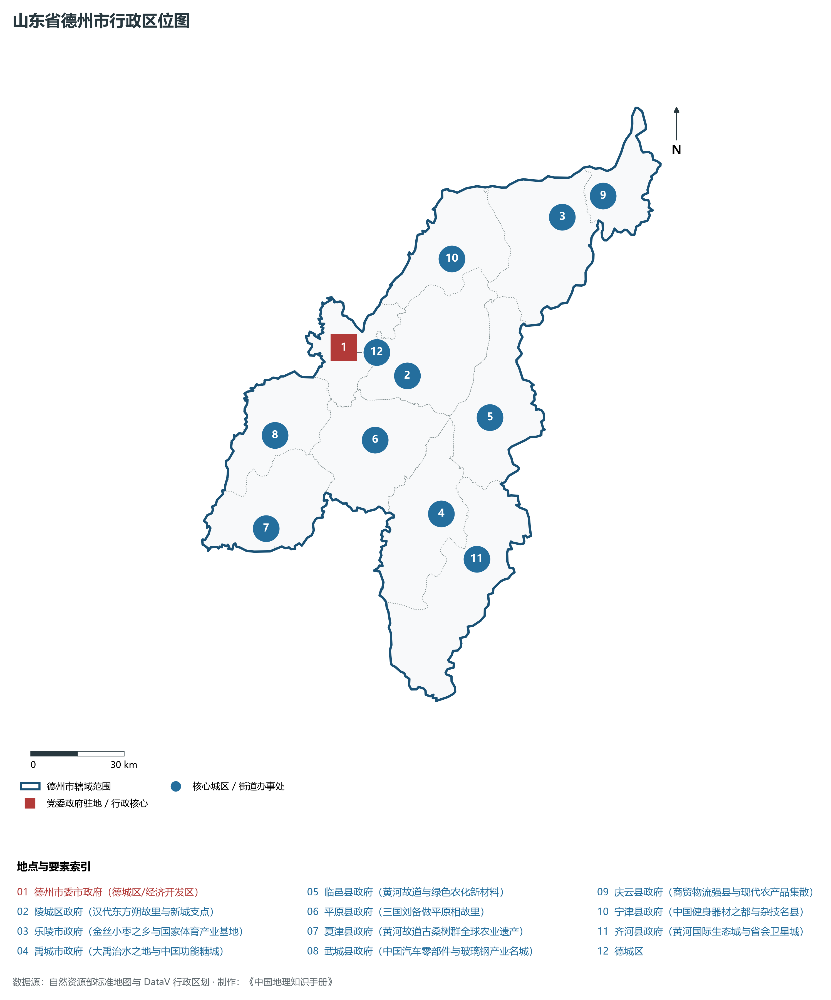
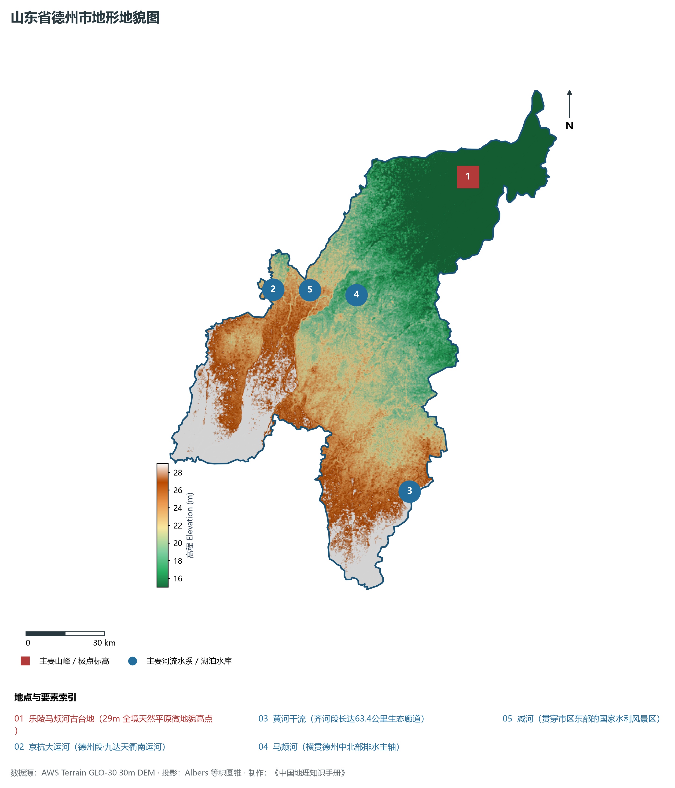
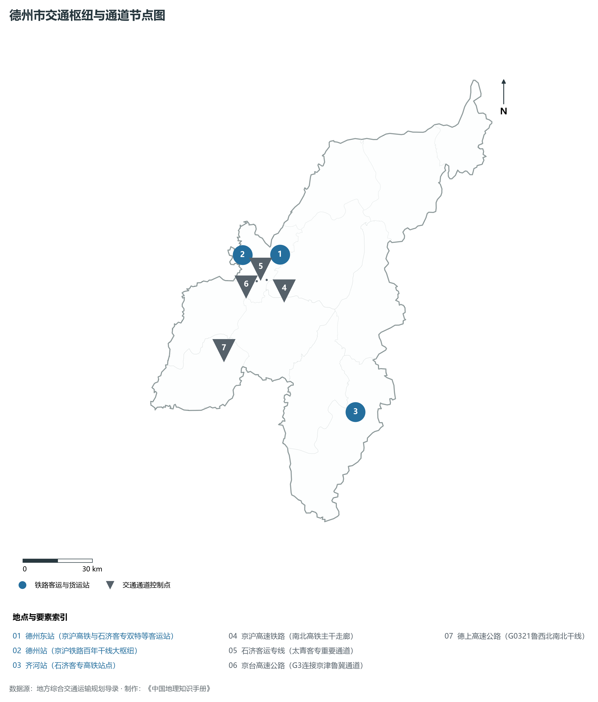
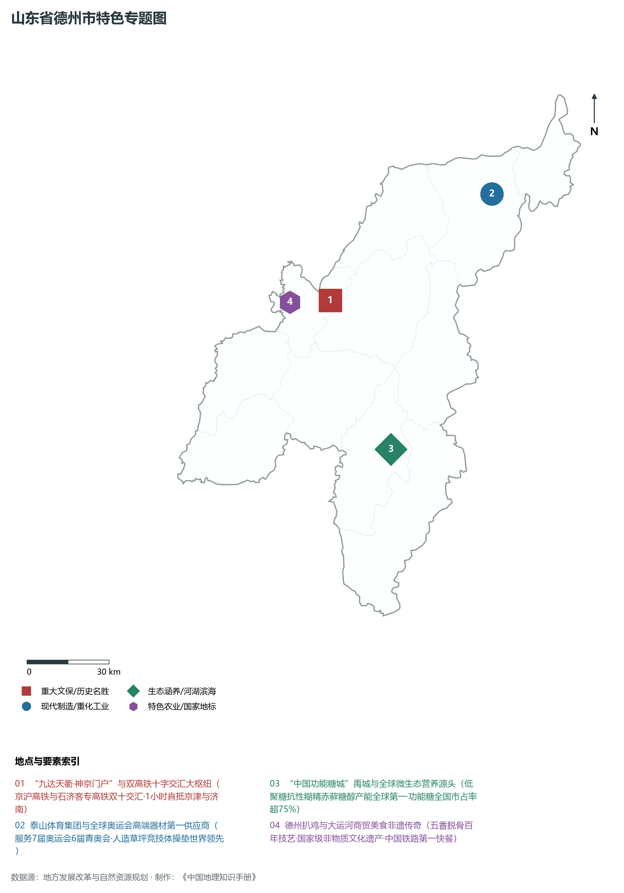
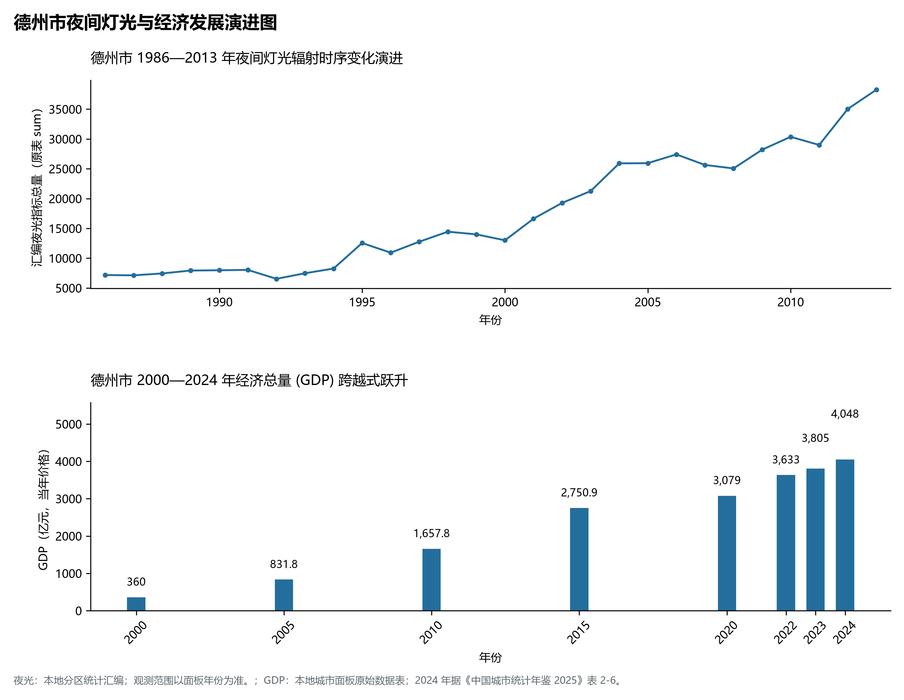

# 8.13 德州市

德州市，位于山东省，其城市功能定位与发展愿景概括为：**“九达天衢·京津门户”·京津冀协同发展示范区·国家新型功能材料与特色装备基地**。2024 年常住人口 **548 万人**，常住人口城镇化率 **57.29%**，地区生产总值 **4,048 亿元**（当年价格），人均地区生产总值 **73,468 元**，三次产业构成为 **9.6 : 43.34 : 47.06**。

---

## 一、自然地理底盘与地貌水系机理

德州市在大地构造演化史上地处华北克拉通陆块演化关键带，构造活动剧烈，断块升降与岩浆喷发侵入历史源远流长，塑造了丘陵起伏、山水相融或平原开阔的自然地理底盘。全境地表高程最低为 **15.0 m**，最高隆起山峰或高地海拔达 **29.0 m**，地势梯级起伏与垂直微地貌分异构筑了层次鲜明的生态水文环境与战略资源承载力。

区域骨干控制性山脉与地形高程极点包括：

- **乐陵马颊河古台地 (29m 全境天然平原微地貌高点)**（坐标约东经 117.200°、北纬 37.750°，高程约 29.0 m）：构成区域地形骨架与水系分水岭的关键高程控制点；

水系与水文网络方面，德州市地表水资源丰富，骨干江河湖库穿流浸润：

- **京杭大运河 (德州段·九达天衢南运河)**（流经约东经 116.290°、北纬 37.450° 水域）：对全市工农业供水、生态水系构建及防汛抗旱减灾发挥核心支撑调蓄作用；
- **黄河干流 (齐河段长达63.4公里生态廊道)**（流经约东经 116.780°、北纬 36.720° 水域）：对全市工农业供水、生态水系构建及防汛抗旱减灾发挥核心支撑调蓄作用；
- **马颊河 (横贯德州中北部排水主轴)**（流经约东经 116.650°、北纬 37.400° 水域）：对全市工农业供水、生态水系构建及防汛抗旱减灾发挥核心支撑调蓄作用；
- **减河 (贯穿市区东部的国家水利风景区)**（流经约东经 116.390°、北纬 37.440° 水域）：对全市工农业供水、生态水系构建及防汛抗旱减灾发挥核心支撑调蓄作用；

---

## 二、行政区划沿革与城镇空间体系

德州市历史文脉积淀深厚，建置沿革久远。新中国成立以来，伴随国家现代工业化进程推进、沿海开放战略落地与新型城镇化纵深发展，形成了市辖区高效协同、县域特色支撑、产城高度融合的市辖区与县级行政单元空间组织体系：

- **德州市委市政府 (德城区/经济开发区)**（驻地坐标：116.360°E, 37.435°N）；
- **陵城区政府 (汉代东方朔故里与新城支点)**（驻地坐标：116.580°E, 37.335°N）；
- **乐陵市政府 (金丝小枣之乡与国家体育产业基地)**（驻地坐标：117.220°E, 37.730°N）；
- **禹城市政府 (大禹治水之地与中国功能糖城)**（驻地坐标：116.645°E, 36.935°N）；
- **临邑县政府 (黄河故道与绿色农化新材料)**（驻地坐标：116.865°E, 37.190°N）；
- **平原县政府 (三国刘备做平原相故里)**（驻地坐标：116.435°E, 37.165°N）；
- **夏津县政府 (黄河故道古桑树群全球农业遗产)**（驻地坐标：116.000°E, 36.950°N）；
- **武城县政府 (中国汽车零部件与玻璃钢产业名城)**（驻地坐标：116.070°E, 37.210°N）；
- **庆云县政府 (商贸物流强县与现代农产品集散)**（驻地坐标：117.380°E, 37.775°N）；
- **宁津县政府 (中国健身器材之都与杂技名县)**（驻地坐标：116.795°E, 37.650°N）；
- **齐河县政府 (黄河国际生态城与省会卫星城)**（驻地坐标：116.755°E, 36.795°N）；

在城镇空间总体布局上，德州市紧扣《国土空间总体规划》，坚持“极核集聚、轴带贯通、组团联动、陆海协同”的战略方针，做优做精中心城区核心能级，提升县域经济特色承载能力，构筑紧凑集约、生态宜居的现代城乡空间组织体系。

---

## 三、综合立体交通网络与交通走廊

德州市地处齐鲁综合立体交通网络重要节点，依托高速铁路、骨干干线铁路、国家高速公路与沿海深水海港/内河大港/航空机场，构筑了四通八达的现代化立体综合交通运输骨架：

**主要综合客运与货运物流交通枢纽节点：**

- **德州东站 (京沪高铁与石济客专双特等客运站)**（位置坐标：116.480°E, 37.440°N）；
- **德州站 (京沪铁路百年干线大枢纽)**（位置坐标：116.295°E, 37.455°N）；
- **齐河站 (石济客专高铁站点)**（位置坐标：116.760°E, 36.810°N）；

**核心干线铁路与高等级公路交通走廊：**

- **京沪高速铁路 (南北高铁主干走廊)**（廊道控制点：116.480°E, 37.300°N）：对外快速互联互通的高速客货运通道；
- **石济客运专线 (太青客专重要通道)**（廊道控制点：116.400°E, 37.350°N）：对外快速互联互通的高速客货运通道；
- **京台高速公路 (G3连接京津鲁冀通道)**（廊道控制点：116.350°E, 37.350°N）：对外快速互联互通的高速客货运通道；
- **德上高速公路 (G0321鲁西北南北干线)**（廊道控制点：116.150°E, 37.100°N）：对外快速互联互通的高速客货运通道；

---

## 四、现代产业体系与新质生产力布局

德州市坚定践行新发展理念，以绿色低碳高质量发展为主线，大力推进传统优势产业数智化改造，培育壮大战略性新兴产业集群，构建具有区域核心竞争力的现代产业新格局：

**核心先进制造业园区与高新技术创新集聚区：**

- **泰山体育产业集团全球研发总部 (乐陵)**（园区坐标：117.210°E, 37.720°N）：区域重大产业创新与先进制造业集群承载核心平台；
- **保龄宝与龙力生物功能糖产业园 (禹城)**（园区坐标：116.660°E, 36.940°N）：区域重大产业创新与先进制造业集群承载核心平台；
- **宁津国家健身器材智能制造示范园**（园区坐标：116.800°E, 37.660°N）：区域重大产业创新与先进制造业集群承载核心平台；
- **德州经济技术开发区新能源与新材料基地**（园区坐标：116.410°E, 37.450°N）：区域重大产业创新与先进制造业集群承载核心平台；

**标志性特色主题要素与领航龙头优势：**

- **“九达天衢·神京门户”与双高铁十字交汇大枢纽**（空间坐标：116.480°E, 37.440°N）：京沪高铁与石济客专高铁双十交汇·1小时直抵京津与济南；
- **泰山体育集团与全球奥运会高端器材第一供应商**（空间坐标：117.210°E, 37.720°N）：服务7届奥运会6届青奥会·人造草坪竞技体操垫世界领先；
- **“中国功能糖城”禹城与全球微生态营养源头**（空间坐标：116.660°E, 36.940°N）：低聚糖抗性糊精赤藓糖醇产能全球第一·功能糖全国市占率超75%；
- **德州扒鸡与大运河商贸美食非遗传奇**（空间坐标：116.310°E, 37.450°N）：五香脱骨百年技艺·国家级非物质文化遗产·中国铁路第一快餐；

---

## 五、历史文化底蕴、名胜古迹与全域文旅地理

德州市人杰地灵、文脉昌盛，自然风光雄奇秀美，人文古迹璀璨夺目。全境汇聚了高等级风景名胜区、全国重点文物保护单位与国家非物质文化遗产代表作：

- **中国太阳谷景区 (4A·世界太阳能之都标志)**（地标坐标：116.370°E, 37.380°N）：享誉国内外的标志性风景名胜与国家级文旅高地；
- **苏禄国东王墓 (全国重点文保·古代海丝友谊)**（地标坐标：116.290°E, 37.480°N）：享誉国内外的标志性风景名胜与国家级文旅高地；
- **夏津黄河故道古桑树群 (全球重要农业文化遗产)**（地标坐标：115.980°E, 36.960°N）：享誉国内外的标志性风景名胜与国家级文旅高地；
- **齐河泉城欧乐堡梦幻世界与动物王国**（地标坐标：116.800°E, 36.780°N）：享誉国内外的标志性风景名胜与国家级文旅高地；
- **德州扒鸡非遗博览馆 (三百年中华老字号)**（地标坐标：116.310°E, 37.450°N）：享誉国内外的标志性风景名胜与国家级文旅高地；

德州市坚持以文塑旅、以旅彰文，全面推进“文旅+生态+制造+乡村”深度融合，持续优化全域旅游产品体系与消费场景，打造高辨识度文旅品牌。

---

## 六、夜间灯光辐射与经济变化时序演进

本节夜光图的观测年份为 1986—2013 年，指标为行政区汇总值（原表 sum）。

| 年份 | 地区生产总值（亿元，当年价格） |
|:---|---:|
| 2000 年 | 360 |
| 2005 年 | 831.8 |
| 2010 年 | 1,657.8 |
| 2015 年 | 2,750.9 |
| 2020 年 | 3,079 |
| 2022 年 | 3,633 |
| 2023 年 | 3,805 |
| 2024 年 | 4,048 |

- **1996 年前后**：京沪铁路德州老站周边与运河码头主城集中发亮；
- **2005 年前后**：京沪高铁德州东站规划·开发区太阳能产业爆发；
- **2013 年前后**：石济客专交汇成双十字·齐河乐陵禹城工业带互联；

---

2024 年统计来源：《中国城市统计年鉴 2025》表 2-1、2-6、2-7（2024 年，全市）。其他年份 GDP 据本地城市面板“原始数据”表，单位为亿元、当年价格。
