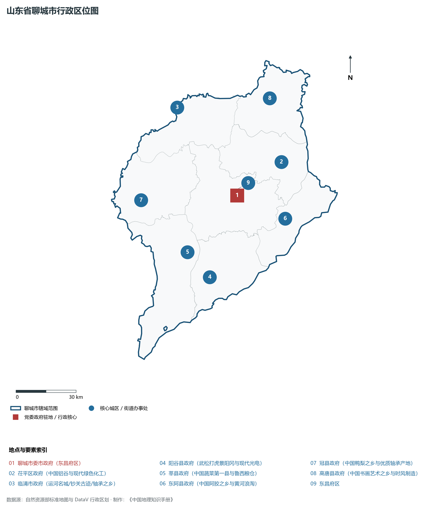
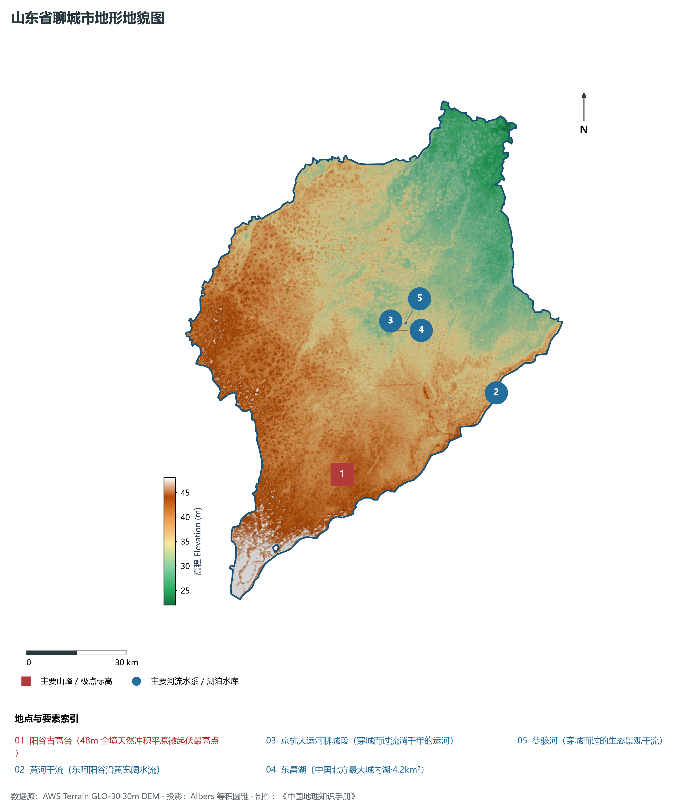
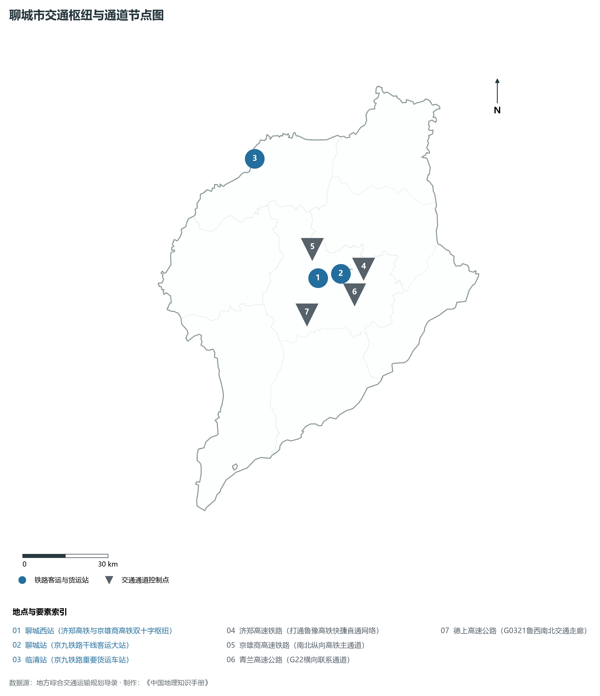
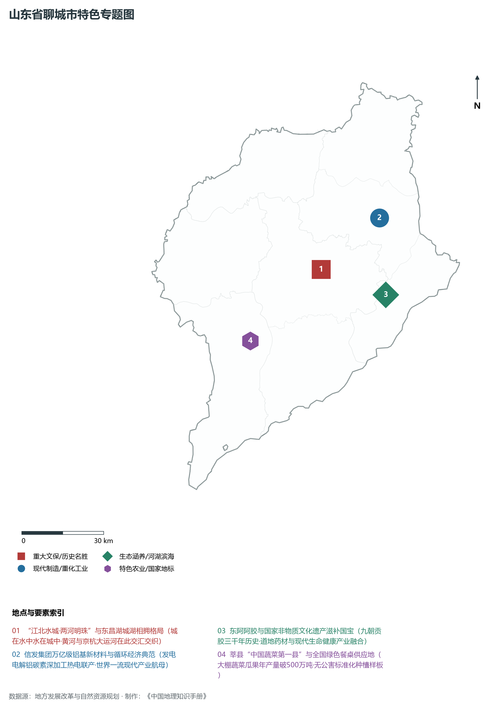
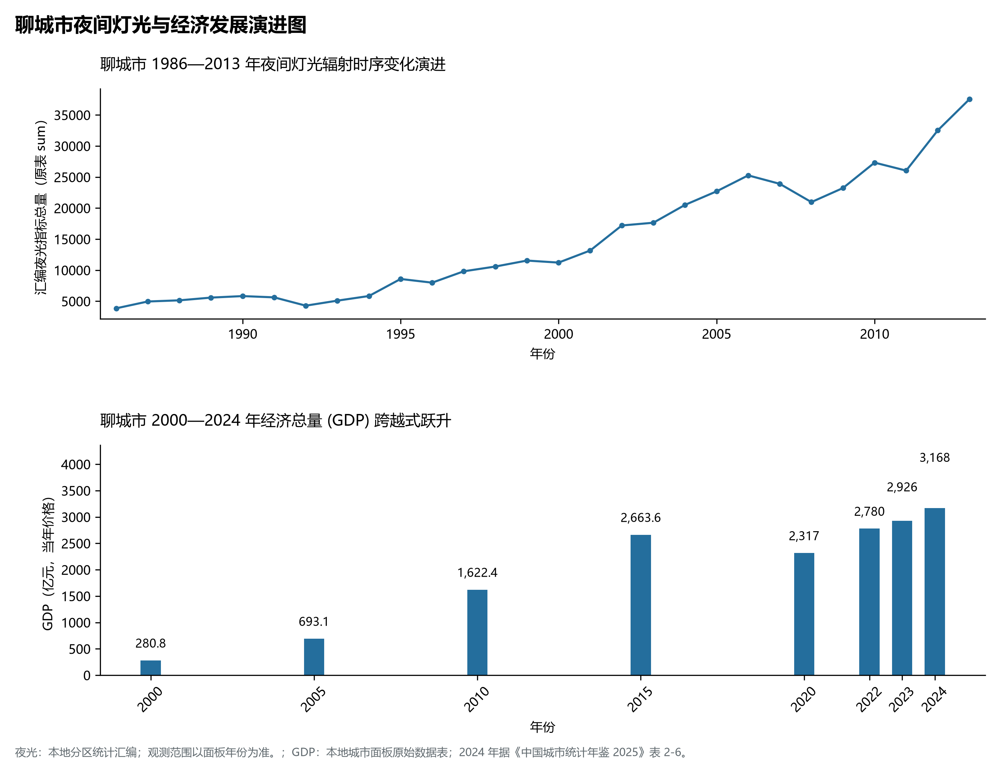

# 8.14 聊城市

聊城市，位于山东省，其城市功能定位与发展愿景概括为：**“江北水城·两河明珠”·国家历史文化名城·京九高铁枢纽·铝基新材料与现代农业高地**。2024 年常住人口 **580 万人**，常住人口城镇化率 **57.05%**，地区生产总值 **3,168 亿元**（当年价格），人均地区生产总值 **54,326 元**，三次产业构成为 **13.55 : 41.41 : 45.04**。

---

## 一、自然地理底盘与地貌水系机理

聊城市在大地构造演化史上地处华北克拉通陆块演化关键带，构造活动剧烈，断块升降与岩浆喷发侵入历史源远流长，塑造了丘陵起伏、山水相融或平原开阔的自然地理底盘。全境地表高程最低为 **22.0 m**，最高隆起山峰或高地海拔达 **48.0 m**，地势梯级起伏与垂直微地貌分异构筑了层次鲜明的生态水文环境与战略资源承载力。

区域骨干控制性山脉与地形高程极点包括：

- **阳谷古高台 (48m 全境天然冲积平原微起伏最高点)**（坐标约东经 115.750°、北纬 36.080°，高程约 48.0 m）：构成区域地形骨架与水系分水岭的关键高程控制点；

水系与水文网络方面，聊城市地表水资源丰富，骨干江河湖库穿流浸润：

- **黄河干流 (东阿阳谷沿黄宽阔水流)**（流经约东经 116.300°、北纬 36.250° 水域）：对全市工农业供水、生态水系构建及防汛抗旱减灾发挥核心支撑调蓄作用；
- **京杭大运河聊城段 (穿城而过流淌千年的运河)**（流经约东经 115.970°、北纬 36.470° 水域）：对全市工农业供水、生态水系构建及防汛抗旱减灾发挥核心支撑调蓄作用；
- **东昌湖 (中国北方最大城内湖·4.2km²)**（流经约东经 115.975°、北纬 36.445° 水域）：对全市工农业供水、生态水系构建及防汛抗旱减灾发挥核心支撑调蓄作用；
- **徒骇河 (穿城而过的生态景观干流)**（流经约东经 116.020°、北纬 36.460° 水域）：对全市工农业供水、生态水系构建及防汛抗旱减灾发挥核心支撑调蓄作用；

---

## 二、行政区划沿革与城镇空间体系

聊城市历史文脉积淀深厚，建置沿革久远。新中国成立以来，伴随国家现代工业化进程推进、沿海开放战略落地与新型城镇化纵深发展，形成了市辖区高效协同、县域特色支撑、产城高度融合的市辖区与县级行政单元空间组织体系：

- **聊城市委市政府 (东昌府区)**（驻地坐标：115.985°E, 36.455°N）；
- **茌平区政府 (中国铝谷与现代绿色化工)**（驻地坐标：116.255°E, 36.580°N）；
- **临清市政府 (运河名城/钞关古迹/轴承之乡)**（驻地坐标：115.700°E, 36.870°N）；
- **阳谷县政府 (武松打虎景阳冈与现代光电)**（驻地坐标：115.780°E, 36.110°N）；
- **莘县政府 (中国蔬菜第一县与鲁西粮仓)**（驻地坐标：115.670°E, 36.230°N）；
- **东阿县政府 (中国阿胶之乡与黄河浪淘)**（驻地坐标：116.240°E, 36.330°N）；
- **冠县政府 (中国鸭梨之乡与优质轴承产地)**（驻地坐标：115.440°E, 36.480°N）；
- **高唐县政府 (中国书画艺术之乡与时风制造)**（驻地坐标：116.230°E, 36.865°N）；

在城镇空间总体布局上，聊城市紧扣《国土空间总体规划》，坚持“极核集聚、轴带贯通、组团联动、陆海协同”的战略方针，做优做精中心城区核心能级，提升县域经济特色承载能力，构筑紧凑集约、生态宜居的现代城乡空间组织体系。

---

## 三、综合立体交通网络与交通走廊

聊城市地处齐鲁综合立体交通网络重要节点，依托高速铁路、骨干干线铁路、国家高速公路与沿海深水海港/内河大港/航空机场，构筑了四通八达的现代化立体综合交通运输骨架：

**主要综合客运与货运物流交通枢纽节点：**

- **聊城西站 (济郑高铁与京雄商高铁双十字枢纽)**（位置坐标：115.910°E, 36.460°N）；
- **聊城站 (京九铁路干线客运大站)**（位置坐标：115.955°E, 36.470°N）；
- **临清站 (京九铁路重要货运车站)**（位置坐标：115.710°E, 36.850°N）；

**核心干线铁路与高等级公路交通走廊：**

- **济郑高速铁路 (打通鲁豫高铁快捷直通网络)**（廊道控制点：116.000°E, 36.480°N）：对外快速互联互通的高速客货运通道；
- **京雄商高速铁路 (南北纵向高铁主通道)**（廊道控制点：115.900°E, 36.550°N）：对外快速互联互通的高速客货运通道；
- **青兰高速公路 (G22横向联系通道)**（廊道控制点：116.000°E, 36.400°N）：对外快速互联互通的高速客货运通道；
- **德上高速公路 (G0321鲁西南北交通走廊)**（廊道控制点：115.850°E, 36.350°N）：对外快速互联互通的高速客货运通道；

---

## 四、现代产业体系与新质生产力布局

聊城市坚定践行新发展理念，以绿色低碳高质量发展为主线，大力推进传统优势产业数智化改造，培育壮大战略性新兴产业集群，构建具有区域核心竞争力的现代产业新格局：

**核心先进制造业园区与高新技术创新集聚区：**

- **信发集团铝电化工一体化超大型基地 (茌平)**（园区坐标：116.240°E, 36.590°N）：区域重大产业创新与先进制造业集群承载核心平台；
- **东阿阿胶国家级非遗生物医药健康产业园**（园区坐标：116.230°E, 36.340°N）：区域重大产业创新与先进制造业集群承载核心平台；
- **莘县国家现代农业产业园 (中国蔬菜第一县)**（园区坐标：115.650°E, 36.240°N）：区域重大产业创新与先进制造业集群承载核心平台；
- **中通客车绿色新能源客车智能制造基地**（园区坐标：116.020°E, 36.480°N）：区域重大产业创新与先进制造业集群承载核心平台；

**标志性特色主题要素与领航龙头优势：**

- **“江北水城·两河明珠”与东昌湖城湖相拥格局**（空间坐标：115.975°E, 36.445°N）：城在水中水在城中·黄河与京杭大运河在此交汇交织；
- **信发集团万亿级铝基新材料与循环经济典范**（空间坐标：116.240°E, 36.590°N）：发电电解铝碳素深加工热电联产·世界一流现代产业航母；
- **东阿阿胶与国家非物质文化遗产滋补国宝**（空间坐标：116.230°E, 36.340°N）：九朝贡胶三千年历史·道地药材与现代生命健康产业融合；
- **莘县“中国蔬菜第一县”与全国绿色餐桌供应地**（空间坐标：115.650°E, 36.240°N）：大棚蔬菜瓜果年产量破500万吨·无公害标准化种植样板；

---

## 五、历史文化底蕴、名胜古迹与全域文旅地理

聊城市人杰地灵、文脉昌盛，自然风光雄奇秀美，人文古迹璀璨夺目。全境汇聚了高等级风景名胜区、全国重点文物保护单位与国家非物质文化遗产代表作：

- **光岳楼 (全国重点文保·宋元明楼·鲁西第一楼)**（地标坐标：115.975°E, 36.445°N）：享誉国内外的标志性风景名胜与国家级文旅高地；
- **东昌湖国家湿地公园 (4A·水城明珠)**（地标坐标：115.970°E, 36.435°N）：享誉国内外的标志性风景名胜与国家级文旅高地；
- **临清运河钞关 (全国唯一存留的大运河钞关文保)**（地标坐标：115.705°E, 36.865°N）：享誉国内外的标志性风景名胜与国家级文旅高地；
- **景阳冈水浒文化旅游区 (4A·阳谷)**（地标坐标：115.820°E, 36.060°N）：享誉国内外的标志性风景名胜与国家级文旅高地；
- **东阿阿胶城与中国阿胶博物馆**（地标坐标：116.240°E, 36.325°N）：享誉国内外的标志性风景名胜与国家级文旅高地；

聊城市坚持以文塑旅、以旅彰文，全面推进“文旅+生态+制造+乡村”深度融合，持续优化全域旅游产品体系与消费场景，打造高辨识度文旅品牌。

---

## 六、夜间灯光辐射与经济变化时序演进

本节夜光图的观测年份为 1986—2013 年，指标为行政区汇总值（原表 sum）。

| 年份 | 地区生产总值（亿元，当年价格） |
|:---|---:|
| 2000 年 | 280.8 |
| 2005 年 | 693.1 |
| 2010 年 | 1,622.4 |
| 2015 年 | 2,663.6 |
| 2020 年 | 2,317 |
| 2022 年 | 2,780 |
| 2023 年 | 2,926 |
| 2024 年 | 3,168 |

- **1996 年前后**：东昌湖环城古城与东昌府老城区点状亮斑；
- **2005 年前后**：信发集团铝业化工茌平崛起·开发区东拓明显；

---

2024 年统计来源：《中国城市统计年鉴 2025》表 2-1、2-6、2-7（2024 年，全市）。其他年份 GDP 据本地城市面板“原始数据”表，单位为亿元、当年价格。
