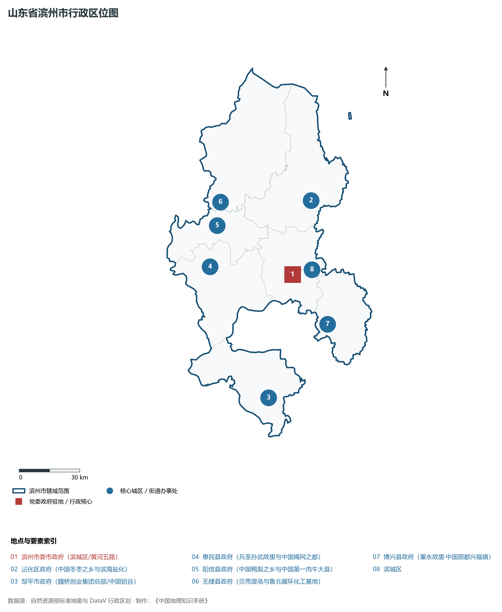
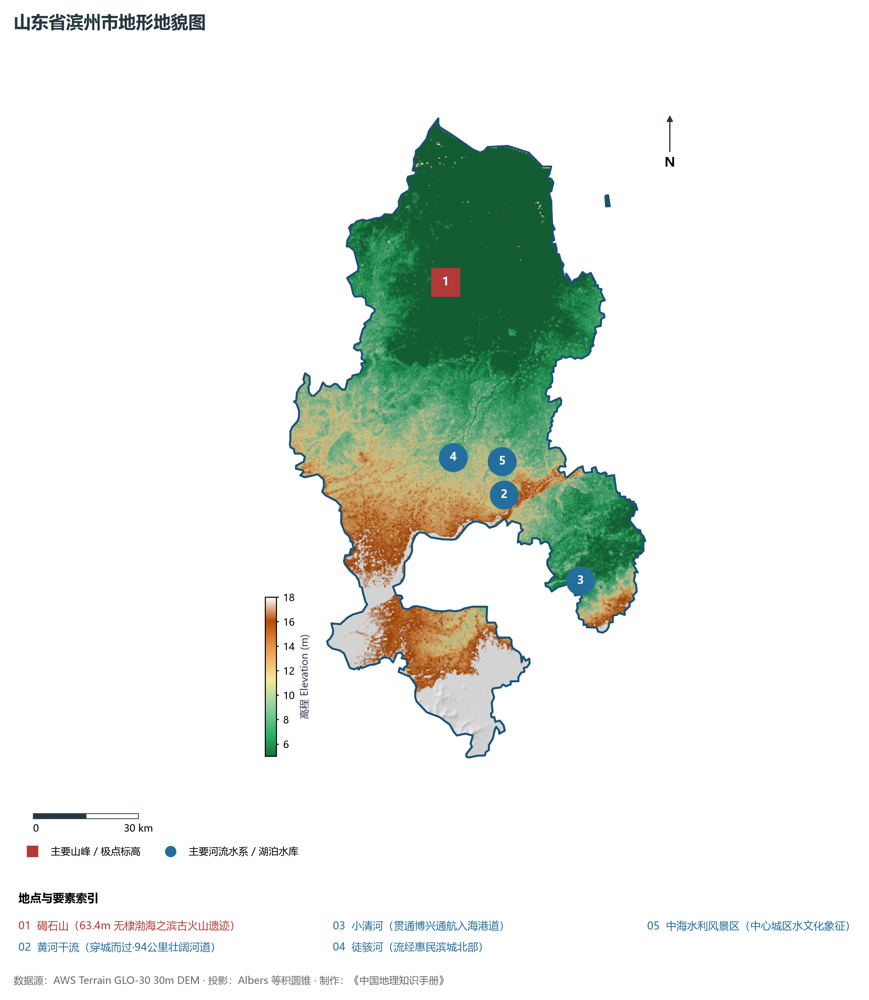
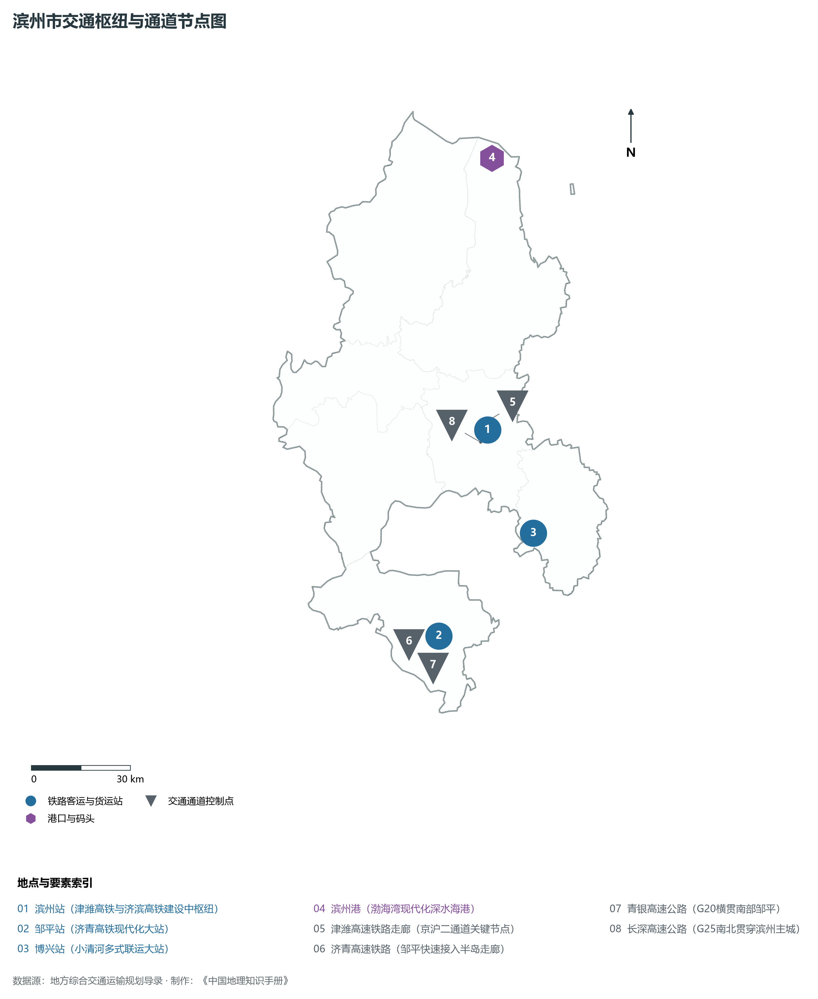
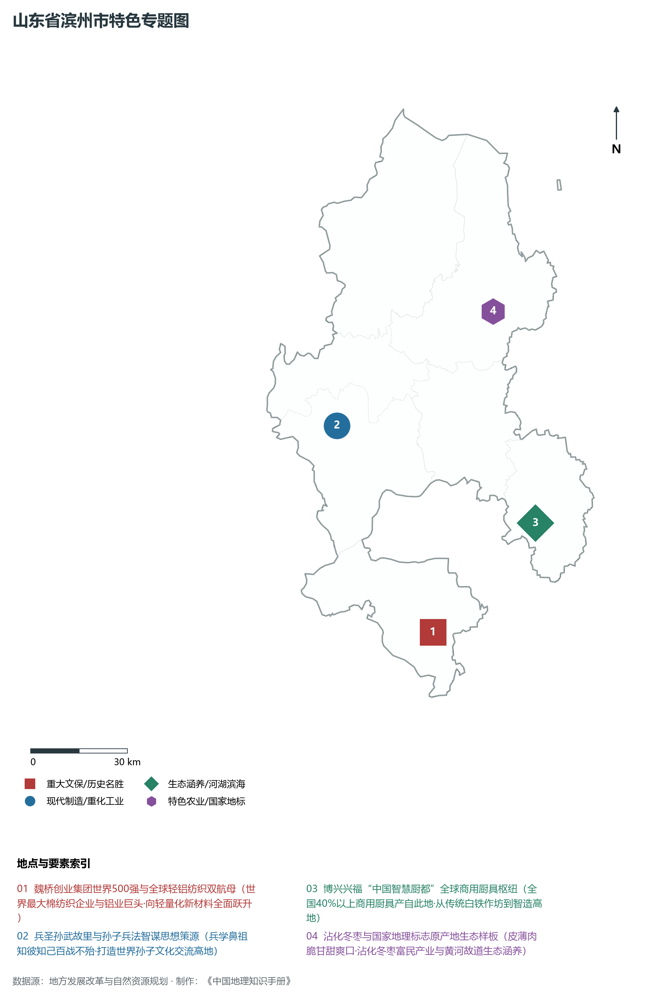
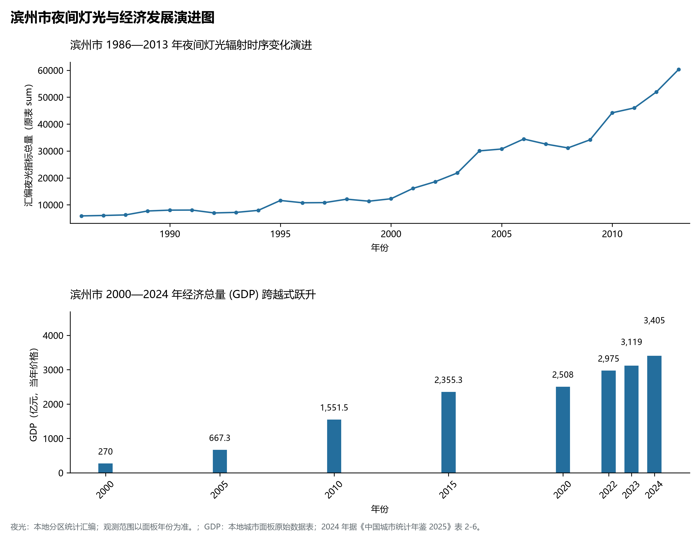

# 8.15 滨州市

滨州市，位于山东省，其城市功能定位与发展愿景概括为：**“孙子故里·生态滨州”·世界级高端铝业基地·国家特纺轻纺高地与黄河流域出海门户**。2024 年常住人口 **387 万人**，常住人口城镇化率 **63.03%**，地区生产总值 **3,405 亿元**（当年价格），人均地区生产总值 **87,542 元**，三次产业构成为 **9.17 : 45.51 : 45.32**。

---

## 一、自然地理底盘与地貌水系机理

滨州市在大地构造演化史上地处华北克拉通陆块演化关键带，构造活动剧烈，断块升降与岩浆喷发侵入历史源远流长，塑造了丘陵起伏、山水相融或平原开阔的自然地理底盘。全境地表高程最低为 **5.0 m**，最高隆起山峰或高地海拔达 **18.0 m**，地势梯级起伏与垂直微地貌分异构筑了层次鲜明的生态水文环境与战略资源承载力。

区域骨干控制性山脉与地形高程极点包括：

- **碣石山 (63.4m 无棣渤海之滨古火山遗迹)**（坐标约东经 117.850°、北纬 37.890°，高程约 63.4 m）：构成区域地形骨架与水系分水岭的关键高程控制点；

水系与水文网络方面，滨州市地表水资源丰富，骨干江河湖库穿流浸润：

- **黄河干流 (穿城而过·94公里壮阔河道)**（流经约东经 117.950°、北纬 37.340° 水域）：对全市工农业供水、生态水系构建及防汛抗旱减灾发挥核心支撑调蓄作用；
- **小清河 (贯通博兴通航入海港道)**（流经约东经 118.160°、北纬 37.100° 水域）：对全市工农业供水、生态水系构建及防汛抗旱减灾发挥核心支撑调蓄作用；
- **徒骇河 (流经惠民滨城北部)**（流经约东经 117.800°、北纬 37.450° 水域）：对全市工农业供水、生态水系构建及防汛抗旱减灾发挥核心支撑调蓄作用；
- **中海水利风景区 (中心城区水文化象征)**（流经约东经 117.950°、北纬 37.380° 水域）：对全市工农业供水、生态水系构建及防汛抗旱减灾发挥核心支撑调蓄作用；

---

## 二、行政区划沿革与城镇空间体系

滨州市历史文脉积淀深厚，建置沿革久远。新中国成立以来，伴随国家现代工业化进程推进、沿海开放战略落地与新型城镇化纵深发展，形成了市辖区高效协同、县域特色支撑、产城高度融合的市辖区与县级行政单元空间组织体系：

- **滨州市委市政府 (滨城区/黄河五路)**（驻地坐标：117.970°E, 37.385°N）；
- **沾化区政府 (中国冬枣之乡与滨海盐化)**（驻地坐标：118.130°E, 37.695°N）；
- **邹平市政府 (魏桥创业集团总部/中国铝谷)**（驻地坐标：117.745°E, 36.865°N）；
- **惠民县政府 (兵圣孙武故里与中国绳网之都)**（驻地坐标：117.510°E, 37.465°N）；
- **阳信县政府 (中国鸭梨之乡与中国第一肉牛大县)**（驻地坐标：117.580°E, 37.640°N）；
- **无棣县政府 (贝壳堤岛与鲁北循环化工基地)**（驻地坐标：117.615°E, 37.740°N）；
- **博兴县政府 (董永故里·中国厨都兴福镇)**（驻地坐标：118.130°E, 37.150°N）；

在城镇空间总体布局上，滨州市紧扣《国土空间总体规划》，坚持“极核集聚、轴带贯通、组团联动、陆海协同”的战略方针，做优做精中心城区核心能级，提升县域经济特色承载能力，构筑紧凑集约、生态宜居的现代城乡空间组织体系。

---

## 三、综合立体交通网络与交通走廊

滨州市地处齐鲁综合立体交通网络重要节点，依托高速铁路、骨干干线铁路、国家高速公路与沿海深水海港/内河大港/航空机场，构筑了四通八达的现代化立体综合交通运输骨架：

**主要综合客运与货运物流交通枢纽节点：**

- **滨州站 (津潍高铁与济滨高铁建设中枢纽)**（位置坐标：118.010°E, 37.430°N）；
- **邹平站 (济青高铁现代化大站)**（位置坐标：117.750°E, 36.900°N）；
- **博兴站 (小清河多式联运大站)**（位置坐标：118.120°E, 37.140°N）；
- **滨州港 (渤海湾现代化深水海港)**（位置坐标：118.150°E, 38.150°N）；

**核心干线铁路与高等级公路交通走廊：**

- **津潍高速铁路走廊 (京沪二通道关键节点)**（廊道控制点：118.000°E, 37.450°N）：对外快速互联互通的高速客货运通道；
- **济青高速铁路 (邹平快速接入半岛走廊)**（廊道控制点：117.700°E, 36.880°N）：对外快速互联互通的高速客货运通道；
- **青银高速公路 (G20横贯南部邹平)**（廊道控制点：117.750°E, 36.850°N）：对外快速互联互通的高速客货运通道；
- **长深高速公路 (G25南北贯穿滨州主城)**（廊道控制点：117.980°E, 37.400°N）：对外快速互联互通的高速客货运通道；

---

## 四、现代产业体系与新质生产力布局

滨州市坚定践行新发展理念，以绿色低碳高质量发展为主线，大力推进传统优势产业数智化改造，培育壮大战略性新兴产业集群，构建具有区域核心竞争力的现代产业新格局：

**核心先进制造业园区与高新技术创新集聚区：**

- **魏桥创业集团全球总部与超大型轻铝基地 (邹平)**（园区坐标：117.760°E, 36.870°N）：区域重大产业创新与先进制造业集群承载核心平台；
- **博兴兴福“中国智慧厨都”商用厨具产业园**（园区坐标：118.170°E, 37.130°N）：区域重大产业创新与先进制造业集群承载核心平台；
- **沾化冬枣现代农业科技示范区**（园区坐标：118.150°E, 37.710°N）：区域重大产业创新与先进制造业集群承载核心平台；
- **鲁北高新技术开发区绿色循环产业集群 (无棣)**（园区坐标：117.650°E, 38.000°N）：区域重大产业创新与先进制造业集群承载核心平台；

**标志性特色主题要素与领航龙头优势：**

- **魏桥创业集团世界500强与全球轻铝纺织双航母**（空间坐标：117.760°E, 36.870°N）：世界最大棉纺织企业与铝业巨头·向轻量化新材料全面跃升；
- **兵圣孙武故里与孙子兵法智谋思想策源**（空间坐标：117.515°E, 37.465°N）：兵学鼻祖知彼知己百战不殆·打造世界孙子文化交流高地；
- **博兴兴福“中国智慧厨都”全球商用厨具枢纽**（空间坐标：118.170°E, 37.130°N）：全国40%以上商用厨具产自此地·从传统白铁作坊到智造高地；
- **沾化冬枣与国家地理标志原产地生态样板**（空间坐标：118.120°E, 37.720°N）：皮薄肉脆甘甜爽口·沾化冬枣富民产业与黄河故道生态涵养；

---

## 五、历史文化底蕴、名胜古迹与全域文旅地理

滨州市人杰地灵、文脉昌盛，自然风光雄奇秀美，人文古迹璀璨夺目。全境汇聚了高等级风景名胜区、全国重点文物保护单位与国家非物质文化遗产代表作：

- **孙子兵法城 (惠民·全国4A·兵圣文化圣地)**（地标坐标：117.515°E, 37.465°N）：享誉国内外的标志性风景名胜与国家级文旅高地；
- **魏氏庄园 (全国重点文保·中国古代北方城堡民居)**（地标坐标：117.550°E, 37.420°N）：享誉国内外的标志性风景名胜与国家级文旅高地；
- **沾化冬枣生态旅游区 (金秋采摘盛地)**（地标坐标：118.120°E, 37.720°N）：享誉国内外的标志性风景名胜与国家级文旅高地；
- **无棣贝壳堤岛与湿地系统国家级自然保护区**（地标坐标：117.750°E, 38.100°N）：享誉国内外的标志性风景名胜与国家级文旅高地；

滨州市坚持以文塑旅、以旅彰文，全面推进“文旅+生态+制造+乡村”深度融合，持续优化全域旅游产品体系与消费场景，打造高辨识度文旅品牌。

---

## 六、夜间灯光辐射与经济变化时序演进

本节夜光图的观测年份为 1986—2013 年，指标为行政区汇总值（原表 sum）。

| 年份 | 地区生产总值（亿元，当年价格） |
|:---|---:|
| 2000 年 | 270 |
| 2005 年 | 667.3 |
| 2010 年 | 1,551.5 |
| 2015 年 | 2,355.3 |
| 2020 年 | 2,508 |
| 2022 年 | 2,975 |
| 2023 年 | 3,119 |
| 2024 年 | 3,405 |

- **1996 年前后**：滨城区老城区黄河两岸与邹平纺织工厂点状亮起；
- **2013 年前后**：滨州高新区兴起·北海新区沿海重港化工向北拓展；

---

2024 年统计来源：《中国城市统计年鉴 2025》表 2-1、2-6、2-7（2024 年，全市）。其他年份 GDP 据本地城市面板“原始数据”表，单位为亿元、当年价格。
