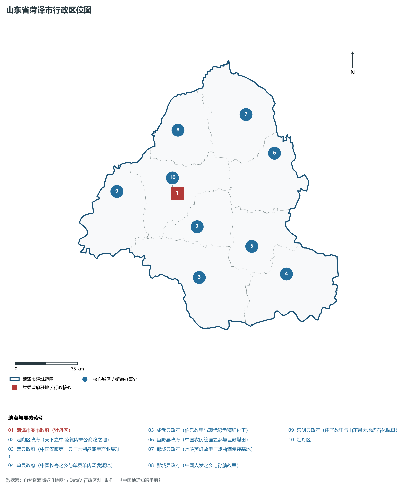
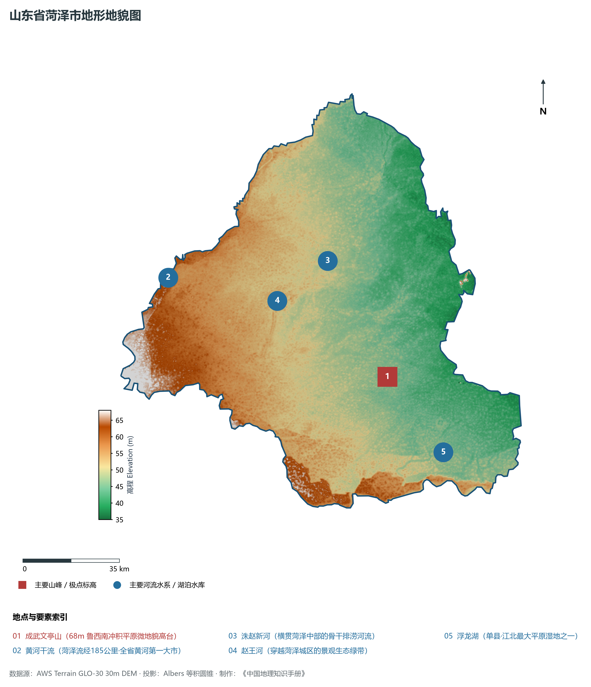
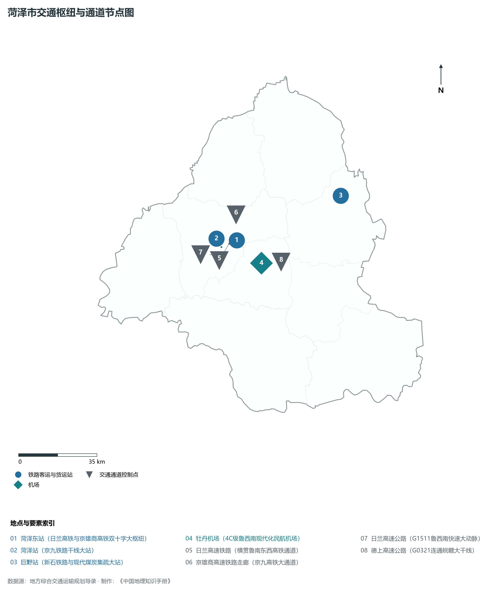
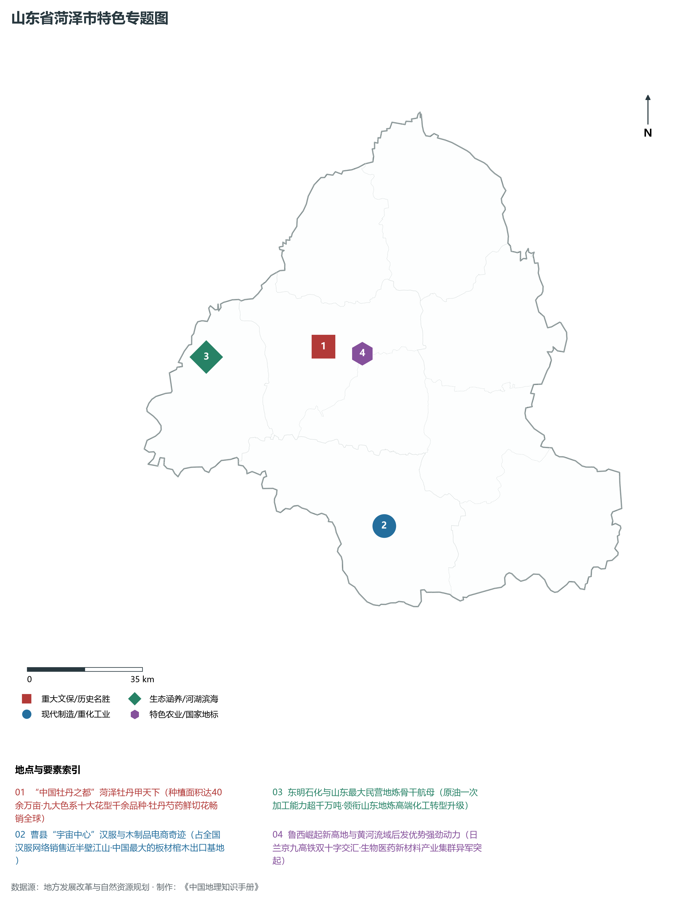
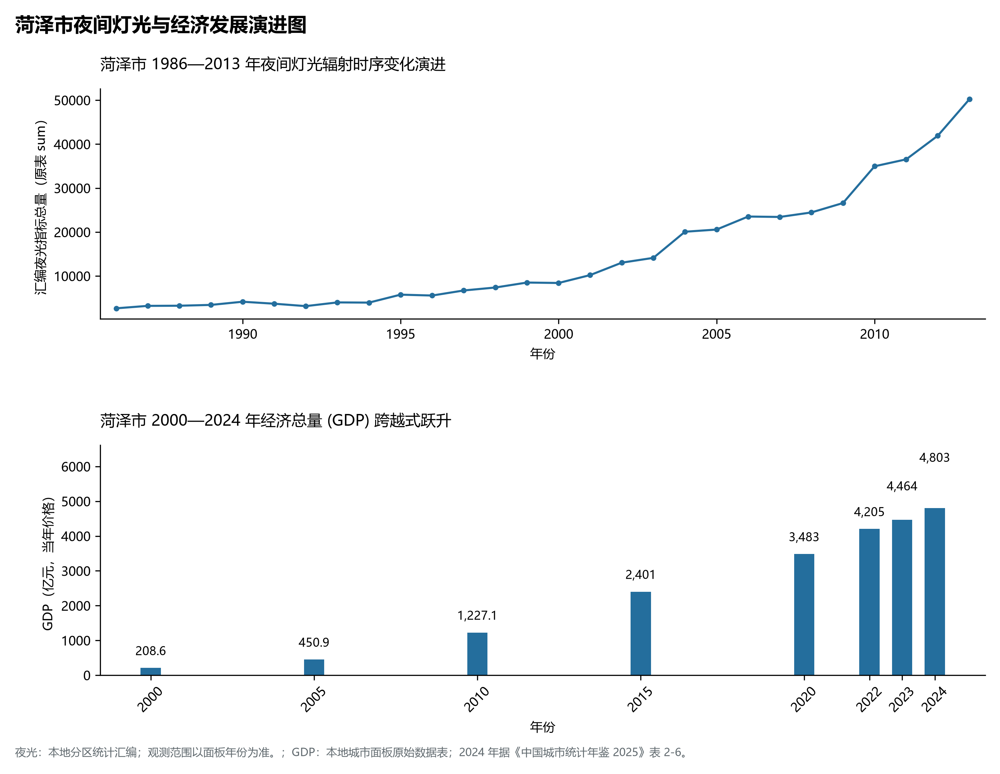

# 8.16 菏泽市

菏泽市，位于山东省，其城市功能定位与发展愿景概括为：**“中国牡丹之都”·鲁西崛起新高地·商汤故里与戏曲之乡·现代医药港与特色产业集聚区**。2024 年常住人口 **851 万人**，常住人口城镇化率 **54.64%**，地区生产总值 **4,803 亿元**（当年价格），人均地区生产总值 **56,027 元**，三次产业构成为 **9.15 : 43.42 : 47.43**。

---

## 一、自然地理底盘与地貌水系机理

菏泽市在大地构造演化史上地处华北克拉通陆块演化关键带，构造活动剧烈，断块升降与岩浆喷发侵入历史源远流长，塑造了丘陵起伏、山水相融或平原开阔的自然地理底盘。全境地表高程最低为 **35.0 m**，最高隆起山峰或高地海拔达 **68.0 m**，地势梯级起伏与垂直微地貌分异构筑了层次鲜明的生态水文环境与战略资源承载力。

区域骨干控制性山脉与地形高程极点包括：

- **成武文亭山 (68m 鲁西南冲积平原微地貌高台)**（坐标约东经 115.890°、北纬 34.960°，高程约 68.0 m）：构成区域地形骨架与水系分水岭的关键高程控制点；

水系与水文网络方面，菏泽市地表水资源丰富，骨干江河湖库穿流浸润：

- **黄河干流 (菏泽流经185公里·全省黄河第一大市)**（流经约东经 115.050°、北纬 35.350° 水域）：对全市工农业供水、生态水系构建及防汛抗旱减灾发挥核心支撑调蓄作用；
- **洙赵新河 (横贯菏泽中部的骨干排涝河流)**（流经约东经 115.700°、北纬 35.350° 水域）：对全市工农业供水、生态水系构建及防汛抗旱减灾发挥核心支撑调蓄作用；
- **赵王河 (穿越菏泽城区的景观生态绿带)**（流经约东经 115.480°、北纬 35.240° 水域）：对全市工农业供水、生态水系构建及防汛抗旱减灾发挥核心支撑调蓄作用；
- **浮龙湖 (单县·江北最大平原湿地之一)**（流经约东经 116.080°、北纬 34.700° 水域）：对全市工农业供水、生态水系构建及防汛抗旱减灾发挥核心支撑调蓄作用；

---

## 二、行政区划沿革与城镇空间体系

菏泽市历史文脉积淀深厚，建置沿革久远。新中国成立以来，伴随国家现代工业化进程推进、沿海开放战略落地与新型城镇化纵深发展，形成了市辖区高效协同、县域特色支撑、产城高度融合的市辖区与县级行政单元空间组织体系：

- **菏泽市委市政府 (牡丹区)**（驻地坐标：115.465°E, 35.250°N）；
- **定陶区政府 (天下之中·范蠡陶朱公商隐之地)**（驻地坐标：115.565°E, 35.075°N）；
- **曹县政府 (中国汉服第一县与木制品淘宝产业集群)**（驻地坐标：115.545°E, 34.825°N）；
- **单县政府 (中国长寿之乡与单县羊肉汤发源地)**（驻地坐标：116.085°E, 34.795°N）；
- **成武县政府 (伯乐故里与现代绿色精细化工)**（驻地坐标：115.890°E, 34.950°N）；
- **巨野县政府 (中国农民绘画之乡与巨野煤田)**（驻地坐标：116.095°E, 35.395°N）；
- **郓城县政府 (水浒英雄故里与戏曲酒包装基地)**（驻地坐标：115.945°E, 35.600°N）；
- **鄄城县政府 (中国人发之乡与孙膑故里)**（驻地坐标：115.510°E, 35.560°N）；
- **东明县政府 (庄子故里与山东最大地炼石化航母)**（驻地坐标：115.090°E, 35.290°N）；

在城镇空间总体布局上，菏泽市紧扣《国土空间总体规划》，坚持“极核集聚、轴带贯通、组团联动、陆海协同”的战略方针，做优做精中心城区核心能级，提升县域经济特色承载能力，构筑紧凑集约、生态宜居的现代城乡空间组织体系。

---

## 三、综合立体交通网络与交通走廊

菏泽市地处齐鲁综合立体交通网络重要节点，依托高速铁路、骨干干线铁路、国家高速公路与沿海深水海港/内河大港/航空机场，构筑了四通八达的现代化立体综合交通运输骨架：

**主要综合客运与货运物流交通枢纽节点：**

- **菏泽东站 (日兰高铁与京雄商高铁双十字大枢纽)**（位置坐标：115.540°E, 35.250°N）；
- **菏泽站 (京九铁路干线大站)**（位置坐标：115.460°E, 35.230°N）；
- **牡丹机场 (4C级鲁西南现代化民航机场)**（位置坐标：115.650°E, 35.150°N）；
- **巨野站 (新石铁路与现代煤炭集疏大站)**（位置坐标：116.080°E, 35.380°N）；

**核心干线铁路与高等级公路交通走廊：**

- **日兰高速铁路 (横贯鲁南东西高铁通道)**（廊道控制点：115.500°E, 35.240°N）：对外快速互联互通的高速客货运通道；
- **京雄商高速铁路走廊 (京九高铁大通道)**（廊道控制点：115.550°E, 35.350°N）：对外快速互联互通的高速客货运通道；
- **日兰高速公路 (G1511鲁西南快速大动脉)**（廊道控制点：115.450°E, 35.200°N）：对外快速互联互通的高速客货运通道；
- **德上高速公路 (G0321连通皖赣大干线)**（廊道控制点：115.700°E, 35.150°N）：对外快速互联互通的高速客货运通道；

---

## 四、现代产业体系与新质生产力布局

菏泽市坚定践行新发展理念，以绿色低碳高质量发展为主线，大力推进传统优势产业数智化改造，培育壮大战略性新兴产业集群，构建具有区域核心竞争力的现代产业新格局：

**核心先进制造业园区与高新技术创新集聚区：**

- **菏泽现代医药港 (高端仿制药与生物医药基地)**（园区坐标：115.520°E, 35.260°N）：区域重大产业创新与先进制造业集群承载核心平台；
- **曹县大集镇汉服与木制品电商产业集群**（园区坐标：115.600°E, 34.780°N）：区域重大产业创新与先进制造业集群承载核心平台；
- **东明石化集团千万吨级炼化一体化基地**（园区坐标：115.060°E, 35.280°N）：区域重大产业创新与先进制造业集群承载核心平台；
- **巨野煤炭能源与精细化工园区**（园区坐标：116.120°E, 35.410°N）：区域重大产业创新与先进制造业集群承载核心平台；

**标志性特色主题要素与领航龙头优势：**

- **“中国牡丹之都”菏泽牡丹甲天下**（空间坐标：115.460°E, 35.275°N）：种植面积达40余万亩·九大色系十大花型千余品种·牡丹芍药鲜切花畅销全球；
- **曹县“宇宙中心”汉服与木制品电商奇迹**（空间坐标：115.600°E, 34.780°N）：占全国汉服网络销售近半壁江山·中国最大的板材棺木出口基地；
- **东明石化与山东最大民营地炼骨干航母**（空间坐标：115.060°E, 35.280°N）：原油一次加工能力超千万吨·领衔山东地炼高端化工转型升级；
- **鲁西崛起新高地与黄河流域后发优势强劲动力**（空间坐标：115.540°E, 35.250°N）：日兰京九高铁双十字交汇·生物医药新材料产业集群异军突起；

---

## 五、历史文化底蕴、名胜古迹与全域文旅地理

菏泽市人杰地灵、文脉昌盛，自然风光雄奇秀美，人文古迹璀璨夺目。全境汇聚了高等级风景名胜区、全国重点文物保护单位与国家非物质文化遗产代表作：

- **曹州牡丹园 (4A·世界面积最大牡丹主题公园)**（地标坐标：115.460°E, 35.275°N）：享誉国内外的标志性风景名胜与国家级文旅高地；
- **郓城水浒好汉城 (4A·水浒文化活态体验园)**（地标坐标：115.940°E, 35.590°N）：享誉国内外的标志性风景名胜与国家级文旅高地；
- **单县浮龙湖生态旅游度假区 (4A·长寿之乡湖泊)**（地标坐标：116.080°E, 34.710°N）：享誉国内外的标志性风景名胜与国家级文旅高地；
- **孙膑旅游城与圆融禅寺 (鄄城4A)**（地标坐标：115.530°E, 35.580°N）：享誉国内外的标志性风景名胜与国家级文旅高地；
- **定陶范蠡墓与陶朱公商圣遗址**（地标坐标：115.580°E, 35.060°N）：享誉国内外的标志性风景名胜与国家级文旅高地；

菏泽市坚持以文塑旅、以旅彰文，全面推进“文旅+生态+制造+乡村”深度融合，持续优化全域旅游产品体系与消费场景，打造高辨识度文旅品牌。

---

## 六、夜间灯光辐射与经济变化时序演进

本节夜光图的观测年份为 1986—2013 年，指标为行政区汇总值（原表 sum）。

| 年份 | 地区生产总值（亿元，当年价格） |
|:---|---:|
| 2000 年 | 208.6 |
| 2005 年 | 450.9 |
| 2010 年 | 1,227.1 |
| 2015 年 | 2,401 |
| 2020 年 | 3,483 |
| 2022 年 | 4,205 |
| 2023 年 | 4,464 |
| 2024 年 | 4,803 |

- **1996 年前后**：牡丹区老城区与曹县火车站周边星星点点；
- **2005 年前后**：京九铁路大动脉拉动·东明石化基地初具规模；
- **2013 年前后**：日兰高铁与牡丹机场开通·曹县电商汉服集群爆发；

---

2024 年统计来源：《中国城市统计年鉴 2025》表 2-1、2-6、2-7（2024 年，全市）。其他年份 GDP 据本地城市面板“原始数据”表，单位为亿元、当年价格。
