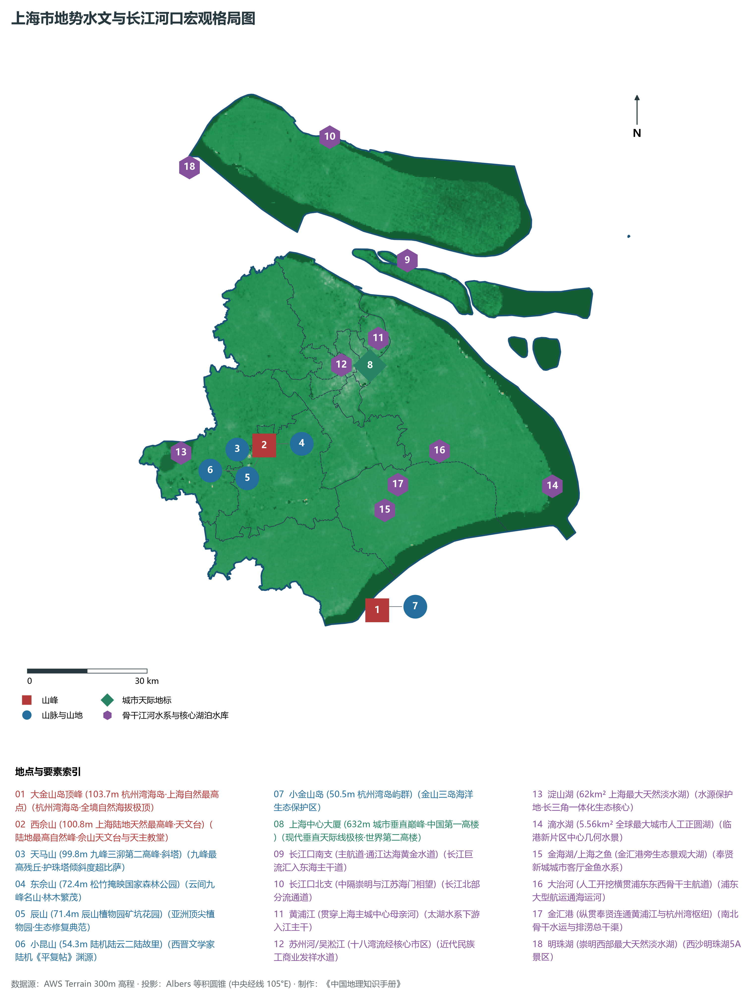
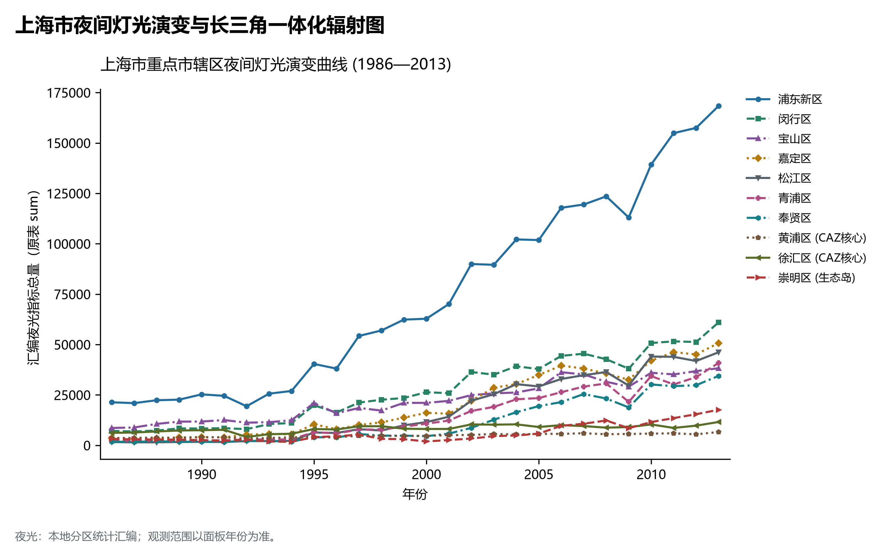
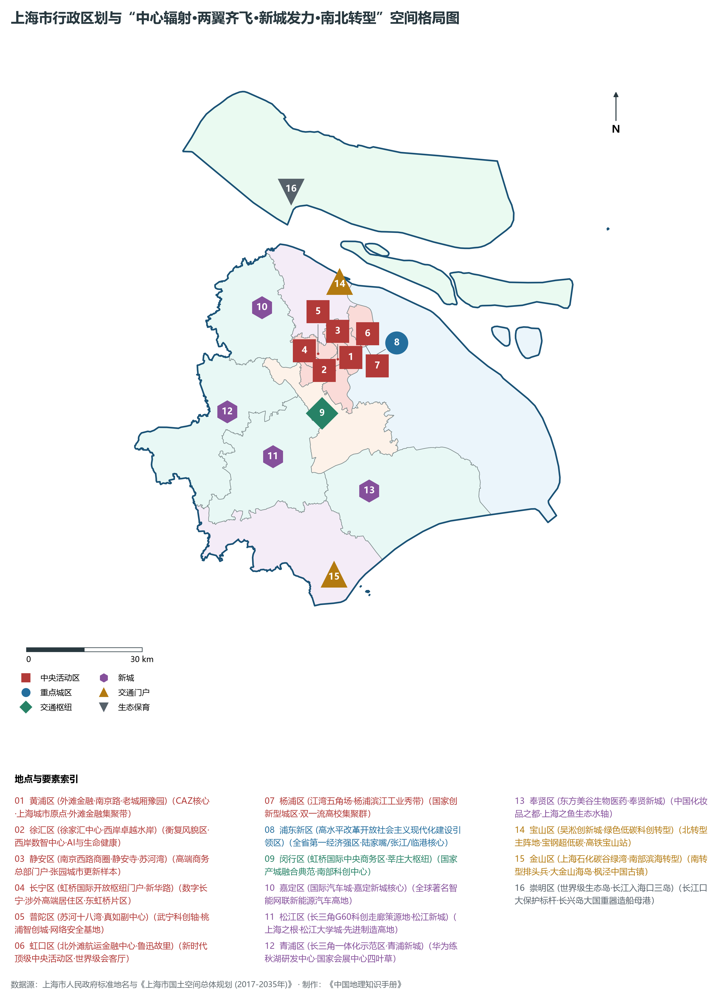
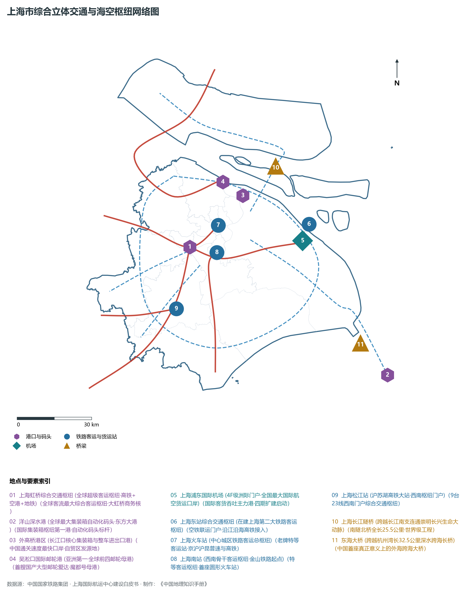
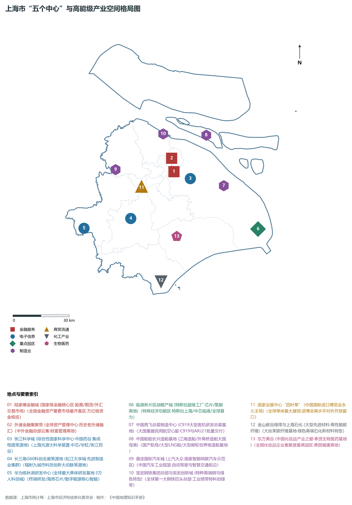

# 9.0 上海市地理统揽

上海市，简称“沪”，别称“申”，是中华人民共和国直辖市、国家中心城市、超大城市，我国最大的经济中心和国际化大都市，地处中国东部沿海、长江入海口南翼，东濒东海，南临杭州湾，西接江苏、浙江两省，北界长江，处于东经 120° 52' ～ 122° 12'、北纬 30° 40' ～ 31° 53' 之间。全市陆地总面积达 **6340.5 km²**，水域面积约 697 km²；拥有大陆海岸线和岛屿岸线合计长达 450 km 余，呈现江海交汇、岛陆相拥、水网纵横的复合型滨江临海空间格局。作为中国共产党的诞生地、中国近现代工业与金融业的发祥地、海派文化的策源地，上海历来是我国通往世界的重要门户与改革开放的排头兵。

全境地貌在宏观上呈现极为典型的**“江海陆岛融通、水网低平坦荡、西高东低略呈倾斜”冲积平原总体地貌底盘**。全境绝大部分为第四纪以来长江巨量泥沙经潮流波浪长期堆积而成的滨海河口冲积平原，平均海拔仅 3～ 5 m；西南部松江散布着天马山、西佘山等数座中生代火山岩残丘，南部杭州湾海域矗立着大金山岛、小金山岛等基岩孤岛。全市现辖 16 个市辖区（黄浦区、徐汇区、长宁区、静安区、普陀区、虹口区、杨浦区、闵行区、宝山区、嘉定区、浦东新区、金山区、松江区、青浦区、奉贤区、崇明区）。截至 2024 年末，全市常住人口约 **2487.4 万人**，常住人口城镇化率达 **89.5%** 以上。2024 年全市实现地区生产总值（GDP）突破 **5.15 万亿元**，成为全国首个跨越五万亿元大关的经济中心城市，人均 GDP 超 20.7 万元。当前，上海正以**“中心辐射、两翼齐飞、新城发力、南北转型”**为主体空间格局，全面强化“四大功能”（全球资源配置、科技创新策源、高端产业引领、开放枢纽门户），深化**“五个中心”**（国际经济、金融、贸易、航运、科技创新中心）建设，全力打造具有世界影响力的社会主义现代化国际大都市。

---

## 一、地质地貌演化与“江海陆岛融通”宏观地貌底盘

上海地处扬子准地台下扬子拗陷带东端，地质构造基底深厚，经历了太古代以来的多次强烈构造旋回。自中生代燕山运动以来，区域发生强烈的断块差异升降与中酸性火山岩浆喷溢，奠定了西高东低的基岩侵蚀剥蚀古地貌轮廓；新生代第四纪以来，长江水系携带的巨量泥沙向东海推进，在海陆相互作用与全新世海侵退变节律下，经潮流堆积与古冈身（贝壳沙堤）沙洲围海造陆，塑造了平展辽阔的现代冲积平原：

上海市自然地表高程极值跨度介于长江入海口滨海潮间滩涂的 **0.0 m** 至杭州湾大金山岛顶峰的 **103.7 m** 之间：

- **全境自然地理最高点**：位于金山区杭州湾海域的**大金山岛主峰（海拔 103.7 m）**，属于由晚侏罗世流纹岩构成的基岩岛屿，悬崖峭壁、孤峙海中，为上海市自然海拔之冠；
- **陆地天然最高峰**：位于松江区的**西佘山（海拔 100.8 m）**，与天马山（99.8 m）、东佘山（72.4 m）、辰山（71.4 m）、小昆山（54.3 m）等共同构成著名的“云间九峰”，为第四纪沉积层覆盖前剥蚀残留的火成岩残丘群；
- **现代垂直人工天际线极顶**：位于浦东新区陆家嘴金融贸易区的**上海中心大厦（建筑总高度 632 m）**，为中国第一高楼、世界第二高楼，构成了现代上海无与伦比的垂直空间图腾；
- **陆地平原标高**：全境平原主体地面标高多在海拔 **3.0～ 5.0 m** 之间，西部低洼淀泖平原海拔约 2.5～ 3.5 m，中部古冈身带（嘉定—闵行沙冈—奉贤竹冈）地面标高抬升至 4.5～ 6.0 m，东部滨海海滨平原一般在 3.5～ 4.5 m。

**上海市宏观地势阶梯与江海陆岛空间剖面示意表**

| 青浦淀泖低平洼地 | 松江残丘与古冈身 | 黄浦江穿越主城区 | 浦东滨海冲积平原 | 长江口与杭州湾岛屿 |
| --- | --- | --- | --- | --- |
| (淀山湖/练秋湖)；海拔 2.5~3.5m；湖荡交织·生态水源 | (西佘山 100.8m)；天马山 99.8m；上海之根·文化源核 | (陆家嘴/外滩CAZ)；海拔 3.5~4.5m；金融集聚·卓越水岸 | (张江/商飞总装)；海拔 3.5~5.0m；改革开放·硬核科技 | (崇明岛/大金山岛)；大金山岛 103.7m；世界生态岛·海岛极点 |

西 (淀泖低洼水网) · → 中西 (松江基岩残丘) · → 中 (主城黄浦江两岸) · → 东 (浦东滨海冲积) · → 海口 (崇明岛/杭州湾)

---

## 二、亚热带季风气候与长江河口巨型水网系统

上海市属于典型的**北亚热带南缘季风性湿润气候**，受东亚季风和太平洋潮汐双重调节，呈现四季分明、日照充分、雨热同季、温和湿润的气候特征：

- **气温与光照**：全市年平均气温在 16.5°C ～ 17.8°C 之间，极端最高气温可达 40°C，极端最低气温约 -5°C 左右。年无霜期长达 230～ 250 d，全年日照时数约 1800～ 2000 h；
- **降水时空分布**：全市年平均降水量达 **1150～ 1300 mm**，雨量充沛。全年月降水呈现明显的双峰特征：初夏 6—7 月梅雨期受江淮静止锋控制，阴雨连绵、降水集中；夏秋 8—9 月受台风与东风波影响，常伴有大风与暴雨，强对流天气多发。防台防汛与暴潮防御是超大城市运行安全的基础防线。

上海地处太湖流域下游尾闾与长江巨流入海口，境内河网密布、湖荡连绵，形成了江、海、湖、河有机交融的水网体系：

1. **长江入海口（世界巨川通江达海枢纽）**：
   - 长江在江苏徐六泾以下进入上海河口段，在崇明岛头分为**南支**与**北支**。南支为长江主航道，流经宝山吴淞口外再度被长兴岛、横沙岛分为南港与北港，南港再经九段沙分为南槽与北槽。深水航道常年水深达 12.5 m，万吨级巨轮乘潮通江达海，是长江黄金水道的咽喉总闸；
2. **黄浦江（穿越超大城市中心的母亲河）**：
   - 发源于太湖淀山湖及太浦河，流经青浦、松江、闵行、奉贤、徐汇、黄浦、虹口、杨浦、浦东新区和宝山，在吴淞口汇入长江，全长 **113 km**，平均河宽 300～ 700 m，水深 8～ 12 m。黄浦江不仅是上海最重要的城市供水骨干通道与内河航运走廊，其核心段外滩—陆家嘴—世博—前滩—徐汇西岸构成了闻名全球的“一江一河”世界级卓越水岸；
3. **苏州河/吴淞江（近代民族工商业摇篮与都市景观项链）**：
   - 发源于太湖瓜泾口，穿昆山由青浦白鹤入沪，经嘉定、闵行、长宁、普陀、静安、黄浦、虹口，在外白渡桥下汇入黄浦江。上海境内全长约 **53.1 km**（流经市区 21 km，号称“苏河十八湾”）。经数十载截污治水与贯通工程，已全面蜕变为流金溢彩的生态文化活力长廊；
4. **湖泊水库与纵横人工干渠**：
   - **淀山湖**：位于青浦区西部与江苏昆山交界处，水面积达 **62 km²**，库容近 3 亿立方米，为上海最大天然淡水湖泊，是全市二级饮用水水源保护区与长三角生态绿色一体化示范区生态之核；
   - **滴水湖**：位于浦东临港新片区核心区，湖面面积 **5.56 km²**，为全球最大的人工正圆城市湖泊；
   - **大治河**：全长 39.5 km，人工开凿横贯浦东东西，连通黄浦江与东海，为江南最高等级人工通航排涝水利主通道；
   - **金汇港**：纵贯奉贤区南北，连接黄浦江与杭州湾，是上海南部骨干水运走廊。

---

## 三、行政区划、人口与“中心辐射·两翼齐飞·新城发力·南北转型”空间格局

上海市现辖 16 个市辖区，下辖 107 个街道、106 个镇、2 个乡，共 215 个乡级行政单元，下设 4,700 余个居委会和村委会。2024 年末常住人口 2487.4 万人，外来常住人口超 1,000 万人，是全球人口密度与要素集聚度最高的特大型城市之一。

围绕《上海市国土空间总体规划（2017—2035年）》与新时代高质量发展战略要求，上海全面构建**“中心辐射、两翼齐飞、新城发力、南北转型”**的城市空间新格局：

1. **“中心辐射”：主城区中央活动区（CAZ）能级跃升**：
   - 涵盖黄浦区、徐汇区、长宁区、静安区、普陀区、虹口区、杨浦区及浦东新区陆家嘴、世博、前滩等区域。着力做强外滩金融集聚带、南京西路、淮海中路、陆家嘴金融城、北外滩、苏河湾、徐汇滨江数智中心等高能级核心板块，强化全球资源配置功能与总部经济集聚效应；
2. **“两翼齐飞”：东翼临港新片区与西翼长三角一体化示范区**：
   - **东翼（临港新片区与东方枢纽）**：依托浦东国际机场、洋山深水港与在建上海东站，建设全国最高水平对外开放特殊经济功能区，布局集成电路、人工智能、新能源汽车等硬核科技产业；
   - **西翼（长三角生态绿色一体化发展示范区）**：依托青浦区全域，携手江苏吴江、浙江嘉善，聚焦华为练秋湖研发中心与西岑科创中心，探索生态优势转化为经济社会发展优势的制度创新高地；
3. **“新城发力”：嘉定、青浦、松江、奉贤、南汇五大新城独立综合性节点城市**：
   - 打破传统郊区“卫星城”思维，按照“产城融合、功能完备、职住平衡、生态宜居、交通便利”标准，打造各具特色的千亿级现代产业集群（嘉定国际汽车城、松江G60科创走廊、青浦现代物流与数字信息、奉贤东方美谷、南汇临港现代智造）；
4. **“南北转型”：宝山吴淞创新城与金山滨海碳谷绿色转型**：
   - **北转型（宝山区）**：由传统重工业与宝钢基地向绿色低碳科创高地与机器人及智能制造基地全面蝶变；
   - **南转型（金山区）**：由传统石油化工向高端合成材料、碳纤维、生物医药与滨海文旅新城转型；
5. **生态屏障：崇明世界级生态岛**：
   - 崇明岛、长兴岛、横沙岛全域坚守生态底线，森林覆盖率超 30%，长兴岛打造大国重器现代造船母港，崇明东滩成为亚太候鸟国际栖息圣地。

---

## 四、综合立体交通枢纽与海空铁水网四位一体

上海是我国沿海沿江立体交通大网络的总枢纽，构筑了通达全球、辐射全国、高效连接长三角的世界一流综合交通体系：

1. **国际海港枢纽（全球第一大集装箱大港）**：
   - **上海港**：集装箱年吞吐量连续 15 年蝉联**全球第 1 位**（2024 年突破 4900 万标准箱 TEU）。由洋山深水港区（拥有全球规模最大、自动化程度最高的全自动化集装箱码头）、外高桥港区、吴淞港区与罗泾港区协同组成。洋山港经全长 32.5 km 的东海大桥与陆域紧密相连；
2. **国际航空双枢纽（全国第一大空运门户）**：
   - **浦东国际机场与虹桥国际机场**：年旅客吞吐量突破 1.25 亿人次，货邮吞吐量超 400 万吨，位居全球城市前三位。虹桥枢纽集空港、高铁、城际、地铁、磁浮等于一体，为全球客流量最大的综合客运枢纽；在建上海东站与浦东机场一体化构筑“东方枢纽”；
3. **高速铁路与骨干轨道交通大枢纽**：
   - **铁路枢纽客站体系**：上海虹桥站、上海站、上海南站、在建上海东站与上海松江站（9台23线，沪苏湖高铁大站）五大枢纽鼎立，京沪高铁、沪宁城际、沪昆高铁、沪苏湖高铁、沿江高铁连通全国；
   - **超大规模轨道交通网络**：上海轨道交通运营里程达 **831 km**，车站 508 座，运营里程与客运规模稳居世界超大城市前列；新建机场联络线（设计时速 160 km/h，虹桥至浦东仅需 40 分钟）、嘉闵线、示范区线等市域铁路线加速织网；
4. **越江跨海通道与高架快速路网**：
   - 拥有延安高架路、南北高架路、中环线、内环线、外环高速（S20）、绕城高速（G1503）环放射路网；全长 25.5 km 的上海长江隧桥一桥飞架南北，越黄浦江建成 18 条公路隧道、13 座特大跨江桥梁（南浦、杨浦、徐浦、卢浦、闵浦、松浦等）。

---

## 五、“五个中心”战略纵深与现代化产业高地

作为中国经济发展的核心引擎，上海坚决担负起“五个中心”建设国家战略使命，大力发展“新质生产力”，构建以**“3+6”新型产业体系**（集成电路、生物医药、人工智能三大先导产业 + 电子信息、生命健康、汽车、高端装备、先进材料、时尚消费品六大重点产业）为骨干的高能级现代产业集群：

1. **国际金融中心与全球资源配置枢纽**：
   - 上海证券交易所股票市值居全球前三，上海期货交易所、中国金融期货交易所、中国外汇交易中心、上海黄金交易所等国家级金融要素市场云集陆家嘴与外滩金融集聚带，金融业增加值突破 8500 亿元；
2. **三大先导产业与战略性新兴产业策源地**：
   - **集成电路**：张江高科技园区与临港新片区汇聚了中芯国际、华虹宏力、韦尔半导体等龙头企业，涵盖设计、制造、封测与装备材料全产业链，产值占全国近三分之一；
   - **生物医药**：张江药谷、徐汇生命蓝湾、奉贤东方美谷构筑全球创新药研发高地，原创新药与创新医疗器械获批数量领跑全国；
   - **人工智能**：徐汇西岸、浦东张江集聚全国顶尖大模型研发团队与国家实验室，世界人工智能大会（WAIC）成为全球科技风向标；
3. **大国重器与大飞机/船舶/汽车先进制造航母**：
   - **民用航空客机**：中国商用飞机有限责任公司（COMAC）在浦东祝桥设立大型客机总装制造基地，C919 大型客机实现商业化常态运营与规模化量产交付；
   - **世界造船母港**：中国船舶集团长兴造船基地（江南造船、外高桥造船），成功建造首艘国产大型邮轮“爱达·魔都号”、全球首创大型 LNG 运输船及现代化航母，是全球造船技术制高点；
   - **新能源汽车与智能网联**：嘉定国际汽车城、临港特斯拉超级工厂（年交付整车超 90 万辆）推动上海成为全球新能源智能汽车智造与出口中心。
