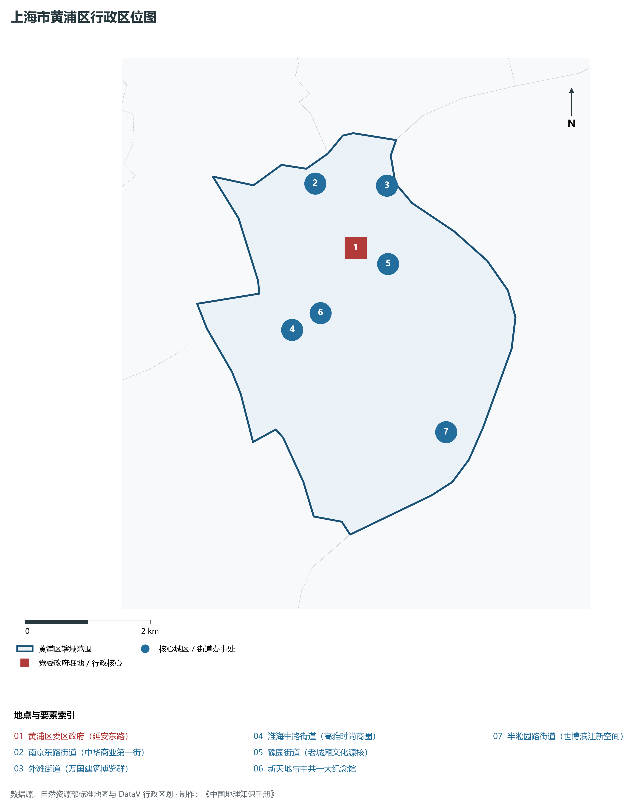
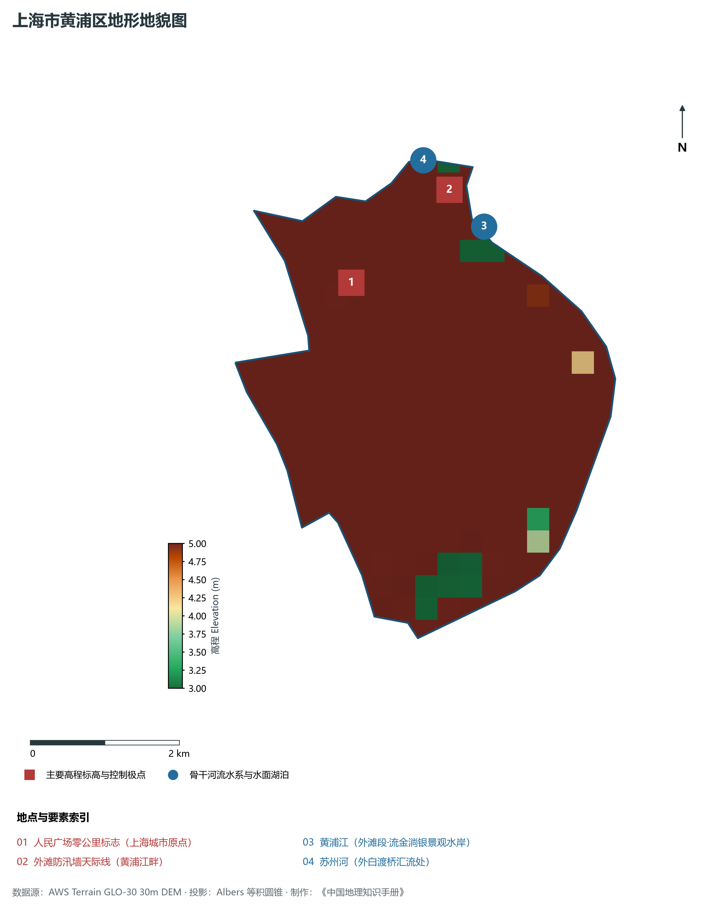
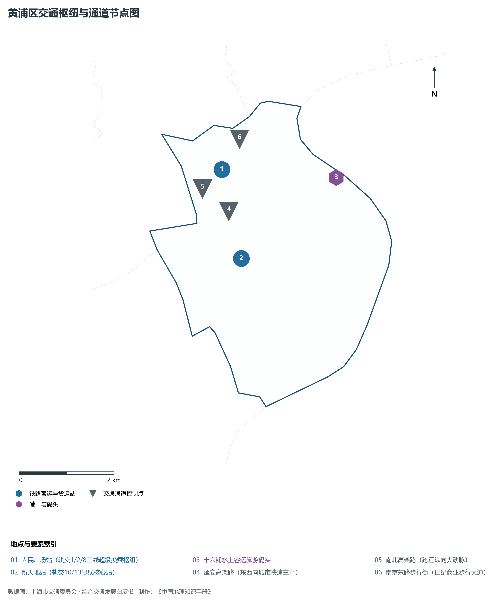
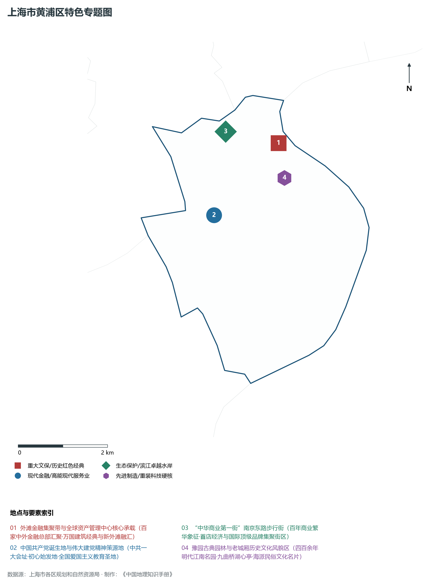
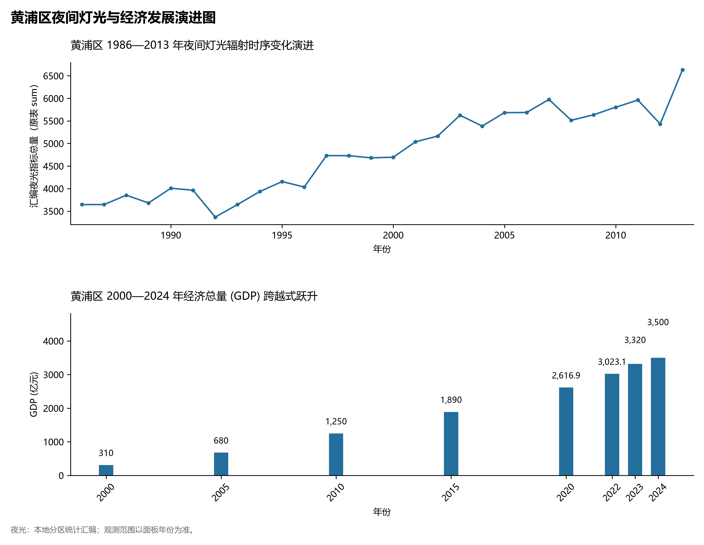

# 9.1 黄浦区

黄浦区，地处上海市关键战略板块，其区域综合定位与发展格局概括为：**上海中央活动区核心区·外滩金融集聚带·“中华商业第一街”南京路·人民广场与老城厢豫园·现代服务业高地**。全区陆地总面积达 **20.52 km²**，截至 2024 年末全区常住人口约 **64.8** 万人，常住人口城镇化率达 **100.0%**。2024 年实现地区生产总值（GDP）约 **3,500.0** 亿元，人均 GDP 突破 **540,100** 元，三次产业结构比为 **0.0 : 1.5 : 98.5**。全区自然地表标高介于 **3.0 m ～ 5.0 m** 之间，展现出江海交汇的平原水网机理与极高密度、极高能级的国际化大都市现代化产业核心基底。

---

## 一、自然地理环境与城市微地貌底盘

区域骨干控制性高程标高与标志性天际极点包括：

- **人民广场零公里标志 (上海城市原点)**（空间坐标约东经 121.475°、北纬 31.231°，控制标高约 4.5 m）：构成区域微地貌与现代垂直天际线的重要基准控制点；
- **外滩防汛墙天际线 (黄浦江畔)**（空间坐标约东经 121.491°、北纬 31.240°，控制标高约 5.2 m）：构成区域微地貌与现代垂直天际线的重要基准控制点；

水系水网与生态廊道方面，黄浦区江河交织、水网如织：

- **黄浦江 (外滩段·流金淌银景观水岸)**（水域坐标约东经 121.495°、北纬 31.235°）：发挥防汛排涝、航运通航、生态水景与城市水岸活力营造的核心支撑功能；
- **苏州河 (外白渡桥汇流处)**（水域坐标约东经 121.488°、北纬 31.244°）：发挥防汛排涝、航运通航、生态水景与城市水岸活力营造的核心支撑功能；

---

## 二、历史文脉演进与城市功能空间重塑

黄浦区历史文化底蕴深厚，在上海从古代江南海滨村落向近代国际商埠、现代社会主义现代化国际大都市跃升的历史进程中扮演了不可替代的关键角色。伴随历次城市总体规划演化与“一江一河”世界级卓越水岸贯通、城市更新纵深推进，构建了权责明晰、功能复合的街道社区与城镇空间治理网络：

- **黄浦区委区政府 (延安东路)**（驻地坐标：121.485°E, 31.228°N）：区域政治治理、高品质公共服务与综合经济管理的关键极核；
- **南京东路街道 (中华商业第一街)**（驻地坐标：121.480°E, 31.238°N）：区域政治治理、高品质公共服务与综合经济管理的关键极核；
- **外滩街道 (万国建筑博览群)**（驻地坐标：121.492°E, 31.236°N）：区域政治治理、高品质公共服务与综合经济管理的关键极核；
- **淮海中路街道 (高雅时尚商圈)**（驻地坐标：121.472°E, 31.218°N）：区域政治治理、高品质公共服务与综合经济管理的关键极核；
- **豫园街道 (老城厢文化源核)**（驻地坐标：121.490°E, 31.225°N）：区域政治治理、高品质公共服务与综合经济管理的关键极核；
- **新天地与中共一大纪念馆**（驻地坐标：121.475°E, 31.220°N）：区域政治治理、高品质公共服务与综合经济管理的关键极核；
- **半淞园路街道 (世博滨江新空间)**（驻地坐标：121.495°E, 31.200°N）：区域政治治理、高品质公共服务与综合经济管理的关键极核；

在空间开发保护总体格局上，黄浦区坚定贯彻“人民城市人民建，人民城市为人民”重要理念，持续推动空间集约紧凑发展、精细化微更新与生态韧性安全构筑，高水准推进产城融合与人居环境改善。

---

## 三、综合立体交通网络与枢纽门户功能

黄浦区紧密依托上海超大规模立体交通网络，形成了多维交织的轨道交通、城市快速路、骨干主干道与骨干对外客货运大通道：

**核心综合客运交通枢纽与关键站点：**

- **人民广场站 (轨交1/2/8三线超级换乘枢纽)**（位置坐标：121.475°E, 31.233°N）：区域客货运流量组织与换乘集散的关键节点；
- **十六铺水上客运旅游码头**（位置坐标：121.500°E, 31.228°N）：区域客货运流量组织与换乘集散的关键节点；
- **新天地站 (轨交10/13号线核心站)**（位置坐标：121.476°E, 31.216°N）：区域客货运流量组织与换乘集散的关键节点；

**骨干交通走廊与快速路网通道：**

- **延安高架路 (东西向城市快速主脊)**（走廊控制点：121.475°E, 31.225°N）：承担跨区快速通勤与大容量经济要素流动的高速骨架；
- **南北高架路 (跨江纵向大动脉)**（走廊控制点：121.470°E, 31.230°N）：承担跨区快速通勤与大容量经济要素流动的高速骨架；
- **南京东路步行街 (世纪商业步行大道)**（走廊控制点：121.480°E, 31.238°N）：承担跨区快速通勤与大容量经济要素流动的高速骨架；

---

## 四、现代产业体系与新质生产力布局

黄浦区立足全市“五个中心”建设战略布局，全力发展新质生产力，积极构建以实体经济为支撑、现代服务业为主导或先进制造业为脊梁的高能级现代产业体系：

**重大科技园区与高新技术产业集聚平台：**

- **外滩金融集聚带核心区**（园区坐标：121.492°E, 31.234°N）：集聚顶尖创新资源、推动成果转化与新经济孵化的主阵地；
- **新天地国际创新创意园区**（园区坐标：121.473°E, 31.219°N）：集聚顶尖创新资源、推动成果转化与新经济孵化的主阵地；
- **黄浦滨江世博科创总部基地**（园区坐标：121.498°E, 31.205°N）：集聚顶尖创新资源、推动成果转化与新经济孵化的主阵地；

**标志性特色主题要素与领航龙头优势：**

- **外滩金融集聚带与全球资产管理中心核心承载**（空间坐标：121.492°E, 31.234°N）：百家中外金融总部汇聚·万国建筑经典与新外滩融汇；
- **中国共产党诞生地与伟大建党精神策源地**（空间坐标：121.474°E, 31.222°N）：中共一大会址·初心始发地·全国爱国主义教育圣地；
- **“中华商业第一街”南京东路步行街**（空间坐标：121.480°E, 31.238°N）：百年商业繁华象征·首店经济与国际顶级品牌集聚街区；
- **豫园古典园林与老城厢历史文化风貌区**（空间坐标：121.492°E, 31.227°N）：四百余年明代江南名园·九曲桥湖心亭·海派民俗文化名片；

---

## 五、历史文化底蕴、名胜古迹与全域文旅地理

黄浦区文商旅交相辉映，历史风貌保护区与现代化公共文化设施融为一体，拥有享誉海内外的标志性文旅资源：

- **中共一大纪念馆 (中国共产党诞生地)**（地标坐标：121.474°E, 31.222°N）：彰显红色文脉、海派底蕴与生态景观的典范文旅空间；
- **上海外滩 (万国建筑博览·全国重点文保)**（地标坐标：121.490°E, 31.240°N）：彰显红色文脉、海派底蕴与生态景观的典范文旅空间；
- **豫园与老城隍庙 (全国重点文保·江南名园)**（地标坐标：121.492°E, 31.227°N）：彰显红色文脉、海派底蕴与生态景观的典范文旅空间；
- **南京东路步行街与人民广场**（地标坐标：121.478°E, 31.235°N）：彰显红色文脉、海派底蕴与生态景观的典范文旅空间；

黄浦区持续推动以文塑旅、以旅彰文，打响“上海文化”品牌，不断拓宽文旅消费新场景，提升城区软实力与国际美誉度。

---

## 六、夜间灯光辐射与跨世纪经济变化时序演进

本节夜光图的观测年份为 1986—2013 年，指标为行政区汇总值（原表 sum）。

| 统计基准年份 | 地区生产总值 GDP (亿元) | 发展阶段主要特征与空间跃升标志 |
|:---|:---|:---|
| **2000 年** | 310.0 | 世纪之交产业重组与现代城市功能筑基 |
| **2005 年** | 680.0 | 世纪之交产业重组与现代城市功能筑基 |
| **2010 年** | 1,250.0 | 世博效应驱动城市更新与高端现代服务业集聚 |
| **2015 年** | 1,890.0 | 世博效应驱动城市更新与高端现代服务业集聚 |
| **2020 年** | 2,616.9 | 新发展格局下高质量发展与新质生产力全面成势 |
| **2022 年** | 3,023.1 | 新发展格局下高质量发展与新质生产力全面成势 |
| **2023 年** | 3,320.0 | 新发展格局下高质量发展与新质生产力全面成势 |
| **2024 年** | 3,500.0 | 新发展格局下高质量发展与新质生产力全面成势 |

