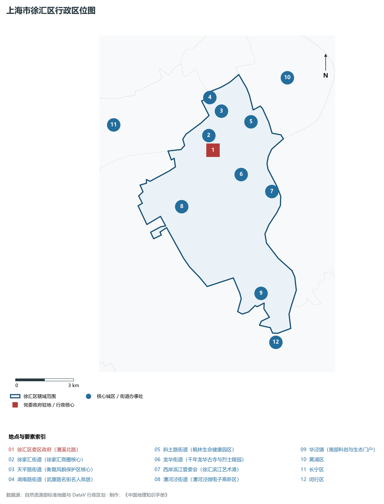
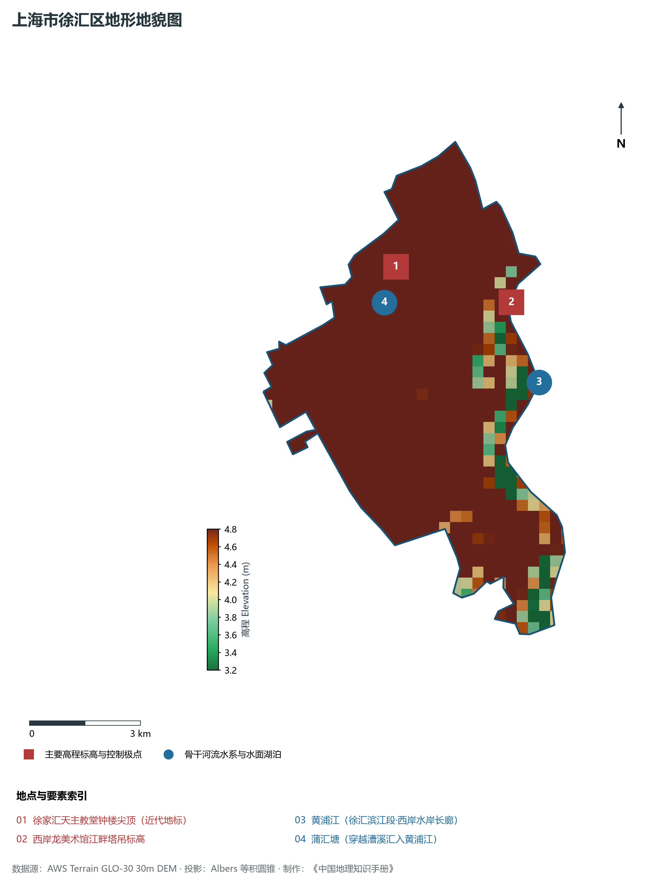
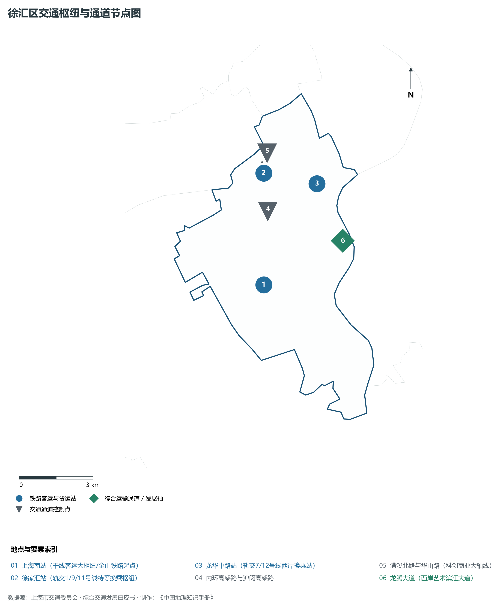
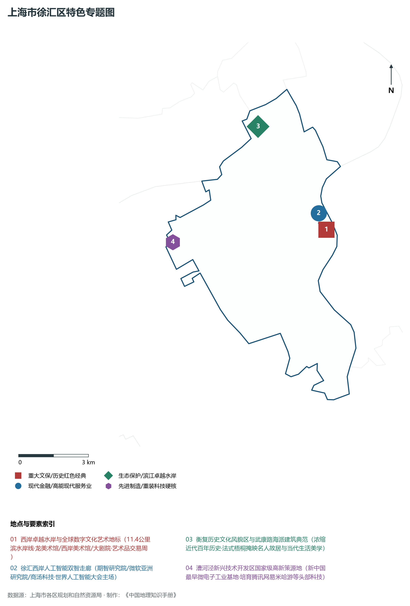
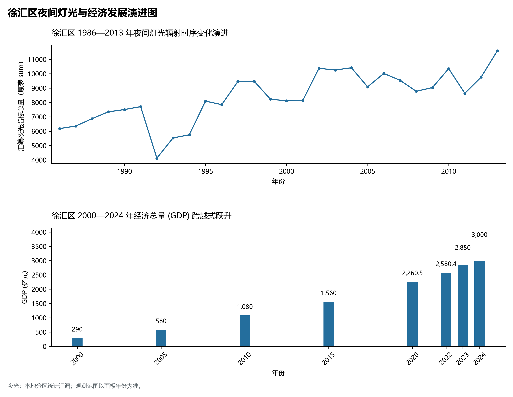

# 9.2 徐汇区

徐汇区，地处上海市关键战略板块，其区域综合定位与发展格局概括为：**西岸滨江卓越水岸·徐家汇中央活动区·衡复历史文化风貌区·人工智能与生命健康科创策源地**。全区陆地总面积达 **54.93 km²**，截至 2024 年末全区常住人口约 **111.3** 万人，常住人口城镇化率达 **100.0%**。2024 年实现地区生产总值（GDP）约 **3,000.0** 亿元，人均 GDP 突破 **269,500** 元，三次产业结构比为 **0.0 : 8.5 : 91.5**。全区自然地表标高介于 **3.2 m ～ 4.8 m** 之间，展现出江海交汇的平原水网机理与极高密度、极高能级的国际化大都市现代化产业核心基底。

---

## 一、自然地理环境与城市微地貌底盘

区域骨干控制性高程标高与标志性天际极点包括：

- **徐家汇天主教堂钟楼尖顶 (近代地标)**（空间坐标约东经 121.435°、北纬 31.193°，控制标高约 4.5 m）：构成区域微地貌与现代垂直天际线的重要基准控制点；
- **西岸龙美术馆江畔塔吊标高**（空间坐标约东经 121.466°、北纬 31.180°，控制标高约 5.0 m）：构成区域微地貌与现代垂直天际线的重要基准控制点；

水系水网与生态廊道方面，徐汇区江河交织、水网如织：

- **黄浦江 (徐汇滨江段·西岸水岸长廊)**（水域坐标约东经 121.470°、北纬 31.160°）：发挥防汛排涝、航运通航、生态水景与城市水岸活力营造的核心支撑功能；
- **蒲汇塘 (穿越漕溪汇入黄浦江)**（水域坐标约东经 121.430°、北纬 31.185°）：发挥防汛排涝、航运通航、生态水景与城市水岸活力营造的核心支撑功能；

---

## 二、历史文脉演进与城市功能空间重塑

徐汇区历史文化底蕴深厚，在上海从古代江南海滨村落向近代国际商埠、现代社会主义现代化国际大都市跃升的历史进程中扮演了不可替代的关键角色。伴随历次城市总体规划演化与“一江一河”世界级卓越水岸贯通、城市更新纵深推进，构建了权责明晰、功能复合的街道社区与城镇空间治理网络：

- **徐汇区委区政府 (漕溪北路)**（驻地坐标：121.437°E, 31.188°N）：区域政治治理、高品质公共服务与综合经济管理的关键极核；
- **徐家汇街道 (徐家汇商圈核心)**（驻地坐标：121.436°E, 31.195°N）：区域政治治理、高品质公共服务与综合经济管理的关键极核；
- **天平路街道 (衡复风貌保护区核心)**（驻地坐标：121.445°E, 31.205°N）：区域政治治理、高品质公共服务与综合经济管理的关键极核；
- **湖南路街道 (武康路名街名人故居)**（驻地坐标：121.440°E, 31.212°N）：区域政治治理、高品质公共服务与综合经济管理的关键极核；
- **斜土路街道 (枫林生命健康园区)**（驻地坐标：121.460°E, 31.198°N）：区域政治治理、高品质公共服务与综合经济管理的关键极核；
- **龙华街道 (千年龙华古寺与烈士陵园)**（驻地坐标：121.450°E, 31.175°N）：区域政治治理、高品质公共服务与综合经济管理的关键极核；
- **西岸滨江管委会 (徐汇滨江艺术港)**（驻地坐标：121.465°E, 31.165°N）：区域政治治理、高品质公共服务与综合经济管理的关键极核；
- **漕河泾街道 (漕河泾微电子高新区)**（驻地坐标：121.415°E, 31.165°N）：区域政治治理、高品质公共服务与综合经济管理的关键极核；
- **华泾镇 (南部科创与生态门户)**（驻地坐标：121.450°E, 31.120°N）：区域政治治理、高品质公共服务与综合经济管理的关键极核；

在空间开发保护总体格局上，徐汇区坚定贯彻“人民城市人民建，人民城市为人民”重要理念，持续推动空间集约紧凑发展、精细化微更新与生态韧性安全构筑，高水准推进产城融合与人居环境改善。

---

## 三、综合立体交通网络与枢纽门户功能

徐汇区紧密依托上海超大规模立体交通网络，形成了多维交织的轨道交通、城市快速路、骨干主干道与骨干对外客货运大通道：

**核心综合客运交通枢纽与关键站点：**

- **上海南站 (干线客运大枢纽/金山铁路起点)**（位置坐标：121.428°E, 31.154°N）：区域客货运流量组织与换乘集散的关键节点；
- **徐家汇站 (轨交1/9/11号线特等换乘枢纽)**（位置坐标：121.436°E, 31.194°N）：区域客货运流量组织与换乘集散的关键节点；
- **龙华中路站 (轨交7/12号线西岸换乘站)**（位置坐标：121.458°E, 31.187°N）：区域客货运流量组织与换乘集散的关键节点；

**骨干交通走廊与快速路网通道：**

- **内环高架路与沪闵高架路**（走廊控制点：121.435°E, 31.180°N）：承担跨区快速通勤与大容量经济要素流动的高速骨架；
- **龙腾大道 (西岸艺术滨江大道)**（走廊控制点：121.465°E, 31.165°N）：承担跨区快速通勤与大容量经济要素流动的高速骨架；
- **漕溪北路与华山路 (科创商业大轴线)**（走廊控制点：121.436°E, 31.198°N）：承担跨区快速通勤与大容量经济要素流动的高速骨架；

---

## 四、现代产业体系与新质生产力布局

徐汇区立足全市“五个中心”建设战略布局，全力发展新质生产力，积极构建以实体经济为支撑、现代服务业为主导或先进制造业为脊梁的高能级现代产业体系：

**重大科技园区与高新技术产业集聚平台：**

- **西岸智塔与人工智能产业集聚区**（园区坐标：121.462°E, 31.168°N）：集聚顶尖创新资源、推动成果转化与新经济孵化的主阵地；
- **漕河泾新兴技术开发区 (国家级高新区)**（园区坐标：121.395°E, 31.170°N）：集聚顶尖创新资源、推动成果转化与新经济孵化的主阵地；
- **枫林生命健康科创园区 (三甲医院科研集群)**（园区坐标：121.455°E, 31.195°N）：集聚顶尖创新资源、推动成果转化与新经济孵化的主阵地；
- **大零号湾徐汇辐射创新板块**（园区坐标：121.440°E, 31.130°N）：集聚顶尖创新资源、推动成果转化与新经济孵化的主阵地；

**标志性特色主题要素与领航龙头优势：**

- **西岸卓越水岸与全球数字文化艺术地标**（空间坐标：121.465°E, 31.165°N）：11.4公里滨水岸线·龙美术馆/西岸美术馆/大剧院·艺术品交易周；
- **徐汇西岸人工智能双智走廊**（空间坐标：121.462°E, 31.168°N）：期智研究院/微软亚洲研究院/商汤科技·世界人工智能大会主场；
- **衡复历史文化风貌区与武康路海派建筑典范**（空间坐标：121.442°E, 31.208°N）：浓缩近代百年历史·法式梧桐掩映名人故居与当代生活美学；
- **漕河泾新兴技术开发区国家级高新策源地**（空间坐标：121.395°E, 31.170°N）：新中国最早微电子工业基地·培育腾讯网易米哈游等头部科技；

---

## 五、历史文化底蕴、名胜古迹与全域文旅地理

徐汇区文商旅交相辉映，历史风貌保护区与现代化公共文化设施融为一体，拥有享誉海内外的标志性文旅资源：

- **龙华寺与龙华烈士陵园 (全国重点文保)**（地标坐标：121.450°E, 31.175°N）：彰显红色文脉、海派底蕴与生态景观的典范文旅空间；
- **武康路历史文化名街与宋庆龄故居**（地标坐标：121.442°E, 31.208°N）：彰显红色文脉、海派底蕴与生态景观的典范文旅空间；
- **徐家汇源景区 (4A·徐光启纪念馆/天主堂)**（地标坐标：121.434°E, 31.192°N）：彰显红色文脉、海派底蕴与生态景观的典范文旅空间；
- **西岸美术馆大道与油罐艺术中心**（地标坐标：121.463°E, 31.172°N）：彰显红色文脉、海派底蕴与生态景观的典范文旅空间；

徐汇区持续推动以文塑旅、以旅彰文，打响“上海文化”品牌，不断拓宽文旅消费新场景，提升城区软实力与国际美誉度。

---

## 六、夜间灯光辐射与跨世纪经济变化时序演进

本节夜光图的观测年份为 1986—2013 年，指标为行政区汇总值（原表 sum）。

| 统计基准年份 | 地区生产总值 GDP (亿元) | 发展阶段主要特征与空间跃升标志 |
|:---|:---|:---|
| **2000 年** | 290.0 | 世纪之交产业重组与现代城市功能筑基 |
| **2005 年** | 580.0 | 世纪之交产业重组与现代城市功能筑基 |
| **2010 年** | 1,080.0 | 世博效应驱动城市更新与高端现代服务业集聚 |
| **2015 年** | 1,560.0 | 世博效应驱动城市更新与高端现代服务业集聚 |
| **2020 年** | 2,260.5 | 新发展格局下高质量发展与新质生产力全面成势 |
| **2022 年** | 2,580.4 | 新发展格局下高质量发展与新质生产力全面成势 |
| **2023 年** | 2,850.0 | 新发展格局下高质量发展与新质生产力全面成势 |
| **2024 年** | 3,000.0 | 新发展格局下高质量发展与新质生产力全面成势 |

