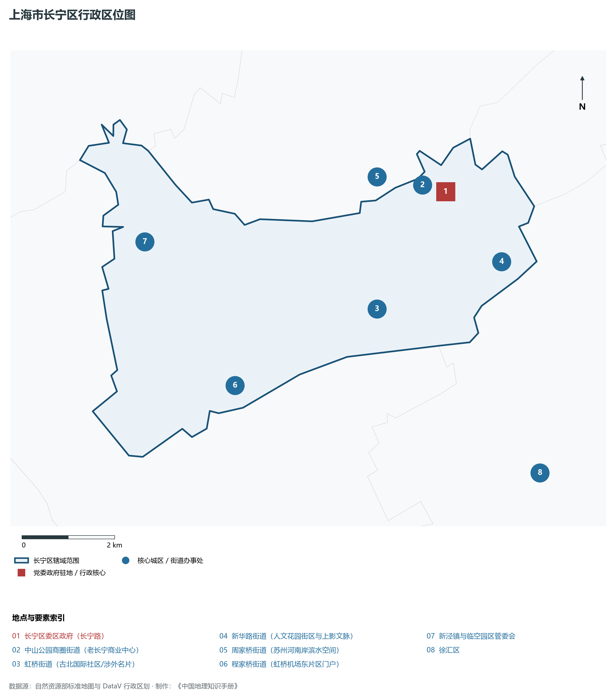
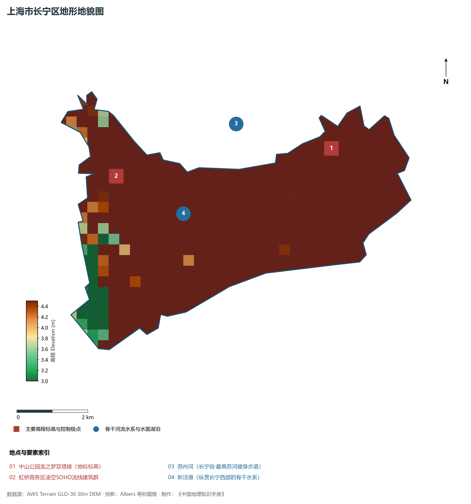
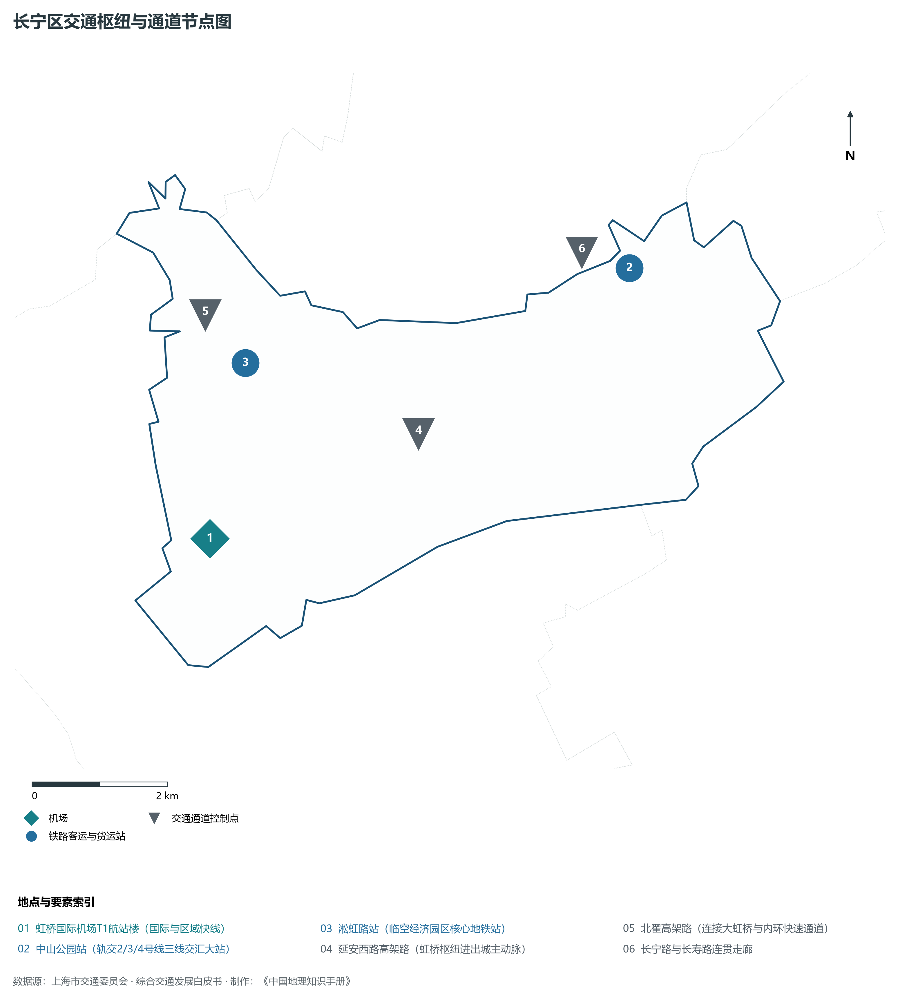
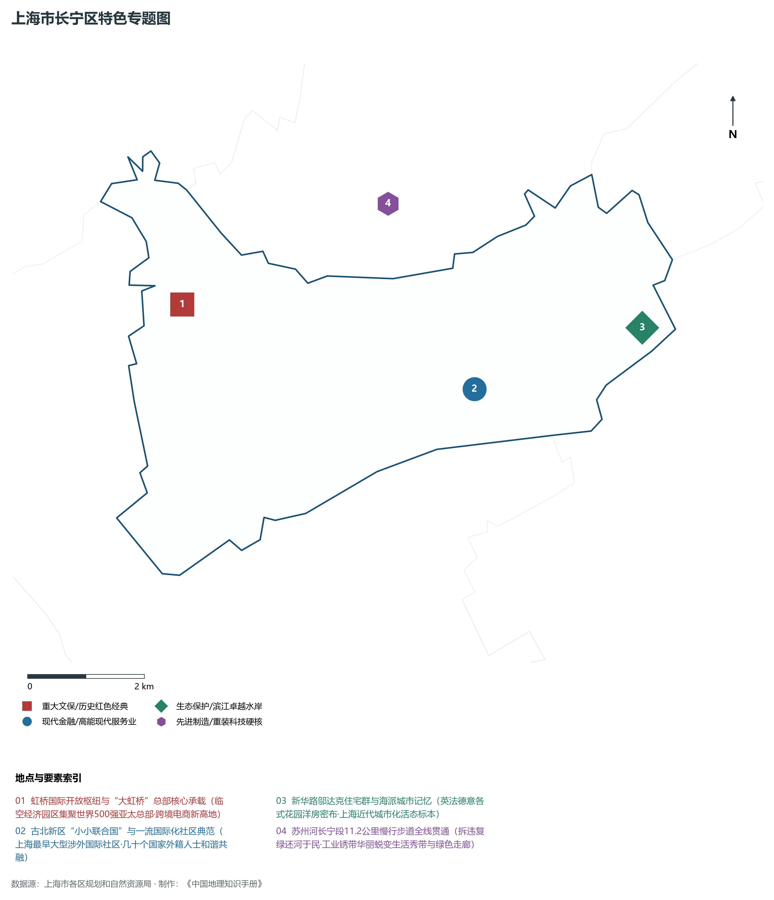
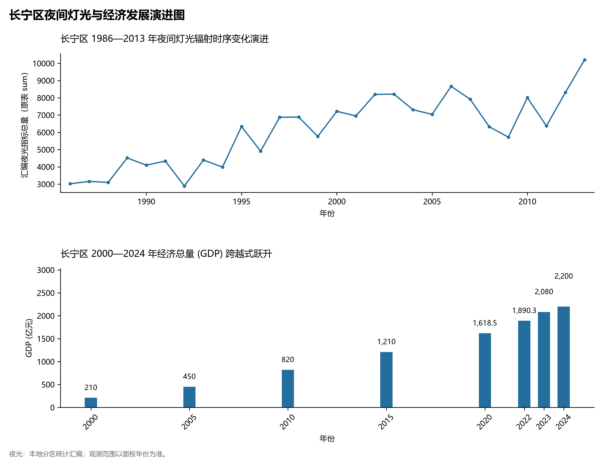

# 9.3 长宁区

长宁区，地处上海市关键战略板块，其区域综合定位与发展格局概括为：**虹桥国际开放枢纽核心区·“数字长宁”策源地·国际精品城区·高端涉外商贸与航空服务高地**。全区陆地总面积达 **37.19 km²**，截至 2024 年末全区常住人口约 **69.4** 万人，常住人口城镇化率达 **100.0%**。2024 年实现地区生产总值（GDP）约 **2,200.0** 亿元，人均 GDP 突破 **317,000** 元，三次产业结构比为 **0.0 : 4.8 : 95.2**。全区自然地表标高介于 **3.0 m ～ 4.5 m** 之间，展现出江海交汇的平原水网机理与极高密度、极高能级的国际化大都市现代化产业核心基底。

---

## 一、自然地理环境与城市微地貌底盘

区域骨干控制性高程标高与标志性天际极点包括：

- **中山公园龙之梦双塔楼 (地标标高)**（空间坐标约东经 121.417°、北纬 31.220°，控制标高约 4.5 m）：构成区域微地貌与现代垂直天际线的重要基准控制点；
- **虹桥商务区凌空SOHO流线建筑群**（空间坐标约东经 121.352°、北纬 31.222°，控制标高约 4.0 m）：构成区域微地貌与现代垂直天际线的重要基准控制点；

水系水网与生态廊道方面，长宁区江河交织、水网如织：

- **苏州河 (长宁段·最美苏河健身步道)**（水域坐标约东经 121.390°、北纬 31.230°）：发挥防汛排涝、航运通航、生态水景与城市水岸活力营造的核心支撑功能；
- **新泾港 (纵贯长宁西部的骨干水系)**（水域坐标约东经 121.370°、北纬 31.210°）：发挥防汛排涝、航运通航、生态水景与城市水岸活力营造的核心支撑功能；

---

## 二、历史文脉演进与城市功能空间重塑

长宁区历史文化底蕴深厚，在上海从古代江南海滨村落向近代国际商埠、现代社会主义现代化国际大都市跃升的历史进程中扮演了不可替代的关键角色。伴随历次城市总体规划演化与“一江一河”世界级卓越水岸贯通、城市更新纵深推进，构建了权责明晰、功能复合的街道社区与城镇空间治理网络：

- **长宁区委区政府 (长宁路)**（驻地坐标：121.420°E, 31.220°N）：区域政治治理、高品质公共服务与综合经济管理的关键极核；
- **中山公园商圈街道 (老长宁商业中心)**（驻地坐标：121.415°E, 31.222°N）：区域政治治理、高品质公共服务与综合经济管理的关键极核；
- **虹桥街道 (古北国际社区/涉外名片)**（驻地坐标：121.400°E, 31.200°N）：区域政治治理、高品质公共服务与综合经济管理的关键极核；
- **新华路街道 (人文花园街区与上影文脉)**（驻地坐标：121.430°E, 31.205°N）：区域政治治理、高品质公共服务与综合经济管理的关键极核；
- **周家桥街道 (苏州河南岸滨水空间)**（驻地坐标：121.405°E, 31.225°N）：区域政治治理、高品质公共服务与综合经济管理的关键极核；
- **程家桥街道 (虹桥机场东片区门户)**（驻地坐标：121.365°E, 31.190°N）：区域政治治理、高品质公共服务与综合经济管理的关键极核；
- **新泾镇与临空园区管委会**（驻地坐标：121.350°E, 31.220°N）：区域政治治理、高品质公共服务与综合经济管理的关键极核；

在空间开发保护总体格局上，长宁区坚定贯彻“人民城市人民建，人民城市为人民”重要理念，持续推动空间集约紧凑发展、精细化微更新与生态韧性安全构筑，高水准推进产城融合与人居环境改善。

---

## 三、综合立体交通网络与枢纽门户功能

长宁区紧密依托上海超大规模立体交通网络，形成了多维交织的轨道交通、城市快速路、骨干主干道与骨干对外客货运大通道：

**核心综合客运交通枢纽与关键站点：**

- **虹桥国际机场T1航站楼 (国际与区域快线)**（位置坐标：121.345°E, 31.196°N）：区域客货运流量组织与换乘集散的关键节点；
- **中山公园站 (轨交2/3/4号线三线交汇大站)**（位置坐标：121.417°E, 31.222°N）：区域客货运流量组织与换乘集散的关键节点；
- **淞虹路站 (临空经济园区核心地铁站)**（位置坐标：121.355°E, 31.218°N）：区域客货运流量组织与换乘集散的关键节点；

**骨干交通走廊与快速路网通道：**

- **延安西路高架路 (虹桥枢纽进出城主动脉)**（走廊控制点：121.380°E, 31.205°N）：承担跨区快速通勤与大容量经济要素流动的高速骨架；
- **北翟高架路 (连接大虹桥与内环快速通道)**（走廊控制点：121.350°E, 31.225°N）：承担跨区快速通勤与大容量经济要素流动的高速骨架；
- **长宁路与长寿路连贯走廊**（走廊控制点：121.410°E, 31.225°N）：承担跨区快速通勤与大容量经济要素流动的高速骨架；

---

## 四、现代产业体系与新质生产力布局

长宁区立足全市“五个中心”建设战略布局，全力发展新质生产力，积极构建以实体经济为支撑、现代服务业为主导或先进制造业为脊梁的高能级现代产业体系：

**重大科技园区与高新技术产业集聚平台：**

- **虹桥临空经济示范区 (总部经济与航空物流)**（园区坐标：121.350°E, 31.220°N）：集聚顶尖创新资源、推动成果转化与新经济孵化的主阵地；
- **“数字长宁”创新产业走廊 (拼多多/美团等电商)**（园区坐标：121.380°E, 31.210°N）：集聚顶尖创新资源、推动成果转化与新经济孵化的主阵地；
- **虹桥国际涉外贸易金融中心 (上海世贸商城)**（园区坐标：121.400°E, 31.202°N）：集聚顶尖创新资源、推动成果转化与新经济孵化的主阵地；

**标志性特色主题要素与领航龙头优势：**

- **虹桥国际开放枢纽与“大虹桥”总部核心承载**（空间坐标：121.350°E, 31.220°N）：临空经济园区集聚世界500强亚太总部·跨境电商新高地；
- **古北新区“小小联合国”与一流国际化社区典范**（空间坐标：121.400°E, 31.200°N）：上海最早大型涉外国际社区·几十个国家外籍人士和谐共融；
- **新华路邬达克住宅群与海派城市记忆**（空间坐标：121.432°E, 31.205°N）：英法德意各式花园洋房密布·上海近代城市化活态标本；
- **苏州河长宁段11.2公里慢行步道全线贯通**（空间坐标：121.390°E, 31.230°N）：拆违复绿还河于民·工业锈带华丽蜕变生活秀带与绿色走廊；

---

## 五、历史文化底蕴、名胜古迹与全域文旅地理

长宁区文商旅交相辉映，历史风貌保护区与现代化公共文化设施融为一体，拥有享誉海内外的标志性文旅资源：

- **新华路历史文化风貌区 (万国住宅邬达克建筑)**（地标坐标：121.432°E, 31.205°N）：彰显红色文脉、海派底蕴与生态景观的典范文旅空间；
- **中山公园 (百年欧式历史名园)**（地标坐标：121.418°E, 31.223°N）：彰显红色文脉、海派底蕴与生态景观的典范文旅空间；
- **上海动物园 (原西郊公园·国家级动物保护地)**（地标坐标：121.360°E, 31.195°N）：彰显红色文脉、海派底蕴与生态景观的典范文旅空间；
- **愚园路历史名人名街 (海派生活美学街区)**（地标坐标：121.425°E, 31.220°N）：彰显红色文脉、海派底蕴与生态景观的典范文旅空间；

长宁区持续推动以文塑旅、以旅彰文，打响“上海文化”品牌，不断拓宽文旅消费新场景，提升城区软实力与国际美誉度。

---

## 六、夜间灯光辐射与跨世纪经济变化时序演进

本节夜光图的观测年份为 1986—2013 年，指标为行政区汇总值（原表 sum）。

| 统计基准年份 | 地区生产总值 GDP (亿元) | 发展阶段主要特征与空间跃升标志 |
|:---|:---|:---|
| **2000 年** | 210.0 | 世纪之交产业重组与现代城市功能筑基 |
| **2005 年** | 450.0 | 世纪之交产业重组与现代城市功能筑基 |
| **2010 年** | 820.0 | 世博效应驱动城市更新与高端现代服务业集聚 |
| **2015 年** | 1,210.0 | 世博效应驱动城市更新与高端现代服务业集聚 |
| **2020 年** | 1,618.5 | 新发展格局下高质量发展与新质生产力全面成势 |
| **2022 年** | 1,890.3 | 新发展格局下高质量发展与新质生产力全面成势 |
| **2023 年** | 2,080.0 | 新发展格局下高质量发展与新质生产力全面成势 |
| **2024 年** | 2,200.0 | 新发展格局下高质量发展与新质生产力全面成势 |

