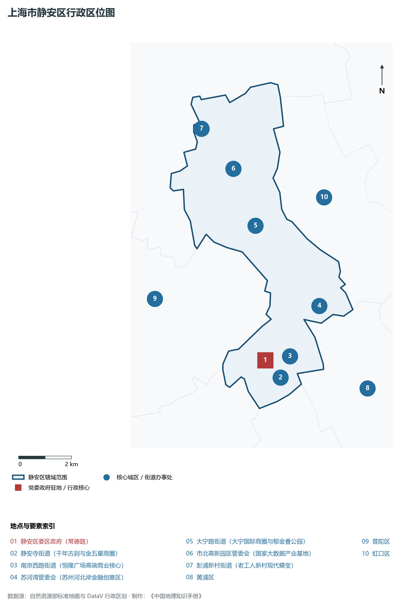
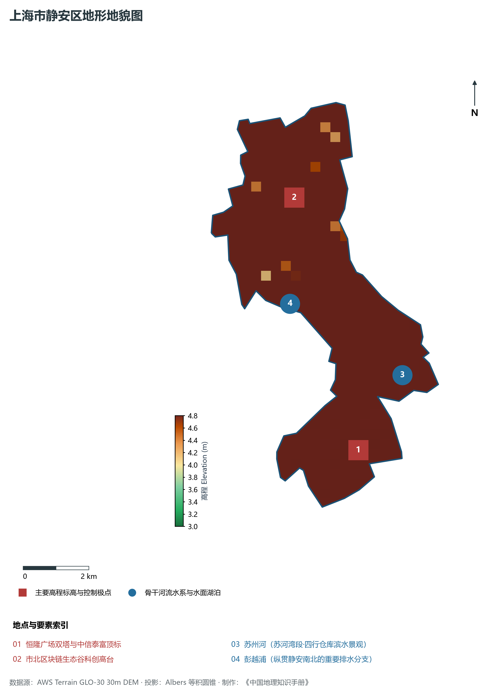
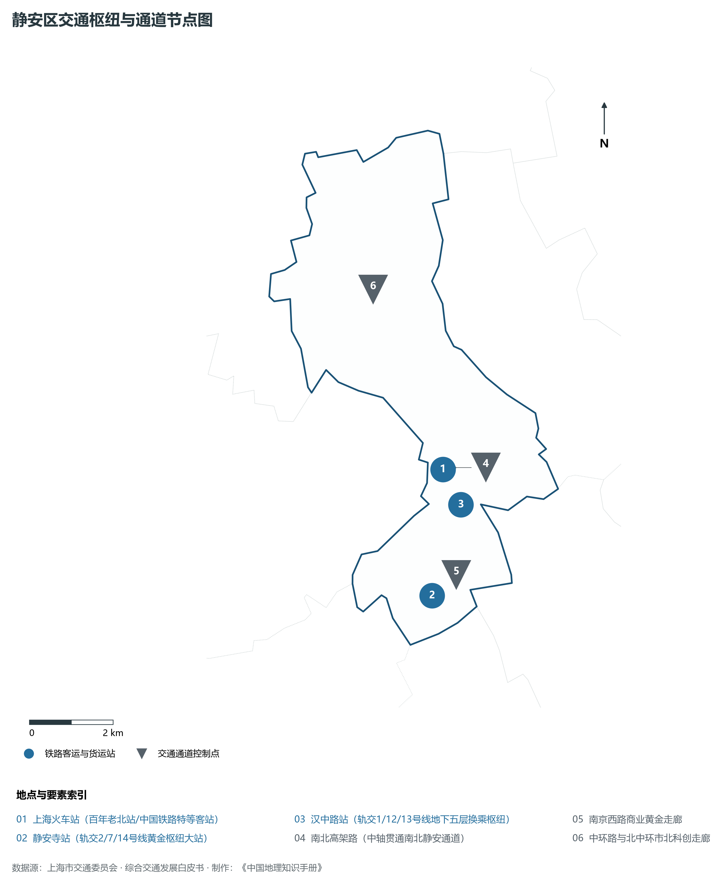
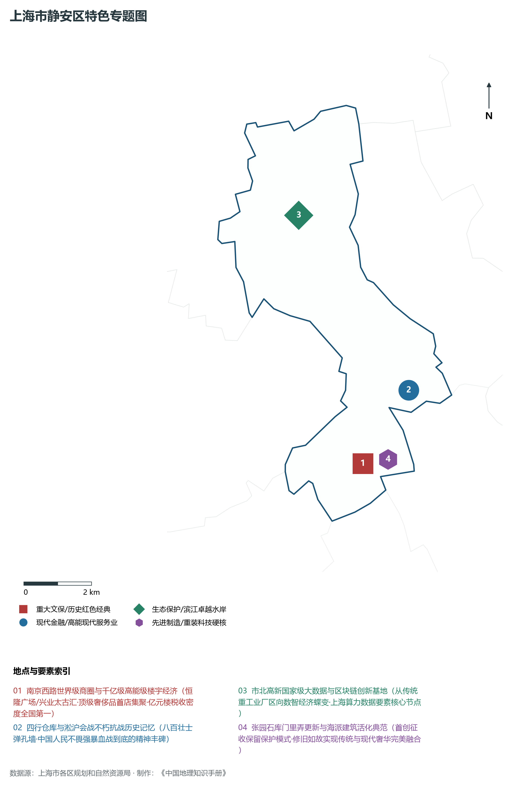
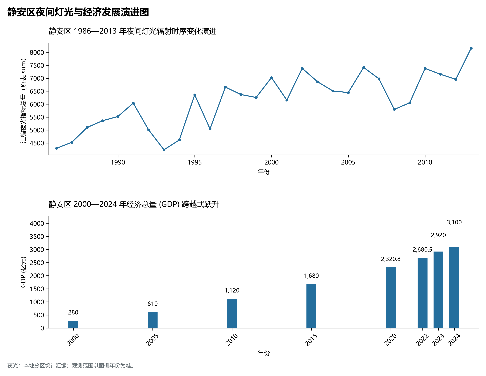

# 9.4 静安区

静安区，地处上海市关键战略板块，其区域综合定位与发展格局概括为：**“国际静安·卓越城区”·南京西路百亿商圈·苏河湾世界级滨水活力带·跨国公司总部集聚区·国家大数据产业基石**。全区陆地总面积达 **37.00 km²**，截至 2024 年末全区常住人口约 **97.6** 万人，常住人口城镇化率达 **100.0%**。2024 年实现地区生产总值（GDP）约 **3,100.0** 亿元，人均 GDP 突破 **317,600** 元，三次产业结构比为 **0.0 : 2.5 : 97.5**。全区自然地表标高介于 **3.0 m ～ 4.8 m** 之间，展现出江海交汇的平原水网机理与极高密度、极高能级的国际化大都市现代化产业核心基底。

---

## 一、自然地理环境与城市微地貌底盘

区域骨干控制性高程标高与标志性天际极点包括：

- **恒隆广场双塔与中信泰富顶标**（空间坐标约东经 121.454°、北纬 31.228°，控制标高约 4.5 m）：构成区域微地貌与现代垂直天际线的重要基准控制点；
- **市北区块链生态谷科创高台**（空间坐标约东经 121.447°、北纬 31.298°，控制标高约 4.2 m）：构成区域微地貌与现代垂直天际线的重要基准控制点；

水系水网与生态廊道方面，静安区江河交织、水网如织：

- **苏州河 (苏河湾段·四行仓库滨水景观)**（水域坐标约东经 121.472°、北纬 31.246°）：发挥防汛排涝、航运通航、生态水景与城市水岸活力营造的核心支撑功能；
- **彭越浦 (纵贯静安南北的重要排水分支)**（水域坐标约东经 121.440°、北纬 31.270°）：发挥防汛排涝、航运通航、生态水景与城市水岸活力营造的核心支撑功能；

---

## 二、历史文脉演进与城市功能空间重塑

静安区历史文化底蕴深厚，在上海从古代江南海滨村落向近代国际商埠、现代社会主义现代化国际大都市跃升的历史进程中扮演了不可替代的关键角色。伴随历次城市总体规划演化与“一江一河”世界级卓越水岸贯通、城市更新纵深推进，构建了权责明晰、功能复合的街道社区与城镇空间治理网络：

- **静安区委区政府 (常德路)**（驻地坐标：121.445°E, 31.230°N）：区域政治治理、高品质公共服务与综合经济管理的关键极核；
- **静安寺街道 (千年古刹与金五星商圈)**（驻地坐标：121.446°E, 31.224°N）：区域政治治理、高品质公共服务与综合经济管理的关键极核；
- **南京西路街道 (恒隆广场高端商业核心)**（驻地坐标：121.455°E, 31.230°N）：区域政治治理、高品质公共服务与综合经济管理的关键极核；
- **苏河湾管委会 (苏州河北岸金融创意区)**（驻地坐标：121.470°E, 31.245°N）：区域政治治理、高品质公共服务与综合经济管理的关键极核；
- **大宁路街道 (大宁国际商圈与郁金香公园)**（驻地坐标：121.450°E, 31.275°N）：区域政治治理、高品质公共服务与综合经济管理的关键极核；
- **市北高新园区管委会 (国家大数据产业基地)**（驻地坐标：121.445°E, 31.295°N）：区域政治治理、高品质公共服务与综合经济管理的关键极核；
- **彭浦新村街道 (老工人新村现代蝶变)**（驻地坐标：121.435°E, 31.310°N）：区域政治治理、高品质公共服务与综合经济管理的关键极核；

在空间开发保护总体格局上，静安区坚定贯彻“人民城市人民建，人民城市为人民”重要理念，持续推动空间集约紧凑发展、精细化微更新与生态韧性安全构筑，高水准推进产城融合与人居环境改善。

---

## 三、综合立体交通网络与枢纽门户功能

静安区紧密依托上海超大规模立体交通网络，形成了多维交织的轨道交通、城市快速路、骨干主干道与骨干对外客货运大通道：

**核心综合客运交通枢纽与关键站点：**

- **上海火车站 (百年老北站/中国铁路特等客站)**（位置坐标：121.455°E, 31.250°N）：区域客货运流量组织与换乘集散的关键节点；
- **静安寺站 (轨交2/7/14号线黄金枢纽大站)**（位置坐标：121.447°E, 31.224°N）：区域客货运流量组织与换乘集散的关键节点；
- **汉中路站 (轨交1/12/13号线地下五层换乘枢纽)**（位置坐标：121.458°E, 31.242°N）：区域客货运流量组织与换乘集散的关键节点；

**骨干交通走廊与快速路网通道：**

- **南北高架路 (中轴贯通南北静安通道)**（走廊控制点：121.458°E, 31.250°N）：承担跨区快速通勤与大容量经济要素流动的高速骨架；
- **南京西路商业黄金走廊**（走廊控制点：121.450°E, 31.228°N）：承担跨区快速通勤与大容量经济要素流动的高速骨架；
- **中环路与北中环市北科创走廊**（走廊控制点：121.445°E, 31.290°N）：承担跨区快速通勤与大容量经济要素流动的高速骨架；

---

## 四、现代产业体系与新质生产力布局

静安区立足全市“五个中心”建设战略布局，全力发展新质生产力，积极构建以实体经济为支撑、现代服务业为主导或先进制造业为脊梁的高能级现代产业体系：

**重大科技园区与高新技术产业集聚平台：**

- **市北高新技术服务业园区 (国家级大数据产业基地)**（园区坐标：121.445°E, 31.295°N）：集聚顶尖创新资源、推动成果转化与新经济孵化的主阵地；
- **苏河湾全球资产管理与现代专业服务集聚区**（园区坐标：121.468°E, 31.245°N）：集聚顶尖创新资源、推动成果转化与新经济孵化的主阵地；
- **南京西路跨国公司地区总部集群**（园区坐标：121.452°E, 31.228°N）：集聚顶尖创新资源、推动成果转化与新经济孵化的主阵地；

**标志性特色主题要素与领航龙头优势：**

- **南京西路世界级商圈与千亿级高能级楼宇经济**（空间坐标：121.452°E, 31.228°N）：恒隆广场/兴业太古汇·顶级奢侈品首店集聚·亿元楼税收密度全国第一；
- **四行仓库与淞沪会战不朽抗战历史记忆**（空间坐标：121.470°E, 31.245°N）：八百壮士弹孔墙·中国人民不畏强暴血战到底的精神丰碑；
- **市北高新国家级大数据与区块链创新基地**（空间坐标：121.445°E, 31.295°N）：从传统重工业厂区向数智经济蝶变·上海算力数据要素核心节点；
- **张园石库门里弄更新与海派建筑活化典范**（空间坐标：121.460°E, 31.228°N）：首创征收保留保护模式·修旧如故实现传统与现代奢华完美融合；

---

## 五、历史文化底蕴、名胜古迹与全域文旅地理

静安区文商旅交相辉映，历史风貌保护区与现代化公共文化设施融为一体，拥有享誉海内外的标志性文旅资源：

- **静安寺 (三国孙吴始建千年古刹)**（地标坐标：121.447°E, 31.224°N）：彰显红色文脉、海派底蕴与生态景观的典范文旅空间；
- **四行仓库抗战纪念馆 (淞沪抗战八百壮士壮举)**（地标坐标：121.470°E, 31.245°N）：彰显红色文脉、海派底蕴与生态景观的典范文旅空间；
- **中共二大会址纪念馆 (首部党章诞生地)**（地标坐标：121.465°E, 31.227°N）：彰显红色文脉、海派底蕴与生态景观的典范文旅空间；
- **张园历史文化风貌区 (海上第一名园·石库门博物馆)**（地标坐标：121.460°E, 31.228°N）：彰显红色文脉、海派底蕴与生态景观的典范文旅空间；
- **大宁郁金香公园与上海马戏城**（地标坐标：121.452°E, 31.278°N）：彰显红色文脉、海派底蕴与生态景观的典范文旅空间；

静安区持续推动以文塑旅、以旅彰文，打响“上海文化”品牌，不断拓宽文旅消费新场景，提升城区软实力与国际美誉度。

---

## 六、夜间灯光辐射与跨世纪经济变化时序演进

本节夜光图的观测年份为 1986—2013 年，指标为行政区汇总值（原表 sum）。

| 统计基准年份 | 地区生产总值 GDP (亿元) | 发展阶段主要特征与空间跃升标志 |
|:---|:---|:---|
| **2000 年** | 280.0 | 世纪之交产业重组与现代城市功能筑基 |
| **2005 年** | 610.0 | 世纪之交产业重组与现代城市功能筑基 |
| **2010 年** | 1,120.0 | 世博效应驱动城市更新与高端现代服务业集聚 |
| **2015 年** | 1,680.0 | 世博效应驱动城市更新与高端现代服务业集聚 |
| **2020 年** | 2,320.8 | 新发展格局下高质量发展与新质生产力全面成势 |
| **2022 年** | 2,680.5 | 新发展格局下高质量发展与新质生产力全面成势 |
| **2023 年** | 2,920.0 | 新发展格局下高质量发展与新质生产力全面成势 |
| **2024 年** | 3,100.0 | 新发展格局下高质量发展与新质生产力全面成势 |

