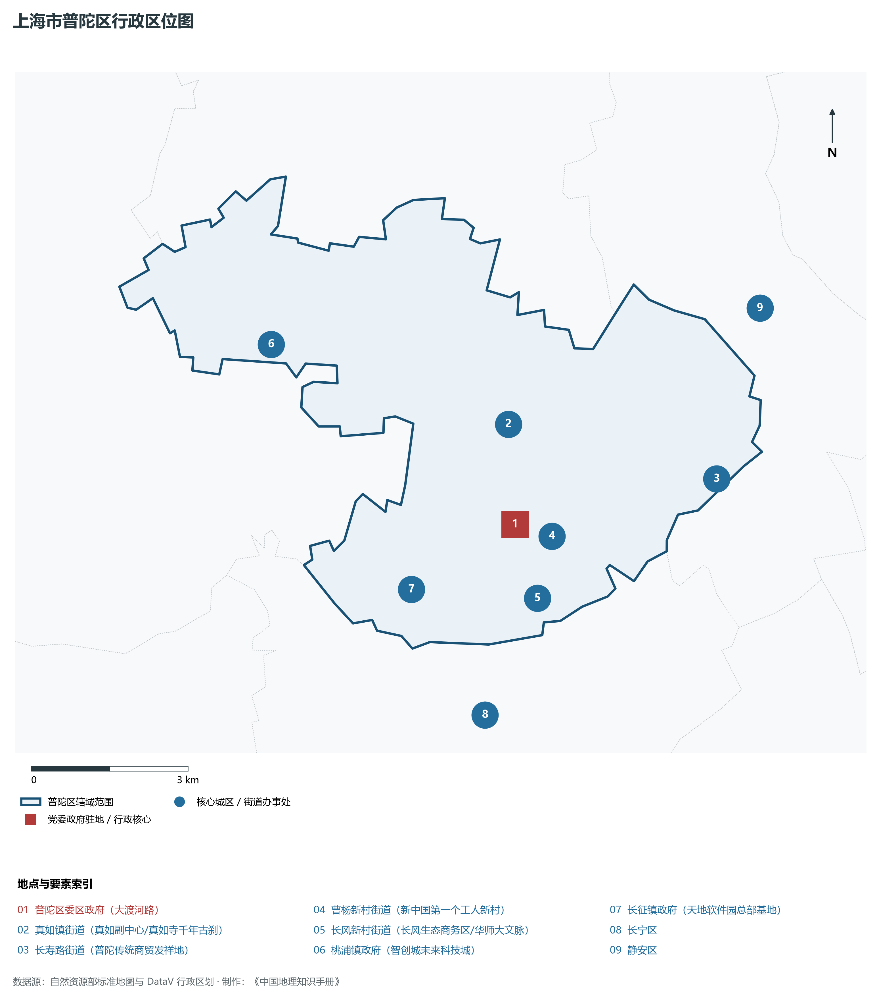
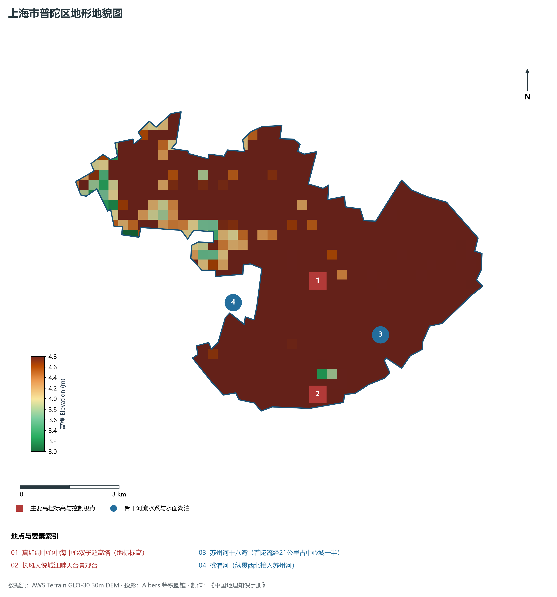
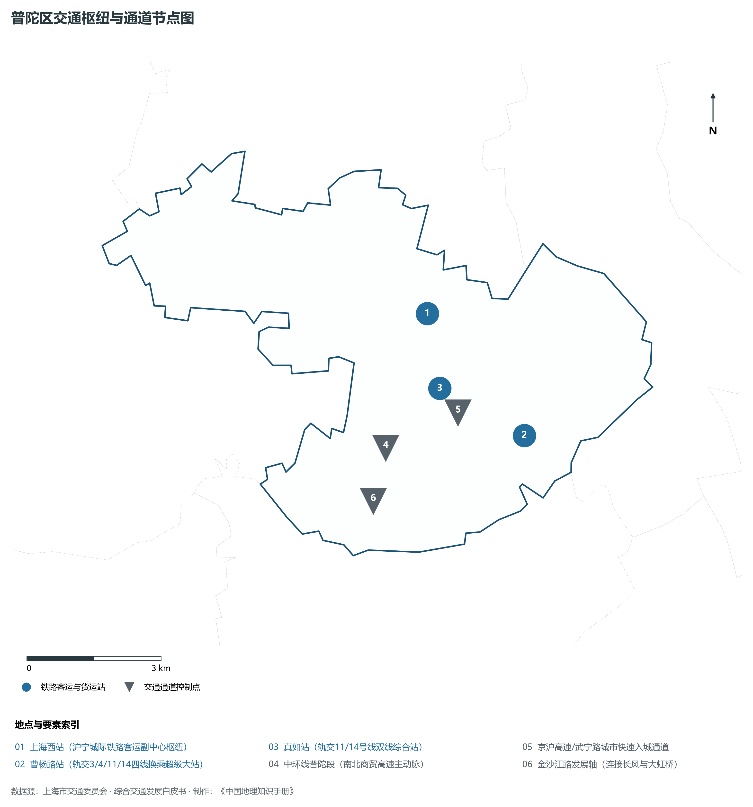
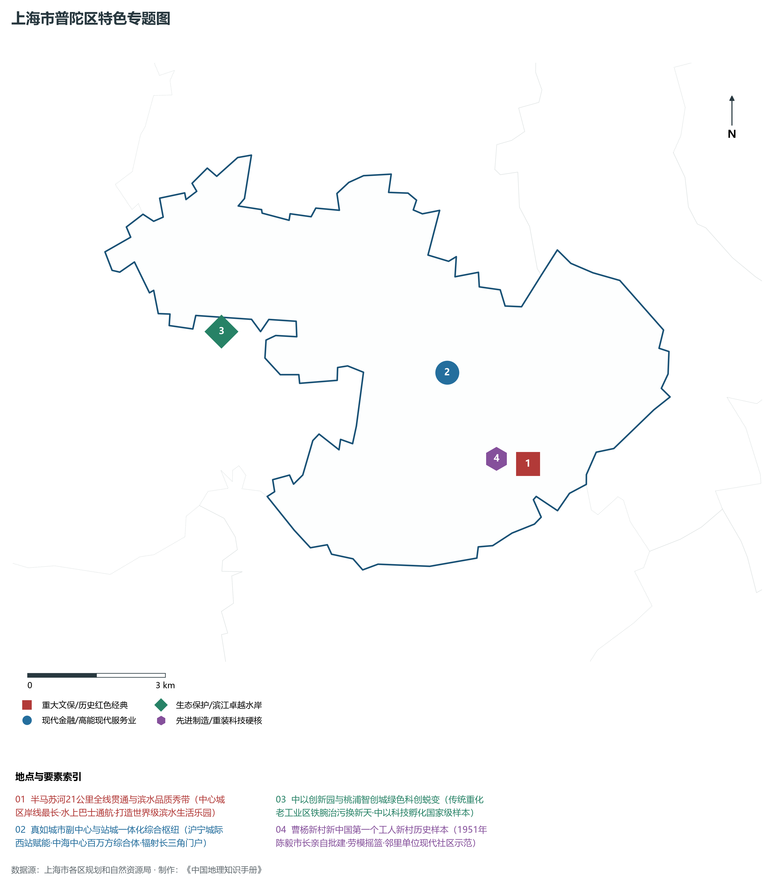
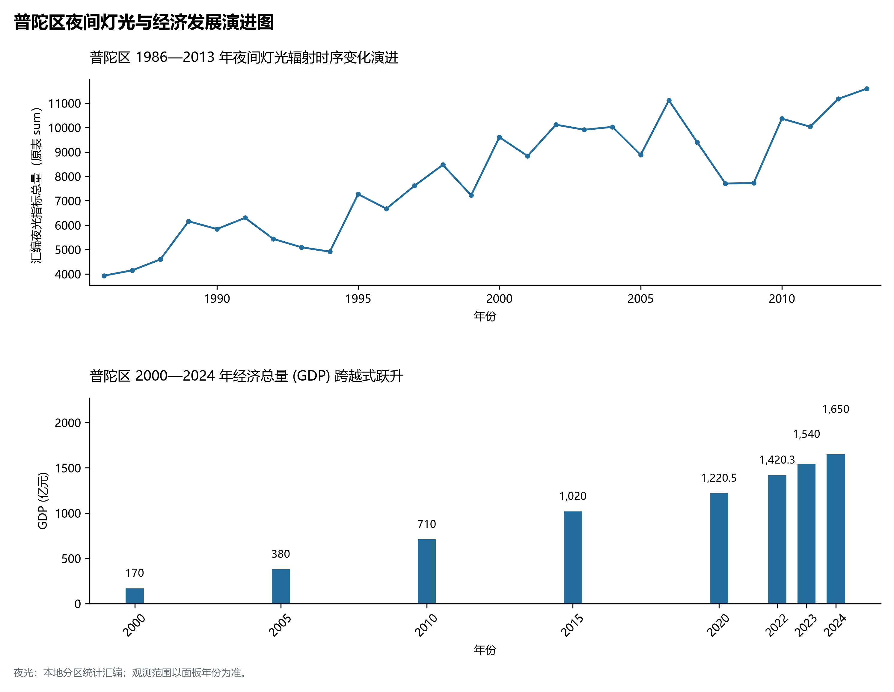

# 9.5 普陀区

普陀区，地处上海市关键战略板块，其区域综合定位与发展格局概括为：**“苏河水岸·活力普陀”·苏州河十八湾长廊·真如城市副中心·中以创新园与海纳小镇数字经济城**。全区陆地总面积达 **55.53 km²**，截至 2024 年末全区常住人口约 **124.0** 万人，常住人口城镇化率达 **100.0%**。2024 年实现地区生产总值（GDP）约 **1,650.0** 亿元，人均 GDP 突破 **133,100** 元，三次产业结构比为 **0.0 : 10.5 : 89.5**。全区自然地表标高介于 **3.0 m ～ 4.8 m** 之间，展现出江海交汇的平原水网机理与极高密度、极高能级的国际化大都市现代化产业核心基底。

---

## 一、自然地理环境与城市微地貌底盘

区域骨干控制性高程标高与标志性天际极点包括：

- **真如副中心中海中心双子超高塔 (地标标高)**（空间坐标约东经 121.398°、北纬 31.252°，控制标高约 4.5 m）：构成区域微地貌与现代垂直天际线的重要基准控制点；
- **长风大悦城江畔天台景观台**（空间坐标约东经 121.392°、北纬 31.222°，控制标高约 4.0 m）：构成区域微地貌与现代垂直天际线的重要基准控制点；

水系水网与生态廊道方面，普陀区江河交织、水网如织：

- **苏州河十八湾 (普陀流经21公里占中心城一半)**（水域坐标约东经 121.415°、北纬 31.235°）：发挥防汛排涝、航运通航、生态水景与城市水岸活力营造的核心支撑功能；
- **桃浦河 (纵贯西北接入苏州河)**（水域坐标约东经 121.370°、北纬 31.250°）：发挥防汛排涝、航运通航、生态水景与城市水岸活力营造的核心支撑功能；

---

## 二、历史文脉演进与城市功能空间重塑

普陀区历史文化底蕴深厚，在上海从古代江南海滨村落向近代国际商埠、现代社会主义现代化国际大都市跃升的历史进程中扮演了不可替代的关键角色。伴随历次城市总体规划演化与“一江一河”世界级卓越水岸贯通、城市更新纵深推进，构建了权责明晰、功能复合的街道社区与城镇空间治理网络：

- **普陀区委区政府 (大渡河路)**（驻地坐标：121.398°E, 31.238°N）：区域政治治理、高品质公共服务与综合经济管理的关键极核；
- **真如镇街道 (真如副中心/真如寺千年古刹)**（驻地坐标：121.400°E, 31.255°N）：区域政治治理、高品质公共服务与综合经济管理的关键极核；
- **长寿路街道 (普陀传统商贸发祥地)**（驻地坐标：121.440°E, 31.240°N）：区域政治治理、高品质公共服务与综合经济管理的关键极核；
- **曹杨新村街道 (新中国第一个工人新村)**（驻地坐标：121.405°E, 31.235°N）：区域政治治理、高品质公共服务与综合经济管理的关键极核；
- **长风新村街道 (长风生态商务区/华师大文脉)**（驻地坐标：121.400°E, 31.225°N）：区域政治治理、高品质公共服务与综合经济管理的关键极核；
- **桃浦镇政府 (智创城未来科技城)**（驻地坐标：121.355°E, 31.275°N）：区域政治治理、高品质公共服务与综合经济管理的关键极核；
- **长征镇政府 (天地软件园总部基地)**（驻地坐标：121.375°E, 31.230°N）：区域政治治理、高品质公共服务与综合经济管理的关键极核；

在空间开发保护总体格局上，普陀区坚定贯彻“人民城市人民建，人民城市为人民”重要理念，持续推动空间集约紧凑发展、精细化微更新与生态韧性安全构筑，高水准推进产城融合与人居环境改善。

---

## 三、综合立体交通网络与枢纽门户功能

普陀区紧密依托上海超大规模立体交通网络，形成了多维交织的轨道交通、城市快速路、骨干主干道与骨干对外客货运大通道：

**核心综合客运交通枢纽与关键站点：**

- **上海西站 (沪宁城际铁路客运副中心枢纽)**（位置坐标：121.400°E, 31.265°N）：区域客货运流量组织与换乘集散的关键节点；
- **曹杨路站 (轨交3/4/11/14四线换乘超级大站)**（位置坐标：121.418°E, 31.238°N）：区域客货运流量组织与换乘集散的关键节点；
- **真如站 (轨交11/14号线双线综合站)**（位置坐标：121.400°E, 31.250°N）：区域客货运流量组织与换乘集散的关键节点；

**骨干交通走廊与快速路网通道：**

- **中环线普陀段 (南北商贸高速主动脉)**（走廊控制点：121.385°E, 31.240°N）：承担跨区快速通勤与大容量经济要素流动的高速骨架；
- **京沪高速/武宁路城市快速入城通道**（走廊控制点：121.400°E, 31.245°N）：承担跨区快速通勤与大容量经济要素流动的高速骨架；
- **金沙江路发展轴 (连接长风与大虹桥)**（走廊控制点：121.380°E, 31.230°N）：承担跨区快速通勤与大容量经济要素流动的高速骨架；

---

## 四、现代产业体系与新质生产力布局

普陀区立足全市“五个中心”建设战略布局，全力发展新质生产力，积极构建以实体经济为支撑、现代服务业为主导或先进制造业为脊梁的高能级现代产业体系：

**重大科技园区与高新技术产业集聚平台：**

- **中以(上海)创新园 (桃浦智创城国际创新高地)**（园区坐标：121.350°E, 31.270°N）：集聚顶尖创新资源、推动成果转化与新经济孵化的主阵地；
- **海纳小镇数字化转型示范策源地**（园区坐标：121.390°E, 31.250°N）：集聚顶尖创新资源、推动成果转化与新经济孵化的主阵地；
- **长风生态商务区 (金融科技与现代服务业)**（园区坐标：121.390°E, 31.225°N）：集聚顶尖创新资源、推动成果转化与新经济孵化的主阵地；
- **天地软件园 (数字互联网与网络游戏基地)**（园区坐标：121.370°E, 31.232°N）：集聚顶尖创新资源、推动成果转化与新经济孵化的主阵地；

**标志性特色主题要素与领航龙头优势：**

- **半马苏河21公里全线贯通与滨水品质秀带**（空间坐标：121.415°E, 31.235°N）：中心城区岸线最长·水上巴士通航·打造世界级滨水生活乐园；
- **真如城市副中心与站城一体化综合枢纽**（空间坐标：121.400°E, 31.255°N）：沪宁城际西站赋能·中海中心百万方综合体·辐射长三角门户；
- **中以创新园与桃浦智创城绿色科创蜕变**（空间坐标：121.350°E, 31.270°N）：传统重化老工业区铁腕治污换新天·中以科技孵化国家级样本；
- **曹杨新村新中国第一个工人新村历史样本**（空间坐标：121.408°E, 31.237°N）：1951年陈毅市长亲自批建·劳模摇篮·邻里单位现代社区示范；

---

## 五、历史文化底蕴、名胜古迹与全域文旅地理

普陀区文商旅交相辉映，历史风貌保护区与现代化公共文化设施融为一体，拥有享誉海内外的标志性文旅资源：

- **真如寺 (元代木构大殿·全国重点文保)**（地标坐标：121.400°E, 31.255°N）：彰显红色文脉、海派底蕴与生态景观的典范文旅空间；
- **曹杨新村村史馆与百禧公园 (工人新村高线公园)**（地标坐标：121.408°E, 31.237°N）：彰显红色文脉、海派底蕴与生态景观的典范文旅空间；
- **苏州河工业文明展示馆 (长风老厂房更新)**（地标坐标：121.385°E, 31.218°N）：彰显红色文脉、海派底蕴与生态景观的典范文旅空间；
- **长风公园与大洋海底世界 (4A)**（地标坐标：121.400°E, 31.228°N）：彰显红色文脉、海派底蕴与生态景观的典范文旅空间；
- **M50创意园 (莫干山路纺织厂改建艺术街区)**（地标坐标：121.448°E, 31.248°N）：彰显红色文脉、海派底蕴与生态景观的典范文旅空间；

普陀区持续推动以文塑旅、以旅彰文，打响“上海文化”品牌，不断拓宽文旅消费新场景，提升城区软实力与国际美誉度。

---

## 六、夜间灯光辐射与跨世纪经济变化时序演进

本节夜光图的观测年份为 1986—2013 年，指标为行政区汇总值（原表 sum）。

| 统计基准年份 | 地区生产总值 GDP (亿元) | 发展阶段主要特征与空间跃升标志 |
|:---|:---|:---|
| **2000 年** | 170.0 | 世纪之交产业重组与现代城市功能筑基 |
| **2005 年** | 380.0 | 世纪之交产业重组与现代城市功能筑基 |
| **2010 年** | 710.0 | 世博效应驱动城市更新与高端现代服务业集聚 |
| **2015 年** | 1,020.0 | 世博效应驱动城市更新与高端现代服务业集聚 |
| **2020 年** | 1,220.5 | 新发展格局下高质量发展与新质生产力全面成势 |
| **2022 年** | 1,420.3 | 新发展格局下高质量发展与新质生产力全面成势 |
| **2023 年** | 1,540.0 | 新发展格局下高质量发展与新质生产力全面成势 |
| **2024 年** | 1,650.0 | 新发展格局下高质量发展与新质生产力全面成势 |

