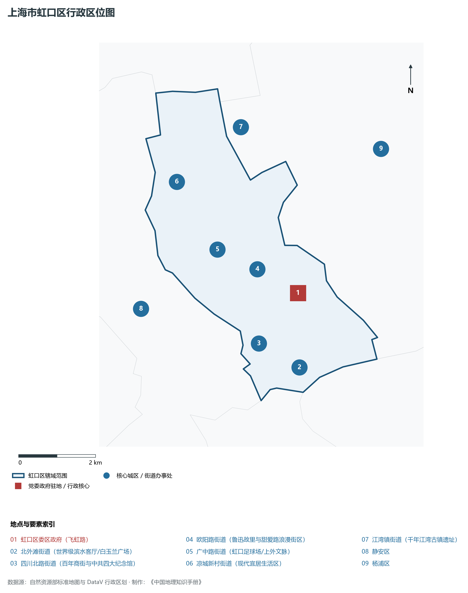
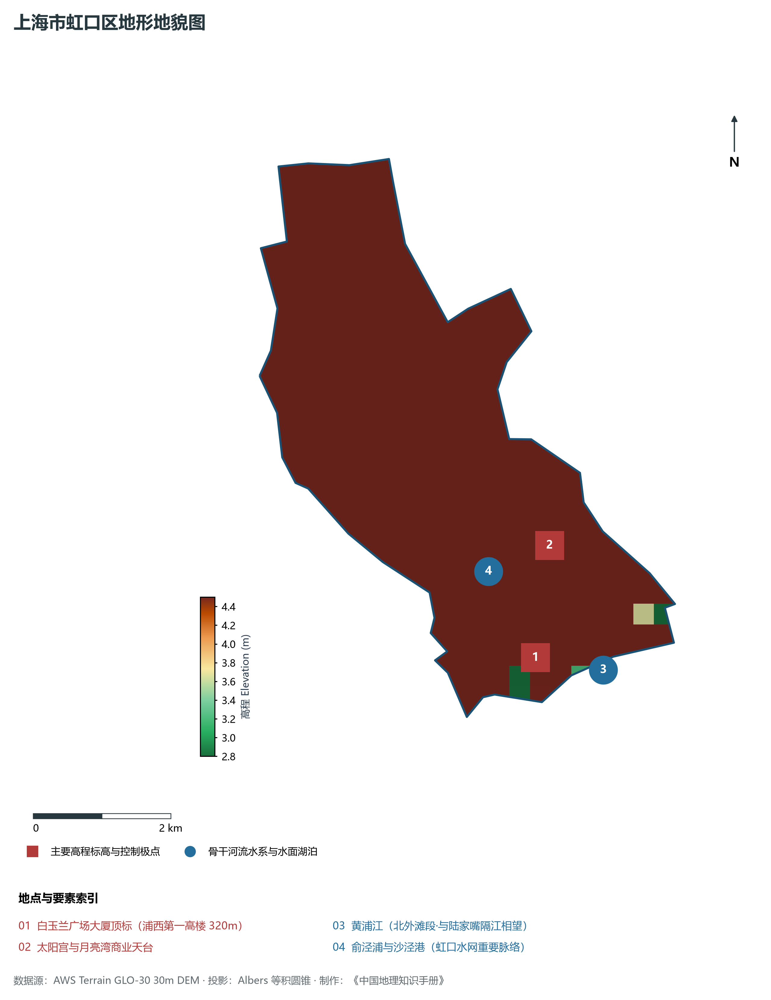
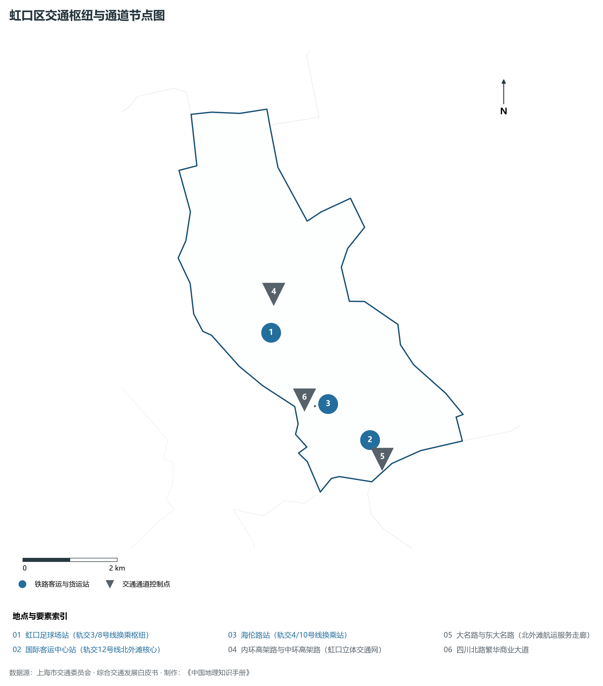
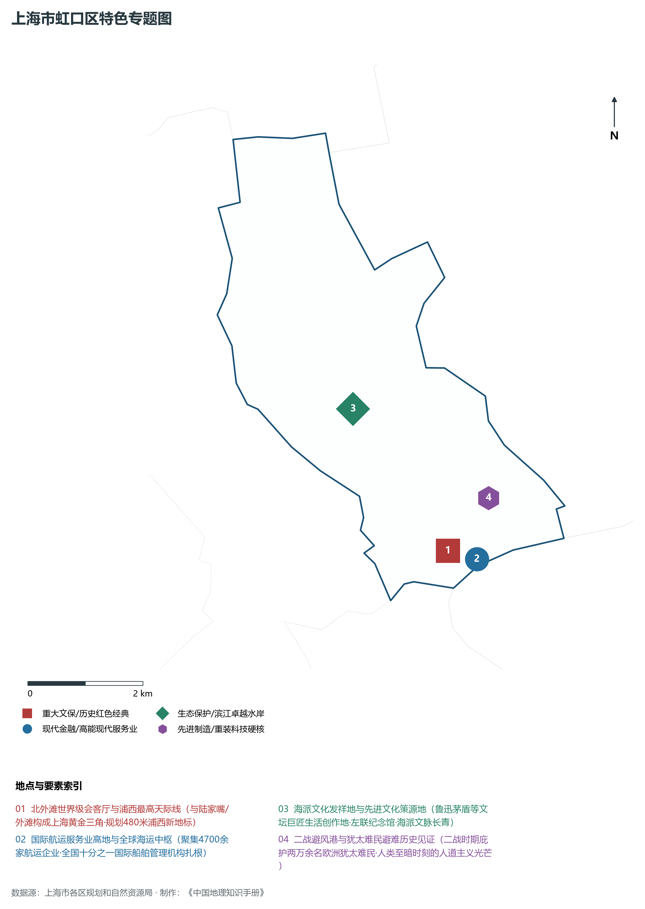
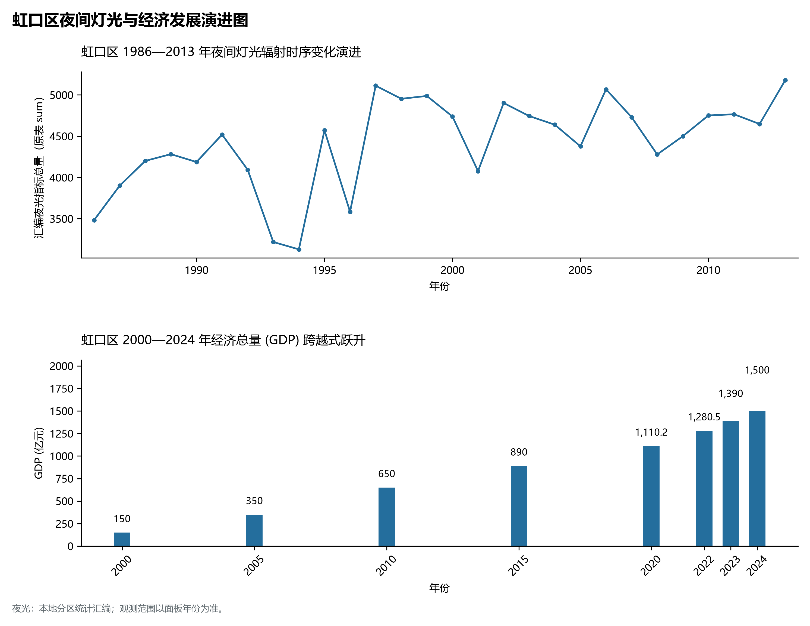

# 9.6 虹口区

虹口区，地处上海市关键战略板块，其区域综合定位与发展格局概括为：**北外滩“世界级会客厅”·新时代都市发展新标杆·现代航运与绿色金融双引擎·海派文化发祥地**。全区陆地总面积达 **23.48 km²**，截至 2024 年末全区常住人口约 **75.7** 万人，常住人口城镇化率达 **100.0%**。2024 年实现地区生产总值（GDP）约 **1,500.0** 亿元，人均 GDP 突破 **198,100** 元，三次产业结构比为 **0.0 : 4.0 : 96.0**。全区自然地表标高介于 **2.8 m ～ 4.5 m** 之间，展现出江海交汇的平原水网机理与极高密度、极高能级的国际化大都市现代化产业核心基底。

---

## 一、自然地理环境与城市微地貌底盘

区域骨干控制性高程标高与标志性天际极点包括：

- **白玉兰广场大厦顶标 (浦西第一高楼 320m)**（空间坐标约东经 121.495°、北纬 31.248°，控制标高约 4.5 m）：构成区域微地貌与现代垂直天际线的重要基准控制点；
- **太阳宫与月亮湾商业天台**（空间坐标约东经 121.500°、北纬 31.262°，控制标高约 4.0 m）：构成区域微地貌与现代垂直天际线的重要基准控制点；

水系水网与生态廊道方面，虹口区江河交织、水网如织：

- **黄浦江 (北外滩段·与陆家嘴隔江相望)**（水域坐标约东经 121.505°、北纬 31.245°）：发挥防汛排涝、航运通航、生态水景与城市水岸活力营造的核心支撑功能；
- **俞泾浦与沙泾港 (虹口水网重要脉络)**（水域坐标约东经 121.490°、北纬 31.260°）：发挥防汛排涝、航运通航、生态水景与城市水岸活力营造的核心支撑功能；

---

## 二、历史文脉演进与城市功能空间重塑

虹口区历史文化底蕴深厚，在上海从古代江南海滨村落向近代国际商埠、现代社会主义现代化国际大都市跃升的历史进程中扮演了不可替代的关键角色。伴随历次城市总体规划演化与“一江一河”世界级卓越水岸贯通、城市更新纵深推进，构建了权责明晰、功能复合的街道社区与城镇空间治理网络：

- **虹口区委区政府 (飞虹路)**（驻地坐标：121.498°E, 31.265°N）：区域政治治理、高品质公共服务与综合经济管理的关键极核；
- **北外滩街道 (世界级滨水客厅/白玉兰广场)**（驻地坐标：121.495°E, 31.248°N）：区域政治治理、高品质公共服务与综合经济管理的关键极核；
- **四川北路街道 (百年商街与中共四大纪念馆)**（驻地坐标：121.485°E, 31.255°N）：区域政治治理、高品质公共服务与综合经济管理的关键极核；
- **欧阳路街道 (鲁迅故里与甜爱路浪漫街区)**（驻地坐标：121.488°E, 31.272°N）：区域政治治理、高品质公共服务与综合经济管理的关键极核；
- **广中路街道 (虹口足球场/上外文脉)**（驻地坐标：121.478°E, 31.278°N）：区域政治治理、高品质公共服务与综合经济管理的关键极核；
- **凉城新村街道 (现代宜居生活区)**（驻地坐标：121.470°E, 31.295°N）：区域政治治理、高品质公共服务与综合经济管理的关键极核；
- **江湾镇街道 (千年江湾古镇遗址)**（驻地坐标：121.490°E, 31.305°N）：区域政治治理、高品质公共服务与综合经济管理的关键极核；

在空间开发保护总体格局上，虹口区坚定贯彻“人民城市人民建，人民城市为人民”重要理念，持续推动空间集约紧凑发展、精细化微更新与生态韧性安全构筑，高水准推进产城融合与人居环境改善。

---

## 三、综合立体交通网络与枢纽门户功能

虹口区紧密依托上海超大规模立体交通网络，形成了多维交织的轨道交通、城市快速路、骨干主干道与骨干对外客货运大通道：

**核心综合客运交通枢纽与关键站点：**

- **虹口足球场站 (轨交3/8号线换乘枢纽)**（位置坐标：121.478°E, 31.273°N）：区域客货运流量组织与换乘集散的关键节点；
- **国际客运中心站 (轨交12号线北外滩核心)**（位置坐标：121.496°E, 31.250°N）：区域客货运流量组织与换乘集散的关键节点；
- **海伦路站 (轨交4/10号线换乘站)**（位置坐标：121.488°E, 31.258°N）：区域客货运流量组织与换乘集散的关键节点；

**骨干交通走廊与快速路网通道：**

- **内环高架路与中环高架路 (虹口立体交通网)**（走廊控制点：121.480°E, 31.280°N）：承担跨区快速通勤与大容量经济要素流动的高速骨架；
- **大名路与东大名路 (北外滩航运服务走廊)**（走廊控制点：121.498°E, 31.246°N）：承担跨区快速通勤与大容量经济要素流动的高速骨架；
- **四川北路繁华商业大道**（走廊控制点：121.485°E, 31.258°N）：承担跨区快速通勤与大容量经济要素流动的高速骨架；

---

## 四、现代产业体系与新质生产力布局

虹口区立足全市“五个中心”建设战略布局，全力发展新质生产力，积极构建以实体经济为支撑、现代服务业为主导或先进制造业为脊梁的高能级现代产业体系：

**重大科技园区与高新技术产业集聚平台：**

- **北外滩航运与金融双重服务核心集聚区**（园区坐标：121.496°E, 31.248°N）：集聚顶尖创新资源、推动成果转化与新经济孵化的主阵地；
- **中远海运集团总部与国际航运机构集群**（园区坐标：121.500°E, 31.246°N）：集聚顶尖创新资源、推动成果转化与新经济孵化的主阵地；
- **大柏树数智科创孵化走廊**（园区坐标：121.485°E, 31.290°N）：集聚顶尖创新资源、推动成果转化与新经济孵化的主阵地；

**标志性特色主题要素与领航龙头优势：**

- **北外滩世界级会客厅与浦西最高天际线**（空间坐标：121.495°E, 31.248°N）：与陆家嘴/外滩构成上海黄金三角·规划480米浦西新地标；
- **国际航运服务业高地与全球海运中枢**（空间坐标：121.500°E, 31.246°N）：聚集4700余家航运企业·全国十分之一国际船舶管理机构扎根；
- **海派文化发祥地与先进文化策源地**（空间坐标：121.482°E, 31.272°N）：鲁迅茅盾等文坛巨匠生活创作地·左联纪念馆·海派文脉长青；
- **二战避风港与犹太难民避难历史见证**（空间坐标：121.504°E, 31.255°N）：二战时期庇护两万余名欧洲犹太难民·人类至暗时刻的人道主义光芒；

---

## 五、历史文化底蕴、名胜古迹与全域文旅地理

虹口区文商旅交相辉映，历史风貌保护区与现代化公共文化设施融为一体，拥有享誉海内外的标志性文旅资源：

- **中共四大纪念馆 (全国爱国主义教育基地)**（地标坐标：121.486°E, 31.258°N）：彰显红色文脉、海派底蕴与生态景观的典范文旅空间；
- **鲁迅公园与鲁迅故居·纪念馆**（地标坐标：121.482°E, 31.272°N）：彰显红色文脉、海派底蕴与生态景观的典范文旅空间；
- **上海邮政总局大楼 (全国重点文保·苏州河口)**（地标坐标：121.485°E, 31.246°N）：彰显红色文脉、海派底蕴与生态景观的典范文旅空间；
- **北外滩滨江绿地与巨型彩虹桥**（地标坐标：121.502°E, 31.244°N）：彰显红色文脉、海派底蕴与生态景观的典范文旅空间；
- **犹太难民纪念馆 (摩西会堂·世界二战记忆)**（地标坐标：121.504°E, 31.255°N）：彰显红色文脉、海派底蕴与生态景观的典范文旅空间；

虹口区持续推动以文塑旅、以旅彰文，打响“上海文化”品牌，不断拓宽文旅消费新场景，提升城区软实力与国际美誉度。

---

## 六、夜间灯光辐射与跨世纪经济变化时序演进

本节夜光图的观测年份为 1986—2013 年，指标为行政区汇总值（原表 sum）。

| 统计基准年份 | 地区生产总值 GDP (亿元) | 发展阶段主要特征与空间跃升标志 |
|:---|:---|:---|
| **2000 年** | 150.0 | 世纪之交产业重组与现代城市功能筑基 |
| **2005 年** | 350.0 | 世纪之交产业重组与现代城市功能筑基 |
| **2010 年** | 650.0 | 世博效应驱动城市更新与高端现代服务业集聚 |
| **2015 年** | 890.0 | 世博效应驱动城市更新与高端现代服务业集聚 |
| **2020 年** | 1,110.2 | 新发展格局下高质量发展与新质生产力全面成势 |
| **2022 年** | 1,280.5 | 新发展格局下高质量发展与新质生产力全面成势 |
| **2023 年** | 1,390.0 | 新发展格局下高质量发展与新质生产力全面成势 |
| **2024 年** | 1,500.0 | 新发展格局下高质量发展与新质生产力全面成势 |

