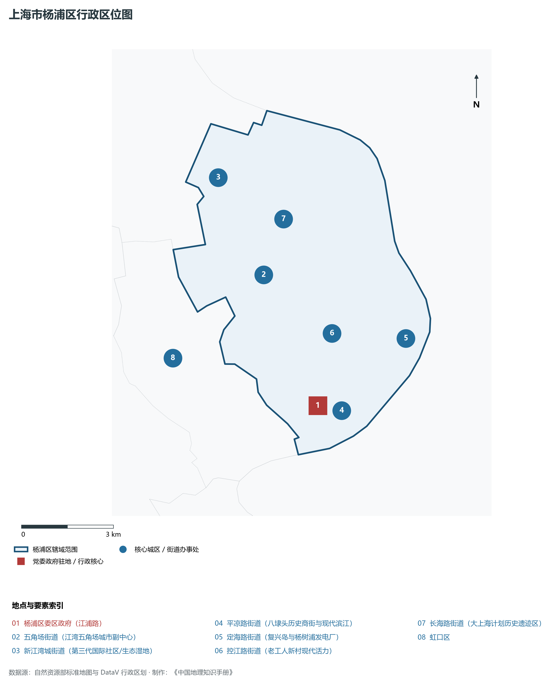
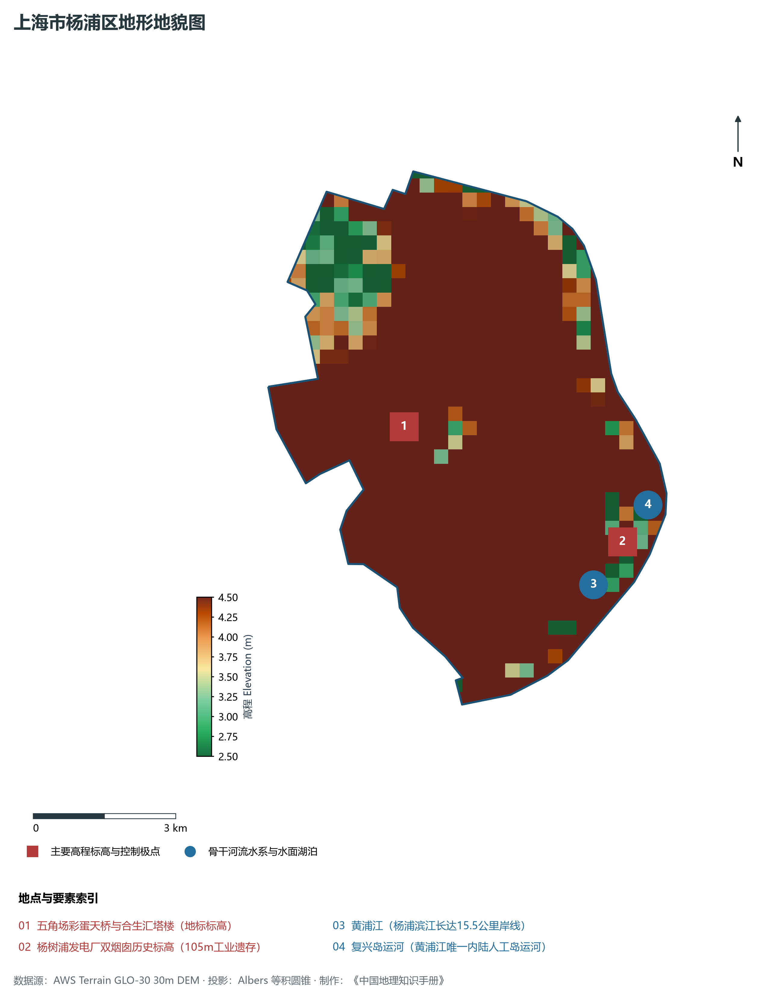
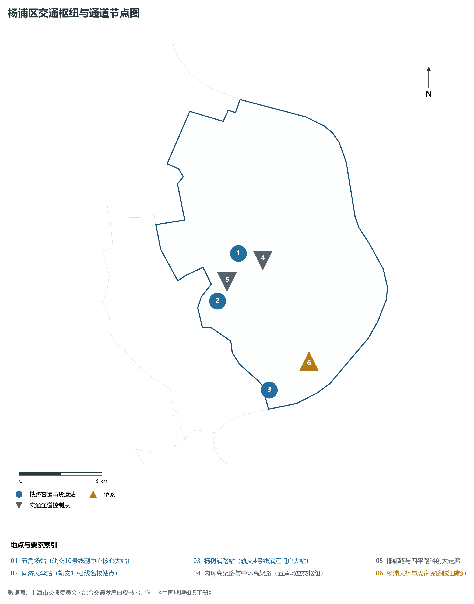
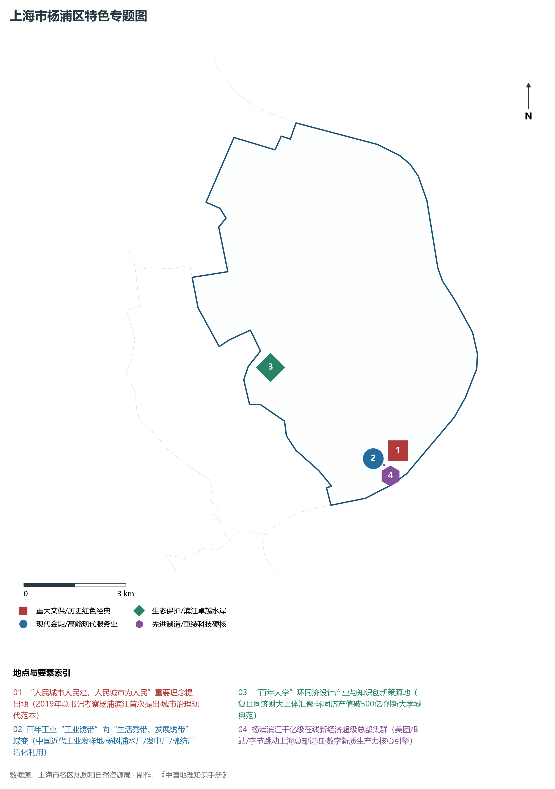
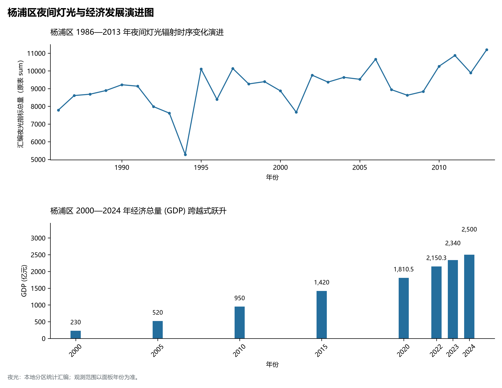

# 9.7 杨浦区

杨浦区，地处上海市关键战略板块，其区域综合定位与发展格局概括为：**“人民城市”重要理念首提地·百年大学·百年工业·百年根脉·杨浦滨江创新秀带·在线新经济集群**。全区陆地总面积达 **60.61 km²**，截至 2024 年末全区常住人口约 **121.7** 万人，常住人口城镇化率达 **100.0%**。2024 年实现地区生产总值（GDP）约 **2,500.0** 亿元，人均 GDP 突破 **205,400** 元，三次产业结构比为 **0.0 : 12.0 : 88.0**。全区自然地表标高介于 **2.5 m ～ 4.5 m** 之间，展现出江海交汇的平原水网机理与极高密度、极高能级的国际化大都市现代化产业核心基底。

---

## 一、自然地理环境与城市微地貌底盘

区域骨干控制性高程标高与标志性天际极点包括：

- **五角场彩蛋天桥与合生汇塔楼 (地标标高)**（空间坐标约东经 121.514°、北纬 31.300°，控制标高约 4.5 m）：构成区域微地貌与现代垂直天际线的重要基准控制点；
- **杨树浦发电厂双烟囱历史标高 (105m工业遗存)**（空间坐标约东经 121.558°、北纬 31.272°，控制标高约 4.8 m）：构成区域微地貌与现代垂直天际线的重要基准控制点；

水系水网与生态廊道方面，杨浦区江河交织、水网如织：

- **黄浦江 (杨浦滨江长达15.5公里岸线)**（水域坐标约东经 121.550°、北纬 31.265°）：发挥防汛排涝、航运通航、生态水景与城市水岸活力营造的核心支撑功能；
- **复兴岛运河 (黄浦江唯一内陆人工岛运河)**（水域坐标约东经 121.565°、北纬 31.278°）：发挥防汛排涝、航运通航、生态水景与城市水岸活力营造的核心支撑功能；

---

## 二、历史文脉演进与城市功能空间重塑

杨浦区历史文化底蕴深厚，在上海从古代江南海滨村落向近代国际商埠、现代社会主义现代化国际大都市跃升的历史进程中扮演了不可替代的关键角色。伴随历次城市总体规划演化与“一江一河”世界级卓越水岸贯通、城市更新纵深推进，构建了权责明晰、功能复合的街道社区与城镇空间治理网络：

- **杨浦区委区政府 (江浦路)**（驻地坐标：121.526°E, 31.260°N）：区域政治治理、高品质公共服务与综合经济管理的关键极核；
- **五角场街道 (江湾五角场城市副中心)**（驻地坐标：121.515°E, 31.300°N）：区域政治治理、高品质公共服务与综合经济管理的关键极核；
- **新江湾城街道 (第三代国际社区/生态湿地)**（驻地坐标：121.505°E, 31.330°N）：区域政治治理、高品质公共服务与综合经济管理的关键极核；
- **平凉路街道 (八埭头历史商街与现代滨江)**（驻地坐标：121.530°E, 31.258°N）：区域政治治理、高品质公共服务与综合经济管理的关键极核；
- **定海路街道 (复兴岛与杨树浦发电厂)**（驻地坐标：121.560°E, 31.275°N）：区域政治治理、高品质公共服务与综合经济管理的关键极核；
- **控江路街道 (老工人新村现代活力)**（驻地坐标：121.535°E, 31.280°N）：区域政治治理、高品质公共服务与综合经济管理的关键极核；
- **长海路街道 (大上海计划历史遗迹区)**（驻地坐标：121.525°E, 31.315°N）：区域政治治理、高品质公共服务与综合经济管理的关键极核；

在空间开发保护总体格局上，杨浦区坚定贯彻“人民城市人民建，人民城市为人民”重要理念，持续推动空间集约紧凑发展、精细化微更新与生态韧性安全构筑，高水准推进产城融合与人居环境改善。

---

## 三、综合立体交通网络与枢纽门户功能

杨浦区紧密依托上海超大规模立体交通网络，形成了多维交织的轨道交通、城市快速路、骨干主干道与骨干对外客货运大通道：

**核心综合客运交通枢纽与关键站点：**

- **五角场站 (轨交10号线副中心核心大站)**（位置坐标：121.515°E, 31.298°N）：区域客货运流量组织与换乘集散的关键节点；
- **同济大学站 (轨交10号线名校站点)**（位置坐标：121.504°E, 31.284°N）：区域客货运流量组织与换乘集散的关键节点；
- **杨树浦路站 (轨交4号线滨江门户大站)**（位置坐标：121.518°E, 31.253°N）：区域客货运流量组织与换乘集散的关键节点；

**骨干交通走廊与快速路网通道：**

- **内环高架路与中环高架路 (五角场立交枢纽)**（走廊控制点：121.520°E, 31.295°N）：承担跨区快速通勤与大容量经济要素流动的高速骨架；
- **杨浦大桥与周家嘴路越江隧道**（走廊控制点：121.535°E, 31.260°N）：承担跨区快速通勤与大容量经济要素流动的高速骨架；
- **邯郸路与四平路科创大走廊**（走廊控制点：121.505°E, 31.290°N）：承担跨区快速通勤与大容量经济要素流动的高速骨架；

---

## 四、现代产业体系与新质生产力布局

杨浦区立足全市“五个中心”建设战略布局，全力发展新质生产力，积极构建以实体经济为支撑、现代服务业为主导或先进制造业为脊梁的高能级现代产业体系：

**重大科技园区与高新技术产业集聚平台：**

- **杨浦滨江在线新经济生态园 (美团/抖音等总部)**（园区坐标：121.535°E, 31.255°N）：集聚顶尖创新资源、推动成果转化与新经济孵化的主阵地；
- **复旦软件园与湾谷科技园**（园区坐标：121.500°E, 31.345°N）：集聚顶尖创新资源、推动成果转化与新经济孵化的主阵地；
- **同济大学环同济知识经济圈 (设计之都百亿圈)**（园区坐标：121.505°E, 31.285°N）：集聚顶尖创新资源、推动成果转化与新经济孵化的主阵地；
- **创智天地与江湾大学科技创新集聚区**（园区坐标：121.512°E, 31.305°N）：集聚顶尖创新资源、推动成果转化与新经济孵化的主阵地；

**标志性特色主题要素与领航龙头优势：**

- **“人民城市人民建，人民城市为人民”重要理念提出地**（空间坐标：121.540°E, 31.258°N）：2019年总书记考察杨浦滨江首次提出·城市治理现代范本；
- **百年工业“工业锈带”向“生活秀带、发展绣带”蝶变**（空间坐标：121.535°E, 31.255°N）：中国近代工业发祥地·杨树浦水厂/发电厂/棉纺厂活化利用；
- **“百年大学”环同济设计产业与知识创新策源地**（空间坐标：121.505°E, 31.285°N）：复旦同济财大上体汇聚·环同济产值破500亿·创新大学城典范；
- **杨浦滨江千亿级在线新经济超级总部集群**（空间坐标：121.535°E, 31.255°N）：美团/B站/字节跳动上海总部进驻·数字新质生产力核心引擎；

---

## 五、历史文化底蕴、名胜古迹与全域文旅地理

杨浦区文商旅交相辉映，历史风貌保护区与现代化公共文化设施融为一体，拥有享誉海内外的标志性文旅资源：

- **杨树浦水厂 (全国重点文保·英式城堡式近代水厂)**（地标坐标：121.532°E, 31.252°N）：彰显红色文脉、海派底蕴与生态景观的典范文旅空间；
- **杨浦滨江公共空间 (人民城市重要理念首提地)**（地标坐标：121.540°E, 31.258°N）：彰显红色文脉、海派底蕴与生态景观的典范文旅空间；
- **旧上海特别市政府大楼 (大上海计划古典宫殿)**（地标坐标：121.523°E, 31.314°N）：彰显红色文脉、海派底蕴与生态景观的典范文旅空间；
- **共青森林公园 (4A·上海最大滨江森林生态公园)**（地标坐标：121.555°E, 31.325°N）：彰显红色文脉、海派底蕴与生态景观的典范文旅空间；

杨浦区持续推动以文塑旅、以旅彰文，打响“上海文化”品牌，不断拓宽文旅消费新场景，提升城区软实力与国际美誉度。

---

## 六、夜间灯光辐射与跨世纪经济变化时序演进

本节夜光图的观测年份为 1986—2013 年，指标为行政区汇总值（原表 sum）。

| 统计基准年份 | 地区生产总值 GDP (亿元) | 发展阶段主要特征与空间跃升标志 |
|:---|:---|:---|
| **2000 年** | 230.0 | 世纪之交产业重组与现代城市功能筑基 |
| **2005 年** | 520.0 | 世纪之交产业重组与现代城市功能筑基 |
| **2010 年** | 950.0 | 世博效应驱动城市更新与高端现代服务业集聚 |
| **2015 年** | 1,420.0 | 世博效应驱动城市更新与高端现代服务业集聚 |
| **2020 年** | 1,810.5 | 新发展格局下高质量发展与新质生产力全面成势 |
| **2022 年** | 2,150.3 | 新发展格局下高质量发展与新质生产力全面成势 |
| **2023 年** | 2,340.0 | 新发展格局下高质量发展与新质生产力全面成势 |
| **2024 年** | 2,500.0 | 新发展格局下高质量发展与新质生产力全面成势 |

