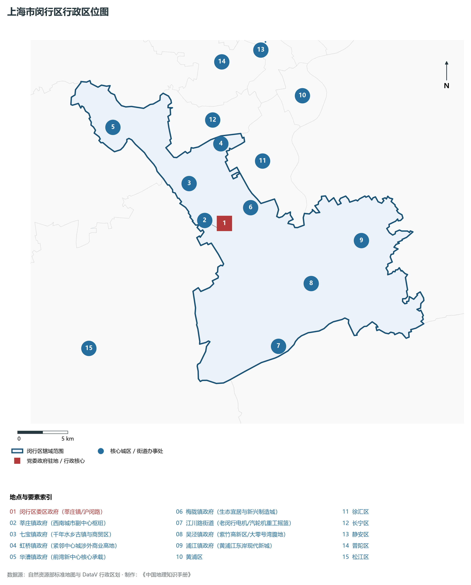
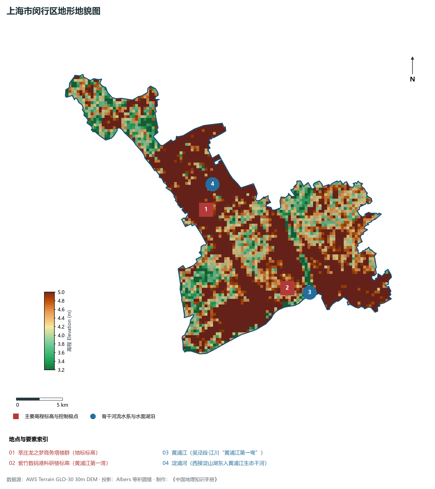
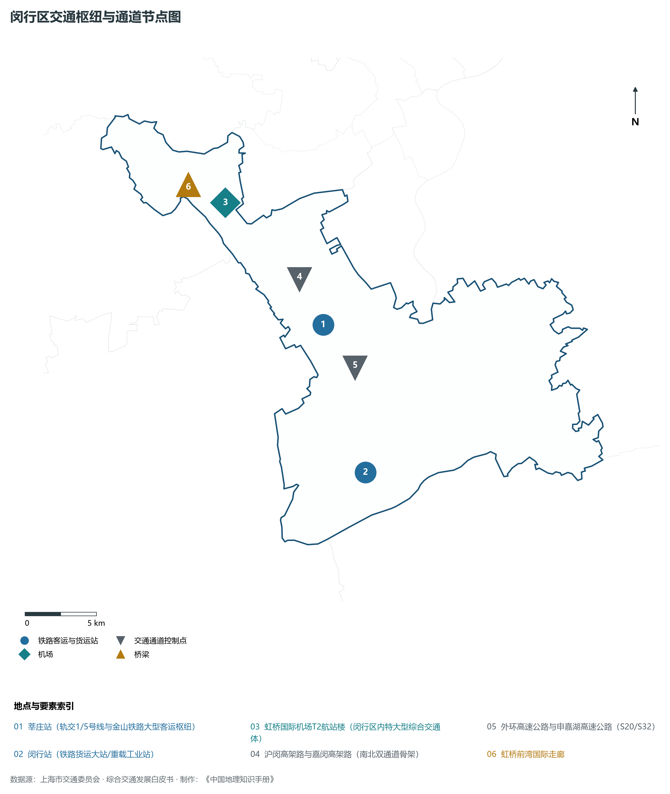
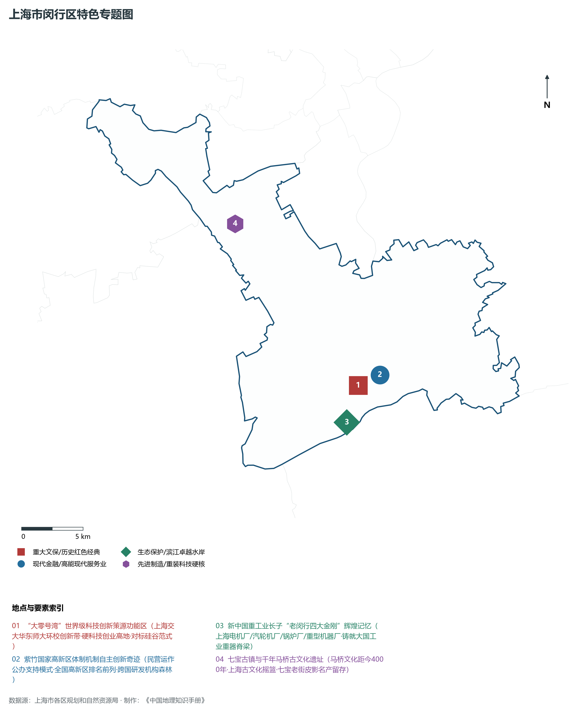
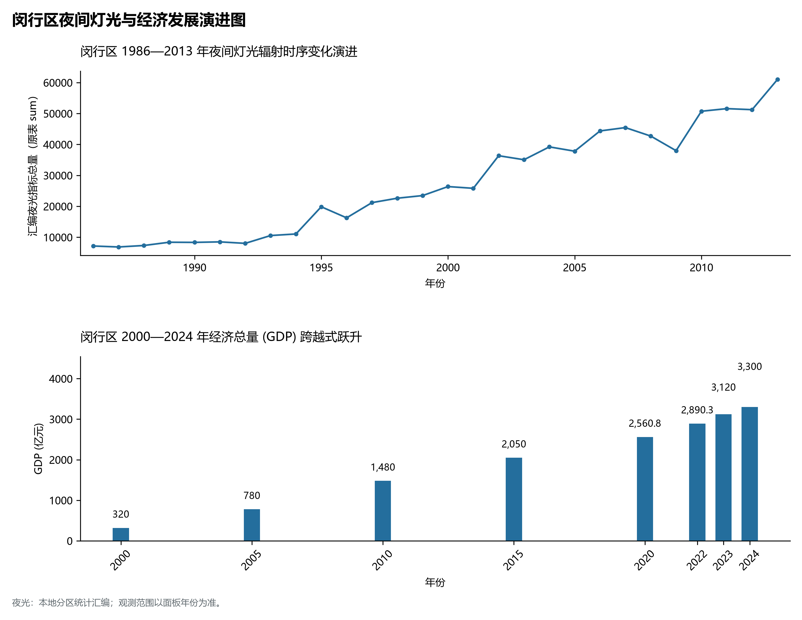

# 9.8 闵行区

闵行区，地处上海市关键战略板块，其区域综合定位与发展格局概括为：**虹桥国际开放枢纽南向带·“大零号湾”科技创新策源区·莘庄城市副中心·紫竹高新区与航空航天基地**。全区陆地总面积达 **372.56 km²**，截至 2024 年末全区常住人口约 **265.3** 万人，常住人口城镇化率达 **100.0%**。2024 年实现地区生产总值（GDP）约 **3,300.0** 亿元，人均 GDP 突破 **124,400** 元，三次产业结构比为 **0.1 : 38.5 : 61.4**。全区自然地表标高介于 **3.2 m ～ 5.0 m** 之间，展现出江海交汇的平原水网机理与极高密度、极高能级的国际化大都市现代化产业核心基底。

---

## 一、自然地理环境与城市微地貌底盘

区域骨干控制性高程标高与标志性天际极点包括：

- **莘庄龙之梦商务塔楼群 (地标标高)**（空间坐标约东经 121.378°、北纬 31.112°，控制标高约 4.8 m）：构成区域微地貌与现代垂直天际线的重要基准控制点；
- **紫竹数码港科研楼标高 (黄浦江第一湾)**（空间坐标约东经 121.455°、北纬 31.025°，控制标高约 4.5 m）：构成区域微地貌与现代垂直天际线的重要基准控制点；

水系水网与生态廊道方面，闵行区江河交织、水网如织：

- **黄浦江 (吴泾段·江川“黄浦江第一弯”)**（水域坐标约东经 121.460°、北纬 31.020°）：发挥防汛排涝、航运通航、生态水景与城市水岸活力营造的核心支撑功能；
- **淀浦河 (西接淀山湖东入黄浦江生态干河)**（水域坐标约东经 121.390°、北纬 31.135°）：发挥防汛排涝、航运通航、生态水景与城市水岸活力营造的核心支撑功能；

---

## 二、历史文脉演进与城市功能空间重塑

闵行区历史文化底蕴深厚，在上海从古代江南海滨村落向近代国际商埠、现代社会主义现代化国际大都市跃升的历史进程中扮演了不可替代的关键角色。伴随历次城市总体规划演化与“一江一河”世界级卓越水岸贯通、城市更新纵深推进，构建了权责明晰、功能复合的街道社区与城镇空间治理网络：

- **闵行区委区政府 (莘庄镇/沪闵路)**（驻地坐标：121.380°E, 31.115°N）：区域政治治理、高品质公共服务与综合经济管理的关键极核；
- **莘庄镇政府 (西南城市副中心枢纽)**（驻地坐标：121.375°E, 31.110°N）：区域政治治理、高品质公共服务与综合经济管理的关键极核；
- **七宝镇政府 (千年水乡古镇与商贸区)**（驻地坐标：121.350°E, 31.155°N）：区域政治治理、高品质公共服务与综合经济管理的关键极核；
- **虹桥镇政府 (紧邻中心城涉外商业高地)**（驻地坐标：121.390°E, 31.185°N）：区域政治治理、高品质公共服务与综合经济管理的关键极核；
- **华漕镇政府 (前湾新中心核心承载)**（驻地坐标：121.280°E, 31.215°N）：区域政治治理、高品质公共服务与综合经济管理的关键极核；
- **梅陇镇政府 (生态宜居与新兴制造城)**（驻地坐标：121.410°E, 31.125°N）：区域政治治理、高品质公共服务与综合经济管理的关键极核；
- **江川路街道 (老闵行电机/汽轮机重工摇篮)**（驻地坐标：121.415°E, 31.000°N）：区域政治治理、高品质公共服务与综合经济管理的关键极核；
- **吴泾镇政府 (紫竹高新区/大零号湾腹地)**（驻地坐标：121.460°E, 31.050°N）：区域政治治理、高品质公共服务与综合经济管理的关键极核；
- **浦江镇政府 (黄浦江东岸现代新城)**（驻地坐标：121.520°E, 31.080°N）：区域政治治理、高品质公共服务与综合经济管理的关键极核；

在空间开发保护总体格局上，闵行区坚定贯彻“人民城市人民建，人民城市为人民”重要理念，持续推动空间集约紧凑发展、精细化微更新与生态韧性安全构筑，高水准推进产城融合与人居环境改善。

---

## 三、综合立体交通网络与枢纽门户功能

闵行区紧密依托上海超大规模立体交通网络，形成了多维交织的轨道交通、城市快速路、骨干主干道与骨干对外客货运大通道：

**核心综合客运交通枢纽与关键站点：**

- **莘庄站 (轨交1/5号线与金山铁路大型客运枢纽)**（位置坐标：121.382°E, 31.110°N）：区域客货运流量组织与换乘集散的关键节点；
- **虹桥国际机场T2航站楼 (闵行区内特大型综合交通体)**（位置坐标：121.325°E, 31.195°N）：区域客货运流量组织与换乘集散的关键节点；
- **闵行站 (铁路货运大站/重载工业站)**（位置坐标：121.395°E, 31.015°N）：区域客货运流量组织与换乘集散的关键节点；

**骨干交通走廊与快速路网通道：**

- **沪闵高架路与嘉闵高架路 (南北双通道骨架)**（走廊控制点：121.370°E, 31.140°N）：承担跨区快速通勤与大容量经济要素流动的高速骨架；
- **外环高速公路与申嘉湖高速公路 (S20/S32)**（走廊控制点：121.400°E, 31.080°N）：承担跨区快速通勤与大容量经济要素流动的高速骨架；
- **虹桥前湾国际走廊**（走廊控制点：121.300°E, 31.210°N）：承担跨区快速通勤与大容量经济要素流动的高速骨架；

---

## 四、现代产业体系与新质生产力布局

闵行区立足全市“五个中心”建设战略布局，全力发展新质生产力，积极构建以实体经济为支撑、现代服务业为主导或先进制造业为脊梁的高能级现代产业体系：

**重大科技园区与高新技术产业集聚平台：**

- **“大零号湾”科技创新策源功能区 (交大/华师大依托)**（园区坐标：121.435°E, 31.025°N）：集聚顶尖创新资源、推动成果转化与新经济孵化的主阵地；
- **紫竹国家高新技术产业开发区 (英特尔/微软等研发)**（园区坐标：121.455°E, 31.030°N）：集聚顶尖创新资源、推动成果转化与新经济孵化的主阵地；
- **上海航天技术研究院 (中国航天第八研究院总部)**（园区坐标：121.390°E, 31.005°N）：集聚顶尖创新资源、推动成果转化与新经济孵化的主阵地；
- **上海电气上海重机重工基地 (四大金刚发祥地)**（园区坐标：121.420°E, 31.000°N）：集聚顶尖创新资源、推动成果转化与新经济孵化的主阵地；
- **虹桥前湾现代专业服务与医疗中心**（园区坐标：121.285°E, 31.220°N）：集聚顶尖创新资源、推动成果转化与新经济孵化的主阵地；

**标志性特色主题要素与领航龙头优势：**

- **“大零号湾”世界级科技创新策源功能区**（空间坐标：121.435°E, 31.025°N）：上海交大华东师大环校创新带·硬科技创业高地·对标硅谷范式；
- **紫竹国家高新区体制机制自主创新奇迹**（空间坐标：121.455°E, 31.030°N）：民营运作公办支持模式·全国高新区排名前列·跨国研发机构森林；
- **新中国重工业长子“老闵行四大金刚”辉煌记忆**（空间坐标：121.420°E, 31.000°N）：上海电机厂/汽轮机厂/锅炉厂/重型机器厂·铸就大国工业重器脊梁；
- **七宝古镇与千年马桥古文化遗址**（空间坐标：121.353°E, 31.155°N）：马桥文化距今4000年·上海古文化摇篮·七宝老街皮影名产留存；

---

## 五、历史文化底蕴、名胜古迹与全域文旅地理

闵行区文商旅交相辉映，历史风貌保护区与现代化公共文化设施融为一体，拥有享誉海内外的标志性文旅资源：

- **七宝老街古镇 (国家4A·江南水乡蒲汇塘畔)**（地标坐标：121.353°E, 31.155°N）：彰显红色文脉、海派底蕴与生态景观的典范文旅空间；
- **上海浦江第一湾生态公园**（地标坐标：121.465°E, 31.022°N）：彰显红色文脉、海派底蕴与生态景观的典范文旅空间；
- **韩湘水博园 (马桥古文化发祥地古典园林)**（地标坐标：121.365°E, 31.005°N）：彰显红色文脉、海派底蕴与生态景观的典范文旅空间；
- **召稼楼古镇 (浦江农耕文化策源名胜)**（地标坐标：121.545°E, 31.080°N）：彰显红色文脉、海派底蕴与生态景观的典范文旅空间；

闵行区持续推动以文塑旅、以旅彰文，打响“上海文化”品牌，不断拓宽文旅消费新场景，提升城区软实力与国际美誉度。

---

## 六、夜间灯光辐射与跨世纪经济变化时序演进

本节夜光图的观测年份为 1986—2013 年，指标为行政区汇总值（原表 sum）。

| 统计基准年份 | 地区生产总值 GDP (亿元) | 发展阶段主要特征与空间跃升标志 |
|:---|:---|:---|
| **2000 年** | 320.0 | 世纪之交产业重组与现代城市功能筑基 |
| **2005 年** | 780.0 | 世纪之交产业重组与现代城市功能筑基 |
| **2010 年** | 1,480.0 | 世博效应驱动城市更新与高端现代服务业集聚 |
| **2015 年** | 2,050.0 | 世博效应驱动城市更新与高端现代服务业集聚 |
| **2020 年** | 2,560.8 | 新发展格局下高质量发展与新质生产力全面成势 |
| **2022 年** | 2,890.3 | 新发展格局下高质量发展与新质生产力全面成势 |
| **2023 年** | 3,120.0 | 新发展格局下高质量发展与新质生产力全面成势 |
| **2024 年** | 3,300.0 | 新发展格局下高质量发展与新质生产力全面成势 |

