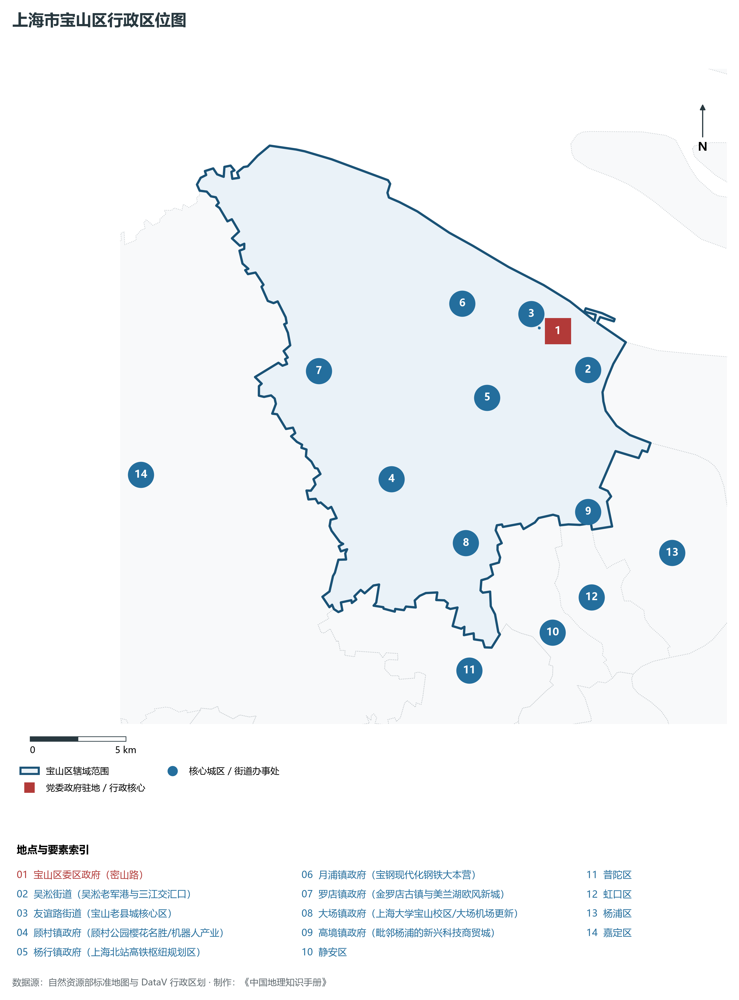
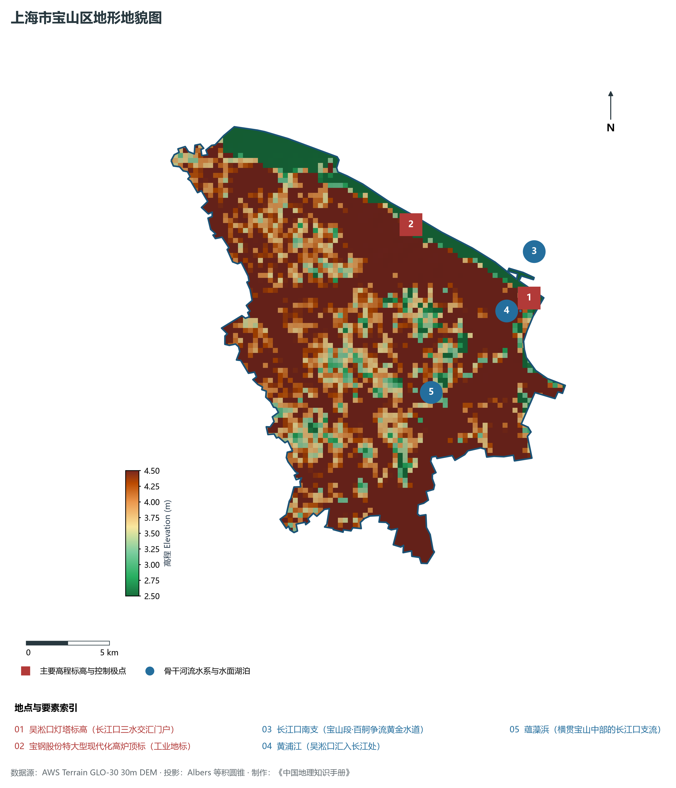
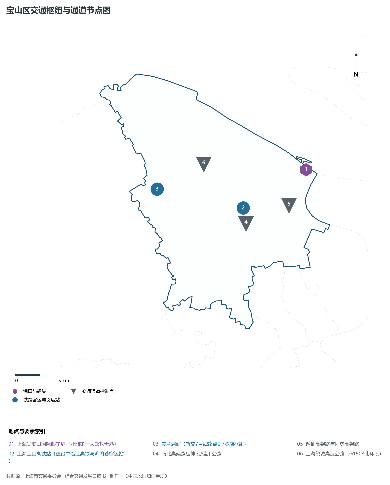
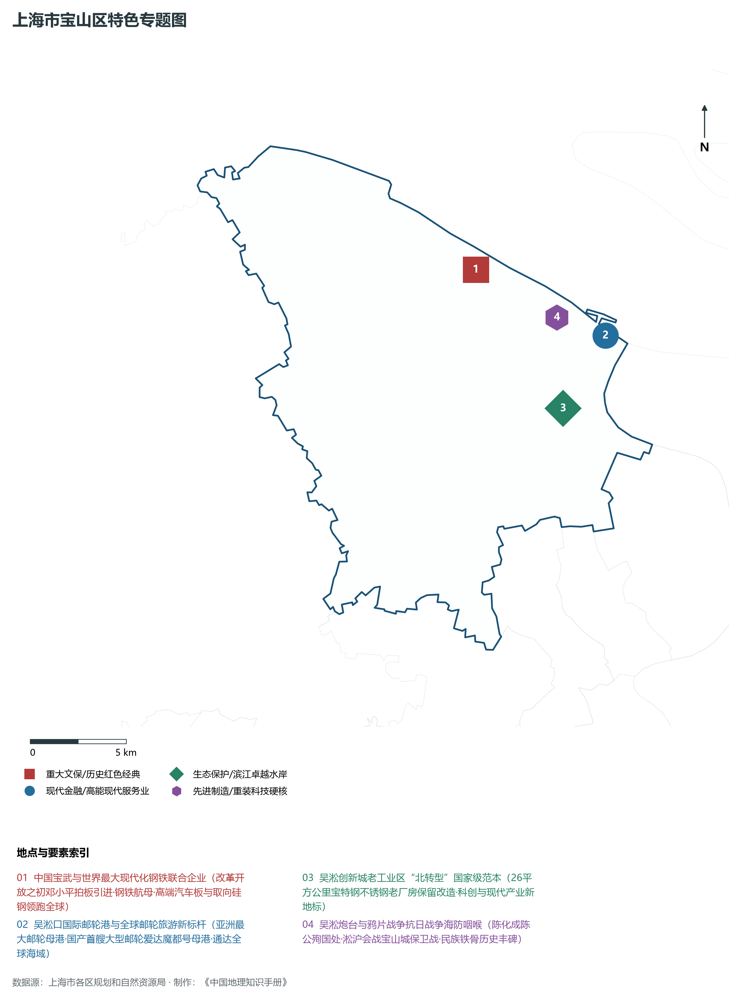
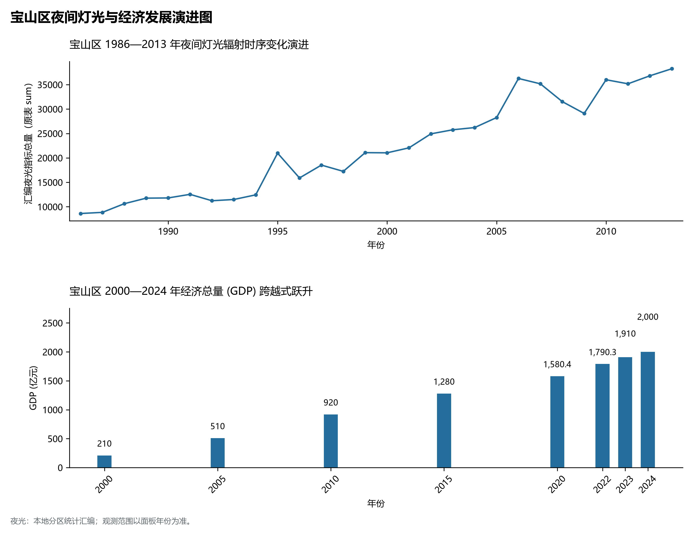

# 9.9 宝山区

宝山区，地处上海市关键战略板块，其区域综合定位与发展格局概括为：**“北转型”战略核心区·上海科创中心主阵地·宝钢集团绿色精品钢铁基地·吴淞创新城·国际邮轮母港**。全区陆地总面积达 **293.71 km²**，截至 2024 年末全区常住人口约 **227.0** 万人，常住人口城镇化率达 **100.0%**。2024 年实现地区生产总值（GDP）约 **2,000.0** 亿元，人均 GDP 突破 **88,100** 元，三次产业结构比为 **0.2 : 36.8 : 63.0**。全区自然地表标高介于 **2.5 m ～ 4.5 m** 之间，展现出江海交汇的平原水网机理与极高密度、极高能级的国际化大都市现代化产业核心基底。

---

## 一、自然地理环境与城市微地貌底盘

区域骨干控制性高程标高与标志性天际极点包括：

- **吴淞口灯塔标高 (长江口三水交汇门户)**（空间坐标约东经 121.512°、北纬 31.396°，控制标高约 4.5 m）：构成区域微地貌与现代垂直天际线的重要基准控制点；
- **宝钢股份特大型现代化高炉顶标 (工业地标)**（空间坐标约东经 121.445°、北纬 31.445°，控制标高约 5.0 m）：构成区域微地貌与现代垂直天际线的重要基准控制点；

水系水网与生态廊道方面，宝山区江河交织、水网如织：

- **长江口南支 (宝山段·百舸争流黄金水道)**（水域坐标约东经 121.520°、北纬 31.420°）：发挥防汛排涝、航运通航、生态水景与城市水岸活力营造的核心支撑功能；
- **黄浦江 (吴淞口汇入长江处)**（水域坐标约东经 121.505°、北纬 31.390°）：发挥防汛排涝、航运通航、生态水景与城市水岸活力营造的核心支撑功能；
- **蕴藻浜 (横贯宝山中部的长江口支流)**（水域坐标约东经 121.440°、北纬 31.355°）：发挥防汛排涝、航运通航、生态水景与城市水岸活力营造的核心支撑功能；

---

## 二、历史文脉演进与城市功能空间重塑

宝山区历史文化底蕴深厚，在上海从古代江南海滨村落向近代国际商埠、现代社会主义现代化国际大都市跃升的历史进程中扮演了不可替代的关键角色。伴随历次城市总体规划演化与“一江一河”世界级卓越水岸贯通、城市更新纵深推进，构建了权责明晰、功能复合的街道社区与城镇空间治理网络：

- **宝山区委区政府 (密山路)**（驻地坐标：121.485°E, 31.405°N）：区域政治治理、高品质公共服务与综合经济管理的关键极核；
- **吴淞街道 (吴淞老军港与三江交汇口)**（驻地坐标：121.498°E, 31.385°N）：区域政治治理、高品质公共服务与综合经济管理的关键极核；
- **友谊路街道 (宝山老县城核心区)**（驻地坐标：121.475°E, 31.408°N）：区域政治治理、高品质公共服务与综合经济管理的关键极核；
- **顾村镇政府 (顾村公园樱花名胜/机器人产业)**（驻地坐标：121.380°E, 31.350°N）：区域政治治理、高品质公共服务与综合经济管理的关键极核；
- **杨行镇政府 (上海北站高铁枢纽规划区)**（驻地坐标：121.440°E, 31.380°N）：区域政治治理、高品质公共服务与综合经济管理的关键极核；
- **月浦镇政府 (宝钢现代化钢铁大本营)**（驻地坐标：121.435°E, 31.425°N）：区域政治治理、高品质公共服务与综合经济管理的关键极核；
- **罗店镇政府 (金罗店古镇与美兰湖欧风新城)**（驻地坐标：121.350°E, 31.405°N）：区域政治治理、高品质公共服务与综合经济管理的关键极核；
- **大场镇政府 (上海大学宝山校区/大场机场更新)**（驻地坐标：121.415°E, 31.315°N）：区域政治治理、高品质公共服务与综合经济管理的关键极核；
- **高境镇政府 (毗邻杨浦的新兴科技商贸城)**（驻地坐标：121.485°E, 31.320°N）：区域政治治理、高品质公共服务与综合经济管理的关键极核；

在空间开发保护总体格局上，宝山区坚定贯彻“人民城市人民建，人民城市为人民”重要理念，持续推动空间集约紧凑发展、精细化微更新与生态韧性安全构筑，高水准推进产城融合与人居环境改善。

---

## 三、综合立体交通网络与枢纽门户功能

宝山区紧密依托上海超大规模立体交通网络，形成了多维交织的轨道交通、城市快速路、骨干主干道与骨干对外客货运大通道：

**核心综合客运交通枢纽与关键站点：**

- **上海吴淞口国际邮轮港 (亚洲第一大邮轮母港)**（位置坐标：121.510°E, 31.400°N）：区域客货运流量组织与换乘集散的关键节点；
- **上海宝山高铁站 (建设中沿江高铁与沪渝蓉客运站)**（位置坐标：121.435°E, 31.375°N）：区域客货运流量组织与换乘集散的关键节点；
- **美兰湖站 (轨交7号线终点站/罗店枢纽)**（位置坐标：121.345°E, 31.405°N）：区域客货运流量组织与换乘集散的关键节点；

**骨干交通走廊与快速路网通道：**

- **南北高架路延伸段/蕰川公路**（走廊控制点：121.435°E, 31.360°N）：承担跨区快速通勤与大容量经济要素流动的高速骨架；
- **逸仙高架路与同济高架路**（走廊控制点：121.485°E, 31.370°N）：承担跨区快速通勤与大容量经济要素流动的高速骨架；
- **上海绕城高速公路 (G1503北环段)**（走廊控制点：121.400°E, 31.420°N）：承担跨区快速通勤与大容量经济要素流动的高速骨架；

---

## 四、现代产业体系与新质生产力布局

宝山区立足全市“五个中心”建设战略布局，全力发展新质生产力，积极构建以实体经济为支撑、现代服务业为主导或先进制造业为脊梁的高能级现代产业体系：

**重大科技园区与高新技术产业集聚平台：**

- **中国宝武钢铁集团总部与绿色碳中和园区**（园区坐标：121.445°E, 31.440°N）：集聚顶尖创新资源、推动成果转化与新经济孵化的主阵地；
- **吴淞创新城 (特大型特钢厂不锈钢厂转型示范区)**（园区坐标：121.480°E, 31.370°N）：集聚顶尖创新资源、推动成果转化与新经济孵化的主阵地；
- **上海机器人产业园 (国家级工业机器人高地)**（园区坐标：121.390°E, 31.360°N）：集聚顶尖创新资源、推动成果转化与新经济孵化的主阵地；
- **南大智慧城 (大场老工业区转型数字孪生城)**（园区坐标：121.385°E, 31.300°N）：集聚顶尖创新资源、推动成果转化与新经济孵化的主阵地；

**标志性特色主题要素与领航龙头优势：**

- **中国宝武与世界最大现代化钢铁联合企业**（空间坐标：121.445°E, 31.440°N）：改革开放之初邓小平拍板引进·钢铁航母·高端汽车板与取向硅钢领跑全球；
- **吴淞口国际邮轮港与全球邮轮旅游新标杆**（空间坐标：121.510°E, 31.400°N）：亚洲最大邮轮母港·国产首艘大型邮轮爱达魔都号母港·通达全球海域；
- **吴淞创新城老工业区“北转型”国家级范本**（空间坐标：121.480°E, 31.370°N）：26平方公里宝特钢不锈钢老厂房保留改造·科创与现代产业新地标；
- **吴淞炮台与鸦片战争抗日战争海防咽喉**（空间坐标：121.485°E, 31.412°N）：陈化成陈公殉国处·淞沪会战宝山城保卫战·民族铁骨历史丰碑；

---

## 五、历史文化底蕴、名胜古迹与全域文旅地理

宝山区文商旅交相辉映，历史风貌保护区与现代化公共文化设施融为一体，拥有享誉海内外的标志性文旅资源：

- **吴淞炮台湾国家湿地公园 (4A·近代抗英抗日海防)**（地标坐标：121.500°E, 31.395°N）：彰显红色文脉、海派底蕴与生态景观的典范文旅空间；
- **顾村公园 (4A·上海樱花节举办胜地)**（地标坐标：121.375°E, 31.350°N）：彰显红色文脉、海派底蕴与生态景观的典范文旅空间；
- **罗店古镇与美兰湖景区 (4A·金罗店历史文脉)**（地标坐标：121.348°E, 31.408°N）：彰显红色文脉、海派底蕴与生态景观的典范文旅空间；
- **上海淞沪抗战纪念馆 (全国爱国主义教育基地)**（地标坐标：121.485°E, 31.412°N）：彰显红色文脉、海派底蕴与生态景观的典范文旅空间；

宝山区持续推动以文塑旅、以旅彰文，打响“上海文化”品牌，不断拓宽文旅消费新场景，提升城区软实力与国际美誉度。

---

## 六、夜间灯光辐射与跨世纪经济变化时序演进

本节夜光图的观测年份为 1986—2013 年，指标为行政区汇总值（原表 sum）。

| 统计基准年份 | 地区生产总值 GDP (亿元) | 发展阶段主要特征与空间跃升标志 |
|:---|:---|:---|
| **2000 年** | 210.0 | 世纪之交产业重组与现代城市功能筑基 |
| **2005 年** | 510.0 | 世纪之交产业重组与现代城市功能筑基 |
| **2010 年** | 920.0 | 世博效应驱动城市更新与高端现代服务业集聚 |
| **2015 年** | 1,280.0 | 世博效应驱动城市更新与高端现代服务业集聚 |
| **2020 年** | 1,580.4 | 新发展格局下高质量发展与新质生产力全面成势 |
| **2022 年** | 1,790.3 | 新发展格局下高质量发展与新质生产力全面成势 |
| **2023 年** | 1,910.0 | 新发展格局下高质量发展与新质生产力全面成势 |
| **2024 年** | 2,000.0 | 新发展格局下高质量发展与新质生产力全面成势 |

