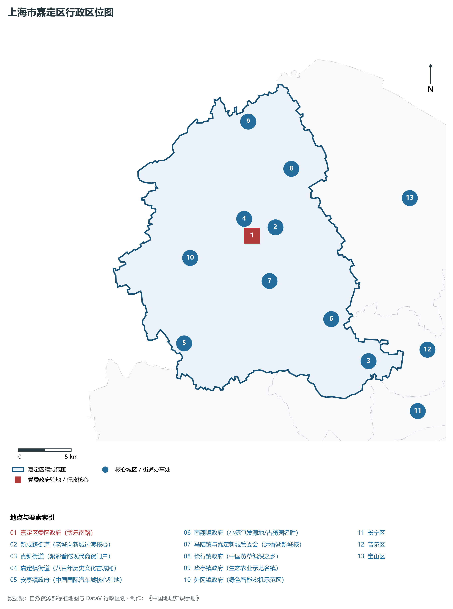
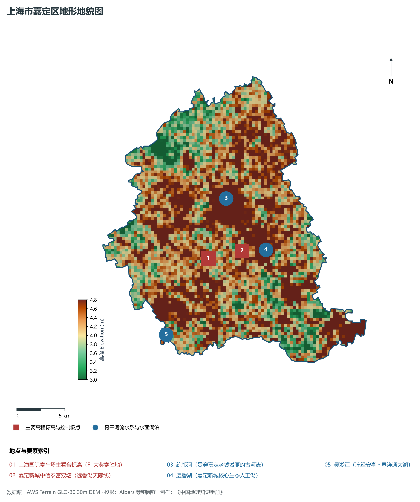
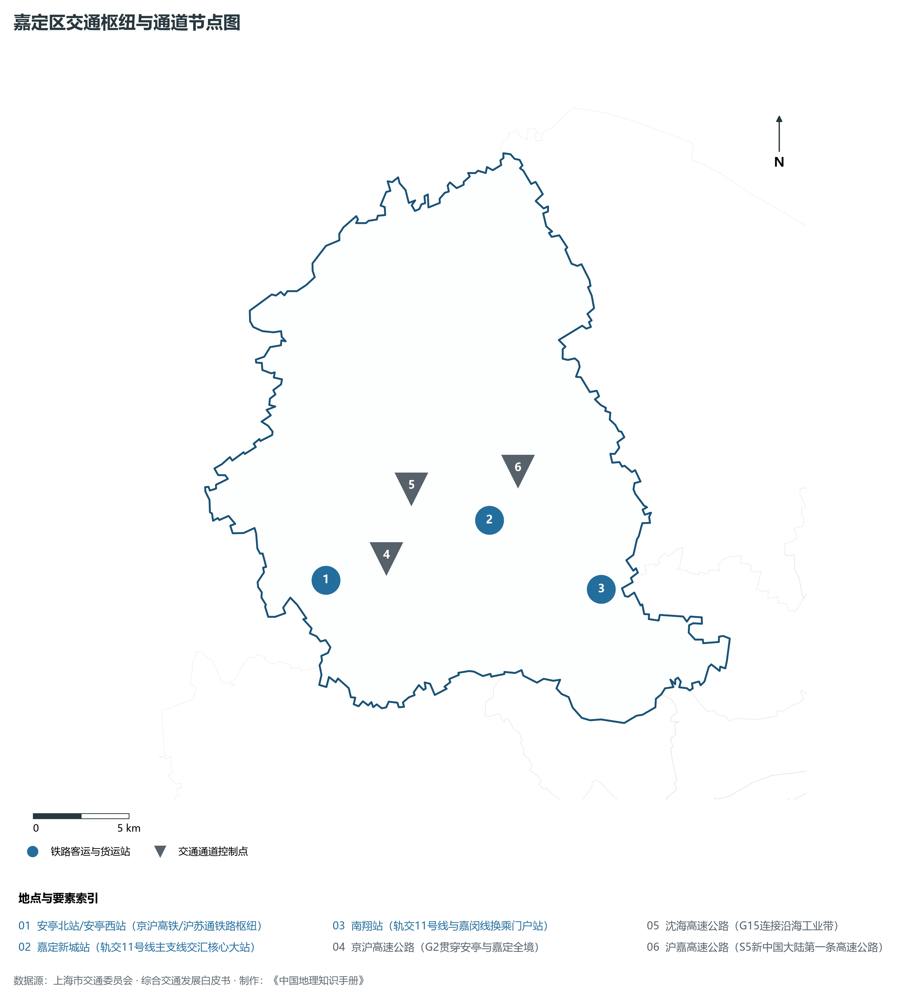
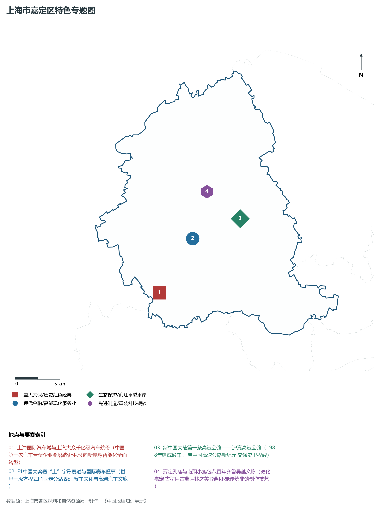
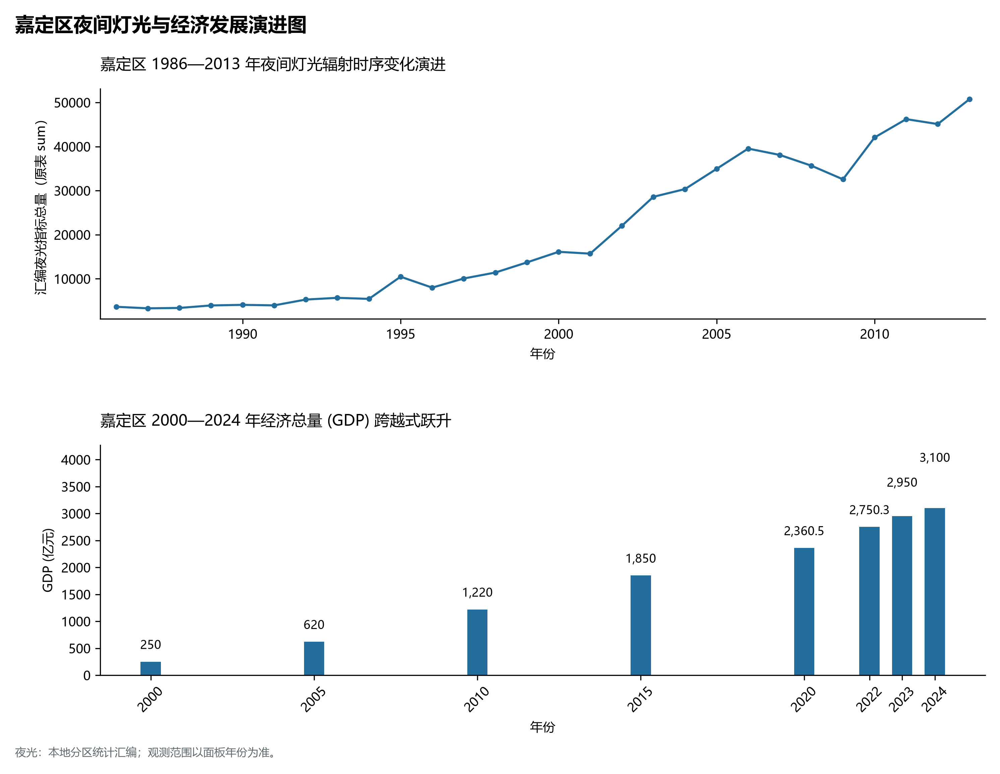

# 9.10 嘉定区

嘉定区，地处上海市关键战略板块，其区域综合定位与发展格局概括为：**“国际汽车城”·智能网联新能源汽车世界级产业集群·F1中国大奖赛举办地·嘉定新城·综合性科学卫星城**。全区陆地总面积达 **463.55 km²**，截至 2024 年末全区常住人口约 **187.5** 万人，常住人口城镇化率达 **92.5%**。2024 年实现地区生产总值（GDP）约 **3,100.0** 亿元，人均 GDP 突破 **165,300** 元，三次产业结构比为 **0.3 : 52.8 : 46.9**。全区自然地表标高介于 **3.0 m ～ 4.8 m** 之间，展现出江海交汇的平原水网机理与极高密度、极高能级的国际化大都市现代化产业核心基底。

---

## 一、自然地理环境与城市微地貌底盘

区域骨干控制性高程标高与标志性天际极点包括：

- **上海国际赛车场主看台标高 (F1大奖赛胜地)**（空间坐标约东经 121.220°、北纬 31.338°，控制标高约 4.5 m）：构成区域微地貌与现代垂直天际线的重要基准控制点；
- **嘉定新城中信泰富双塔 (远香湖天际线)**（空间坐标约东经 121.258°、北纬 31.340°，控制标高约 4.8 m）：构成区域微地貌与现代垂直天际线的重要基准控制点；

水系水网与生态廊道方面，嘉定区江河交织、水网如织：

- **练祁河 (贯穿嘉定老城城厢的古河流)**（水域坐标约东经 121.250°、北纬 31.390°）：发挥防汛排涝、航运通航、生态水景与城市水岸活力营造的核心支撑功能；
- **远香湖 (嘉定新城核心生态人工湖)**（水域坐标约东经 121.265°、北纬 31.340°）：发挥防汛排涝、航运通航、生态水景与城市水岸活力营造的核心支撑功能；
- **吴淞江 (流经安亭南界连通太湖)**（水域坐标约东经 121.160°、北纬 31.275°）：发挥防汛排涝、航运通航、生态水景与城市水岸活力营造的核心支撑功能；

---

## 二、历史文脉演进与城市功能空间重塑

嘉定区历史文化底蕴深厚，在上海从古代江南海滨村落向近代国际商埠、现代社会主义现代化国际大都市跃升的历史进程中扮演了不可替代的关键角色。伴随历次城市总体规划演化与“一江一河”世界级卓越水岸贯通、城市更新纵深推进，构建了权责明晰、功能复合的街道社区与城镇空间治理网络：

- **嘉定区委区政府 (博乐南路)**（驻地坐标：121.250°E, 31.375°N）：区域政治治理、高品质公共服务与综合经济管理的关键极核；
- **新成路街道 (老城向新城过渡核心)**（驻地坐标：121.265°E, 31.380°N）：区域政治治理、高品质公共服务与综合经济管理的关键极核；
- **真新街道 (紧邻普陀现代商贸门户)**（驻地坐标：121.345°E, 31.255°N）：区域政治治理、高品质公共服务与综合经济管理的关键极核；
- **嘉定镇街道 (八百年历史文化古城厢)**（驻地坐标：121.245°E, 31.390°N）：区域政治治理、高品质公共服务与综合经济管理的关键极核；
- **安亭镇政府 (中国国际汽车城核心驻地)**（驻地坐标：121.165°E, 31.295°N）：区域政治治理、高品质公共服务与综合经济管理的关键极核；
- **南翔镇政府 (小笼包发源地/古猗园名胜)**（驻地坐标：121.315°E, 31.295°N）：区域政治治理、高品质公共服务与综合经济管理的关键极核；
- **马陆镇与嘉定新城管委会 (远香湖新城核)**（驻地坐标：121.260°E, 31.335°N）：区域政治治理、高品质公共服务与综合经济管理的关键极核；
- **徐行镇政府 (中国黄草编织之乡)**（驻地坐标：121.300°E, 31.425°N）：区域政治治理、高品质公共服务与综合经济管理的关键极核；
- **华亭镇政府 (生态农业示范名镇)**（驻地坐标：121.265°E, 31.470°N）：区域政治治理、高品质公共服务与综合经济管理的关键极核；
- **外冈镇政府 (绿色智能农机示范区)**（驻地坐标：121.185°E, 31.365°N）：区域政治治理、高品质公共服务与综合经济管理的关键极核；

在空间开发保护总体格局上，嘉定区坚定贯彻“人民城市人民建，人民城市为人民”重要理念，持续推动空间集约紧凑发展、精细化微更新与生态韧性安全构筑，高水准推进产城融合与人居环境改善。

---

## 三、综合立体交通网络与枢纽门户功能

嘉定区紧密依托上海超大规模立体交通网络，形成了多维交织的轨道交通、城市快速路、骨干主干道与骨干对外客货运大通道：

**核心综合客运交通枢纽与关键站点：**

- **安亭北站/安亭西站 (京沪高铁/沪苏通铁路枢纽)**（位置坐标：121.165°E, 31.315°N）：区域客货运流量组织与换乘集散的关键节点；
- **嘉定新城站 (轨交11号线主支线交汇核心大站)**（位置坐标：121.260°E, 31.330°N）：区域客货运流量组织与换乘集散的关键节点；
- **南翔站 (轨交11号线与嘉闵线换乘门户站)**（位置坐标：121.315°E, 31.290°N）：区域客货运流量组织与换乘集散的关键节点；

**骨干交通走廊与快速路网通道：**

- **京沪高速公路 (G2贯穿安亭与嘉定全境)**（走廊控制点：121.200°E, 31.320°N）：承担跨区快速通勤与大容量经济要素流动的高速骨架；
- **沈海高速公路 (G15连接沿海工业带)**（走廊控制点：121.220°E, 31.350°N）：承担跨区快速通勤与大容量经济要素流动的高速骨架；
- **沪嘉高速公路 (S5新中国大陆第一条高速公路)**（走廊控制点：121.280°E, 31.350°N）：承担跨区快速通勤与大容量经济要素流动的高速骨架；

---

## 四、现代产业体系与新质生产力布局

嘉定区立足全市“五个中心”建设战略布局，全力发展新质生产力，积极构建以实体经济为支撑、现代服务业为主导或先进制造业为脊梁的高能级现代产业体系：

**重大科技园区与高新技术产业集聚平台：**

- **上海国际汽车城 (上汽大众总部/汽车研发基地)**（园区坐标：121.170°E, 31.290°N）：集聚顶尖创新资源、推动成果转化与新经济孵化的主阵地；
- **国家智能网联汽车(上海)试点示范区**（园区坐标：121.185°E, 31.305°N）：集聚顶尖创新资源、推动成果转化与新经济孵化的主阵地；
- **中科院上海硅酸盐所/微系统所/光机所基地**（园区坐标：121.240°E, 31.385°N）：集聚顶尖创新资源、推动成果转化与新经济孵化的主阵地；
- **嘉定工业区 (国家级高新技术产业基地)**（园区坐标：121.220°E, 31.420°N）：集聚顶尖创新资源、推动成果转化与新经济孵化的主阵地；

**标志性特色主题要素与领航龙头优势：**

- **上海国际汽车城与上汽大众千亿级汽车航母**（空间坐标：121.170°E, 31.290°N）：中国第一家汽车合资企业桑塔纳诞生地·向新能源智能化全面转型；
- **F1中国大奖赛“上”字形赛道与国际赛车盛事**（空间坐标：121.220°E, 31.338°N）：世界一级方程式F1固定分站·融汇赛车文化与高端汽车文旅；
- **新中国大陆第一条高速公路——沪嘉高速公路**（空间坐标：121.280°E, 31.350°N）：1988年建成通车·开启中国高速公路新纪元·交通史里程碑；
- **嘉定孔庙与南翔小笼包八百年齐鲁吴越文脉**（空间坐标：121.246°E, 31.382°N）：教化嘉定·古猗园古典园林之美·南翔小笼传统非遗制作技艺；

---

## 五、历史文化底蕴、名胜古迹与全域文旅地理

嘉定区文商旅交相辉映，历史风貌保护区与现代化公共文化设施融为一体，拥有享誉海内外的标志性文旅资源：

- **上海国际赛车场 (4A·世界级一级方程式赛道)**（地标坐标：121.220°E, 31.338°N）：彰显红色文脉、海派底蕴与生态景观的典范文旅空间；
- **古猗园 (4A·明代江南五大古典名园之一)**（地标坐标：121.316°E, 31.295°N）：彰显红色文脉、海派底蕴与生态景观的典范文旅空间；
- **嘉定孔庙 (全国重点文保·江南第一孔庙)**（地标坐标：121.246°E, 31.382°N）：彰显红色文脉、海派底蕴与生态景观的典范文旅空间；
- **嘉定博物馆与秋霞圃 (明代古名园)**（地标坐标：121.248°E, 31.392°N）：彰显红色文脉、海派底蕴与生态景观的典范文旅空间；
- **远香湖公园与保利大剧院 (安藤忠雄建筑作品)**（地标坐标：121.265°E, 31.340°N）：彰显红色文脉、海派底蕴与生态景观的典范文旅空间；

嘉定区持续推动以文塑旅、以旅彰文，打响“上海文化”品牌，不断拓宽文旅消费新场景，提升城区软实力与国际美誉度。

---

## 六、夜间灯光辐射与跨世纪经济变化时序演进

本节夜光图的观测年份为 1986—2013 年，指标为行政区汇总值（原表 sum）。

| 统计基准年份 | 地区生产总值 GDP (亿元) | 发展阶段主要特征与空间跃升标志 |
|:---|:---|:---|
| **2000 年** | 250.0 | 世纪之交产业重组与现代城市功能筑基 |
| **2005 年** | 620.0 | 世纪之交产业重组与现代城市功能筑基 |
| **2010 年** | 1,220.0 | 世博效应驱动城市更新与高端现代服务业集聚 |
| **2015 年** | 1,850.0 | 世博效应驱动城市更新与高端现代服务业集聚 |
| **2020 年** | 2,360.5 | 新发展格局下高质量发展与新质生产力全面成势 |
| **2022 年** | 2,750.3 | 新发展格局下高质量发展与新质生产力全面成势 |
| **2023 年** | 2,950.0 | 新发展格局下高质量发展与新质生产力全面成势 |
| **2024 年** | 3,100.0 | 新发展格局下高质量发展与新质生产力全面成势 |

