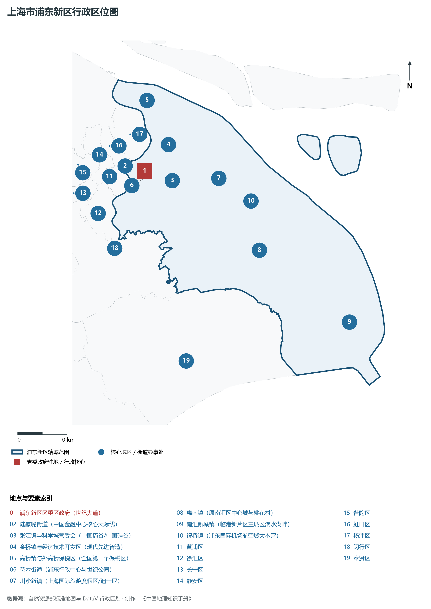
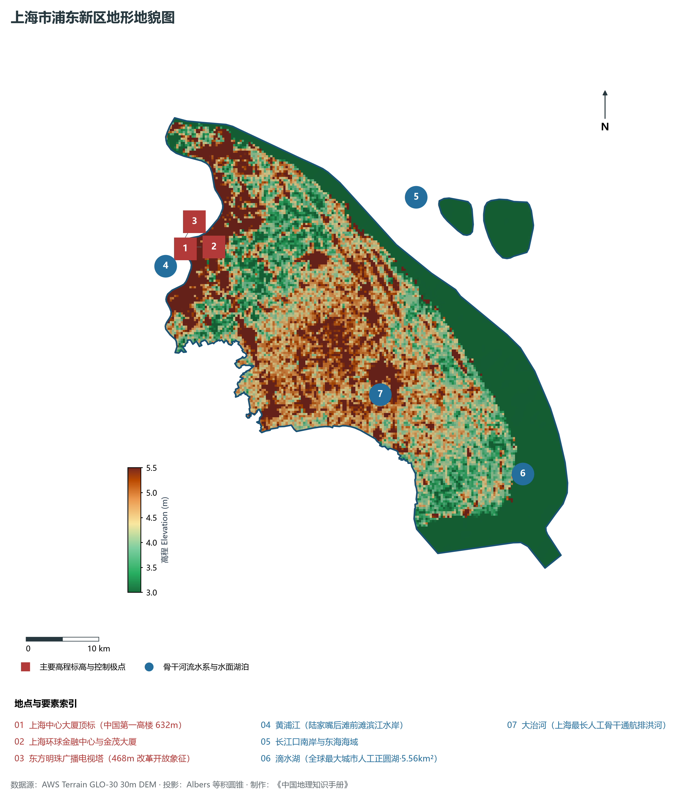
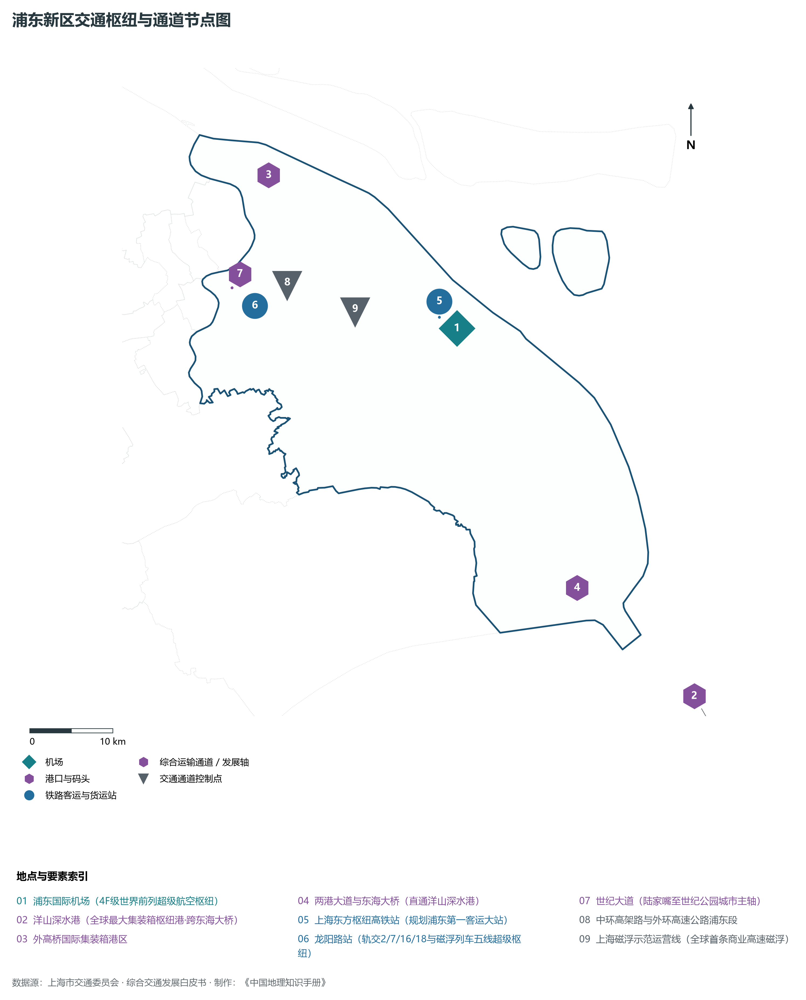
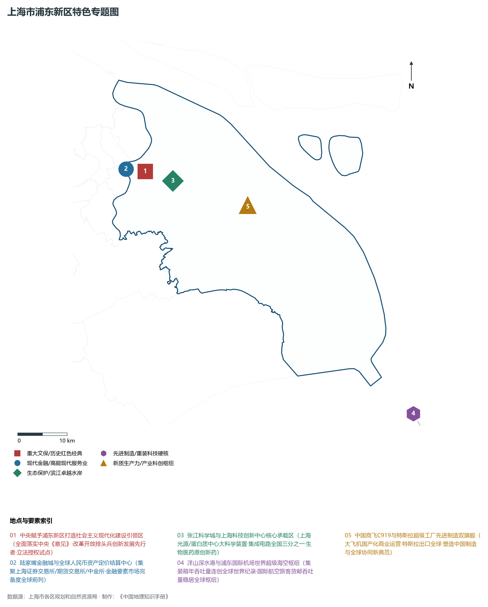
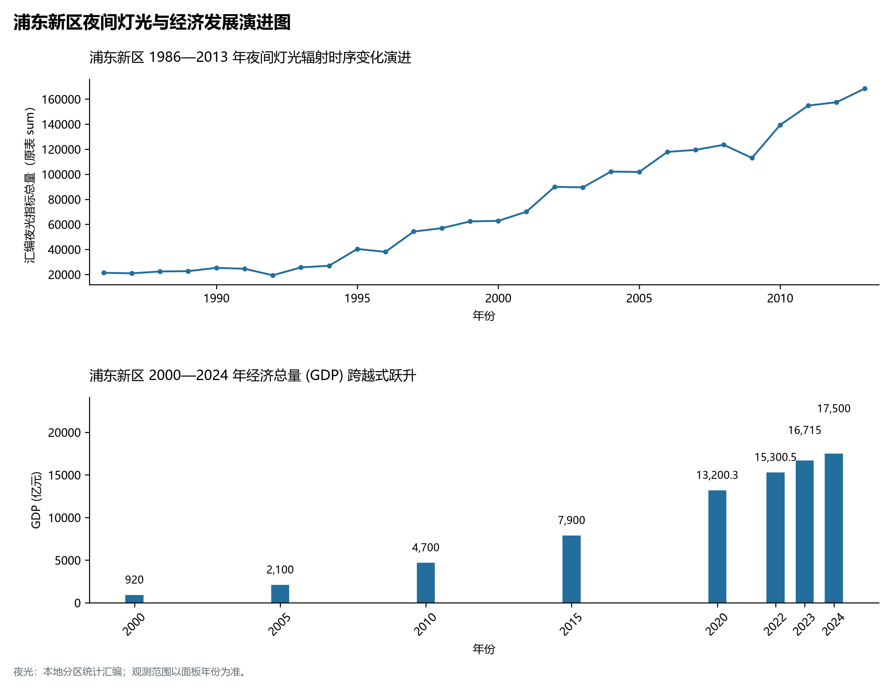

# 9.11 浦东新区

浦东新区，地处上海市关键战略板块，其区域综合定位与发展格局概括为：**社会主义现代化建设引领区·中国改革开放象征·陆家嘴金融贸易区·张江科学城·临港新片区·海空双国际枢纽**。全区陆地总面积达 **1,210.41 km²**，截至 2024 年末全区常住人口约 **578.2** 万人，常住人口城镇化率达 **93.0%**。2024 年实现地区生产总值（GDP）约 **17,500.0** 亿元，人均 GDP 突破 **302,700** 元，三次产业结构比为 **0.2 : 23.5 : 76.3**。全区自然地表标高介于 **3.0 m ～ 5.5 m** 之间，展现出江海交汇的平原水网机理与极高密度、极高能级的国际化大都市现代化产业核心基底。

---

## 一、自然地理环境与城市微地貌底盘

区域骨干控制性高程标高与标志性天际极点包括：

- **上海中心大厦顶标 (中国第一高楼 632m)**（空间坐标约东经 121.505°、北纬 31.235°，控制标高约 5.5 m）：构成区域微地貌与现代垂直天际线的重要基准控制点；
- **上海环球金融中心与金茂大厦**（空间坐标约东经 121.507°、北纬 31.237°，控制标高约 5.2 m）：构成区域微地貌与现代垂直天际线的重要基准控制点；
- **东方明珠广播电视塔 (468m 改革开放象征)**（空间坐标约东经 121.499°、北纬 31.240°，控制标高约 5.0 m）：构成区域微地貌与现代垂直天际线的重要基准控制点；

水系水网与生态廊道方面，浦东新区江河交织、水网如织：

- **黄浦江 (陆家嘴后滩前滩滨江水岸)**（水域坐标约东经 121.510°、北纬 31.230°）：发挥防汛排涝、航运通航、生态水景与城市水岸活力营造的核心支撑功能；
- **长江口南岸与东海海域**（水域坐标约东经 121.850°、北纬 31.250°）：发挥防汛排涝、航运通航、生态水景与城市水岸活力营造的核心支撑功能；
- **滴水湖 (全球最大城市人工正圆湖·5.56km²)**（水域坐标约东经 121.935°、北纬 30.895°）：发挥防汛排涝、航运通航、生态水景与城市水岸活力营造的核心支撑功能；
- **大治河 (上海最长人工骨干通航排洪河)**（水域坐标约东经 121.750°、北纬 31.020°）：发挥防汛排涝、航运通航、生态水景与城市水岸活力营造的核心支撑功能；

---

## 二、历史文脉演进与城市功能空间重塑

浦东新区历史文化底蕴深厚，在上海从古代江南海滨村落向近代国际商埠、现代社会主义现代化国际大都市跃升的历史进程中扮演了不可替代的关键角色。伴随历次城市总体规划演化与“一江一河”世界级卓越水岸贯通、城市更新纵深推进，构建了权责明晰、功能复合的街道社区与城镇空间治理网络：

- **浦东新区区委区政府 (世纪大道)**（驻地坐标：121.545°E, 31.225°N）：区域政治治理、高品质公共服务与综合经济管理的关键极核；
- **陆家嘴街道 (中国金融中心核心天际线)**（驻地坐标：121.505°E, 31.240°N）：区域政治治理、高品质公共服务与综合经济管理的关键极核；
- **张江镇与科学城管委会 (中国药谷/中国硅谷)**（驻地坐标：121.600°E, 31.200°N）：区域政治治理、高品质公共服务与综合经济管理的关键极核；
- **金桥镇与经济技术开发区 (现代先进智造)**（驻地坐标：121.605°E, 31.265°N）：区域政治治理、高品质公共服务与综合经济管理的关键极核；
- **高桥镇与外高桥保税区 (全国第一个保税区)**（驻地坐标：121.575°E, 31.350°N）：区域政治治理、高品质公共服务与综合经济管理的关键极核；
- **花木街道 (浦东行政中心与世纪公园)**（驻地坐标：121.550°E, 31.215°N）：区域政治治理、高品质公共服务与综合经济管理的关键极核；
- **川沙新镇 (上海国际旅游度假区/迪士尼)**（驻地坐标：121.700°E, 31.190°N）：区域政治治理、高品质公共服务与综合经济管理的关键极核；
- **惠南镇 (原南汇区中心城与桃花村)**（驻地坐标：121.760°E, 31.050°N）：区域政治治理、高品质公共服务与综合经济管理的关键极核；
- **南汇新城镇 (临港新片区主城区滴水湖畔)**（驻地坐标：121.925°E, 30.895°N）：区域政治治理、高品质公共服务与综合经济管理的关键极核；
- **祝桥镇 (浦东国际机场航空城大本营)**（驻地坐标：121.760°E, 31.140°N）：区域政治治理、高品质公共服务与综合经济管理的关键极核；

在空间开发保护总体格局上，浦东新区坚定贯彻“人民城市人民建，人民城市为人民”重要理念，持续推动空间集约紧凑发展、精细化微更新与生态韧性安全构筑，高水准推进产城融合与人居环境改善。

---

## 三、综合立体交通网络与枢纽门户功能

浦东新区紧密依托上海超大规模立体交通网络，形成了多维交织的轨道交通、城市快速路、骨干主干道与骨干对外客货运大通道：

**核心综合客运交通枢纽与关键站点：**

- **浦东国际机场 (4F级世界前列超级航空枢纽)**（位置坐标：121.805°E, 31.145°N）：区域客货运流量组织与换乘集散的关键节点；
- **洋山深水港 (全球最大集装箱枢纽港·跨东海大桥)**（位置坐标：122.065°E, 30.620°N）：区域客货运流量组织与换乘集散的关键节点；
- **上海东方枢纽高铁站 (规划浦东第一客运大站)**（位置坐标：121.785°E, 31.160°N）：区域客货运流量组织与换乘集散的关键节点；
- **外高桥国际集装箱港区**（位置坐标：121.600°E, 31.340°N）：区域客货运流量组织与换乘集散的关键节点；
- **龙阳路站 (轨交2/7/16/18与磁浮列车五线超级枢纽)**（位置坐标：121.555°E, 31.205°N）：区域客货运流量组织与换乘集散的关键节点；

**骨干交通走廊与快速路网通道：**

- **世纪大道 (陆家嘴至世纪公园城市主轴)**（走廊控制点：121.530°E, 31.228°N）：承担跨区快速通勤与大容量经济要素流动的高速骨架；
- **中环高架路与外环高速公路浦东段**（走廊控制点：121.600°E, 31.220°N）：承担跨区快速通勤与大容量经济要素流动的高速骨架；
- **两港大道与东海大桥 (直通洋山深水港)**（走廊控制点：121.900°E, 30.850°N）：承担跨区快速通勤与大容量经济要素流动的高速骨架；
- **上海磁浮示范运营线 (全球首条商业高速磁浮)**（走廊控制点：121.680°E, 31.180°N）：承担跨区快速通勤与大容量经济要素流动的高速骨架；

---

## 四、现代产业体系与新质生产力布局

浦东新区立足全市“五个中心”建设战略布局，全力发展新质生产力，积极构建以实体经济为支撑、现代服务业为主导或先进制造业为脊梁的高能级现代产业体系：

**重大科技园区与高新技术产业集聚平台：**

- **张江科学城 (国家实验室/张江高科技园区)**（园区坐标：121.600°E, 31.200°N）：集聚顶尖创新资源、推动成果转化与新经济孵化的主阵地；
- **中国(上海)自由贸易试验区临港新片区**（园区坐标：121.920°E, 30.900°N）：集聚顶尖创新资源、推动成果转化与新经济孵化的主阵地；
- **陆家嘴金融贸易区 (中国华尔街)**（园区坐标：121.505°E, 31.235°N）：集聚顶尖创新资源、推动成果转化与新经济孵化的主阵地；
- **外高桥保税区与海关特殊监管区**（园区坐标：121.585°E, 31.345°N）：集聚顶尖创新资源、推动成果转化与新经济孵化的主阵地；
- **金桥经济技术开发区 (智能新能源汽车高地)**（园区坐标：121.610°E, 31.260°N）：集聚顶尖创新资源、推动成果转化与新经济孵化的主阵地；
- **特斯拉上海超级工厂 (全球最大电动汽车单体工厂)**（园区坐标：121.770°E, 30.875°N）：集聚顶尖创新资源、推动成果转化与新经济孵化的主阵地；
- **中国商飞总装制造中心 (C919大型客机总装基地)**（园区坐标：121.750°E, 31.135°N）：集聚顶尖创新资源、推动成果转化与新经济孵化的主阵地；

**标志性特色主题要素与领航龙头优势：**

- **中央赋予浦东新区打造社会主义现代化建设引领区**（空间坐标：121.545°E, 31.225°N）：全面落实中央《意见》·改革开放排头兵创新发展先行者·立法授权试点；
- **陆家嘴金融城与全球人民币资产定价结算中心**（空间坐标：121.505°E, 31.235°N）：集聚上海证券交易所/期货交易所/中金所·金融要素市场完备度全球前列；
- **张江科学城与上海科技创新中心核心承载区**（空间坐标：121.600°E, 31.200°N）：上海光源/蛋白质中心大科学装置·集成电路全国三分之一·生物医药原创新药；
- **洋山深水港与浦东国际机场世界超级海空枢纽**（空间坐标：122.065°E, 30.620°N）：集装箱年吞吐量连创全球世界纪录·国际航空旅客货邮吞吐量稳居全球枢纽；
- **中国商飞C919与特斯拉超级工厂先进制造双旗舰**（空间坐标：121.750°E, 31.135°N）：大飞机国产化商业运营·特斯拉出口全球·塑造中国制造与全球协同新典范；

---

## 五、历史文化底蕴、名胜古迹与全域文旅地理

浦东新区文商旅交相辉映，历史风貌保护区与现代化公共文化设施融为一体，拥有享誉海内外的标志性文旅资源：

- **东方明珠与陆家嘴三件套 (全国地标·5A东方明珠)**（地标坐标：121.500°E, 31.238°N）：彰显红色文脉、海派底蕴与生态景观的典范文旅空间；
- **上海迪士尼度假区 (中国大陆首座迪士尼乐园)**（地标坐标：121.660°E, 31.145°N）：彰显红色文脉、海派底蕴与生态景观的典范文旅空间；
- **上海科技馆与世纪公园 (4A级自然与科技名片)**（地标坐标：121.545°E, 31.218°N）：彰显红色文脉、海派底蕴与生态景观的典范文旅空间；
- **上海天文馆 (全球建筑面积最大天文馆)**（地标坐标：121.915°E, 30.910°N）：彰显红色文脉、海派底蕴与生态景观的典范文旅空间；
- **滴水湖国家水利风景区 (中国航海博物馆)**（地标坐标：121.935°E, 30.895°N）：彰显红色文脉、海派底蕴与生态景观的典范文旅空间；

浦东新区持续推动以文塑旅、以旅彰文，打响“上海文化”品牌，不断拓宽文旅消费新场景，提升城区软实力与国际美誉度。

---

## 六、夜间灯光辐射与跨世纪经济变化时序演进

本节夜光图的观测年份为 1986—2013 年，指标为行政区汇总值（原表 sum）。

| 统计基准年份 | 地区生产总值 GDP (亿元) | 发展阶段主要特征与空间跃升标志 |
|:---|:---|:---|
| **2000 年** | 920.0 | 世纪之交产业重组与现代城市功能筑基 |
| **2005 年** | 2,100.0 | 世纪之交产业重组与现代城市功能筑基 |
| **2010 年** | 4,700.0 | 世博效应驱动城市更新与高端现代服务业集聚 |
| **2015 年** | 7,900.0 | 世博效应驱动城市更新与高端现代服务业集聚 |
| **2020 年** | 13,200.3 | 新发展格局下高质量发展与新质生产力全面成势 |
| **2022 年** | 15,300.5 | 新发展格局下高质量发展与新质生产力全面成势 |
| **2023 年** | 16,715.0 | 新发展格局下高质量发展与新质生产力全面成势 |
| **2024 年** | 17,500.0 | 新发展格局下高质量发展与新质生产力全面成势 |

