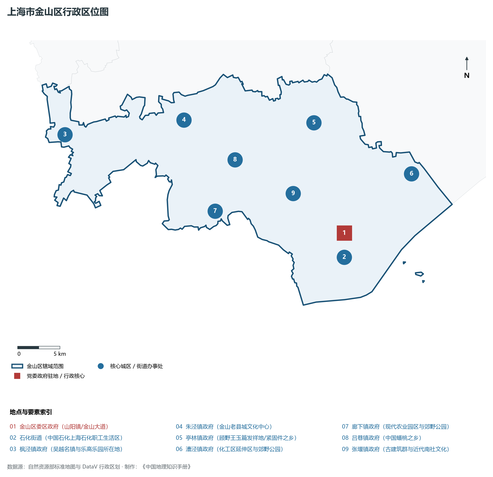
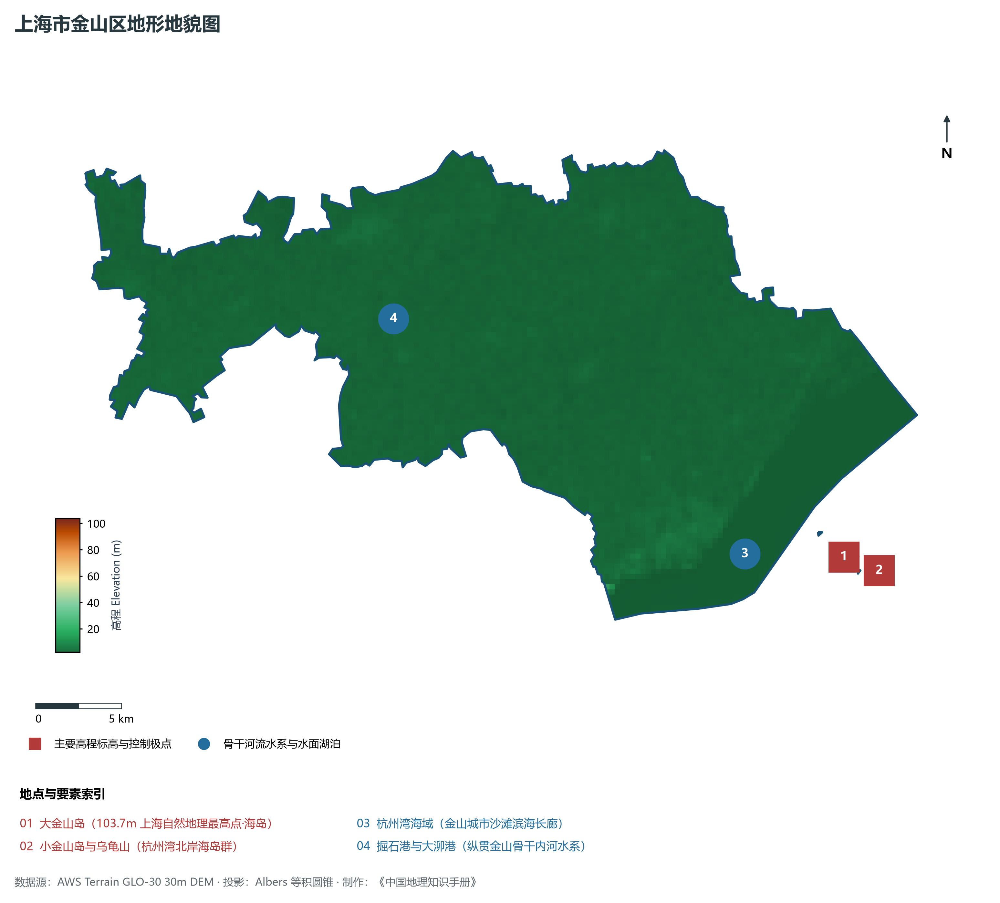
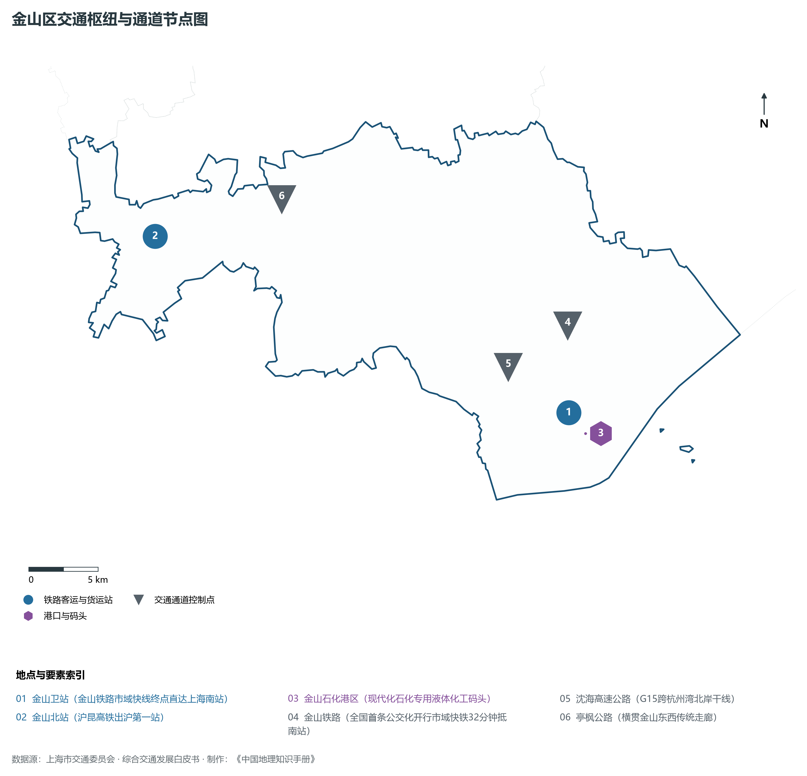
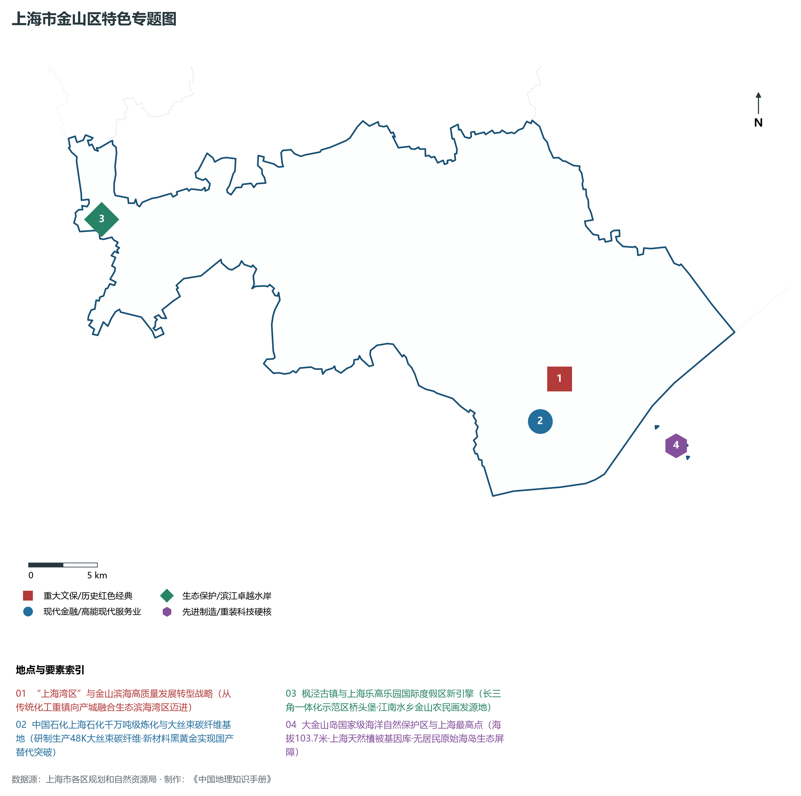
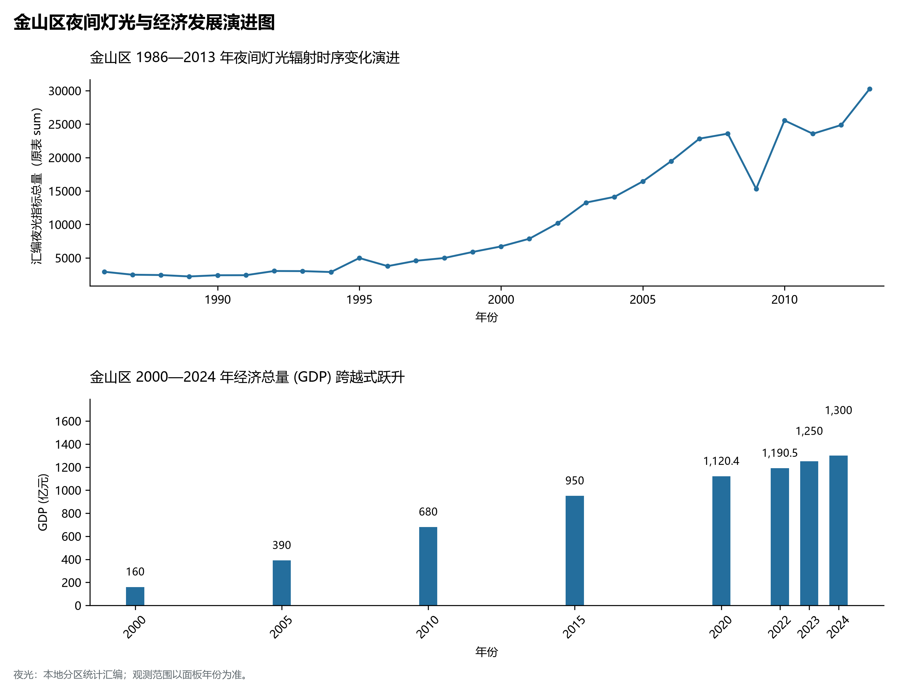

# 9.12 金山区

金山区，地处上海市关键战略板块，其区域综合定位与发展格局概括为：**“南北转型”战略承载地·“上海湾区”·上海石化绿色化工基地·高端碳纤维新材料·枫泾古镇与乐高乐园**。全区陆地总面积达 **613.10 km²**，截至 2024 年末全区常住人口约 **82.3** 万人，常住人口城镇化率达 **73.5%**。2024 年实现地区生产总值（GDP）约 **1,300.0** 亿元，人均 GDP 突破 **157,900** 元，三次产业结构比为 **2.1 : 62.5 : 35.4**。全区自然地表标高介于 **2.5 m ～ 103.7 m** 之间，展现出江海交汇的平原水网机理与极高密度、极高能级的国际化大都市现代化产业核心基底。

---

## 一、自然地理环境与城市微地貌底盘

区域骨干控制性高程标高与标志性天际极点包括：

- **大金山岛 (103.7m 上海自然地理最高点·海岛)**（空间坐标约东经 121.420°、北纬 30.690°，控制标高约 103.7 m）：构成区域微地貌与现代垂直天际线的重要基准控制点；
- **小金山岛与乌龟山 (杭州湾北岸海岛群)**（空间坐标约东经 121.440°、北纬 30.680°，控制标高约 34.0 m）：构成区域微地貌与现代垂直天际线的重要基准控制点；

水系水网与生态廊道方面，金山区江河交织、水网如织：

- **杭州湾海域 (金山城市沙滩滨海长廊)**（水域坐标约东经 121.360°、北纬 30.700°）：发挥防汛排涝、航运通航、生态水景与城市水岸活力营造的核心支撑功能；
- **掘石港与大泖港 (纵贯金山骨干内河水系)**（水域坐标约东经 121.170°、北纬 30.850°）：发挥防汛排涝、航运通航、生态水景与城市水岸活力营造的核心支撑功能；

---

## 二、历史文脉演进与城市功能空间重塑

金山区历史文化底蕴深厚，在上海从古代江南海滨村落向近代国际商埠、现代社会主义现代化国际大都市跃升的历史进程中扮演了不可替代的关键角色。伴随历次城市总体规划演化与“一江一河”世界级卓越水岸贯通、城市更新纵深推进，构建了权责明晰、功能复合的街道社区与城镇空间治理网络：

- **金山区委区政府 (山阳镇/金山大道)**（驻地坐标：121.340°E, 30.745°N）：区域政治治理、高品质公共服务与综合经济管理的关键极核；
- **石化街道 (中国石化上海石化职工生活区)**（驻地坐标：121.335°E, 30.720°N）：区域政治治理、高品质公共服务与综合经济管理的关键极核；
- **枫泾镇政府 (吴越名镇与乐高乐园所在地)**（驻地坐标：121.015°E, 30.895°N）：区域政治治理、高品质公共服务与综合经济管理的关键极核；
- **朱泾镇政府 (金山老县城文化中心)**（驻地坐标：121.165°E, 30.890°N）：区域政治治理、高品质公共服务与综合经济管理的关键极核；
- **亭林镇政府 (顾野王玉篇发祥地/紧固件之乡)**（驻地坐标：121.325°E, 30.865°N）：区域政治治理、高品质公共服务与综合经济管理的关键极核；
- **漕泾镇政府 (化工区延伸区与郊野公园)**（驻地坐标：121.435°E, 30.795°N）：区域政治治理、高品质公共服务与综合经济管理的关键极核；
- **廊下镇政府 (现代农业园区与郊野公园)**（驻地坐标：121.185°E, 30.790°N）：区域政治治理、高品质公共服务与综合经济管理的关键极核；
- **吕巷镇政府 (中国蟠桃之乡)**（驻地坐标：121.220°E, 30.840°N）：区域政治治理、高品质公共服务与综合经济管理的关键极核；
- **张堰镇政府 (古建筑群与近代南社文化)**（驻地坐标：121.285°E, 30.795°N）：区域政治治理、高品质公共服务与综合经济管理的关键极核；

在空间开发保护总体格局上，金山区坚定贯彻“人民城市人民建，人民城市为人民”重要理念，持续推动空间集约紧凑发展、精细化微更新与生态韧性安全构筑，高水准推进产城融合与人居环境改善。

---

## 三、综合立体交通网络与枢纽门户功能

金山区紧密依托上海超大规模立体交通网络，形成了多维交织的轨道交通、城市快速路、骨干主干道与骨干对外客货运大通道：

**核心综合客运交通枢纽与关键站点：**

- **金山卫站 (金山铁路市域快线终点直达上海南站)**（位置坐标：121.340°E, 30.725°N）：区域客货运流量组织与换乘集散的关键节点；
- **金山北站 (沪昆高铁出沪第一站)**（位置坐标：121.050°E, 30.880°N）：区域客货运流量组织与换乘集散的关键节点；
- **金山石化港区 (现代化石化专用液体化工码头)**（位置坐标：121.350°E, 30.710°N）：区域客货运流量组织与换乘集散的关键节点；

**骨干交通走廊与快速路网通道：**

- **金山铁路 (全国首条公交化开行市域快铁32分钟抵南站)**（走廊控制点：121.350°E, 30.780°N）：承担跨区快速通勤与大容量经济要素流动的高速骨架；
- **沈海高速公路 (G15跨杭州湾北岸干线)**（走廊控制点：121.300°E, 30.760°N）：承担跨区快速通勤与大容量经济要素流动的高速骨架；
- **亭枫公路 (横贯金山东西传统走廊)**（走廊控制点：121.150°E, 30.890°N）：承担跨区快速通勤与大容量经济要素流动的高速骨架；

---

## 四、现代产业体系与新质生产力布局

金山区立足全市“五个中心”建设战略布局，全力发展新质生产力，积极构建以实体经济为支撑、现代服务业为主导或先进制造业为脊梁的高能级现代产业体系：

**重大科技园区与高新技术产业集聚平台：**

- **中国石化上海石油化工股份有限公司基地**（园区坐标：121.320°E, 30.720°N）：集聚顶尖创新资源、推动成果转化与新经济孵化的主阵地；
- **上海碳谷绿湾产业园 (绿色高端精细化工)**（园区坐标：121.420°E, 30.780°N）：集聚顶尖创新资源、推动成果转化与新经济孵化的主阵地；
- **金山高新技术产业开发区 (无人机与生物医药)**（园区坐标：121.320°E, 30.820°N）：集聚顶尖创新资源、推动成果转化与新经济孵化的主阵地；
- **上海乐高乐园度假区 (长三角超级文旅IP建设中)**（园区坐标：121.035°E, 30.875°N）：集聚顶尖创新资源、推动成果转化与新经济孵化的主阵地；

**标志性特色主题要素与领航龙头优势：**

- **“上海湾区”与金山滨海高质量发展转型战略**（空间坐标：121.340°E, 30.745°N）：从传统化工重镇向产城融合生态滨海湾区迈进；
- **中国石化上海石化千万吨级炼化与大丝束碳纤维基地**（空间坐标：121.320°E, 30.720°N）：研制生产48K大丝束碳纤维·新材料黑黄金实现国产替代突破；
- **枫泾古镇与上海乐高乐园国际度假区新引擎**（空间坐标：121.012°E, 30.895°N）：长三角一体化示范区桥头堡·江南水乡金山农民画发源地；
- **大金山岛国家级海洋自然保护区与上海最高点**（空间坐标：121.420°E, 30.690°N）：海拔103.7米·上海天然植被基因库·无居民原始海岛生态屏障；

---

## 五、历史文化底蕴、名胜古迹与全域文旅地理

金山区文商旅交相辉映，历史风貌保护区与现代化公共文化设施融为一体，拥有享誉海内外的标志性文旅资源：

- **枫泾古镇风景区 (4A·吴越分界千年历史古镇)**（地标坐标：121.012°E, 30.895°N）：彰显红色文脉、海派底蕴与生态景观的典范文旅空间；
- **金山城市沙滩景区 (4A·人工景观金沙滩海滨)**（地标坐标：121.345°E, 30.715°N）：彰显红色文脉、海派底蕴与生态景观的典范文旅空间；
- **东林寺景区 (4A·朱泾镇元代名刹/吉尼斯金铜佛像)**（地标坐标：121.168°E, 30.895°N）：彰显红色文脉、海派底蕴与生态景观的典范文旅空间；
- **金山嘴渔村 (4A·上海最后一个活态渔村)**（地标坐标：121.370°E, 30.725°N）：彰显红色文脉、海派底蕴与生态景观的典范文旅空间；
- **廊下郊野公园 (全国首家开园的现代农业郊野公园)**（地标坐标：121.180°E, 30.775°N）：彰显红色文脉、海派底蕴与生态景观的典范文旅空间；

金山区持续推动以文塑旅、以旅彰文，打响“上海文化”品牌，不断拓宽文旅消费新场景，提升城区软实力与国际美誉度。

---

## 六、夜间灯光辐射与跨世纪经济变化时序演进

本节夜光图的观测年份为 1986—2013 年，指标为行政区汇总值（原表 sum）。

| 统计基准年份 | 地区生产总值 GDP (亿元) | 发展阶段主要特征与空间跃升标志 |
|:---|:---|:---|
| **2000 年** | 160.0 | 世纪之交产业重组与现代城市功能筑基 |
| **2005 年** | 390.0 | 世纪之交产业重组与现代城市功能筑基 |
| **2010 年** | 680.0 | 世博效应驱动城市更新与高端现代服务业集聚 |
| **2015 年** | 950.0 | 世博效应驱动城市更新与高端现代服务业集聚 |
| **2020 年** | 1,120.4 | 新发展格局下高质量发展与新质生产力全面成势 |
| **2022 年** | 1,190.5 | 新发展格局下高质量发展与新质生产力全面成势 |
| **2023 年** | 1,250.0 | 新发展格局下高质量发展与新质生产力全面成势 |
| **2024 年** | 1,300.0 | 新发展格局下高质量发展与新质生产力全面成势 |

