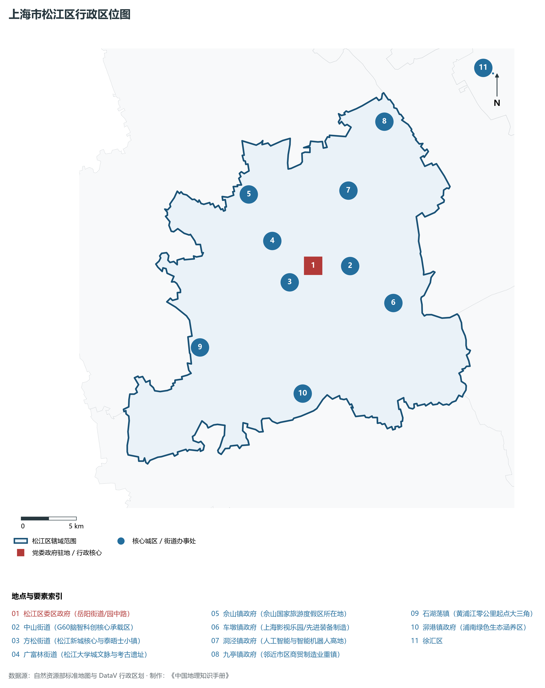
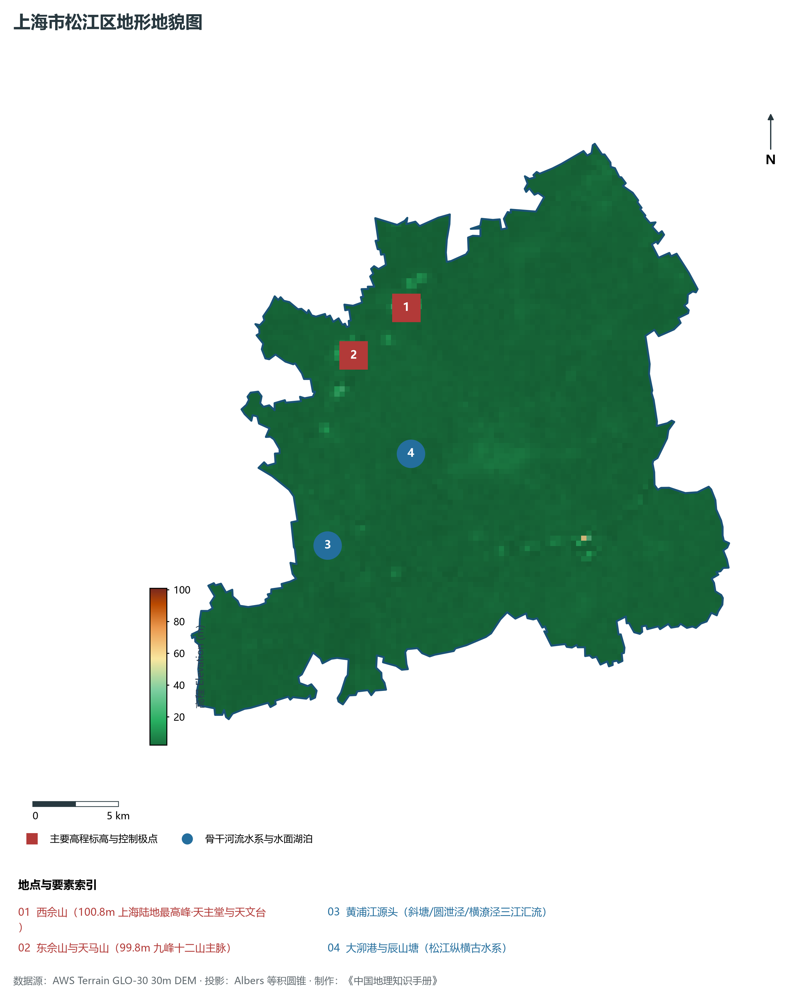
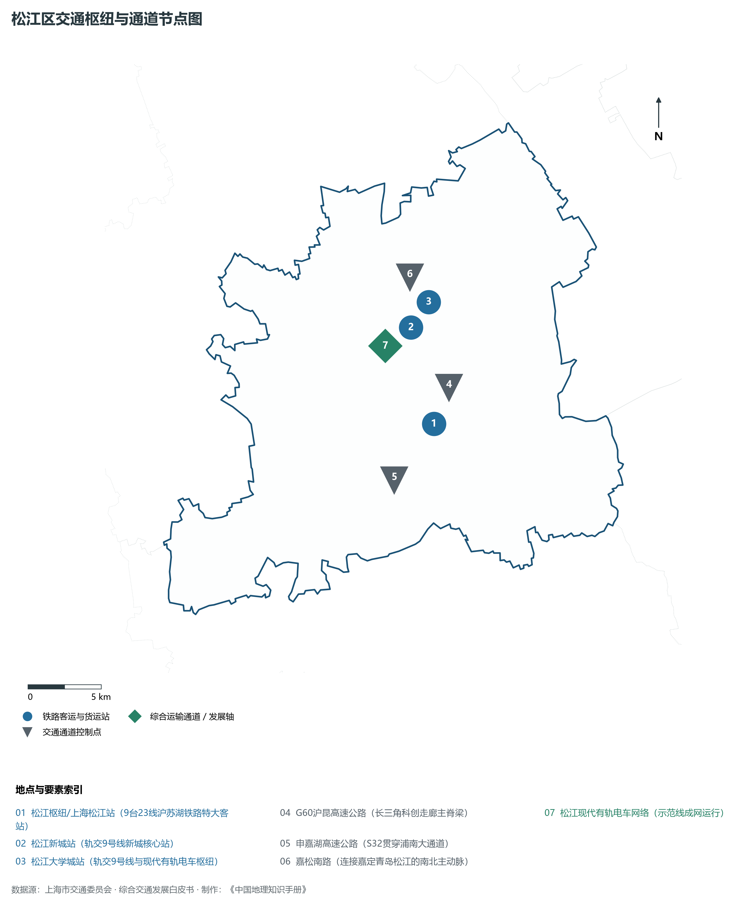
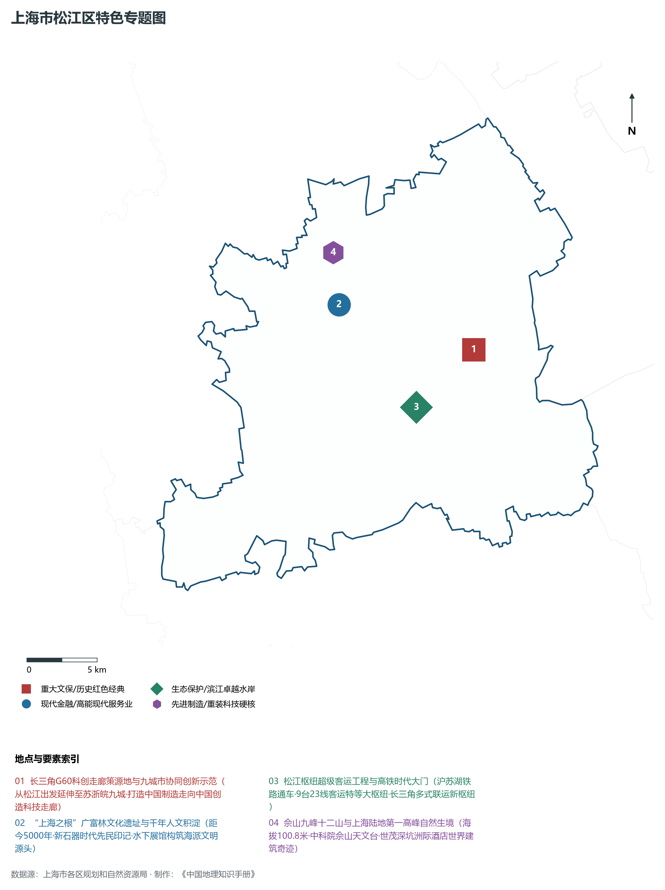
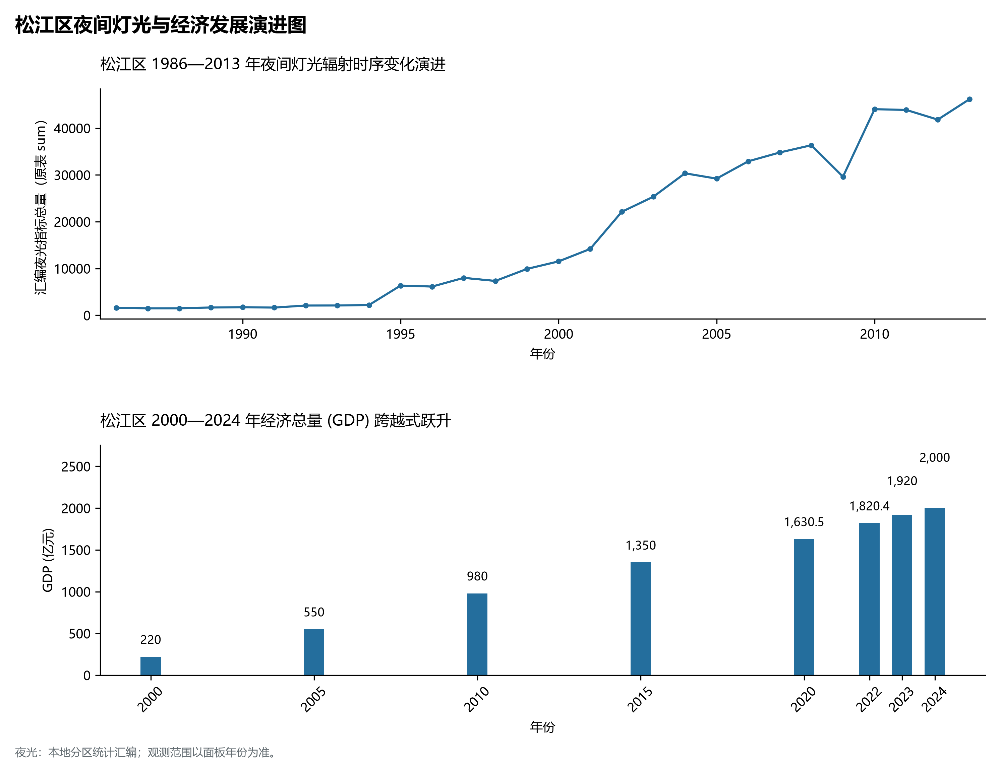

# 9.13 松江区

松江区，地处上海市关键战略板块，其区域综合定位与发展格局概括为：**“上海之根”·长三角G60科创走廊策源地·松江大学城·佘山国家旅游度假区·松江综合客运大枢纽**。全区陆地总面积达 **604.64 km²**，截至 2024 年末全区常住人口约 **195.4** 万人，常住人口城镇化率达 **87.5%**。2024 年实现地区生产总值（GDP）约 **2,000.0** 亿元，人均 GDP 突破 **102,300** 元，三次产业结构比为 **0.8 : 46.5 : 52.7**。全区自然地表标高介于 **2.2 m ～ 100.8 m** 之间，展现出江海交汇的平原水网机理与极高密度、极高能级的国际化大都市现代化产业核心基底。

---

## 一、自然地理环境与城市微地貌底盘

区域骨干控制性高程标高与标志性天际极点包括：

- **西佘山 (100.8m 上海陆地最高峰·天主堂与天文台)**（空间坐标约东经 121.192°、北纬 31.095°，控制标高约 100.8 m）：构成区域微地貌与现代垂直天际线的重要基准控制点；
- **东佘山与天马山 (99.8m 九峰十二山主脉)**（空间坐标约东经 121.155°、北纬 31.075°，控制标高约 99.8 m）：构成区域微地貌与现代垂直天际线的重要基准控制点；

水系水网与生态廊道方面，松江区江河交织、水网如织：

- **黄浦江源头 (斜塘/圆泄泾/横潦泾三江汇流)**（水域坐标约东经 121.120°、北纬 30.980°）：发挥防汛排涝、航运通航、生态水景与城市水岸活力营造的核心支撑功能；
- **大泖港与辰山塘 (松江纵横古水系)**（水域坐标约东经 121.180°、北纬 31.020°）：发挥防汛排涝、航运通航、生态水景与城市水岸活力营造的核心支撑功能；

---

## 二、历史文脉演进与城市功能空间重塑

松江区历史文化底蕴深厚，在上海从古代江南海滨村落向近代国际商埠、现代社会主义现代化国际大都市跃升的历史进程中扮演了不可替代的关键角色。伴随历次城市总体规划演化与“一江一河”世界级卓越水岸贯通、城市更新纵深推进，构建了权责明晰、功能复合的街道社区与城镇空间治理网络：

- **松江区委区政府 (岳阳街道/园中路)**（驻地坐标：121.230°E, 31.035°N）：区域政治治理、高品质公共服务与综合经济管理的关键极核；
- **中山街道 (G60脑智科创核心承载区)**（驻地坐标：121.265°E, 31.030°N）：区域政治治理、高品质公共服务与综合经济管理的关键极核；
- **方松街道 (松江新城核心与泰晤士小镇)**（驻地坐标：121.205°E, 31.025°N）：区域政治治理、高品质公共服务与综合经济管理的关键极核；
- **广富林街道 (松江大学城文脉与考古遗址)**（驻地坐标：121.195°E, 31.060°N）：区域政治治理、高品质公共服务与综合经济管理的关键极核；
- **佘山镇政府 (佘山国家旅游度假区所在地)**（驻地坐标：121.180°E, 31.100°N）：区域政治治理、高品质公共服务与综合经济管理的关键极核；
- **车墩镇政府 (上海影视乐园/先进装备制造)**（驻地坐标：121.300°E, 30.995°N）：区域政治治理、高品质公共服务与综合经济管理的关键极核；
- **洞泾镇政府 (人工智能与智能机器人高地)**（驻地坐标：121.275°E, 31.090°N）：区域政治治理、高品质公共服务与综合经济管理的关键极核；
- **九亭镇政府 (邻近市区商贸制造业重镇)**（驻地坐标：121.320°E, 31.140°N）：区域政治治理、高品质公共服务与综合经济管理的关键极核；
- **石湖荡镇 (黄浦江零公里起点大三角)**（驻地坐标：121.110°E, 30.985°N）：区域政治治理、高品质公共服务与综合经济管理的关键极核；
- **泖港镇政府 (浦南绿色生态涵养区)**（驻地坐标：121.200°E, 30.935°N）：区域政治治理、高品质公共服务与综合经济管理的关键极核；

在空间开发保护总体格局上，松江区坚定贯彻“人民城市人民建，人民城市为人民”重要理念，持续推动空间集约紧凑发展、精细化微更新与生态韧性安全构筑，高水准推进产城融合与人居环境改善。

---

## 三、综合立体交通网络与枢纽门户功能

松江区紧密依托上海超大规模立体交通网络，形成了多维交织的轨道交通、城市快速路、骨干主干道与骨干对外客货运大通道：

**核心综合客运交通枢纽与关键站点：**

- **松江枢纽/上海松江站 (9台23线沪苏湖铁路特大客站)**（位置坐标：121.235°E, 30.990°N）：区域客货运流量组织与换乘集散的关键节点；
- **松江新城站 (轨交9号线新城核心站)**（位置坐标：121.230°E, 31.050°N）：区域客货运流量组织与换乘集散的关键节点；
- **松江大学城站 (轨交9号线与现代有轨电车枢纽)**（位置坐标：121.235°E, 31.065°N）：区域客货运流量组织与换乘集散的关键节点；

**骨干交通走廊与快速路网通道：**

- **G60沪昆高速公路 (长三角科创走廊主脊梁)**（走廊控制点：121.250°E, 31.010°N）：承担跨区快速通勤与大容量经济要素流动的高速骨架；
- **申嘉湖高速公路 (S32贯穿浦南大通道)**（走廊控制点：121.200°E, 30.960°N）：承担跨区快速通勤与大容量经济要素流动的高速骨架；
- **嘉松南路 (连接嘉定青岛松江的南北主动脉)**（走廊控制点：121.235°E, 31.080°N）：承担跨区快速通勤与大容量经济要素流动的高速骨架；
- **松江现代有轨电车网络 (示范线成网运行)**（走廊控制点：121.220°E, 31.040°N）：承担跨区快速通勤与大容量经济要素流动的高速骨架；

---

## 四、现代产业体系与新质生产力布局

松江区立足全市“五个中心”建设战略布局，全力发展新质生产力，积极构建以实体经济为支撑、现代服务业为主导或先进制造业为脊梁的高能级现代产业体系：

**重大科技园区与高新技术产业集聚平台：**

- **长三角G60科创走廊规划展示馆与总部基地**（园区坐标：121.285°E, 31.020°N）：集聚顶尖创新资源、推动成果转化与新经济孵化的主阵地；
- **上海松江综合保税区**（园区坐标：121.280°E, 30.995°N）：集聚顶尖创新资源、推动成果转化与新经济孵化的主阵地；
- **松江经济技术开发区 (集成电路与电子信息)**（园区坐标：121.250°E, 31.000°N）：集聚顶尖创新资源、推动成果转化与新经济孵化的主阵地；
- **洞泾人工智能产业基地**（园区坐标：121.270°E, 31.095°N）：集聚顶尖创新资源、推动成果转化与新经济孵化的主阵地；

**标志性特色主题要素与领航龙头优势：**

- **长三角G60科创走廊策源地与九城市协同创新示范**（空间坐标：121.285°E, 31.020°N）：从松江出发延伸至苏浙皖九城·打造中国制造走向中国创造科技走廊；
- **“上海之根”广富林文化遗址与千年人文积淀**（空间坐标：121.190°E, 31.062°N）：距今5000年·新石器时代先民印记·水下展馆构筑海派文明源头；
- **松江枢纽超级客运工程与高铁时代大门**（空间坐标：121.235°E, 30.990°N）：沪苏湖铁路通车·9台23线客运特等大枢纽·长三角多式联运新枢纽；
- **佘山九峰十二山与上海陆地第一高峰自然生境**（空间坐标：121.192°E, 31.095°N）：海拔100.8米·中科院佘山天文台·世茂深坑洲际酒店世界建筑奇迹；

---

## 五、历史文化底蕴、名胜古迹与全域文旅地理

松江区文商旅交相辉映，历史风貌保护区与现代化公共文化设施融为一体，拥有享誉海内外的标志性文旅资源：

- **广富林文化遗址 (4A·先民之根/水下博物馆)**（地标坐标：121.190°E, 31.062°N）：彰显红色文脉、海派底蕴与生态景观的典范文旅空间；
- **佘山国家旅游度假区 (4A·佘山天主教堂/天文台)**（地标坐标：121.192°E, 31.095°N）：彰显红色文脉、海派底蕴与生态景观的典范文旅空间；
- **辰山植物园 (4A·华东最大综合植物园与矿坑花园)**（地标坐标：121.175°E, 31.075°N）：彰显红色文脉、海派底蕴与生态景观的典范文旅空间；
- **方塔园 (全国重点文保·宋代兴圣教寺塔)**（地标坐标：121.245°E, 31.008°N）：彰显红色文脉、海派底蕴与生态景观的典范文旅空间；
- **醉白池公园 (上海五大古典园林之一)**（地标坐标：121.230°E, 31.002°N）：彰显红色文脉、海派底蕴与生态景观的典范文旅空间；
- **上海影视乐园 (车墩老上海风情街区)**（地标坐标：121.305°E, 30.990°N）：彰显红色文脉、海派底蕴与生态景观的典范文旅空间；

松江区持续推动以文塑旅、以旅彰文，打响“上海文化”品牌，不断拓宽文旅消费新场景，提升城区软实力与国际美誉度。

---

## 六、夜间灯光辐射与跨世纪经济变化时序演进

本节夜光图的观测年份为 1986—2013 年，指标为行政区汇总值（原表 sum）。

| 统计基准年份 | 地区生产总值 GDP (亿元) | 发展阶段主要特征与空间跃升标志 |
|:---|:---|:---|
| **2000 年** | 220.0 | 世纪之交产业重组与现代城市功能筑基 |
| **2005 年** | 550.0 | 世纪之交产业重组与现代城市功能筑基 |
| **2010 年** | 980.0 | 世博效应驱动城市更新与高端现代服务业集聚 |
| **2015 年** | 1,350.0 | 世博效应驱动城市更新与高端现代服务业集聚 |
| **2020 年** | 1,630.5 | 新发展格局下高质量发展与新质生产力全面成势 |
| **2022 年** | 1,820.4 | 新发展格局下高质量发展与新质生产力全面成势 |
| **2023 年** | 1,920.0 | 新发展格局下高质量发展与新质生产力全面成势 |
| **2024 年** | 2,000.0 | 新发展格局下高质量发展与新质生产力全面成势 |

