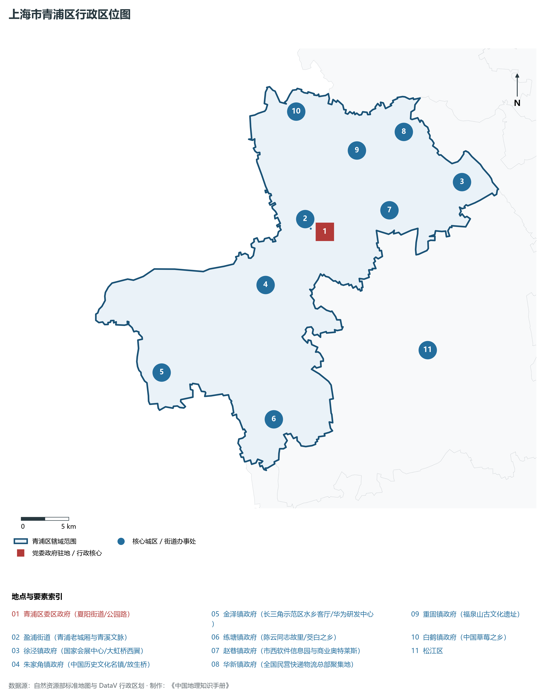
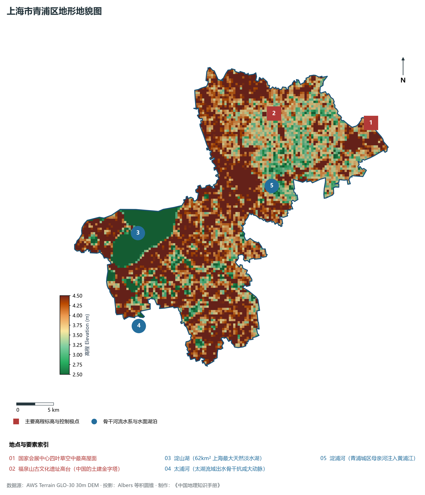
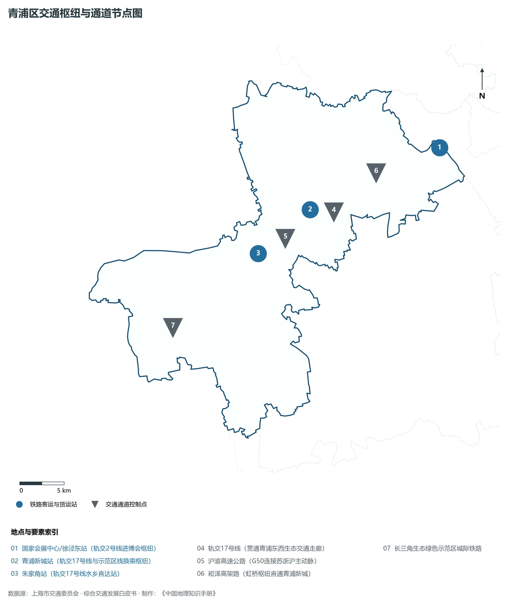
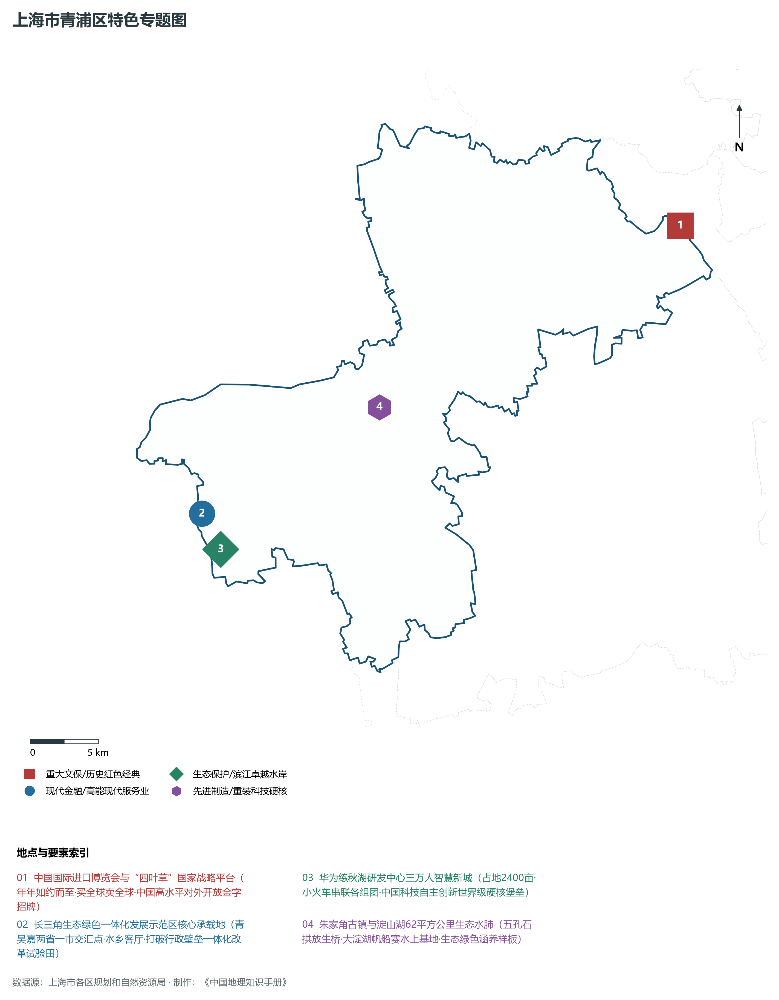
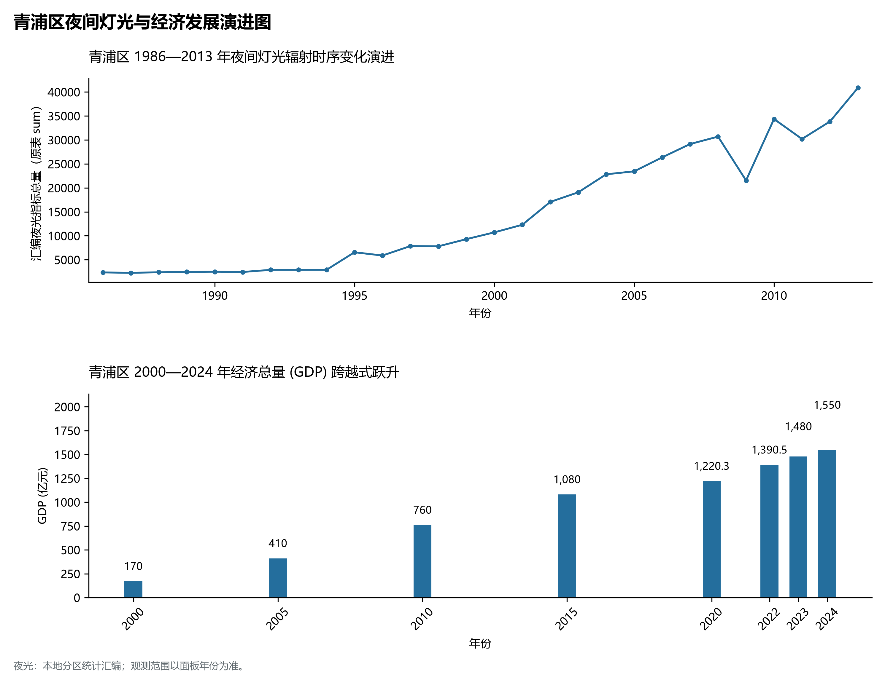

# 9.14 青浦区

青浦区，地处上海市关键战略板块，其区域综合定位与发展格局概括为：**长三角生态绿色一体化示范区·中国进博会举办地(四叶草)·华为练秋湖研发基地·淀山湖·朱家角古镇**。全区陆地总面积达 **668.54 km²**，截至 2024 年末全区常住人口约 **128.0** 万人，常住人口城镇化率达 **84.5%**。2024 年实现地区生产总值（GDP）约 **1,550.0** 亿元，人均 GDP 突破 **121,100** 元，三次产业结构比为 **1.0 : 38.5 : 60.5**。全区自然地表标高介于 **2.5 m ～ 4.5 m** 之间，展现出江海交汇的平原水网机理与极高密度、极高能级的国际化大都市现代化产业核心基底。

---

## 一、自然地理环境与城市微地貌底盘

区域骨干控制性高程标高与标志性天际极点包括：

- **国家会展中心四叶草空中最高屋面**（空间坐标约东经 121.305°、北纬 31.195°，控制标高约 4.5 m）：构成区域微地貌与现代垂直天际线的重要基准控制点；
- **福泉山古文化遗址高台 (中国的土建金字塔)**（空间坐标约东经 121.170°、北纬 31.225°，控制标高约 12.0 m）：构成区域微地貌与现代垂直天际线的重要基准控制点；

水系水网与生态廊道方面，青浦区江河交织、水网如织：

- **淀山湖 (62km² 上海最大天然淡水湖)**（水域坐标约东经 120.950°、北纬 31.110°）：发挥防汛排涝、航运通航、生态水景与城市水岸活力营造的核心支撑功能；
- **太浦河 (太湖流域出水骨干抗咸大动脉)**（水域坐标约东经 120.930°、北纬 31.000°）：发挥防汛排涝、航运通航、生态水景与城市水岸活力营造的核心支撑功能；
- **淀浦河 (青浦城区母亲河注入黄浦江)**（水域坐标约东经 121.150°、北纬 31.140°）：发挥防汛排涝、航运通航、生态水景与城市水岸活力营造的核心支撑功能；

---

## 二、历史文脉演进与城市功能空间重塑

青浦区历史文化底蕴深厚，在上海从古代江南海滨村落向近代国际商埠、现代社会主义现代化国际大都市跃升的历史进程中扮演了不可替代的关键角色。伴随历次城市总体规划演化与“一江一河”世界级卓越水岸贯通、城市更新纵深推进，构建了权责明晰、功能复合的街道社区与城镇空间治理网络：

- **青浦区委区政府 (夏阳街道/公园路)**（驻地坐标：121.125°E, 31.150°N）：区域政治治理、高品质公共服务与综合经济管理的关键极核；
- **盈浦街道 (青浦老城厢与青溪文脉)**（驻地坐标：121.110°E, 31.155°N）：区域政治治理、高品质公共服务与综合经济管理的关键极核；
- **徐泾镇政府 (国家会展中心/大虹桥西翼)**（驻地坐标：121.285°E, 31.175°N）：区域政治治理、高品质公共服务与综合经济管理的关键极核；
- **朱家角镇政府 (中国历史文化名镇/放生桥)**（驻地坐标：121.050°E, 31.110°N）：区域政治治理、高品质公共服务与综合经济管理的关键极核；
- **金泽镇政府 (长三角示范区水乡客厅/华为研发中心)**（驻地坐标：120.920°E, 31.045°N）：区域政治治理、高品质公共服务与综合经济管理的关键极核；
- **练塘镇政府 (陈云同志故里/茭白之乡)**（驻地坐标：121.035°E, 30.985°N）：区域政治治理、高品质公共服务与综合经济管理的关键极核；
- **赵巷镇政府 (市西软件信息园与商业奥特莱斯)**（驻地坐标：121.200°E, 31.160°N）：区域政治治理、高品质公共服务与综合经济管理的关键极核；
- **华新镇政府 (全国民营快递物流总部聚集地)**（驻地坐标：121.230°E, 31.230°N）：区域政治治理、高品质公共服务与综合经济管理的关键极核；
- **重固镇政府 (福泉山古文化遗址)**（驻地坐标：121.175°E, 31.220°N）：区域政治治理、高品质公共服务与综合经济管理的关键极核；
- **白鹤镇政府 (中国草莓之乡)**（驻地坐标：121.115°E, 31.265°N）：区域政治治理、高品质公共服务与综合经济管理的关键极核；

在空间开发保护总体格局上，青浦区坚定贯彻“人民城市人民建，人民城市为人民”重要理念，持续推动空间集约紧凑发展、精细化微更新与生态韧性安全构筑，高水准推进产城融合与人居环境改善。

---

## 三、综合立体交通网络与枢纽门户功能

青浦区紧密依托上海超大规模立体交通网络，形成了多维交织的轨道交通、城市快速路、骨干主干道与骨干对外客货运大通道：

**核心综合客运交通枢纽与关键站点：**

- **国家会展中心/徐泾东站 (轨交2号线进博会枢纽)**（位置坐标：121.300°E, 31.195°N）：区域客货运流量组织与换乘集散的关键节点；
- **青浦新城站 (轨交17号线与示范区线换乘枢纽)**（位置坐标：121.135°E, 31.155°N）：区域客货运流量组织与换乘集散的关键节点；
- **朱家角站 (轨交17号线水乡直达站)**（位置坐标：121.065°E, 31.120°N）：区域客货运流量组织与换乘集散的关键节点；

**骨干交通走廊与快速路网通道：**

- **轨交17号线 (贯通青浦东西生态交通走廊)**（走廊控制点：121.150°E, 31.150°N）：承担跨区快速通勤与大容量经济要素流动的高速骨架；
- **沪渝高速公路 (G50连接苏浙沪主动脉)**（走廊控制点：121.100°E, 31.130°N）：承担跨区快速通勤与大容量经济要素流动的高速骨架；
- **崧泽高架路 (虹桥枢纽直通青浦新城)**（走廊控制点：121.220°E, 31.180°N）：承担跨区快速通勤与大容量经济要素流动的高速骨架；
- **长三角生态绿色示范区城际铁路**（走廊控制点：120.950°E, 31.060°N）：承担跨区快速通勤与大容量经济要素流动的高速骨架；

---

## 四、现代产业体系与新质生产力布局

青浦区立足全市“五个中心”建设战略布局，全力发展新质生产力，积极构建以实体经济为支撑、现代服务业为主导或先进制造业为脊梁的高能级现代产业体系：

**重大科技园区与高新技术产业集聚平台：**

- **华为练秋湖研发中心 (全球最大科技研发基地)**（园区坐标：120.910°E, 31.035°N）：集聚顶尖创新资源、推动成果转化与新经济孵化的主阵地；
- **长三角一体化示范区“水乡客厅”先行启动区**（园区坐标：120.900°E, 31.060°N）：集聚顶尖创新资源、推动成果转化与新经济孵化的主阵地；
- **国家会展中心 (上海) (进博会永久举办地)**（园区坐标：121.305°E, 31.195°N）：集聚顶尖创新资源、推动成果转化与新经济孵化的主阵地；
- **市西软件信息园与长三角数字干线**（园区坐标：121.190°E, 31.165°N）：集聚顶尖创新资源、推动成果转化与新经济孵化的主阵地；
- **华新全国快递物流总部集群 (三通一达顺丰总部)**（园区坐标：121.240°E, 31.225°N）：集聚顶尖创新资源、推动成果转化与新经济孵化的主阵地；

**标志性特色主题要素与领航龙头优势：**

- **中国国际进口博览会与“四叶草”国家战略平台**（空间坐标：121.305°E, 31.195°N）：年年如约而至·买全球卖全球·中国高水平对外开放金字招牌；
- **长三角生态绿色一体化发展示范区核心承载地**（空间坐标：120.900°E, 31.060°N）：青吴嘉两省一市交汇点·水乡客厅·打破行政壁垒一体化改革试验田；
- **华为练秋湖研发中心三万人智慧新城**（空间坐标：120.910°E, 31.035°N）：占地2400亩·小火车串联各组团·中国科技自主创新世界级硬核堡垒；
- **朱家角古镇与淀山湖62平方公里生态水肺**（空间坐标：121.050°E, 31.110°N）：五孔石拱放生桥·大淀湖帆船赛水上基地·生态绿色涵养样板；

---

## 五、历史文化底蕴、名胜古迹与全域文旅地理

青浦区文商旅交相辉映，历史风貌保护区与现代化公共文化设施融为一体，拥有享誉海内外的标志性文旅资源：

- **国家会展中心 (4A·迎五洲宾朋四叶草)**（地标坐标：121.305°E, 31.195°N）：彰显红色文脉、海派底蕴与生态景观的典范文旅空间；
- **朱家角古镇风景区 (4A·放生桥/课植园江南明珠)**（地标坐标：121.050°E, 31.110°N）：彰显红色文脉、海派底蕴与生态景观的典范文旅空间；
- **东方绿舟与淀山湖风景区 (4A·国家国防教育基地)**（地标坐标：120.995°E, 31.105°N）：彰显红色文脉、海派底蕴与生态景观的典范文旅空间；
- **练塘古镇与陈云纪念馆 (全国重点爱国主义教育基地)**（地标坐标：121.035°E, 30.985°N）：彰显红色文脉、海派底蕴与生态景观的典范文旅空间；
- **福泉山古遗址 (全国重点文保·崧泽文化发祥)**（地标坐标：121.172°E, 31.225°N）：彰显红色文脉、海派底蕴与生态景观的典范文旅空间；
- **金泽古镇 (江南第一桥乡·七座宋元明清古桥)**（地标坐标：120.915°E, 31.045°N）：彰显红色文脉、海派底蕴与生态景观的典范文旅空间；

青浦区持续推动以文塑旅、以旅彰文，打响“上海文化”品牌，不断拓宽文旅消费新场景，提升城区软实力与国际美誉度。

---

## 六、夜间灯光辐射与跨世纪经济变化时序演进

本节夜光图的观测年份为 1986—2013 年，指标为行政区汇总值（原表 sum）。

| 统计基准年份 | 地区生产总值 GDP (亿元) | 发展阶段主要特征与空间跃升标志 |
|:---|:---|:---|
| **2000 年** | 170.0 | 世纪之交产业重组与现代城市功能筑基 |
| **2005 年** | 410.0 | 世纪之交产业重组与现代城市功能筑基 |
| **2010 年** | 760.0 | 世博效应驱动城市更新与高端现代服务业集聚 |
| **2015 年** | 1,080.0 | 世博效应驱动城市更新与高端现代服务业集聚 |
| **2020 年** | 1,220.3 | 新发展格局下高质量发展与新质生产力全面成势 |
| **2022 年** | 1,390.5 | 新发展格局下高质量发展与新质生产力全面成势 |
| **2023 年** | 1,480.0 | 新发展格局下高质量发展与新质生产力全面成势 |
| **2024 年** | 1,550.0 | 新发展格局下高质量发展与新质生产力全面成势 |

