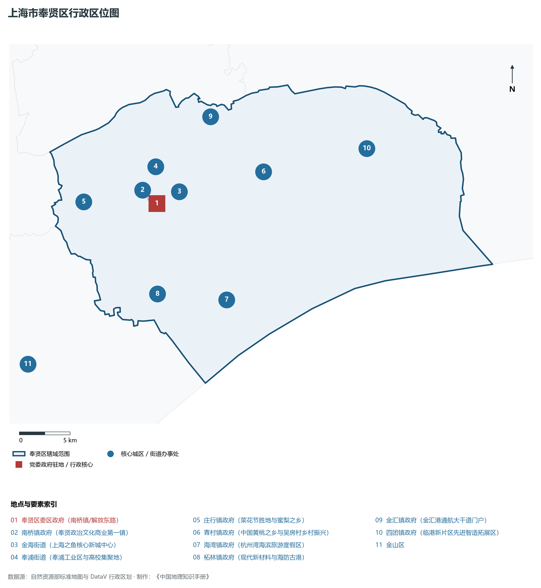
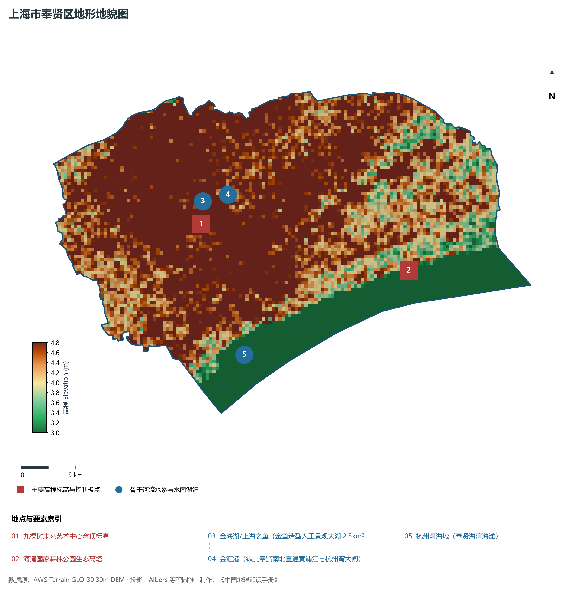
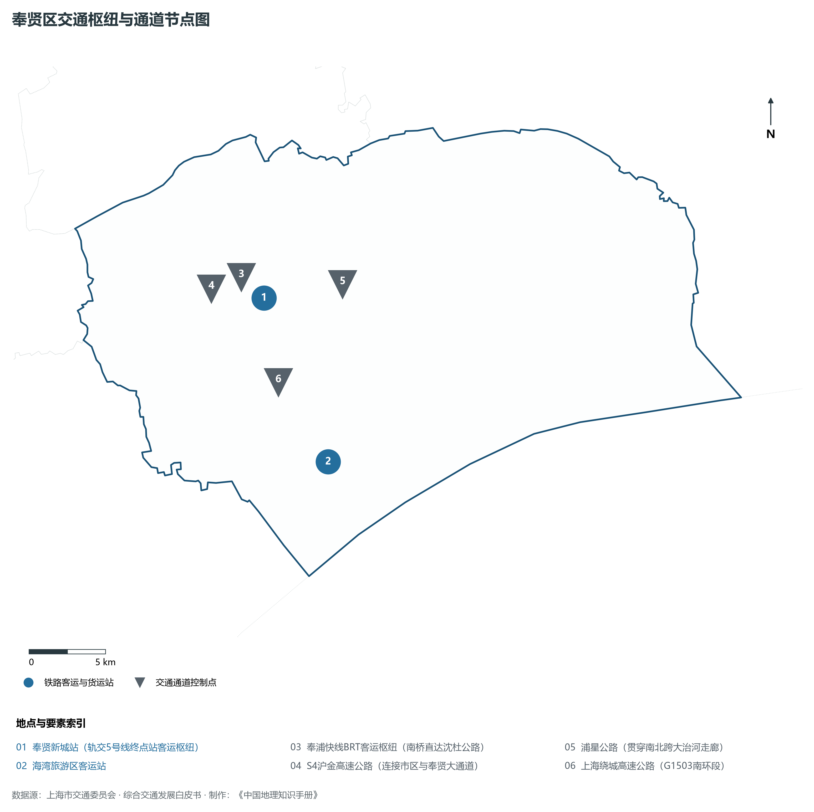
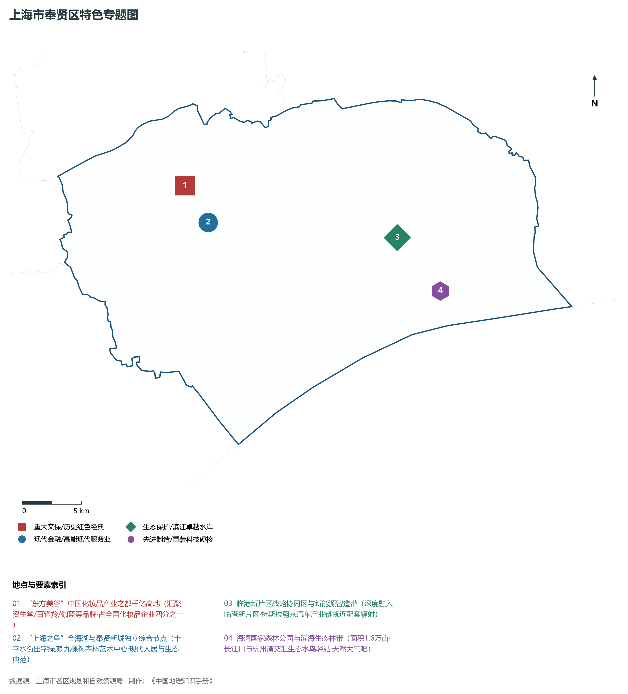
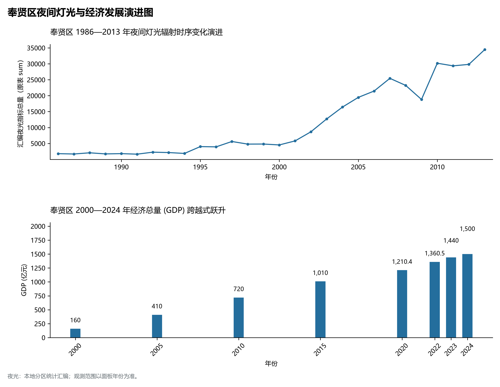

# 9.15 奉贤区

奉贤区，地处上海市关键战略板块，其区域综合定位与发展格局概括为：**“中国化妆品之都·东方美谷”·临港新片区重要承载地·奉贤新城·上海之鱼·杭州湾北翼宜居宜业城**。全区陆地总面积达 **687.39 km²**，截至 2024 年末全区常住人口约 **114.1** 万人，常住人口城镇化率达 **73.0%**。2024 年实现地区生产总值（GDP）约 **1,500.0** 亿元，人均 GDP 突破 **131,500** 元，三次产业结构比为 **1.5 : 54.5 : 44.0**。全区自然地表标高介于 **3.0 m ～ 4.8 m** 之间，展现出江海交汇的平原水网机理与极高密度、极高能级的国际化大都市现代化产业核心基底。

---

## 一、自然地理环境与城市微地貌底盘

区域骨干控制性高程标高与标志性天际极点包括：

- **九棵树未来艺术中心穹顶标高**（空间坐标约东经 121.490°、北纬 30.910°，控制标高约 4.5 m）：构成区域微地貌与现代垂直天际线的重要基准控制点；
- **海湾国家森林公园生态高塔**（空间坐标约东经 121.680°、北纬 30.845°，控制标高约 5.0 m）：构成区域微地貌与现代垂直天际线的重要基准控制点；

水系水网与生态廊道方面，奉贤区江河交织、水网如织：

- **金海湖/上海之鱼 (金鱼造型人工景观大湖·2.5km²)**（水域坐标约东经 121.485°、北纬 30.925°）：发挥防汛排涝、航运通航、生态水景与城市水岸活力营造的核心支撑功能；
- **金汇港 (纵贯奉贤南北直通黄浦江与杭州湾大闸)**（水域坐标约东经 121.520°、北纬 30.930°）：发挥防汛排涝、航运通航、生态水景与城市水岸活力营造的核心支撑功能；
- **杭州湾海域 (奉贤海湾海滩)**（水域坐标约东经 121.510°、北纬 30.800°）：发挥防汛排涝、航运通航、生态水景与城市水岸活力营造的核心支撑功能；

---

## 二、历史文脉演进与城市功能空间重塑

奉贤区历史文化底蕴深厚，在上海从古代江南海滨村落向近代国际商埠、现代社会主义现代化国际大都市跃升的历史进程中扮演了不可替代的关键角色。伴随历次城市总体规划演化与“一江一河”世界级卓越水岸贯通、城市更新纵深推进，构建了权责明晰、功能复合的街道社区与城镇空间治理网络：

- **奉贤区委区政府 (南桥镇/解放东路)**（驻地坐标：121.460°E, 30.918°N）：区域政治治理、高品质公共服务与综合经济管理的关键极核；
- **南桥镇政府 (奉贤政治文化商业第一镇)**（驻地坐标：121.455°E, 30.915°N）：区域政治治理、高品质公共服务与综合经济管理的关键极核；
- **金海街道 (上海之鱼核心新城中心)**（驻地坐标：121.485°E, 30.925°N）：区域政治治理、高品质公共服务与综合经济管理的关键极核；
- **奉浦街道 (奉浦工业区与高校集聚地)**（驻地坐标：121.465°E, 30.950°N）：区域政治治理、高品质公共服务与综合经济管理的关键极核；
- **庄行镇政府 (菜花节胜地与蜜梨之乡)**（驻地坐标：121.385°E, 30.930°N）：区域政治治理、高品质公共服务与综合经济管理的关键极核；
- **青村镇政府 (中国黄桃之乡与吴房村乡村振兴)**（驻地坐标：121.575°E, 30.930°N）：区域政治治理、高品质公共服务与综合经济管理的关键极核；
- **海湾镇政府 (杭州湾海滨旅游度假区)**（驻地坐标：121.515°E, 30.825°N）：区域政治治理、高品质公共服务与综合经济管理的关键极核；
- **柘林镇政府 (现代新材料与海防古港)**（驻地坐标：121.445°E, 30.840°N）：区域政治治理、高品质公共服务与综合经济管理的关键极核；
- **金汇镇政府 (金汇港通航大干道门户)**（驻地坐标：121.530°E, 30.985°N）：区域政治治理、高品质公共服务与综合经济管理的关键极核；
- **四团镇政府 (临港新片区先进智造拓展区)**（驻地坐标：121.685°E, 30.935°N）：区域政治治理、高品质公共服务与综合经济管理的关键极核；

在空间开发保护总体格局上，奉贤区坚定贯彻“人民城市人民建，人民城市为人民”重要理念，持续推动空间集约紧凑发展、精细化微更新与生态韧性安全构筑，高水准推进产城融合与人居环境改善。

---

## 三、综合立体交通网络与枢纽门户功能

奉贤区紧密依托上海超大规模立体交通网络，形成了多维交织的轨道交通、城市快速路、骨干主干道与骨干对外客货运大通道：

**核心综合客运交通枢纽与关键站点：**

- **奉贤新城站 (轨交5号线终点站客运枢纽)**（位置坐标：121.480°E, 30.920°N）：区域客货运流量组织与换乘集散的关键节点；
- **奉浦快线BRT客运枢纽 (南桥直达沈杜公路)**（位置坐标：121.465°E, 30.925°N）：区域客货运流量组织与换乘集散的关键节点；
- **海湾旅游区客运站**（位置坐标：121.505°E, 30.820°N）：区域客货运流量组织与换乘集散的关键节点；

**骨干交通走廊与快速路网通道：**

- **S4沪金高速公路 (连接市区与奉贤大通道)**（走廊控制点：121.445°E, 30.930°N）：承担跨区快速通勤与大容量经济要素流动的高速骨架；
- **浦星公路 (贯穿南北跨大治河走廊)**（走廊控制点：121.535°E, 30.920°N）：承担跨区快速通勤与大容量经济要素流动的高速骨架；
- **上海绕城高速公路 (G1503南环段)**（走廊控制点：121.480°E, 30.870°N）：承担跨区快速通勤与大容量经济要素流动的高速骨架；

---

## 四、现代产业体系与新质生产力布局

奉贤区立足全市“五个中心”建设战略布局，全力发展新质生产力，积极构建以实体经济为支撑、现代服务业为主导或先进制造业为脊梁的高能级现代产业体系：

**重大科技园区与高新技术产业集聚平台：**

- **“东方美谷”核心产业园 (中国化妆品产业之都)**（园区坐标：121.470°E, 30.955°N）：集聚顶尖创新资源、推动成果转化与新经济孵化的主阵地；
- **临港新片区奉贤园区 (新能源汽车核心零部件)**（园区坐标：121.650°E, 30.890°N）：集聚顶尖创新资源、推动成果转化与新经济孵化的主阵地；
- **奉贤高新技术产业开发区 (生物医药与绿色智造)**（园区坐标：121.440°E, 30.940°N）：集聚顶尖创新资源、推动成果转化与新经济孵化的主阵地；
- **庄行工业园与现代农艺创新高地**（园区坐标：121.390°E, 30.920°N）：集聚顶尖创新资源、推动成果转化与新经济孵化的主阵地；

**标志性特色主题要素与领航龙头优势：**

- **“东方美谷”中国化妆品产业之都千亿高地**（空间坐标：121.470°E, 30.955°N）：汇聚资生堂/百雀羚/伽蓝等品牌·占全国化妆品企业四分之一；
- **“上海之鱼”金海湖与奉贤新城独立综合节点**（空间坐标：121.485°E, 30.925°N）：十字水街田字绿廊·九棵树森林艺术中心·现代人居与生态典范；
- **临港新片区战略协同区与新能源智造带**（空间坐标：121.650°E, 30.890°N）：深度融入临港新片区·特斯拉蔚来汽车产业链就近配套辐射；
- **海湾国家森林公园与滨海生态林带**（空间坐标：121.680°E, 30.845°N）：面积1.6万亩·长江口与杭州湾交汇生态水鸟驿站·天然大氧吧；

---

## 五、历史文化底蕴、名胜古迹与全域文旅地理

奉贤区文商旅交相辉映，历史风貌保护区与现代化公共文化设施融为一体，拥有享誉海内外的标志性文旅资源：

- **上海之鱼金海湖与奉贤区规划资源馆**（地标坐标：121.485°E, 30.925°N）：彰显红色文脉、海派底蕴与生态景观的典范文旅空间；
- **九棵树未来艺术中心 (全国首座森林剧场)**（地标坐标：121.490°E, 30.910°N）：彰显红色文脉、海派底蕴与生态景观的典范文旅空间；
- **海湾国家森林公园 (4A·上海最大国家森林公园)**（地标坐标：121.680°E, 30.845°N）：彰显红色文脉、海派底蕴与生态景观的典范文旅空间；
- **庄行乡村旅游景区 (4A·万亩油菜花海菜花节)**（地标坐标：121.385°E, 30.925°N）：彰显红色文脉、海派底蕴与生态景观的典范文旅空间；
- **青村吴房村 (全国乡村振兴示范村·十里桃花)**（地标坐标：121.565°E, 30.915°N）：彰显红色文脉、海派底蕴与生态景观的典范文旅空间；

奉贤区持续推动以文塑旅、以旅彰文，打响“上海文化”品牌，不断拓宽文旅消费新场景，提升城区软实力与国际美誉度。

---

## 六、夜间灯光辐射与跨世纪经济变化时序演进

本节夜光图的观测年份为 1986—2013 年，指标为行政区汇总值（原表 sum）。

| 统计基准年份 | 地区生产总值 GDP (亿元) | 发展阶段主要特征与空间跃升标志 |
|:---|:---|:---|
| **2000 年** | 160.0 | 世纪之交产业重组与现代城市功能筑基 |
| **2005 年** | 410.0 | 世纪之交产业重组与现代城市功能筑基 |
| **2010 年** | 720.0 | 世博效应驱动城市更新与高端现代服务业集聚 |
| **2015 年** | 1,010.0 | 世博效应驱动城市更新与高端现代服务业集聚 |
| **2020 年** | 1,210.4 | 新发展格局下高质量发展与新质生产力全面成势 |
| **2022 年** | 1,360.5 | 新发展格局下高质量发展与新质生产力全面成势 |
| **2023 年** | 1,440.0 | 新发展格局下高质量发展与新质生产力全面成势 |
| **2024 年** | 1,500.0 | 新发展格局下高质量发展与新质生产力全面成势 |

