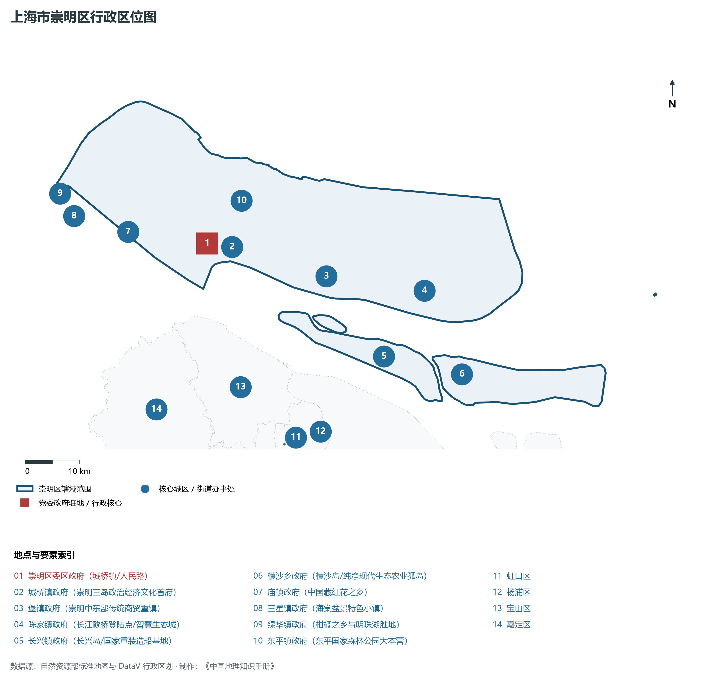
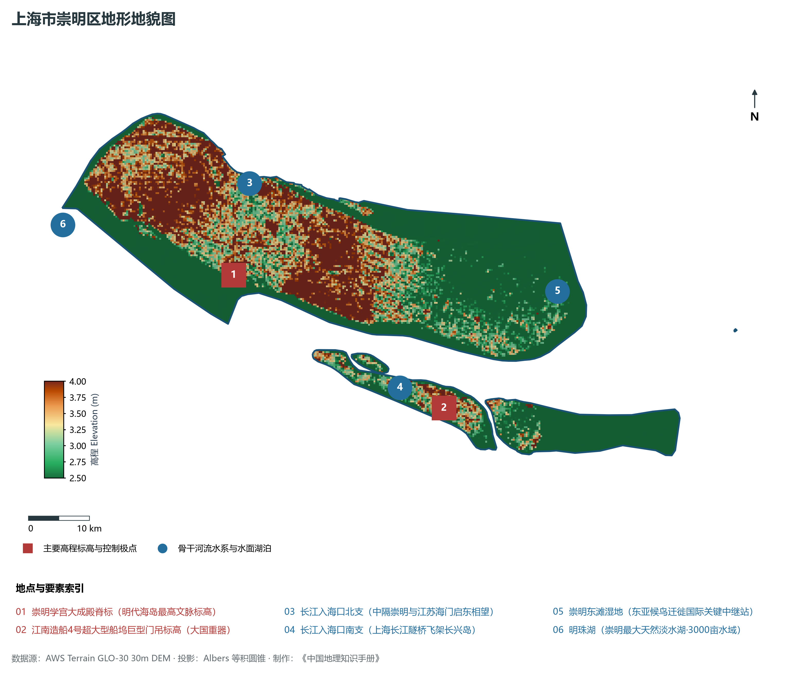
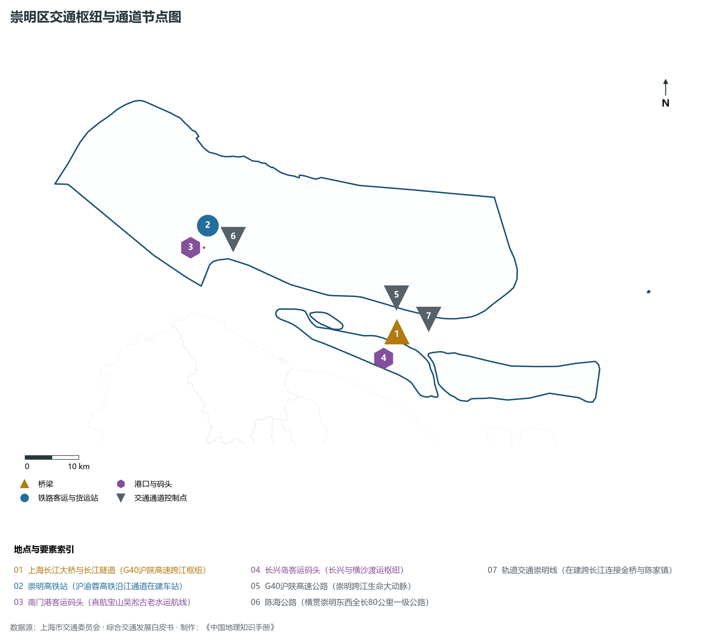
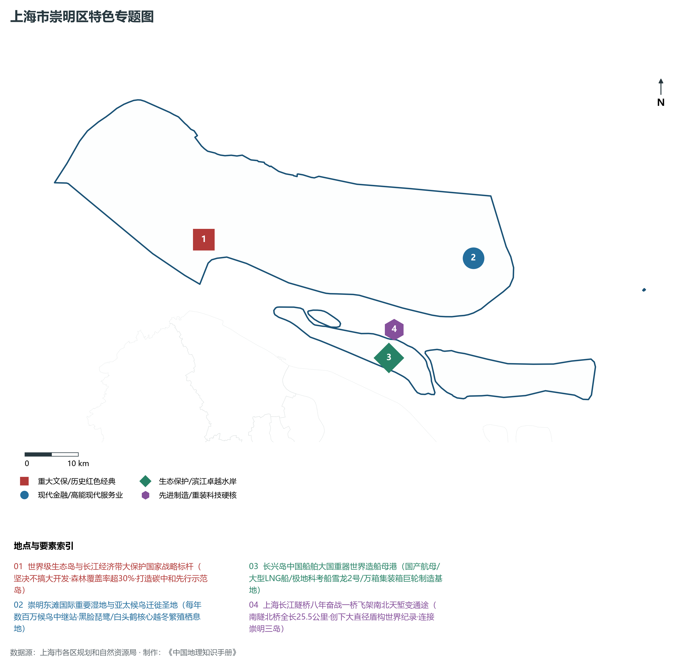
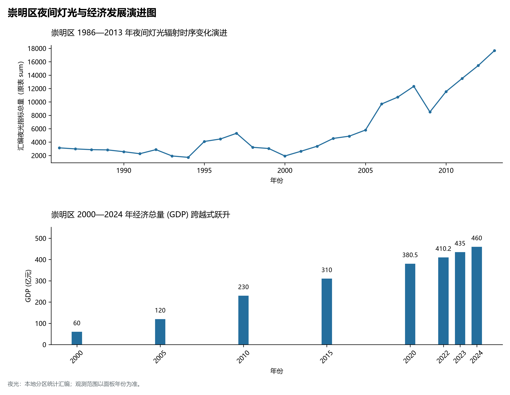

# 9.16 崇明区

崇明区，地处上海市关键战略板块，其区域综合定位与发展格局概括为：**世界级生态岛·长江入海口中国第三大岛·国家级生态大保护典范·长兴岛大国重器造船母港**。全区陆地总面积达 **1,411.00 km²**，截至 2024 年末全区常住人口约 **63.8** 万人，常住人口城镇化率达 **61.5%**。2024 年实现地区生产总值（GDP）约 **460.0** 亿元，人均 GDP 突破 **72,100** 元，三次产业结构比为 **7.5 : 29.5 : 63.0**。全区自然地表标高介于 **2.5 m ～ 4.0 m** 之间，展现出江海交汇的平原水网机理与极高密度、极高能级的国际化大都市现代化产业核心基底。

---

## 一、自然地理环境与城市微地貌底盘

区域骨干控制性高程标高与标志性天际极点包括：

- **崇明学宫大成殿脊标 (明代海岛最高文脉标高)**（空间坐标约东经 121.396°、北纬 31.622°，控制标高约 4.0 m）：构成区域微地貌与现代垂直天际线的重要基准控制点；
- **江南造船4号超大型船坞巨型门吊标高 (大国重器)**（空间坐标约东经 121.720°、北纬 31.380°，控制标高约 5.0 m）：构成区域微地貌与现代垂直天际线的重要基准控制点；

水系水网与生态廊道方面，崇明区江河交织、水网如织：

- **长江入海口北支 (中隔崇明与江苏海门启东相望)**（水域坐标约东经 121.450°、北纬 31.750°）：发挥防汛排涝、航运通航、生态水景与城市水岸活力营造的核心支撑功能；
- **长江入海口南支 (上海长江隧桥飞架长兴岛)**（水域坐标约东经 121.650°、北纬 31.420°）：发挥防汛排涝、航运通航、生态水景与城市水岸活力营造的核心支撑功能；
- **崇明东滩湿地 (东亚候鸟迁徙国际关键中继站)**（水域坐标约东经 121.950°、北纬 31.520°）：发挥防汛排涝、航运通航、生态水景与城市水岸活力营造的核心支撑功能；
- **明珠湖 (崇明最大天然淡水湖·3000亩水域)**（水域坐标约东经 121.115°、北纬 31.735°）：发挥防汛排涝、航运通航、生态水景与城市水岸活力营造的核心支撑功能；

---

## 二、历史文脉演进与城市功能空间重塑

崇明区历史文化底蕴深厚，在上海从古代江南海滨村落向近代国际商埠、现代社会主义现代化国际大都市跃升的历史进程中扮演了不可替代的关键角色。伴随历次城市总体规划演化与“一江一河”世界级卓越水岸贯通、城市更新纵深推进，构建了权责明晰、功能复合的街道社区与城镇空间治理网络：

- **崇明区委区政府 (城桥镇/人民路)**（驻地坐标：121.395°E, 31.625°N）：区域政治治理、高品质公共服务与综合经济管理的关键极核；
- **城桥镇政府 (崇明三岛政治经济文化首府)**（驻地坐标：121.390°E, 31.620°N）：区域政治治理、高品质公共服务与综合经济管理的关键极核；
- **堡镇政府 (崇明中东部传统商贸重镇)**（驻地坐标：121.615°E, 31.540°N）：区域政治治理、高品质公共服务与综合经济管理的关键极核；
- **陈家镇政府 (长江隧桥登陆点/智慧生态城)**（驻地坐标：121.800°E, 31.490°N）：区域政治治理、高品质公共服务与综合经济管理的关键极核；
- **长兴镇政府 (长兴岛/国家重装造船基地)**（驻地坐标：121.700°E, 31.395°N）：区域政治治理、高品质公共服务与综合经济管理的关键极核；
- **横沙乡政府 (横沙岛/纯净现代生态农业孤岛)**（驻地坐标：121.845°E, 31.345°N）：区域政治治理、高品质公共服务与综合经济管理的关键极核；
- **庙镇政府 (中国藏红花之乡)**（驻地坐标：121.245°E, 31.665°N）：区域政治治理、高品质公共服务与综合经济管理的关键极核；
- **三星镇政府 (海棠盆景特色小镇)**（驻地坐标：121.145°E, 31.705°N）：区域政治治理、高品质公共服务与综合经济管理的关键极核；
- **绿华镇政府 (柑橘之乡与明珠湖胜地)**（驻地坐标：121.125°E, 31.745°N）：区域政治治理、高品质公共服务与综合经济管理的关键极核；
- **东平镇政府 (东平国家森林公园大本营)**（驻地坐标：121.475°E, 31.685°N）：区域政治治理、高品质公共服务与综合经济管理的关键极核；

在空间开发保护总体格局上，崇明区坚定贯彻“人民城市人民建，人民城市为人民”重要理念，持续推动空间集约紧凑发展、精细化微更新与生态韧性安全构筑，高水准推进产城融合与人居环境改善。

---

## 三、综合立体交通网络与枢纽门户功能

崇明区紧密依托上海超大规模立体交通网络，形成了多维交织的轨道交通、城市快速路、骨干主干道与骨干对外客货运大通道：

**核心综合客运交通枢纽与关键站点：**

- **上海长江大桥与长江隧道 (G40沪陕高速跨江枢纽)**（位置坐标：121.740°E, 31.425°N）：区域客货运流量组织与换乘集散的关键节点；
- **崇明高铁站 (沪渝蓉高铁沿江通道在建车站)**（位置坐标：121.405°E, 31.650°N）：区域客货运流量组织与换乘集散的关键节点；
- **南门港客运码头 (直航宝山吴淞古老水运航线)**（位置坐标：121.390°E, 31.615°N）：区域客货运流量组织与换乘集散的关键节点；
- **长兴岛客运码头 (长兴与横沙渡运枢纽)**（位置坐标：121.705°E, 31.385°N）：区域客货运流量组织与换乘集散的关键节点；

**骨干交通走廊与快速路网通道：**

- **G40沪陕高速公路 (崇明跨江生命大动脉)**（走廊控制点：121.750°E, 31.480°N）：承担跨区快速通勤与大容量经济要素流动的高速骨架；
- **陈海公路 (横贯崇明东西全长80公里一级公路)**（走廊控制点：121.450°E, 31.620°N）：承担跨区快速通勤与大容量经济要素流动的高速骨架；
- **轨道交通崇明线 (在建跨长江连接金桥与陈家镇)**（走廊控制点：121.780°E, 31.440°N）：承担跨区快速通勤与大容量经济要素流动的高速骨架；

---

## 四、现代产业体系与新质生产力布局

崇明区立足全市“五个中心”建设战略布局，全力发展新质生产力，积极构建以实体经济为支撑、现代服务业为主导或先进制造业为脊梁的高能级现代产业体系：

**重大科技园区与高新技术产业集聚平台：**

- **中国船舶集团长兴造船基地 (江南造船/外高桥造船)**（园区坐标：121.720°E, 31.380°N）：集聚顶尖创新资源、推动成果转化与新经济孵化的主阵地；
- **振华重工长兴重型海洋工程制造基地**（园区坐标：121.750°E, 31.370°N）：集聚顶尖创新资源、推动成果转化与新经济孵化的主阵地；
- **崇明生态农业科创中心与正大现代蛋鸡基地**（园区坐标：121.420°E, 31.680°N）：集聚顶尖创新资源、推动成果转化与新经济孵化的主阵地；
- **崇明东滩智慧创新研发试验区**（园区坐标：121.850°E, 31.500°N）：集聚顶尖创新资源、推动成果转化与新经济孵化的主阵地；

**标志性特色主题要素与领航龙头优势：**

- **世界级生态岛与长江经济带大保护国家战略标杆**（空间坐标：121.395°E, 31.625°N）：坚决不搞大开发·森林覆盖率超30%·打造碳中和先行示范岛；
- **崇明东滩国际重要湿地与亚太候鸟迁徙圣地**（空间坐标：121.920°E, 31.520°N）：每年数百万候鸟中继站·黑脸琵鹭/白头鹤核心越冬繁殖栖息地；
- **长兴岛中国船舶大国重器世界造船母港**（空间坐标：121.720°E, 31.380°N）：国产航母/大型LNG船/极地科考船雪龙2号/万箱集装箱巨轮制造基地；
- **上海长江隧桥八年奋战一桥飞架南北天堑变通途**（空间坐标：121.740°E, 31.425°N）：南隧北桥全长25.5公里·创下大直径盾构世界纪录·连接崇明三岛；

---

## 五、历史文化底蕴、名胜古迹与全域文旅地理

崇明区文商旅交相辉映，历史风貌保护区与现代化公共文化设施融为一体，拥有享誉海内外的标志性文旅资源：

- **东滩湿地公园与东滩鸟类国家级保护区**（地标坐标：121.920°E, 31.520°N）：彰显红色文脉、海派底蕴与生态景观的典范文旅空间；
- **东平国家森林公园 (4A·华东最大平原人工平原林)**（地标坐标：121.480°E, 31.690°N）：彰显红色文脉、海派底蕴与生态景观的典范文旅空间；
- **西沙明珠湖景区 (5A级国家旅游景区·大湿地大水域)**（地标坐标：121.115°E, 31.735°N）：彰显红色文脉、海派底蕴与生态景观的典范文旅空间；
- **崇明学宫 (全国重点文保·崇明博物馆)**（地标坐标：121.398°E, 31.623°N）：彰显红色文脉、海派底蕴与生态景观的典范文旅空间；
- **江南造船展示馆 (爱国主义重装海防教育基地)**（地标坐标：121.710°E, 31.385°N）：彰显红色文脉、海派底蕴与生态景观的典范文旅空间；

崇明区持续推动以文塑旅、以旅彰文，打响“上海文化”品牌，不断拓宽文旅消费新场景，提升城区软实力与国际美誉度。

---

## 六、夜间灯光辐射与跨世纪经济变化时序演进

本节夜光图的观测年份为 1986—2013 年，指标为行政区汇总值（原表 sum）。

| 统计基准年份 | 地区生产总值 GDP (亿元) | 发展阶段主要特征与空间跃升标志 |
|:---|:---|:---|
| **2000 年** | 60.0 | 世纪之交产业重组与现代城市功能筑基 |
| **2005 年** | 120.0 | 世纪之交产业重组与现代城市功能筑基 |
| **2010 年** | 230.0 | 世博效应驱动城市更新与高端现代服务业集聚 |
| **2015 年** | 310.0 | 世博效应驱动城市更新与高端现代服务业集聚 |
| **2020 年** | 380.5 | 新发展格局下高质量发展与新质生产力全面成势 |
| **2022 年** | 410.2 | 新发展格局下高质量发展与新质生产力全面成势 |
| **2023 年** | 435.0 | 新发展格局下高质量发展与新质生产力全面成势 |
| **2024 年** | 460.0 | 新发展格局下高质量发展与新质生产力全面成势 |

