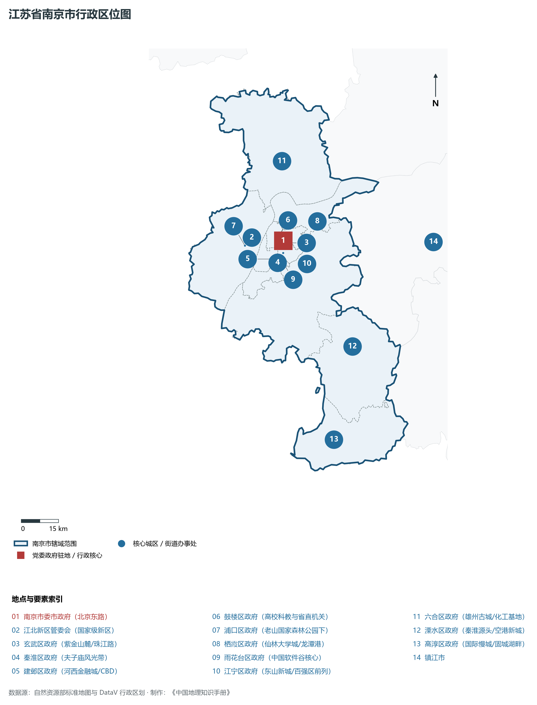
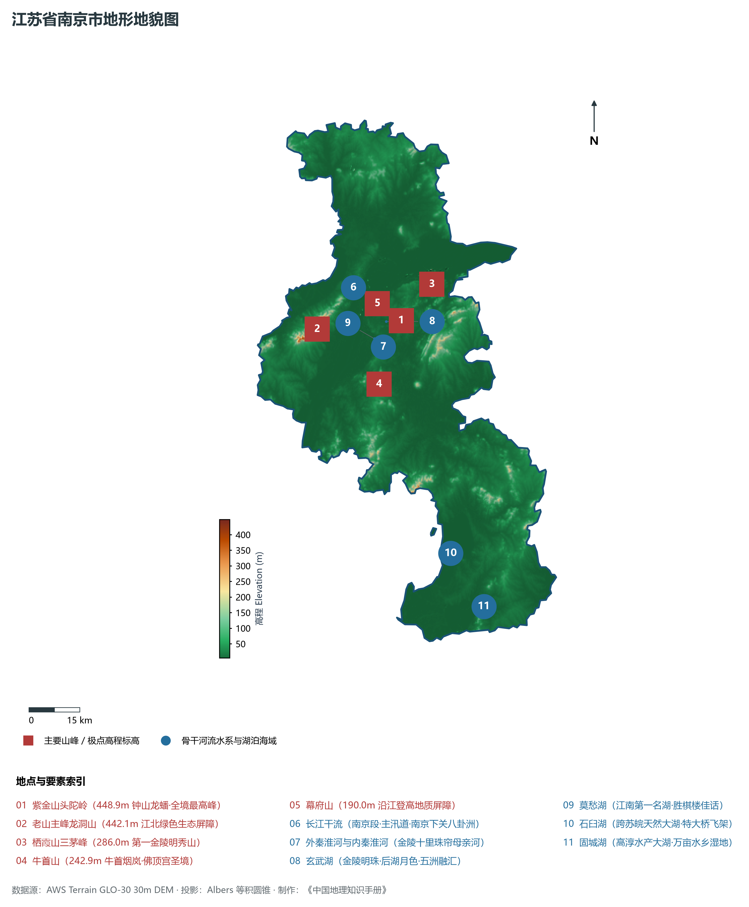
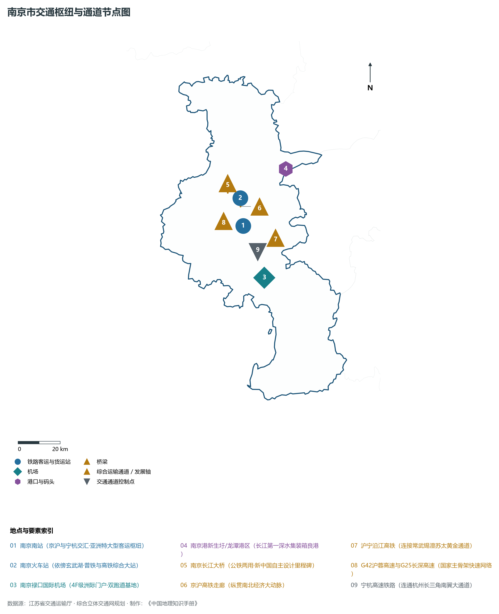
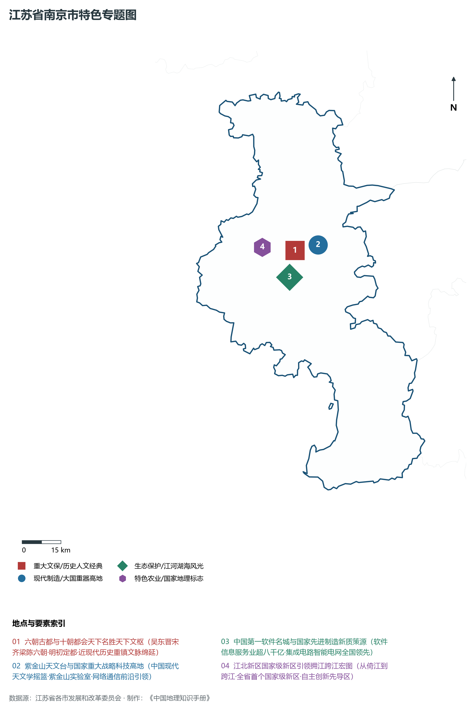
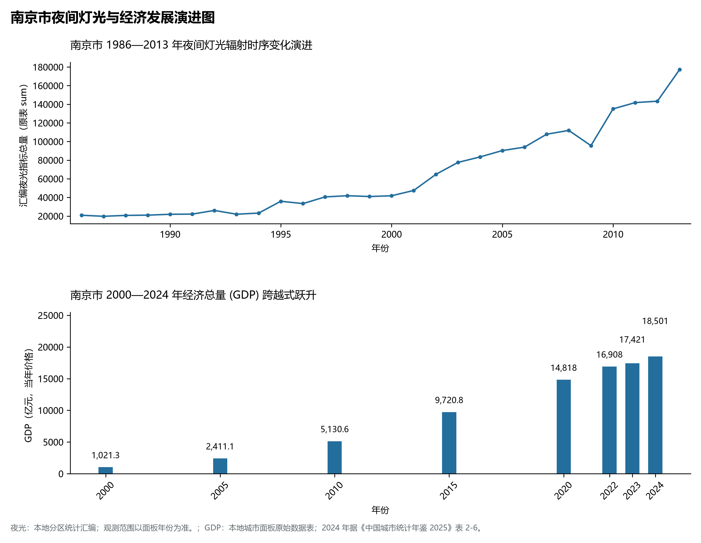

# 10.1 南京市

南京市，位于江苏省核心战略板块，其城市综合定位与发展愿景概括为：**东部地区重要中心城市·长三角特大城市·六朝古都·江北新区与紫金山天文台·国家级科教中心与产业科技创新高地**。2024 年常住人口 **958 万人**，常住人口城镇化率 **87.3%**，地区生产总值 **18,501 亿元**（当年价格），人均地区生产总值 **193,483 元**，三次产业构成为 **1.79 : 31.52 : 66.69**。

---

## 一、自然地理底盘与地貌水系机理

区域骨干控制性山峰与高程标高极点包括：

- **紫金山头陀岭 (448.9m 钟山龙蟠·全境最高峰)**（空间坐标约东经 118.848°、北纬 32.072°，海拔标高约 448.9 m）：构成区域地形骨架与水文视廊的关键基准控制点；
- **老山主峰龙洞山 (442.1m 江北绿色生态屏障)**（空间坐标约东经 118.580°、北纬 32.080°，海拔标高约 442.1 m）：构成区域地形骨架与水文视廊的关键基准控制点；
- **栖霞山三茅峰 (286.0m 第一金陵明秀山)**（空间坐标约东经 118.960°、北纬 32.155°，海拔标高约 286.0 m）：构成区域地形骨架与水文视廊的关键基准控制点；
- **牛首山 (242.9m 牛首烟岚·佛顶宫圣境)**（空间坐标约东经 118.750°、北纬 31.915°，海拔标高约 242.9 m）：构成区域地形骨架与水文视廊的关键基准控制点；
- **幕府山 (190.0m 沿江登高地质屏障)**（空间坐标约东经 118.780°、北纬 32.125°，海拔标高约 190.0 m）：构成区域地形骨架与水文视廊的关键基准控制点；

水系水网与生态廊道方面，南京市江海湖荡相融，骨干河流水网密集：

- **长江干流 (南京段·主汛道·南京下关八卦洲)**（水域坐标约东经 118.750°、北纬 32.150°）：发挥生态调蓄、水源涵养、航运通商与防汛抗旱的核心枢纽功能；
- **外秦淮河与内秦淮河 (金陵十里珠帘母亲河)**（水域坐标约东经 118.780°、北纬 32.010°）：发挥生态调蓄、水源涵养、航运通商与防汛抗旱的核心枢纽功能；
- **玄武湖 (金陵明珠·后湖月色·五洲融汇)**（水域坐标约东经 118.800°、北纬 32.075°）：发挥生态调蓄、水源涵养、航运通商与防汛抗旱的核心枢纽功能；
- **莫愁湖 (江南第一名湖·胜棋楼佳话)**（水域坐标约东经 118.755°、北纬 32.035°）：发挥生态调蓄、水源涵养、航运通商与防汛抗旱的核心枢纽功能；
- **石臼湖 (跨苏皖天然大湖·特大桥飞架)**（水域坐标约东经 118.900°、北纬 31.450°）：发挥生态调蓄、水源涵养、航运通商与防汛抗旱的核心枢纽功能；
- **固城湖 (高淳水产大湖·万亩水乡湿地)**（水域坐标约东经 118.980°、北纬 31.300°）：发挥生态调蓄、水源涵养、航运通商与防汛抗旱的核心枢纽功能；

---

## 二、行政区划沿革与城镇空间体系

南京市建置沿革悠久，人文底蕴深厚，自古为江淮吴越文化交流融合的核心枢纽。新中国成立特别是改革开放以来，伴随撤县设市、撤县设区与都市圈协同建设，形成了极核突出、县域强劲、产城深度融合的现代城镇空间体系：

- **南京市委市政府 (北京东路)**（驻地坐标：118.798°E, 32.058°N）：区域政治治理、高品质公共服务与综合经济管理的核心支撑极核；
- **江北新区管委会 (国家级新区)**（驻地坐标：118.665°E, 32.085°N）：区域政治治理、高品质公共服务与综合经济管理的核心支撑极核；
- **玄武区政府 (紫金山麓/珠江路)**（驻地坐标：118.800°E, 32.050°N）：区域政治治理、高品质公共服务与综合经济管理的核心支撑极核；
- **秦淮区政府 (夫子庙风光带)**（驻地坐标：118.790°E, 32.015°N）：区域政治治理、高品质公共服务与综合经济管理的核心支撑极核；
- **建邺区政府 (河西金融城/CBD)**（驻地坐标：118.730°E, 32.000°N）：区域政治治理、高品质公共服务与综合经济管理的核心支撑极核；
- **鼓楼区政府 (高校科教与省直机关)**（驻地坐标：118.770°E, 32.065°N）：区域政治治理、高品质公共服务与综合经济管理的核心支撑极核；
- **浦口区政府 (老山国家森林公园下)**（驻地坐标：118.630°E, 32.060°N）：区域政治治理、高品质公共服务与综合经济管理的核心支撑极核；
- **栖霞区政府 (仙林大学城/龙潭港)**（驻地坐标：118.910°E, 32.095°N）：区域政治治理、高品质公共服务与综合经济管理的核心支撑极核；
- **雨花台区政府 (中国软件谷核心)**（驻地坐标：118.780°E, 31.990°N）：区域政治治理、高品质公共服务与综合经济管理的核心支撑极核；
- **江宁区政府 (东山新城/百强区前列)**（驻地坐标：118.840°E, 31.950°N）：区域政治治理、高品质公共服务与综合经济管理的核心支撑极核；
- **六合区政府 (雄州古城/化工基地)**（驻地坐标：118.840°E, 32.340°N）：区域政治治理、高品质公共服务与综合经济管理的核心支撑极核；
- **溧水区政府 (秦淮源头/空港新城)**（驻地坐标：119.030°E, 31.650°N）：区域政治治理、高品质公共服务与综合经济管理的核心支撑极核；
- **高淳区政府 (国际慢城/固城湖畔)**（驻地坐标：118.895°E, 31.330°N）：区域政治治理、高品质公共服务与综合经济管理的核心支撑极核；

在城镇空间总体布局上，南京市紧密衔接国土空间总体规划，坚持“集约紧凑、拥江抱湖、轴向拓展、生态筑底”战略，做优中心城区综合服务功能，提升县域特色产业集聚度，构筑全域协调的现代城乡发展格局。

---

## 三、综合立体交通网络与交通走廊

南京市地处江苏立体综合交通网络关键枢纽，依托高速铁路、骨干干线铁路、国家高速公路网与长江深水大港/内河港口/航空空港，构筑了通达全国、联通海外的现代化立体交通通道体系：

**核心综合客运与货运物流交通枢纽节点：**

- **南京南站 (京沪与宁杭交汇·亚洲特大型客运枢纽)**（位置坐标：118.795°E, 31.968°N）：区域客货运流量组织、换乘集散与多式联运的核心节点；
- **南京火车站 (依傍玄武湖·普铁与高铁综合大站)**（位置坐标：118.800°E, 32.085°N）：区域客货运流量组织、换乘集散与多式联运的核心节点；
- **南京禄口国际机场 (4F级洲际门户·双跑道基地)**（位置坐标：118.865°E, 31.740°N）：区域客货运流量组织、换乘集散与多式联运的核心节点；
- **南京港新生圩/龙潭港区 (长江第一深水集装箱良港)**（位置坐标：119.050°E, 32.180°N）：区域客货运流量组织、换乘集散与多式联运的核心节点；
- **南京长江大桥 (公铁两用·新中国自主设计里程碑)**（位置坐标：118.740°E, 32.115°N）：区域客货运流量组织、换乘集散与多式联运的核心节点；

**骨干高速通道走廊与快速干线网络：**

- **京沪高铁走廊 (纵贯南北经济大动脉)**（走廊控制点：118.795°E, 32.050°N）：对外快速互联互通的高速客货运通道与经济发展轴线；
- **宁杭高速铁路 (连通杭州长三角南翼大通道)**（走廊控制点：118.850°E, 31.850°N）：对外快速互联互通的高速客货运通道与经济发展轴线；
- **沪宁沿江高铁 (连接常武锡澄苏太黄金通道)**（走廊控制点：118.950°E, 31.900°N）：对外快速互联互通的高速客货运通道与经济发展轴线；
- **G42沪蓉高速与G25长深高速 (国家主骨架快速网络)**（走廊控制点：118.700°E, 32.000°N）：对外快速互联互通的高速客货运通道与经济发展轴线；

---

## 四、现代产业体系与新质生产力布局

南京市坚定践行实体经济立市导向，抢抓新一轮科技革命和产业变革战略机遇，聚力发展新质生产力，加快构建具有国际竞争力的现代工业集群与高能级创新体系：

**重点先进制造业园区与产业创新高地：**

- **中国软件谷 (全国首批中国软件名城核心承载)**（园区坐标：118.760°E, 31.970°N）：区域战略性新兴产业集聚与科技成果转化的核心战略承载平台；
- **南京江北新区集成电路与生物医药谷**（园区坐标：118.700°E, 32.150°N）：区域战略性新兴产业集聚与科技成果转化的核心战略承载平台；
- **紫金山实验室 (未来网络国家重大科技基础设施)**（园区坐标：118.880°E, 31.950°N）：区域战略性新兴产业集聚与科技成果转化的核心战略承载平台；
- **江宁开发区智能电网与智能制造国家基地**（园区坐标：118.820°E, 31.910°N）：区域战略性新兴产业集聚与科技成果转化的核心战略承载平台；

**标志性特色主题要素与领航龙头优势：**

- **六朝古都与十朝都会天下名胜天下文枢**（空间坐标：118.798°E, 32.058°N）：吴东晋宋齐梁陈六朝·明初定都·近现代历史重镇文脉绵延；
- **紫金山天文台与国家重大战略科技高地**（空间坐标：118.848°E, 32.072°N）：中国现代天文学摇篮·紫金山实验室·网络通信前沿引领；
- **中国第一软件名城与国家先进制造新质策源**（空间坐标：118.760°E, 31.970°N）：软件信息服务业超八千亿·集成电路智能电网全国领先；
- **江北新区国家级新区引领拥江跨江宏图**（空间坐标：118.665°E, 32.085°N）：从倚江到跨江·全省首个国家级新区·自主创新先导区；

---

## 五、历史文化底蕴、名胜古迹与全域文旅地理

南京市江山胜迹璀璨，历史文脉绵延数千年，汇聚了世界文化遗产、国家 5A 级景区与全国重点文物保护单位：

- **中山陵与钟山风景名胜区 (5A·天下为公伟人长眠地)**（地标坐标：118.855°E, 32.065°N）：彰显吴韵汉风、运河文明与生态山水风情的名胜文旅地标；
- **夫子庙秦淮风光带 (5A·江南贡院·十里秦淮)**（地标坐标：118.790°E, 32.020°N）：彰显吴韵汉风、运河文明与生态山水风情的名胜文旅地标；
- **明孝陵 (世界文化遗产·明清皇家第一陵寝)**（地标坐标：118.835°E, 32.055°N）：彰显吴韵汉风、运河文明与生态山水风情的名胜文旅地标；
- **侵华日军南京大屠杀遇难同胞纪念馆 (国家公祭圣地)**（地标坐标：118.745°E, 32.035°N）：彰显吴韵汉风、运河文明与生态山水风情的名胜文旅地标；
- **牛首山文化旅游区 (世界级禅修与建筑艺术宫殿)**（地标坐标：118.750°E, 31.915°N）：彰显吴韵汉风、运河文明与生态山水风情的名胜文旅地标；

南京市持续推动以文塑旅、以旅彰文，深化文化遗产系统性保护与活态传承，培育高品质全域旅游新消费场景，打造高辨识度城市文旅金名片。

---

## 六、夜间灯光辐射与跨世纪经济变化时序演进

本节夜光图的观测年份为 1986—2013 年，指标为行政区汇总值（原表 sum）。

| 年份 | 地区生产总值（亿元，当年价格） |
|:---|---:|
| 2000 年 | 1,021.3 |
| 2005 年 | 2,411.1 |
| 2010 年 | 5,130.6 |
| 2015 年 | 9,720.8 |
| 2020 年 | 14,818 |
| 2022 年 | 16,908 |
| 2023 年 | 17,421 |
| 2024 年 | 18,501 |

2024 年统计来源：《中国城市统计年鉴 2025》表 2-1、2-6、2-7（2024 年，全市）。其他年份 GDP 据本地城市面板“原始数据”表，单位为亿元、当年价格。
