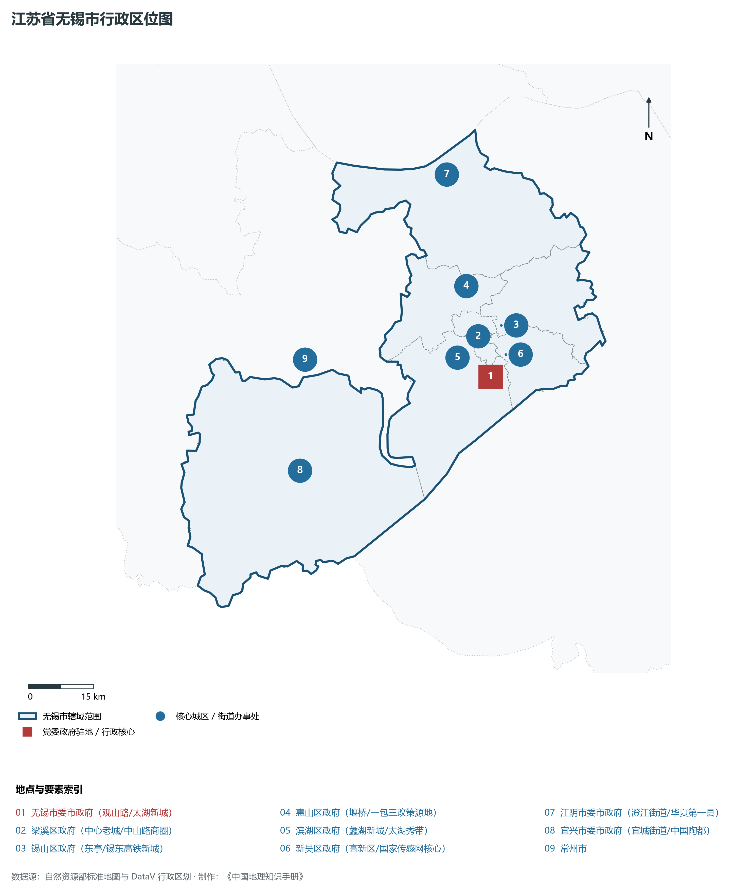
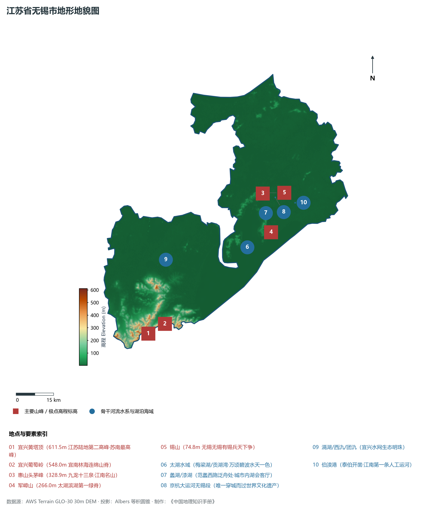
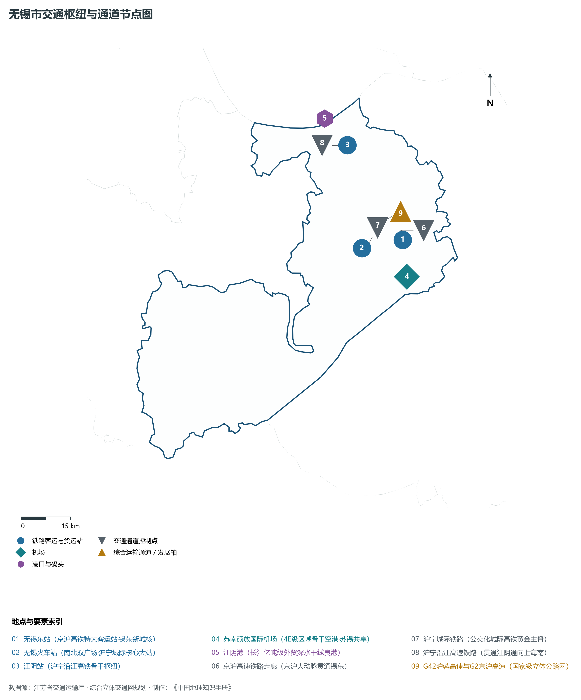
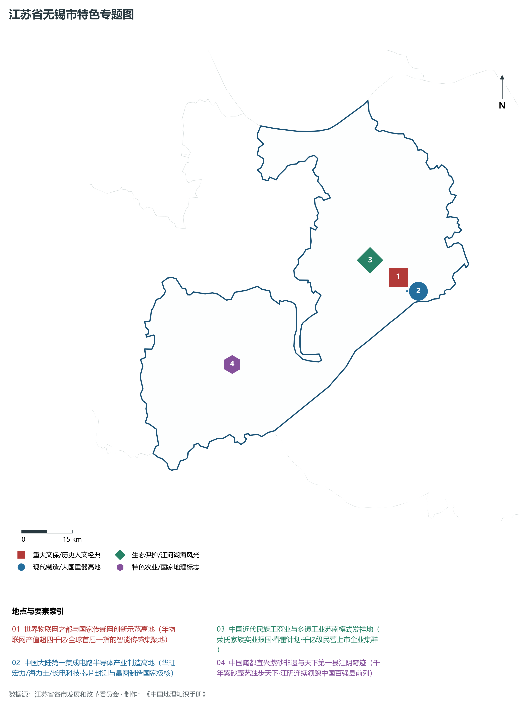
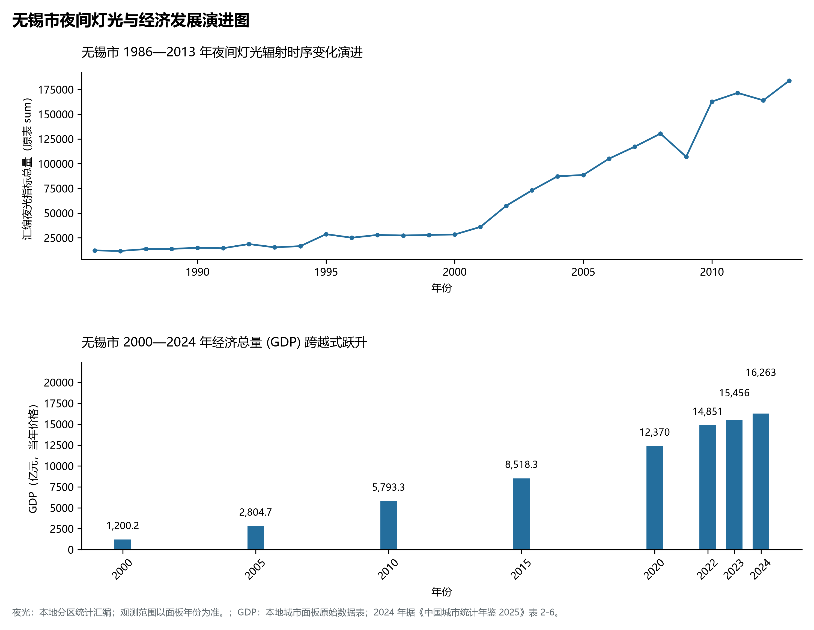

# 10.2 无锡市

无锡市，位于江苏省核心战略板块，其城市综合定位与发展愿景概括为：**太湖明珠·江南盛地·国家传感网创新示范区·物联网与集成电路高地·全国人均GDP领跑城市**。2024 年常住人口 **751 万人**，常住人口城镇化率 **83.51%**，地区生产总值 **16,263 亿元**（当年价格），人均地区生产总值 **216,844 元**，三次产业构成为 **0.86 : 47.44 : 51.69**。

---

## 一、自然地理底盘与地貌水系机理

区域骨干控制性山峰与高程标高极点包括：

- **宜兴黄塔顶 (611.5m 江苏陆地第二高峰·苏南最高峰)**（空间坐标约东经 119.680°、北纬 31.150°，海拔标高约 611.5 m）：构成区域地形骨架与水文视廊的关键基准控制点；
- **宜兴葡萄岭 (548.0m 宜南林海连绵山脊)**（空间坐标约东经 119.720°、北纬 31.180°，海拔标高约 548.0 m）：构成区域地形骨架与水文视廊的关键基准控制点；
- **惠山头茅峰 (328.9m 九龙十三泉·江南名山)**（空间坐标约东经 120.250°、北纬 31.580°，海拔标高约 328.9 m）：构成区域地形骨架与水文视廊的关键基准控制点；
- **军嶂山 (266.0m 太湖滨湖第一绿脊)**（空间坐标约东经 120.260°、北纬 31.440°，海拔标高约 266.0 m）：构成区域地形骨架与水文视廊的关键基准控制点；
- **锡山 (74.8m 无锡无锡有锡兵天下争)**（空间坐标约东经 120.270°、北纬 31.580°，海拔标高约 74.8 m）：构成区域地形骨架与水文视廊的关键基准控制点；

水系水网与生态廊道方面，无锡市江海湖荡相融，骨干河流水网密集：

- **太湖水域 (梅梁湖/贡湖湾·万顷碧波水天一色)**（水域坐标约东经 120.150°、北纬 31.400°）：发挥生态调蓄、水源涵养、航运通商与防汛抗旱的核心枢纽功能；
- **蠡湖/漆湖 (范蠡西施泛舟处·城市内湖会客厅)**（水域坐标约东经 120.250°、北纬 31.510°）：发挥生态调蓄、水源涵养、航运通商与防汛抗旱的核心枢纽功能；
- **京杭大运河无锡段 (唯一穿城而过世界文化遗产)**（水域坐标约东经 120.300°、北纬 31.560°）：发挥生态调蓄、水源涵养、航运通商与防汛抗旱的核心枢纽功能；
- **滆湖/西氿/团氿 (宜兴水网生态明珠)**（水域坐标约东经 119.800°、北纬 31.400°）：发挥生态调蓄、水源涵养、航运通商与防汛抗旱的核心枢纽功能；
- **伯渎港 (泰伯开凿·江南第一条人工运河)**（水域坐标约东经 120.380°、北纬 31.530°）：发挥生态调蓄、水源涵养、航运通商与防汛抗旱的核心枢纽功能；

---

## 二、行政区划沿革与城镇空间体系

无锡市建置沿革悠久，人文底蕴深厚，自古为江淮吴越文化交流融合的核心枢纽。新中国成立特别是改革开放以来，伴随撤县设市、撤县设区与都市圈协同建设，形成了极核突出、县域强劲、产城深度融合的现代城镇空间体系：

- **无锡市委市政府 (观山路/太湖新城)**（驻地坐标：120.315°E, 31.490°N）：区域政治治理、高品质公共服务与综合经济管理的核心支撑极核；
- **梁溪区政府 (中心老城/中山路商圈)**（驻地坐标：120.300°E, 31.575°N）：区域政治治理、高品质公共服务与综合经济管理的核心支撑极核；
- **锡山区政府 (东亭/锡东高铁新城)**（驻地坐标：120.360°E, 31.590°N）：区域政治治理、高品质公共服务与综合经济管理的核心支撑极核；
- **惠山区政府 (堰桥/一包三改策源地)**（驻地坐标：120.290°E, 31.680°N）：区域政治治理、高品质公共服务与综合经济管理的核心支撑极核；
- **滨湖区政府 (蠡湖新城/太湖秀带)**（驻地坐标：120.270°E, 31.520°N）：区域政治治理、高品质公共服务与综合经济管理的核心支撑极核；
- **新吴区政府 (高新区/国家传感网核心)**（驻地坐标：120.360°E, 31.530°N）：区域政治治理、高品质公共服务与综合经济管理的核心支撑极核；
- **江阴市委市政府 (澄江街道/华夏第一县)**（驻地坐标：120.285°E, 31.910°N）：区域政治治理、高品质公共服务与综合经济管理的核心支撑极核；
- **宜兴市委市政府 (宜城街道/中国陶都)**（驻地坐标：119.820°E, 31.360°N）：区域政治治理、高品质公共服务与综合经济管理的核心支撑极核；

在城镇空间总体布局上，无锡市紧密衔接国土空间总体规划，坚持“集约紧凑、拥江抱湖、轴向拓展、生态筑底”战略，做优中心城区综合服务功能，提升县域特色产业集聚度，构筑全域协调的现代城乡发展格局。

---

## 三、综合立体交通网络与交通走廊

无锡市地处江苏立体综合交通网络关键枢纽，依托高速铁路、骨干干线铁路、国家高速公路网与长江深水大港/内河港口/航空空港，构筑了通达全国、联通海外的现代化立体交通通道体系：

**核心综合客运与货运物流交通枢纽节点：**

- **无锡东站 (京沪高铁特大客运站·锡东新城核)**（位置坐标：120.440°E, 31.595°N）：区域客货运流量组织、换乘集散与多式联运的核心节点；
- **无锡火车站 (南北双广场·沪宁城际核心大站)**（位置坐标：120.305°E, 31.590°N）：区域客货运流量组织、换乘集散与多式联运的核心节点；
- **苏南硕放国际机场 (4E级区域骨干空港·苏锡共享)**（位置坐标：120.435°E, 31.495°N）：区域客货运流量组织、换乘集散与多式联运的核心节点；
- **江阴港 (长江亿吨级外贸深水干线良港)**（位置坐标：120.250°E, 31.950°N）：区域客货运流量组织、换乘集散与多式联运的核心节点；
- **江阴站 (沪宁沿江高铁骨干枢纽)**（位置坐标：120.310°E, 31.870°N）：区域客货运流量组织、换乘集散与多式联运的核心节点；

**骨干高速通道走廊与快速干线网络：**

- **京沪高速铁路走廊 (京沪大动脉贯通锡东)**（走廊控制点：120.440°E, 31.620°N）：对外快速互联互通的高速客货运通道与经济发展轴线；
- **沪宁城际铁路 (公交化城际高铁黄金主脊)**（走廊控制点：120.320°E, 31.590°N）：对外快速互联互通的高速客货运通道与经济发展轴线；
- **沪宁沿江高速铁路 (贯通江阴通向上海南)**（走廊控制点：120.300°E, 31.870°N）：对外快速互联互通的高速客货运通道与经济发展轴线；
- **G42沪蓉高速与G2京沪高速 (国家级立体公路网)**（走廊控制点：120.380°E, 31.650°N）：对外快速互联互通的高速客货运通道与经济发展轴线；

---

## 四、现代产业体系与新质生产力布局

无锡市坚定践行实体经济立市导向，抢抓新一轮科技革命和产业变革战略机遇，聚力发展新质生产力，加快构建具有国际竞争力的现代工业集群与高能级创新体系：

**重点先进制造业园区与产业创新高地：**

- **国家传感网创新示范区 (无锡物联网世界高地)**（园区坐标：120.380°E, 31.520°N）：区域战略性新兴产业集聚与科技成果转化的核心战略承载平台；
- **华虹半导体与SK海力士超大规模晶圆制造基地**（园区坐标：120.400°E, 31.480°N）：区域战略性新兴产业集聚与科技成果转化的核心战略承载平台；
- **江阴国家高新区现代高端装备造船新材料园**（园区坐标：120.340°E, 31.900°N）：区域战略性新兴产业集聚与科技成果转化的核心战略承载平台；
- **宜兴环保科技工业园 (全国唯一国家级环保高新区)**（园区坐标：119.810°E, 31.330°N）：区域战略性新兴产业集聚与科技成果转化的核心战略承载平台；

**标志性特色主题要素与领航龙头优势：**

- **世界物联网之都与国家传感网创新示范高地**（空间坐标：120.380°E, 31.520°N）：年物联网产值超四千亿·全球首屈一指的智能传感集聚地；
- **中国大陆第一集成电路半导体产业制造高地**（空间坐标：120.400°E, 31.480°N）：华虹宏力/海力士/长电科技·芯片封测与晶圆制造国家极核；
- **中国近代民族工商业与乡镇工业苏南模式发祥地**（空间坐标：120.300°E, 31.575°N）：荣氏家族实业报国·春雷计划·千亿级民营上市企业集群；
- **中国陶都宜兴紫砂非遗与天下第一县江阴奇迹**（空间坐标：119.820°E, 31.360°N）：千年紫砂壶艺独步天下·江阴连续领跑中国百强县前列；

---

## 五、历史文化底蕴、名胜古迹与全域文旅地理

无锡市江山胜迹璀璨，历史文脉绵延数千年，汇聚了世界文化遗产、国家 5A 级景区与全国重点文物保护单位：

- **太湖鼋头渚风景区 (5A·中华第一赏樱胜地)**（地标坐标：120.210°E, 31.520°N）：彰显吴韵汉风、运河文明与生态山水风情的名胜文旅地标；
- **灵山胜境与拈花湾 (5A·世界佛教论坛永久会址)**（地标坐标：120.100°E, 31.430°N）：彰显吴韵汉风、运河文明与生态山水风情的名胜文旅地标；
- **惠山古镇与寄畅园 (5A·全国重点文保·江南园林典范)**（地标坐标：120.270°E, 31.585°N）：彰显吴韵汉风、运河文明与生态山水风情的名胜文旅地标；
- **宜兴竹海风景区与善卷洞 (4A·陶祖圣境·喀斯特溶洞)**（地标坐标：119.740°E, 31.210°N）：彰显吴韵汉风、运河文明与生态山水风情的名胜文旅地标；
- **中央电视台无锡影视基地 (5A·三国水浒城)**（地标坐标：120.245°E, 31.485°N）：彰显吴韵汉风、运河文明与生态山水风情的名胜文旅地标；

无锡市持续推动以文塑旅、以旅彰文，深化文化遗产系统性保护与活态传承，培育高品质全域旅游新消费场景，打造高辨识度城市文旅金名片。

---

## 六、夜间灯光辐射与跨世纪经济变化时序演进

本节夜光图的观测年份为 1986—2013 年，指标为行政区汇总值（原表 sum）。

| 年份 | 地区生产总值（亿元，当年价格） |
|:---|---:|
| 2000 年 | 1,200.2 |
| 2005 年 | 2,804.7 |
| 2010 年 | 5,793.3 |
| 2015 年 | 8,518.3 |
| 2020 年 | 12,370 |
| 2022 年 | 14,851 |
| 2023 年 | 15,456 |
| 2024 年 | 16,263 |

2024 年统计来源：《中国城市统计年鉴 2025》表 2-1、2-6、2-7（2024 年，全市）。其他年份 GDP 据本地城市面板“原始数据”表，单位为亿元、当年价格。
