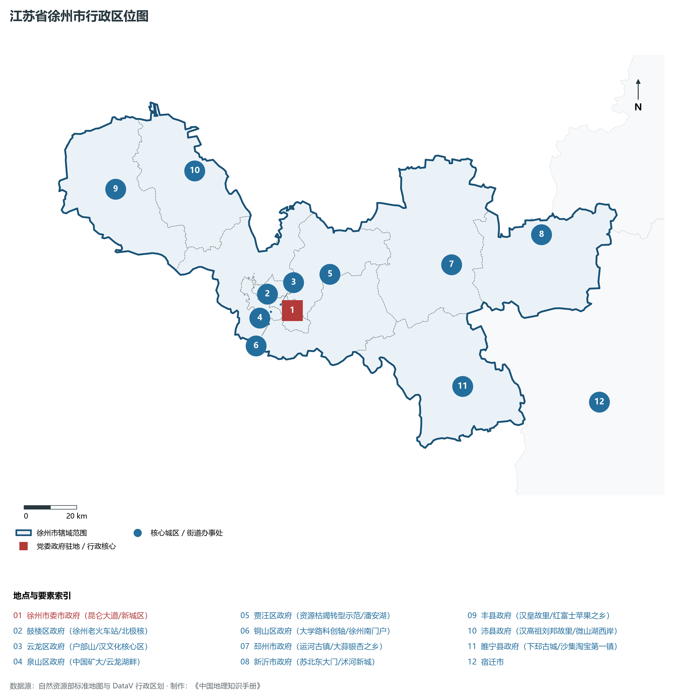
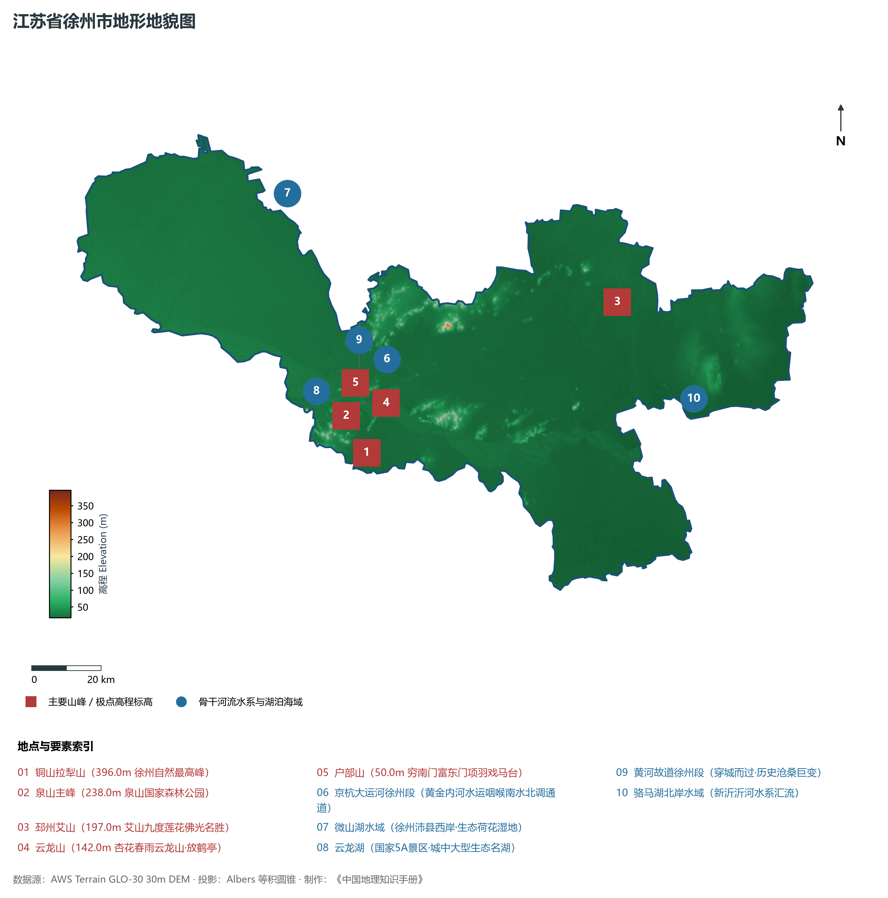
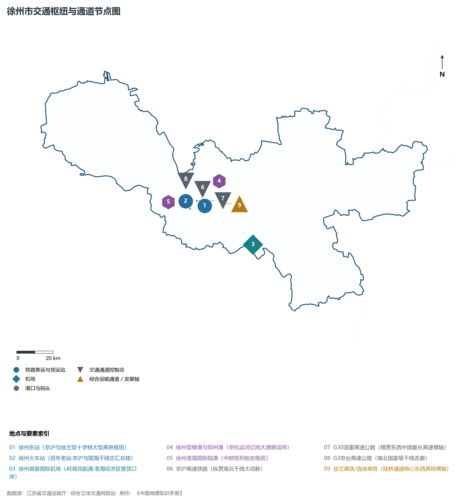
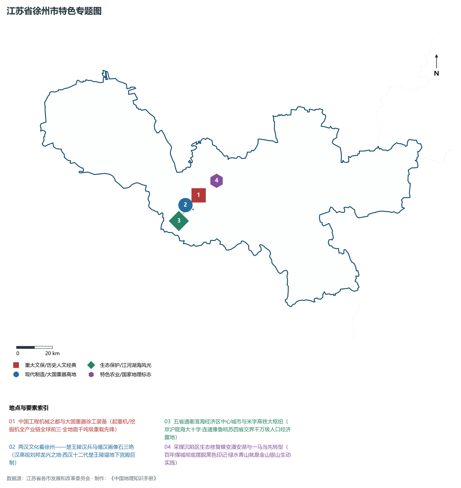
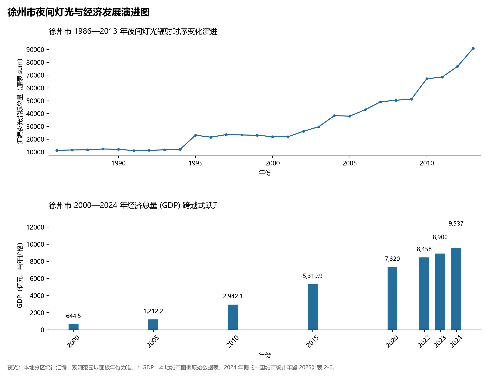

# 10.3 徐州市

徐州市，位于江苏省核心战略板块，其城市综合定位与发展愿景概括为：**淮海经济区中心城市·国家历史文化名城·五省通衢·中国工程机械之都·两汉文化策源地**。2024 年常住人口 **901 万人**，常住人口城镇化率 **68.4%**，地区生产总值 **9,537 亿元**（当年价格），人均地区生产总值 **105,792 元**，三次产业构成为 **8.18 : 38.47 : 53.35**。

---

## 一、自然地理底盘与地貌水系机理

区域骨干控制性山峰与高程标高极点包括：

- **铜山拉犁山 (396.0m 徐州自然最高峰)**（空间坐标约东经 117.200°、北纬 34.120°，海拔标高约 396.0 m）：构成区域地形骨架与水文视廊的关键基准控制点；
- **泉山主峰 (238.0m 泉山国家森林公园)**（空间坐标约东经 117.150°、北纬 34.220°，海拔标高约 238.0 m）：构成区域地形骨架与水文视廊的关键基准控制点；
- **邳州艾山 (197.0m 艾山九度莲花佛光名胜)**（空间坐标约东经 118.050°、北纬 34.420°，海拔标高约 197.0 m）：构成区域地形骨架与水文视廊的关键基准控制点；
- **云龙山 (142.0m 杏花春雨云龙山·放鹤亭)**（空间坐标约东经 117.175°、北纬 34.250°，海拔标高约 142.0 m）：构成区域地形骨架与水文视廊的关键基准控制点；
- **户部山 (50.0m 穷南门富东门项羽戏马台)**（空间坐标约东经 117.185°、北纬 34.258°，海拔标高约 50.0 m）：构成区域地形骨架与水文视廊的关键基准控制点；

水系水网与生态廊道方面，徐州市江海湖荡相融，骨干河流水网密集：

- **京杭大运河徐州段 (黄金内河水运咽喉南水北调通道)**（水域坐标约东经 117.300°、北纬 34.350°）：发挥生态调蓄、水源涵养、航运通商与防汛抗旱的核心枢纽功能；
- **微山湖水域 (徐州沛县西岸·生态荷花湿地)**（水域坐标约东经 117.050°、北纬 34.800°）：发挥生态调蓄、水源涵养、航运通商与防汛抗旱的核心枢纽功能；
- **云龙湖 (国家5A景区·城中大型生态名湖)**（水域坐标约东经 117.150°、北纬 34.240°）：发挥生态调蓄、水源涵养、航运通商与防汛抗旱的核心枢纽功能；
- **黄河故道徐州段 (穿城而过·历史沧桑巨变)**（水域坐标约东经 117.200°、北纬 34.280°）：发挥生态调蓄、水源涵养、航运通商与防汛抗旱的核心枢纽功能；
- **骆马湖北岸水域 (新沂沂河水系汇流)**（水域坐标约东经 118.250°、北纬 34.150°）：发挥生态调蓄、水源涵养、航运通商与防汛抗旱的核心枢纽功能；

---

## 二、行政区划沿革与城镇空间体系

徐州市建置沿革悠久，人文底蕴深厚，自古为江淮吴越文化交流融合的核心枢纽。新中国成立特别是改革开放以来，伴随撤县设市、撤县设区与都市圈协同建设，形成了极核突出、县域强劲、产城深度融合的现代城镇空间体系：

- **徐州市委市政府 (昆仑大道/新城区)**（驻地坐标：117.275°E, 34.225°N）：区域政治治理、高品质公共服务与综合经济管理的核心支撑极核；
- **鼓楼区政府 (徐州老火车站/北极核)**（驻地坐标：117.180°E, 34.290°N）：区域政治治理、高品质公共服务与综合经济管理的核心支撑极核；
- **云龙区政府 (户部山/汉文化核心区)**（驻地坐标：117.230°E, 34.250°N）：区域政治治理、高品质公共服务与综合经济管理的核心支撑极核；
- **泉山区政府 (中国矿大/云龙湖畔)**（驻地坐标：117.185°E, 34.230°N）：区域政治治理、高品质公共服务与综合经济管理的核心支撑极核；
- **贾汪区政府 (资源枯竭转型示范/潘安湖)**（驻地坐标：117.450°E, 34.330°N）：区域政治治理、高品质公共服务与综合经济管理的核心支撑极核；
- **铜山区政府 (大学路科创轴/徐州南门户)**（驻地坐标：117.170°E, 34.190°N）：区域政治治理、高品质公共服务与综合经济管理的核心支撑极核；
- **邳州市政府 (运河古镇/大蒜银杏之乡)**（驻地坐标：117.960°E, 34.310°N）：区域政治治理、高品质公共服务与综合经济管理的核心支撑极核；
- **新沂市政府 (苏北东大门/沭河新城)**（驻地坐标：118.350°E, 34.370°N）：区域政治治理、高品质公共服务与综合经济管理的核心支撑极核；
- **丰县政府 (汉皇故里/红富士苹果之乡)**（驻地坐标：116.600°E, 34.700°N）：区域政治治理、高品质公共服务与综合经济管理的核心支撑极核；
- **沛县政府 (汉高祖刘邦故里/微山湖西岸)**（驻地坐标：116.940°E, 34.730°N）：区域政治治理、高品质公共服务与综合经济管理的核心支撑极核；
- **睢宁县政府 (下邳古城/沙集淘宝第一镇)**（驻地坐标：117.940°E, 33.900°N）：区域政治治理、高品质公共服务与综合经济管理的核心支撑极核；

在城镇空间总体布局上，徐州市紧密衔接国土空间总体规划，坚持“集约紧凑、拥江抱湖、轴向拓展、生态筑底”战略，做优中心城区综合服务功能，提升县域特色产业集聚度，构筑全域协调的现代城乡发展格局。

---

## 三、综合立体交通网络与交通走廊

徐州市地处江苏立体综合交通网络关键枢纽，依托高速铁路、骨干干线铁路、国家高速公路网与长江深水大港/内河港口/航空空港，构筑了通达全国、联通海外的现代化立体交通通道体系：

**核心综合客运与货运物流交通枢纽节点：**

- **徐州东站 (京沪与徐兰双十字特大型高铁枢纽)**（位置坐标：117.295°E, 34.270°N）：区域客货运流量组织、换乘集散与多式联运的核心节点；
- **徐州火车站 (百年老站·京沪与陇海干线交汇总核)**（位置坐标：117.205°E, 34.265°N）：区域客货运流量组织、换乘集散与多式联运的核心节点；
- **徐州观音国际机场 (4E级民航港·淮海经济区客货口岸)**（位置坐标：117.555°E, 34.055°N）：区域客货运流量组织、换乘集散与多式联运的核心节点；
- **徐州双楼港与邳州港 (京杭运河亿吨大港联运网)**（位置坐标：117.400°E, 34.380°N）：区域客货运流量组织、换乘集散与多式联运的核心节点；
- **徐州淮海国际陆港 (中欧班列始发枢纽)**（位置坐标：117.080°E, 34.310°N）：区域客货运流量组织、换乘集散与多式联运的核心节点；

**骨干高速通道走廊与快速干线网络：**

- **京沪高速铁路 (纵贯南北干线大动脉)**（走廊控制点：117.295°E, 34.350°N）：对外快速互联互通的高速客货运通道与经济发展轴线；
- **徐兰高铁/连徐高铁 (陆桥通道核心东西高铁横轴)**（走廊控制点：117.400°E, 34.270°N）：对外快速互联互通的高速客货运通道与经济发展轴线；
- **G30连霍高速公路 (横贯东西中国最长高速横轴)**（走廊控制点：117.250°E, 34.300°N）：对外快速互联互通的高速客货运通道与经济发展轴线；
- **G3京台高速公路 (南北国家级干线走廊)**（走廊控制点：117.200°E, 34.400°N）：对外快速互联互通的高速客货运通道与经济发展轴线；

---

## 四、现代产业体系与新质生产力布局

徐州市坚定践行实体经济立市导向，抢抓新一轮科技革命和产业变革战略机遇，聚力发展新质生产力，加快构建具有国际竞争力的现代工业集群与高能级创新体系：

**重点先进制造业园区与产业创新高地：**

- **徐工集团重型机械智能制造世界级基地**（园区坐标：117.280°E, 34.310°N）：区域战略性新兴产业集聚与科技成果转化的核心战略承载平台；
- **徐州经济技术开发区 (国家级高新技术产业区)**（园区坐标：117.320°E, 34.290°N）：区域战略性新兴产业集聚与科技成果转化的核心战略承载平台；
- **江苏中能硅业与协鑫高纯多晶硅光伏基地**（园区坐标：117.250°E, 34.210°N）：区域战略性新兴产业集聚与科技成果转化的核心战略承载平台；
- **贾汪潘安湖资源枯竭生态转型绿色科创带**（园区坐标：117.420°E, 34.360°N）：区域战略性新兴产业集聚与科技成果转化的核心战略承载平台；

**标志性特色主题要素与领航龙头优势：**

- **中国工程机械之都与大国重器徐工装备**（空间坐标：117.280°E, 34.310°N）：起重机/挖掘机全产业链全球前三·全地面千吨级重载先锋；
- **两汉文化看徐州——楚王陵汉兵马俑汉画像石三绝**（空间坐标：117.235°E, 34.245°N）：汉高祖刘邦龙兴之地·西汉十二代楚王陵寝地下宫殿巨制；
- **五省通衢淮海经济区中心城市与米字高铁大枢纽**（空间坐标：117.205°E, 34.265°N）：京沪陇海大十字·连通豫鲁皖苏四省交界千万级人口经济腹地；
- **采煤沉陷区生态修复蝶变潘安湖与一马当先转型**（空间坐标：117.400°E, 34.370°N）：百年煤城彻底摆脱黑色印记·绿水青山就是金山银山生动实践；

---

## 五、历史文化底蕴、名胜古迹与全域文旅地理

徐州市江山胜迹璀璨，历史文脉绵延数千年，汇聚了世界文化遗产、国家 5A 级景区与全国重点文物保护单位：

- **云龙湖风景区 (5A·十里青山半入城·放鹤亭苏轼足迹)**（地标坐标：117.150°E, 34.235°N）：彰显吴韵汉风、运河文明与生态山水风情的名胜文旅地标；
- **徐州汉文化景区 (4A·狮子山楚王陵/汉兵马俑/汉画像石)**（地标坐标：117.235°E, 34.245°N）：彰显吴韵汉风、运河文明与生态山水风情的名胜文旅地标；
- **潘安湖国家湿地公园 (4A·采煤塌陷区变绿水青山典范)**（地标坐标：117.400°E, 34.370°N）：彰显吴韵汉风、运河文明与生态山水风情的名胜文旅地标；
- **淮海战役烈士纪念塔与纪念馆 (全国爱国主义教育基地)**（地标坐标：117.195°E, 34.225°N）：彰显吴韵汉风、运河文明与生态山水风情的名胜文旅地标；
- **窑湾古镇 (4A·日过桅帆千只夜落明珠万盏·大运河古镇)**（地标坐标：118.060°E, 34.150°N）：彰显吴韵汉风、运河文明与生态山水风情的名胜文旅地标；

徐州市持续推动以文塑旅、以旅彰文，深化文化遗产系统性保护与活态传承，培育高品质全域旅游新消费场景，打造高辨识度城市文旅金名片。

---

## 六、夜间灯光辐射与跨世纪经济变化时序演进

本节夜光图的观测年份为 1986—2013 年，指标为行政区汇总值（原表 sum）。

| 年份 | 地区生产总值（亿元，当年价格） |
|:---|---:|
| 2000 年 | 644.5 |
| 2005 年 | 1,212.2 |
| 2010 年 | 2,942.1 |
| 2015 年 | 5,319.9 |
| 2020 年 | 7,320 |
| 2022 年 | 8,458 |
| 2023 年 | 8,900 |
| 2024 年 | 9,537 |

2024 年统计来源：《中国城市统计年鉴 2025》表 2-1、2-6、2-7（2024 年，全市）。其他年份 GDP 据本地城市面板“原始数据”表，单位为亿元、当年价格。
