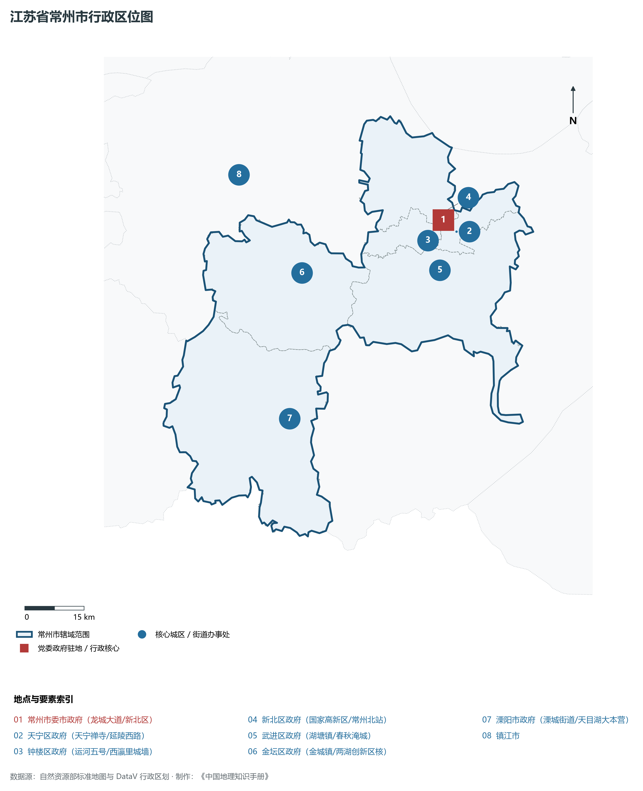
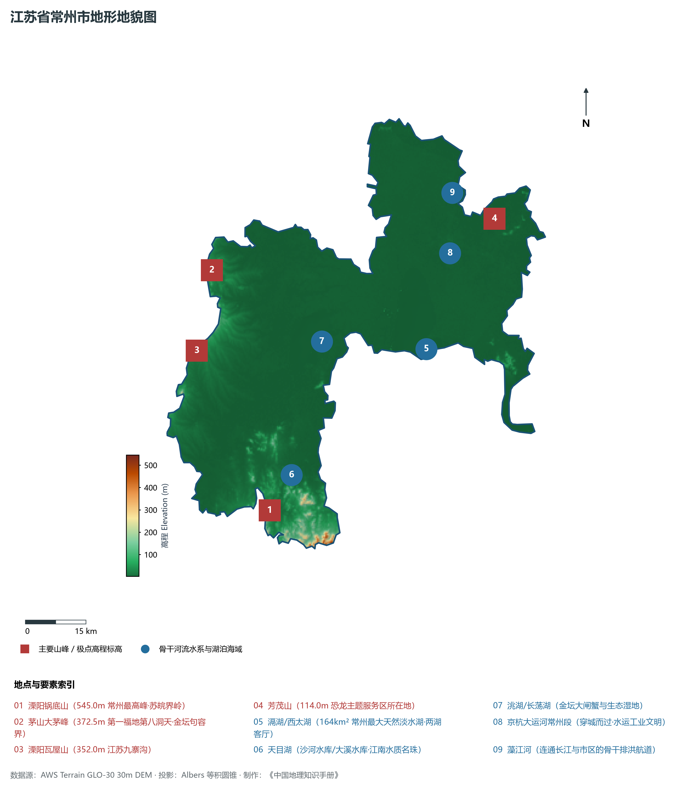
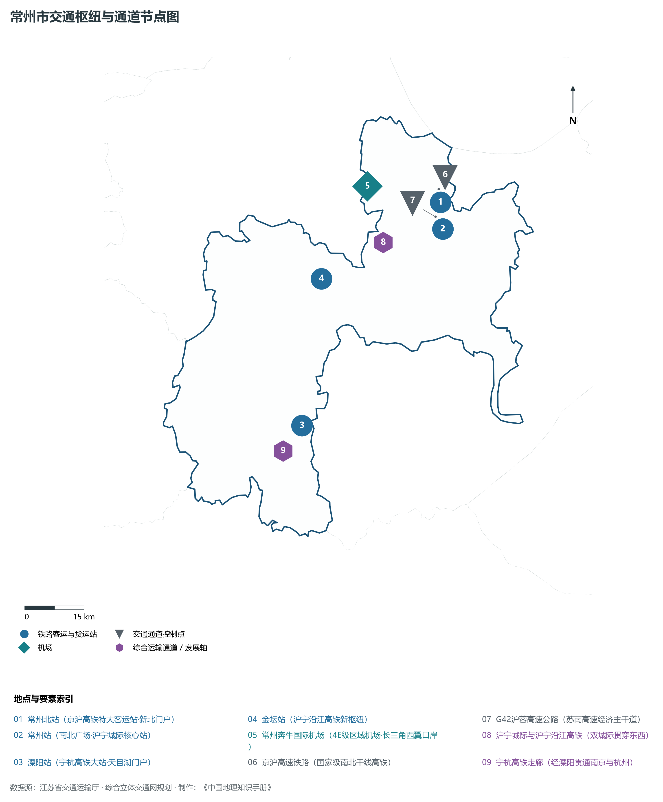
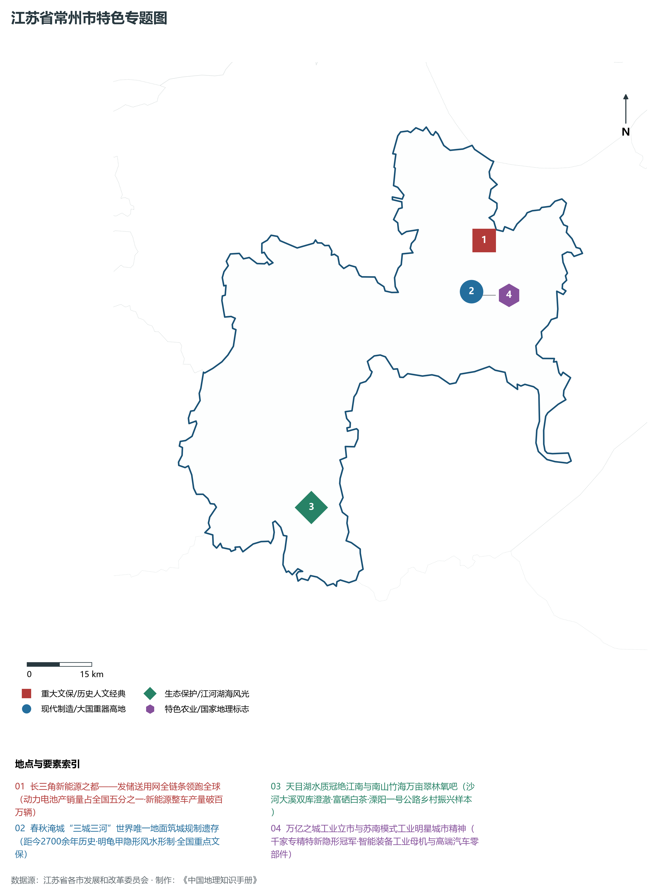
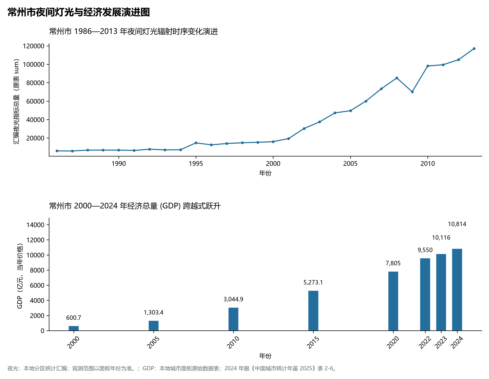

# 10.4 常州市

常州市，位于江苏省核心战略板块，其城市综合定位与发展愿景概括为：**国际化智造名城·长三角新能源之都·万亿之城·两湖创新区·苏南模式发源地之一**。2024 年常住人口 **539 万人**，常住人口城镇化率 **79%**，地区生产总值 **10,814 亿元**（当年价格），人均地区生产总值 **200,977 元**，三次产业构成为 **1.71 : 47.53 : 50.76**。

---

## 一、自然地理底盘与地貌水系机理

区域骨干控制性山峰与高程标高极点包括：

- **溧阳锅底山 (545.0m 常州最高峰·苏皖界岭)**（空间坐标约东经 119.380°、北纬 31.250°，海拔标高约 545.0 m）：构成区域地形骨架与水文视廊的关键基准控制点；
- **茅山大茅峰 (372.5m 第一福地第八洞天·金坛句容界)**（空间坐标约东经 119.320°、北纬 31.790°，海拔标高约 372.5 m）：构成区域地形骨架与水文视廊的关键基准控制点；
- **溧阳瓦屋山 (352.0m 江苏九寨沟)**（空间坐标约东经 119.250°、北纬 31.620°，海拔标高约 352.0 m）：构成区域地形骨架与水文视廊的关键基准控制点；
- **芳茂山 (114.0m 恐龙主题服务区所在地)**（空间坐标约东经 120.080°、北纬 31.810°，海拔标高约 114.0 m）：构成区域地形骨架与水文视廊的关键基准控制点；

水系水网与生态廊道方面，常州市江海湖荡相融，骨干河流水网密集：

- **滆湖/西太湖 (164km² 常州最大天然淡水湖·两湖客厅)**（水域坐标约东经 119.850°、北纬 31.550°）：发挥生态调蓄、水源涵养、航运通商与防汛抗旱的核心枢纽功能；
- **天目湖 (沙河水库/大溪水库·江南水质名珠)**（水域坐标约东经 119.450°、北纬 31.320°）：发挥生态调蓄、水源涵养、航运通商与防汛抗旱的核心枢纽功能；
- **洮湖/长荡湖 (金坛大闸蟹与生态湿地)**（水域坐标约东经 119.580°、北纬 31.600°）：发挥生态调蓄、水源涵养、航运通商与防汛抗旱的核心枢纽功能；
- **京杭大运河常州段 (穿城而过·水运工业文明)**（水域坐标约东经 119.950°、北纬 31.750°）：发挥生态调蓄、水源涵养、航运通商与防汛抗旱的核心枢纽功能；
- **藻江河 (连通长江与市区的骨干排洪航道)**（水域坐标约东经 119.980°、北纬 31.880°）：发挥生态调蓄、水源涵养、航运通商与防汛抗旱的核心枢纽功能；

---

## 二、行政区划沿革与城镇空间体系

常州市建置沿革悠久，人文底蕴深厚，自古为江淮吴越文化交流融合的核心枢纽。新中国成立特别是改革开放以来，伴随撤县设市、撤县设区与都市圈协同建设，形成了极核突出、县域强劲、产城深度融合的现代城镇空间体系：

- **常州市委市政府 (龙城大道/新北区)**（驻地坐标：119.970°E, 31.810°N）：区域政治治理、高品质公共服务与综合经济管理的核心支撑极核；
- **天宁区政府 (天宁禅寺/延陵西路)**（驻地坐标：120.000°E, 31.780°N）：区域政治治理、高品质公共服务与综合经济管理的核心支撑极核；
- **钟楼区政府 (运河五号/西瀛里城墙)**（驻地坐标：119.920°E, 31.770°N）：区域政治治理、高品质公共服务与综合经济管理的核心支撑极核；
- **新北区政府 (国家高新区/常州北站)**（驻地坐标：119.980°E, 31.830°N）：区域政治治理、高品质公共服务与综合经济管理的核心支撑极核；
- **武进区政府 (湖塘镇/春秋淹城)**（驻地坐标：119.940°E, 31.700°N）：区域政治治理、高品质公共服务与综合经济管理的核心支撑极核；
- **金坛区政府 (金城镇/两湖创新区核)**（驻地坐标：119.570°E, 31.740°N）：区域政治治理、高品质公共服务与综合经济管理的核心支撑极核；
- **溧阳市政府 (溧城街道/天目湖大本营)**（驻地坐标：119.480°E, 31.420°N）：区域政治治理、高品质公共服务与综合经济管理的核心支撑极核；

在城镇空间总体布局上，常州市紧密衔接国土空间总体规划，坚持“集约紧凑、拥江抱湖、轴向拓展、生态筑底”战略，做优中心城区综合服务功能，提升县域特色产业集聚度，构筑全域协调的现代城乡发展格局。

---

## 三、综合立体交通网络与交通走廊

常州市地处江苏立体综合交通网络关键枢纽，依托高速铁路、骨干干线铁路、国家高速公路网与长江深水大港/内河港口/航空空港，构筑了通达全国、联通海外的现代化立体交通通道体系：

**核心综合客运与货运物流交通枢纽节点：**

- **常州北站 (京沪高铁特大客运站·新北门户)**（位置坐标：119.970°E, 31.850°N）：区域客货运流量组织、换乘集散与多式联运的核心节点；
- **常州站 (南北广场·沪宁城际核心站)**（位置坐标：119.965°E, 31.790°N）：区域客货运流量组织、换乘集散与多式联运的核心节点；
- **常州奔牛国际机场 (4E级区域机场·长三角西翼口岸)**（位置坐标：119.780°E, 31.910°N）：区域客货运流量组织、换乘集散与多式联运的核心节点；
- **溧阳站 (宁杭高铁大站·天目湖门户)**（位置坐标：119.510°E, 31.400°N）：区域客货运流量组织、换乘集散与多式联运的核心节点；
- **金坛站 (沪宁沿江高铁新枢纽)**（位置坐标：119.620°E, 31.720°N）：区域客货运流量组织、换乘集散与多式联运的核心节点；

**骨干高速通道走廊与快速干线网络：**

- **京沪高速铁路 (国家级南北干线高铁)**（走廊控制点：119.970°E, 31.880°N）：对外快速互联互通的高速客货运通道与经济发展轴线；
- **沪宁城际与沪宁沿江高铁 (双城际贯穿东西)**（走廊控制点：119.800°E, 31.780°N）：对外快速互联互通的高速客货运通道与经济发展轴线；
- **宁杭高铁走廊 (经溧阳贯通南京与杭州)**（走廊控制点：119.450°E, 31.350°N）：对外快速互联互通的高速客货运通道与经济发展轴线；
- **G42沪蓉高速公路 (苏南高速经济主干道)**（走廊控制点：119.950°E, 31.820°N）：对外快速互联互通的高速客货运通道与经济发展轴线；

---

## 四、现代产业体系与新质生产力布局

常州市坚定践行实体经济立市导向，抢抓新一轮科技革命和产业变革战略机遇，聚力发展新质生产力，加快构建具有国际竞争力的现代工业集群与高能级创新体系：

**重点先进制造业园区与产业创新高地：**

- **中创新航与蜂巢能源动力电池超级产业集群**（园区坐标：119.600°E, 31.680°N）：区域战略性新兴产业集聚与科技成果转化的核心战略承载平台；
- **理想汽车常州智能制造基地 (武进高新区)**（园区坐标：119.920°E, 31.630°N）：区域战略性新兴产业集聚与科技成果转化的核心战略承载平台；
- **天合光能光伏科学与技术国家重点实验室**（园区坐标：119.960°E, 31.860°N）：区域战略性新兴产业集聚与科技成果转化的核心战略承载平台；
- **两湖创新区核心区 (打造长三角现代智造策源地)**（园区坐标：119.800°E, 31.650°N）：区域战略性新兴产业集聚与科技成果转化的核心战略承载平台；

**标志性特色主题要素与领航龙头优势：**

- **长三角新能源之都——发储送用网全链条领跑全球**（空间坐标：119.970°E, 31.810°N）：动力电池产销量占全国五分之一·新能源整车产量破百万辆；
- **春秋淹城“三城三河”世界唯一地面筑城规制遗存**（空间坐标：119.920°E, 31.710°N）：距今2700余年历史·明龟甲隐形风水形制·全国重点文保；
- **天目湖水质冠绝江南与南山竹海万亩翠林氧吧**（空间坐标：119.450°E, 31.320°N）：沙河大溪双库澄澈·富硒白茶·溧阳一号公路乡村振兴样本；
- **万亿之城工业立市与苏南模式工业明星城市精神**（空间坐标：119.940°E, 31.700°N）：千家专精特新隐形冠军·智能装备工业母机与高端汽车零部件；

---

## 五、历史文化底蕴、名胜古迹与全域文旅地理

常州市江山胜迹璀璨，历史文脉绵延数千年，汇聚了世界文化遗产、国家 5A 级景区与全国重点文物保护单位：

- **中华恐龙园 (5A·东方侏罗纪·国家级文化旅游标杆)**（地标坐标：120.005°E, 31.825°N）：彰显吴韵汉风、运河文明与生态山水风情的名胜文旅地标；
- **溧阳天目湖旅游度假区 (5A·山水园/南山竹海/御水温泉)**（地标坐标：119.450°E, 31.320°N）：彰显吴韵汉风、运河文明与生态山水风情的名胜文旅地标；
- **中国春秋淹城旅游区 (5A·三城三河古代城池遗迹)**（地标坐标：119.920°E, 31.710°N）：彰显吴韵汉风、运河文明与生态山水风情的名胜文旅地标；
- **天宁禅寺 (4A·东南第一丛林·天宁宝塔神州大佛)**（地标坐标：120.000°E, 31.780°N）：彰显吴韵汉风、运河文明与生态山水风情的名胜文旅地标；
- **青果巷历史文化街区 (江南名士第一巷·瞿秋白故居)**（地标坐标：119.960°E, 31.770°N）：彰显吴韵汉风、运河文明与生态山水风情的名胜文旅地标；

常州市持续推动以文塑旅、以旅彰文，深化文化遗产系统性保护与活态传承，培育高品质全域旅游新消费场景，打造高辨识度城市文旅金名片。

---

## 六、夜间灯光辐射与跨世纪经济变化时序演进

本节夜光图的观测年份为 1986—2013 年，指标为行政区汇总值（原表 sum）。

| 年份 | 地区生产总值（亿元，当年价格） |
|:---|---:|
| 2000 年 | 600.7 |
| 2005 年 | 1,303.4 |
| 2010 年 | 3,044.9 |
| 2015 年 | 5,273.1 |
| 2020 年 | 7,805 |
| 2022 年 | 9,550 |
| 2023 年 | 10,116 |
| 2024 年 | 10,814 |

2024 年统计来源：《中国城市统计年鉴 2025》表 2-1、2-6、2-7（2024 年，全市）。其他年份 GDP 据本地城市面板“原始数据”表，单位为亿元、当年价格。
