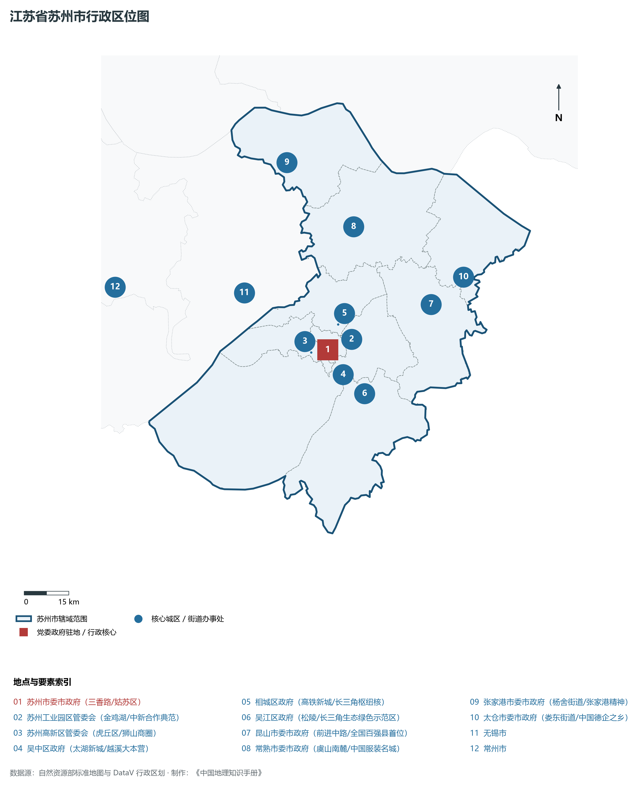
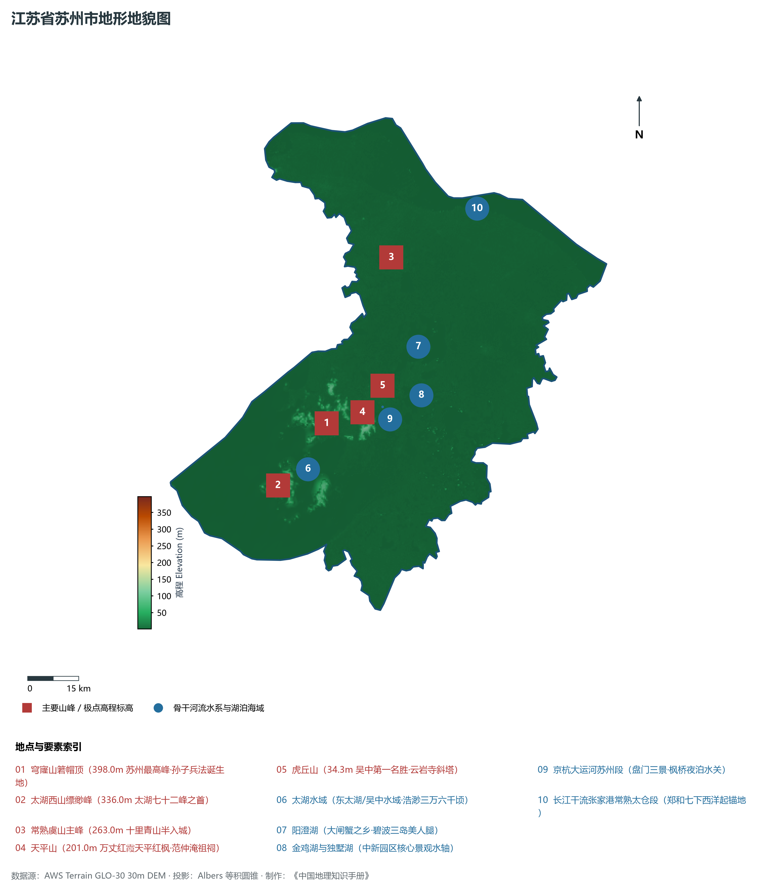
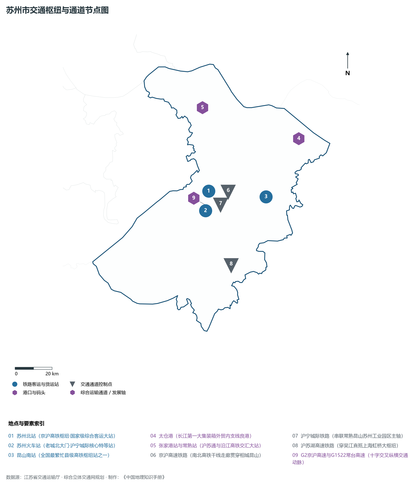
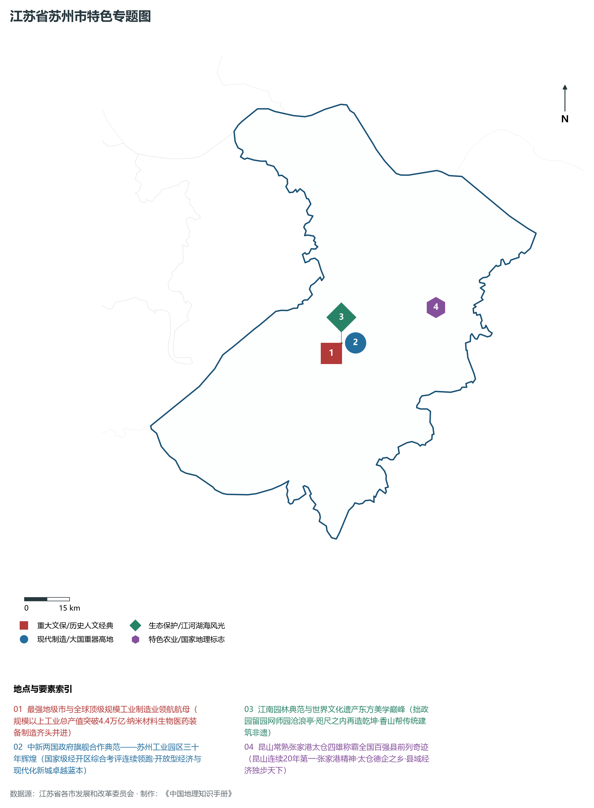
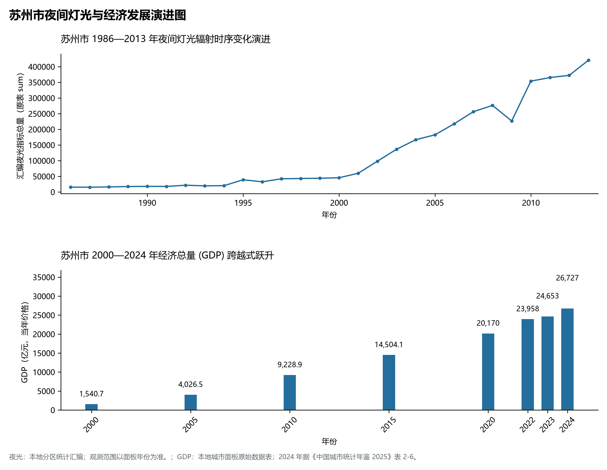

# 10.5 苏州市

苏州市，位于江苏省核心战略板块，其城市综合定位与发展愿景概括为：**东方威尼斯·人间天堂·中国最强地级市·国家高新技术产业与制造业总产值领航者·园林文化之都**。2024 年常住人口 **1,299 万人**，常住人口城镇化率 **82.7%**，地区生产总值 **26,727 亿元**（当年价格），人均地区生产总值 **206,028 元**，三次产业构成为 **0.76 : 46.83 : 52.41**。

---

## 一、自然地理底盘与地貌水系机理

区域骨干控制性山峰与高程标高极点包括：

- **穹窿山箬帽顶 (398.0m 苏州最高峰·孙子兵法诞生地)**（空间坐标约东经 120.430°、北纬 31.260°，海拔标高约 398.0 m）：构成区域地形骨架与水文视廊的关键基准控制点；
- **太湖西山缥缈峰 (336.0m 太湖七十二峰之首)**（空间坐标约东经 120.250°、北纬 31.120°，海拔标高约 336.0 m）：构成区域地形骨架与水文视廊的关键基准控制点；
- **常熟虞山主峰 (263.0m 十里青山半入城)**（空间坐标约东经 120.710°、北纬 31.660°，海拔标高约 263.0 m）：构成区域地形骨架与水文视廊的关键基准控制点；
- **天平山 (201.0m 万丈红霞天平红枫·范仲淹祖祠)**（空间坐标约东经 120.500°、北纬 31.280°，海拔标高约 201.0 m）：构成区域地形骨架与水文视廊的关键基准控制点；
- **虎丘山 (34.3m 吴中第一名胜·云岩寺斜塔)**（空间坐标约东经 120.575°、北纬 31.340°，海拔标高约 34.3 m）：构成区域地形骨架与水文视廊的关键基准控制点；

水系水网与生态廊道方面，苏州市江海湖荡相融，骨干河流水网密集：

- **太湖水域 (东太湖/吴中水域·浩渺三万六千顷)**（水域坐标约东经 120.350°、北纬 31.150°）：发挥生态调蓄、水源涵养、航运通商与防汛抗旱的核心枢纽功能；
- **阳澄湖 (大闸蟹之乡·碧波三岛美人腿)**（水域坐标约东经 120.750°、北纬 31.420°）：发挥生态调蓄、水源涵养、航运通商与防汛抗旱的核心枢纽功能；
- **金鸡湖与独墅湖 (中新园区核心景观水轴)**（水域坐标约东经 120.690°、北纬 31.300°）：发挥生态调蓄、水源涵养、航运通商与防汛抗旱的核心枢纽功能；
- **京杭大运河苏州段 (盘门三景·枫桥夜泊水关)**（水域坐标约东经 120.610°、北纬 31.280°）：发挥生态调蓄、水源涵养、航运通商与防汛抗旱的核心枢纽功能；
- **长江干流张家港常熟太仓段 (郑和七下西洋起锚地)**（水域坐标约东经 121.000°、北纬 31.750°）：发挥生态调蓄、水源涵养、航运通商与防汛抗旱的核心枢纽功能；

---

## 二、行政区划沿革与城镇空间体系

苏州市建置沿革悠久，人文底蕴深厚，自古为江淮吴越文化交流融合的核心枢纽。新中国成立特别是改革开放以来，伴随撤县设市、撤县设区与都市圈协同建设，形成了极核突出、县域强劲、产城深度融合的现代城镇空间体系：

- **苏州市委市政府 (三香路/姑苏区)**（驻地坐标：120.590°E, 31.300°N）：区域政治治理、高品质公共服务与综合经济管理的核心支撑极核；
- **苏州工业园区管委会 (金鸡湖/中新合作典范)**（驻地坐标：120.680°E, 31.320°N）：区域政治治理、高品质公共服务与综合经济管理的核心支撑极核；
- **苏州高新区管委会 (虎丘区/狮山商圈)**（驻地坐标：120.530°E, 31.300°N）：区域政治治理、高品质公共服务与综合经济管理的核心支撑极核；
- **吴中区政府 (太湖新城/越溪大本营)**（驻地坐标：120.630°E, 31.220°N）：区域政治治理、高品质公共服务与综合经济管理的核心支撑极核；
- **相城区政府 (高铁新城/长三角枢纽核)**（驻地坐标：120.640°E, 31.370°N）：区域政治治理、高品质公共服务与综合经济管理的核心支撑极核；
- **吴江区政府 (松陵/长三角生态绿色示范区)**（驻地坐标：120.650°E, 31.160°N）：区域政治治理、高品质公共服务与综合经济管理的核心支撑极核；
- **昆山市委市政府 (前进中路/全国百强县首位)**（驻地坐标：120.980°E, 31.385°N）：区域政治治理、高品质公共服务与综合经济管理的核心支撑极核；
- **常熟市委市政府 (虞山南麓/中国服装名城)**（驻地坐标：120.750°E, 31.650°N）：区域政治治理、高品质公共服务与综合经济管理的核心支撑极核；
- **张家港市委市政府 (杨舍街道/张家港精神)**（驻地坐标：120.550°E, 31.870°N）：区域政治治理、高品质公共服务与综合经济管理的核心支撑极核；
- **太仓市委市政府 (娄东街道/中国德企之乡)**（驻地坐标：121.110°E, 31.450°N）：区域政治治理、高品质公共服务与综合经济管理的核心支撑极核；

在城镇空间总体布局上，苏州市紧密衔接国土空间总体规划，坚持“集约紧凑、拥江抱湖、轴向拓展、生态筑底”战略，做优中心城区综合服务功能，提升县域特色产业集聚度，构筑全域协调的现代城乡发展格局。

---

## 三、综合立体交通网络与交通走廊

苏州市地处江苏立体综合交通网络关键枢纽，依托高速铁路、骨干干线铁路、国家高速公路网与长江深水大港/内河港口/航空空港，构筑了通达全国、联通海外的现代化立体交通通道体系：

**核心综合客运与货运物流交通枢纽节点：**

- **苏州北站 (京沪高铁枢纽·国家级综合客运大站)**（位置坐标：120.640°E, 31.420°N）：区域客货运流量组织、换乘集散与多式联运的核心节点；
- **苏州火车站 (老城北大门·沪宁城际核心特等站)**（位置坐标：120.605°E, 31.330°N）：区域客货运流量组织、换乘集散与多式联运的核心节点；
- **昆山南站 (全国最繁忙县级高铁枢纽站之一)**（位置坐标：120.960°E, 31.350°N）：区域客货运流量组织、换乘集散与多式联运的核心节点；
- **太仓港 (长江第一大集装箱外贸内支线良港)**（位置坐标：121.200°E, 31.600°N）：区域客货运流量组织、换乘集散与多式联运的核心节点；
- **张家港站与常熟站 (沪苏通与沿江高铁交汇大站)**（位置坐标：120.680°E, 31.820°N）：区域客货运流量组织、换乘集散与多式联运的核心节点；

**骨干高速通道走廊与快速干线网络：**

- **京沪高速铁路 (南北高铁干线走廊贯穿相城昆山)**（走廊控制点：120.750°E, 31.400°N）：对外快速互联互通的高速客货运通道与经济发展轴线；
- **沪宁城际铁路 (串联常熟昆山苏州工业园区主轴)**（走廊控制点：120.650°E, 31.350°N）：对外快速互联互通的高速客货运通道与经济发展轴线；
- **沪苏湖高速铁路 (穿吴江直抵上海虹桥大枢纽)**（走廊控制点：120.700°E, 31.050°N）：对外快速互联互通的高速客货运通道与经济发展轴线；
- **G2京沪高速与G1522常台高速 (十字交叉纵横交通动脉)**（走廊控制点：120.620°E, 31.350°N）：对外快速互联互通的高速客货运通道与经济发展轴线；

---

## 四、现代产业体系与新质生产力布局

苏州市坚定践行实体经济立市导向，抢抓新一轮科技革命和产业变革战略机遇，聚力发展新质生产力，加快构建具有国际竞争力的现代工业集群与高能级创新体系：

**重点先进制造业园区与产业创新高地：**

- **苏州工业园区国家级生物医药与纳米创新园**（园区坐标：120.750°E, 31.280°N）：区域战略性新兴产业集聚与科技成果转化的核心战略承载平台；
- **昆山经济技术开发区两岸微电子智能制造区**（园区坐标：121.020°E, 31.370°N）：区域战略性新兴产业集聚与科技成果转化的核心战略承载平台；
- **恒力集团与盛虹集团世界500强总部基地**（园区坐标：120.680°E, 31.140°N）：区域战略性新兴产业集聚与科技成果转化的核心战略承载平台；
- **沙钢集团超大型钢铁基地 (张家港)**（园区坐标：120.620°E, 31.950°N）：区域战略性新兴产业集聚与科技成果转化的核心战略承载平台；

**标志性特色主题要素与领航龙头优势：**

- **最强地级市与全球顶级规模工业制造业领航航母**（空间坐标：120.590°E, 31.300°N）：规模以上工业总产值突破4.4万亿·纳米材料生物医药装备制造齐头并进；
- **中新两国政府旗舰合作典范——苏州工业园区三十年辉煌**（空间坐标：120.680°E, 31.320°N）：国家级经开区综合考评连续领跑·开放型经济与现代化新城卓越蓝本；
- **江南园林典范与世界文化遗产东方美学巅峰**（空间坐标：120.630°E, 31.325°N）：拙政园留园网师园沧浪亭·咫尺之内再造乾坤·香山帮传统建筑非遗；
- **昆山常熟张家港太仓四雄称霸全国百强县前列奇迹**（空间坐标：120.980°E, 31.385°N）：昆山连续20年第一·张家港精神·太仓德企之乡·县域经济独步天下；

---

## 五、历史文化底蕴、名胜古迹与全域文旅地理

苏州市江山胜迹璀璨，历史文脉绵延数千年，汇聚了世界文化遗产、国家 5A 级景区与全国重点文物保护单位：

- **拙政园与苏州园林世界文化遗产群 (5A·天下名园首)**（地标坐标：120.630°E, 31.325°N）：彰显吴韵汉风、运河文明与生态山水风情的名胜文旅地标；
- **周庄古镇 (5A·中国第一水乡·双桥画卷)**（地标坐标：120.850°E, 31.115°N）：彰显吴韵汉风、运河文明与生态山水风情的名胜文旅地标；
- **同里古镇 (5A·江南水乡名镇·退思园名录)**（地标坐标：120.720°E, 31.160°N）：彰显吴韵汉风、运河文明与生态山水风情的名胜文旅地标；
- **虎丘山风景名胜区 (5A·吴王阖闾墓·剑池斜塔)**（地标坐标：120.575°E, 31.340°N）：彰显吴韵汉风、运河文明与生态山水风情的名胜文旅地标；
- **沙家浜·虞山尚湖旅游区 (5A·芦苇荡革命传奇)**（地标坐标：120.780°E, 31.550°N）：彰显吴韵汉风、运河文明与生态山水风情的名胜文旅地标；

苏州市持续推动以文塑旅、以旅彰文，深化文化遗产系统性保护与活态传承，培育高品质全域旅游新消费场景，打造高辨识度城市文旅金名片。

---

## 六、夜间灯光辐射与跨世纪经济变化时序演进

本节夜光图的观测年份为 1986—2013 年，指标为行政区汇总值（原表 sum）。

| 年份 | 地区生产总值（亿元，当年价格） |
|:---|---:|
| 2000 年 | 1,540.7 |
| 2005 年 | 4,026.5 |
| 2010 年 | 9,228.9 |
| 2015 年 | 14,504.1 |
| 2020 年 | 20,170 |
| 2022 年 | 23,958 |
| 2023 年 | 24,653 |
| 2024 年 | 26,727 |

2024 年统计来源：《中国城市统计年鉴 2025》表 2-1、2-6、2-7（2024 年，全市）。其他年份 GDP 据本地城市面板“原始数据”表，单位为亿元、当年价格。
