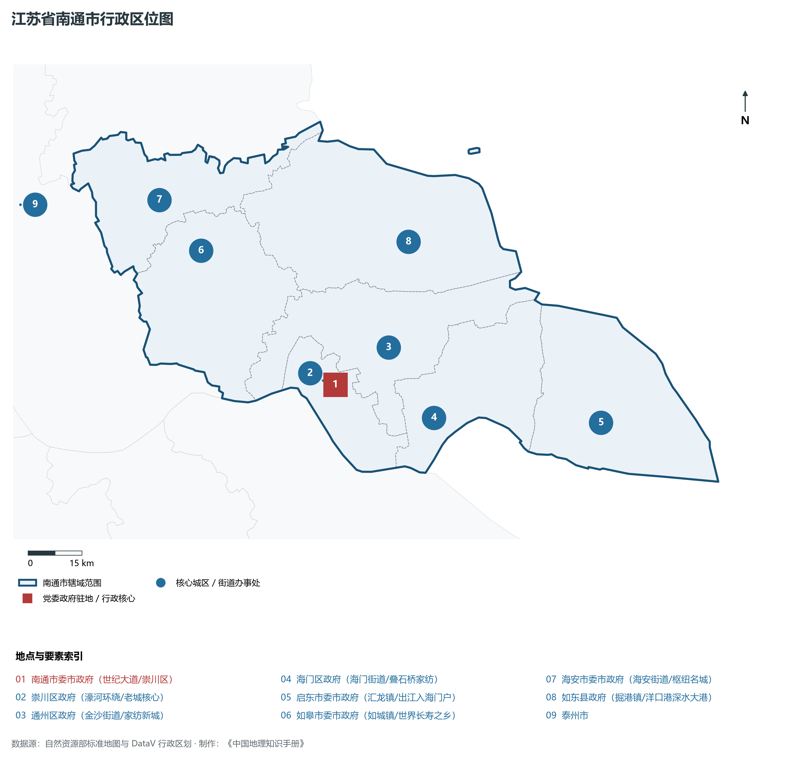
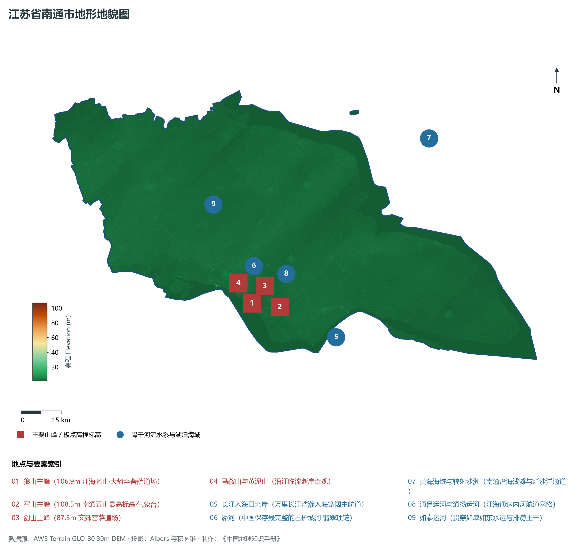
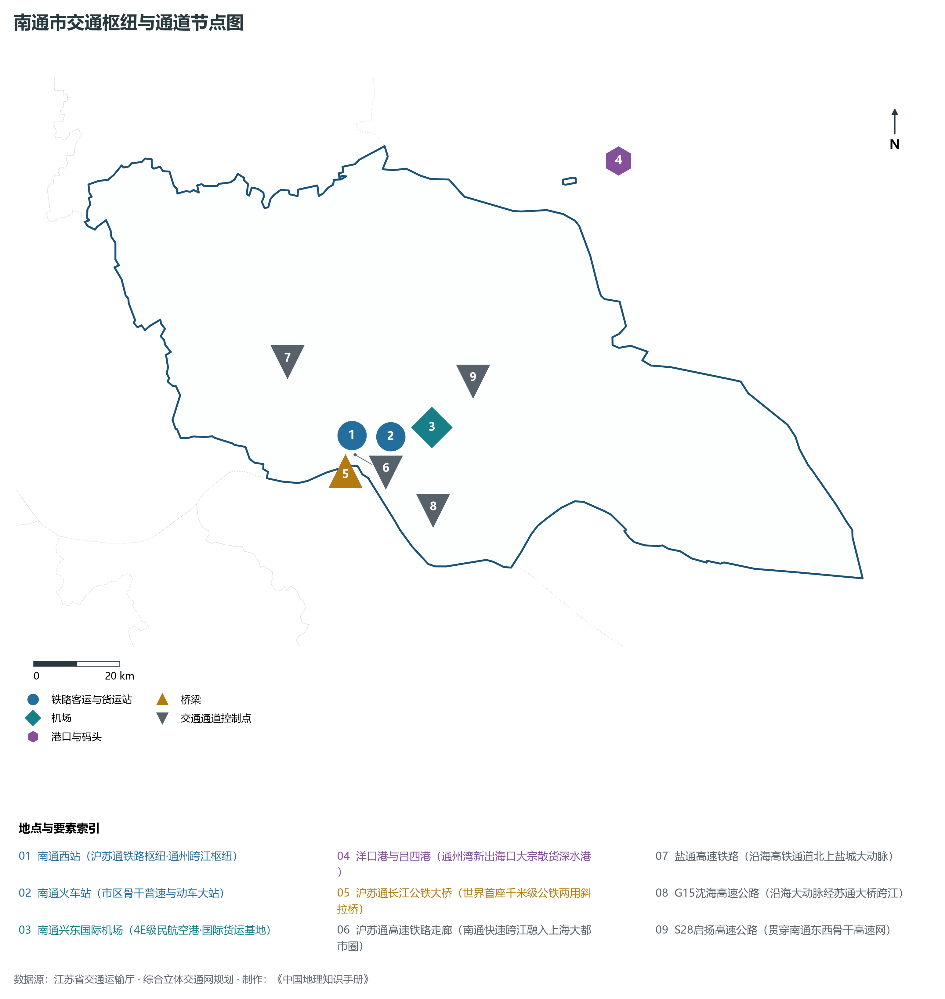
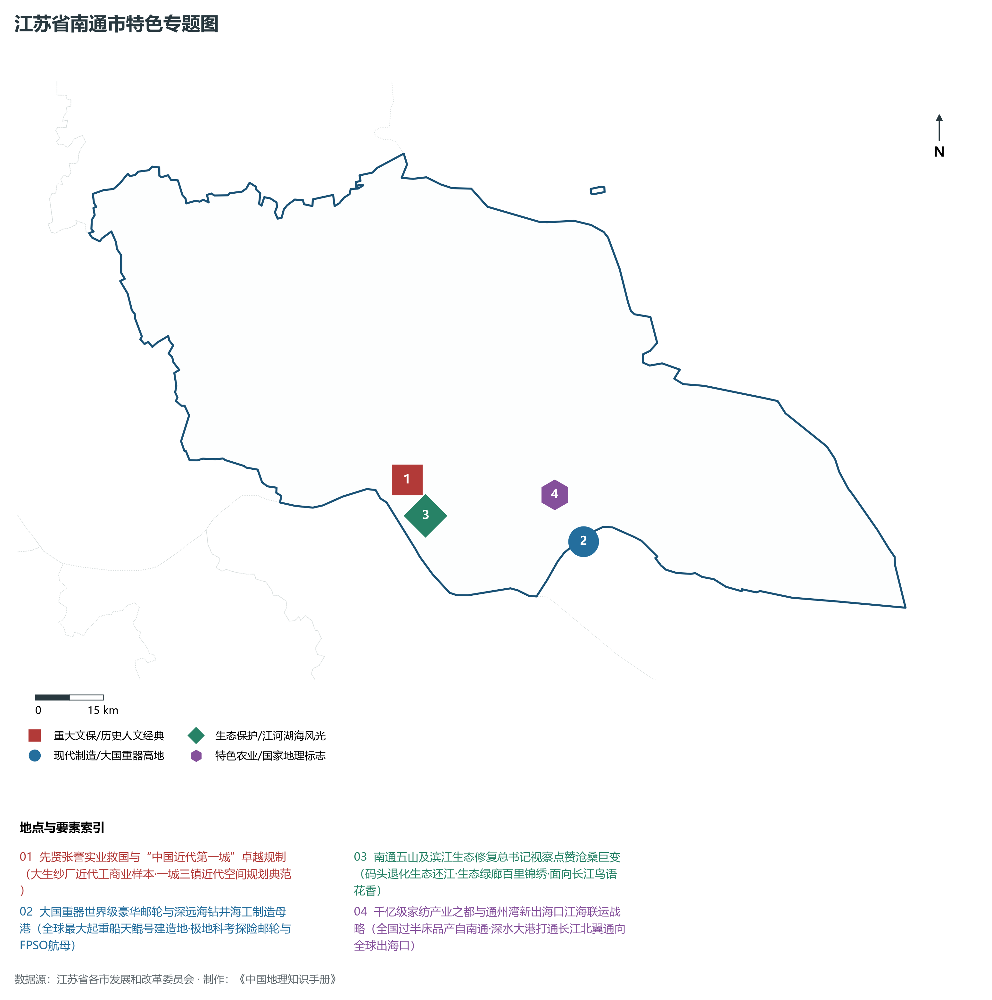
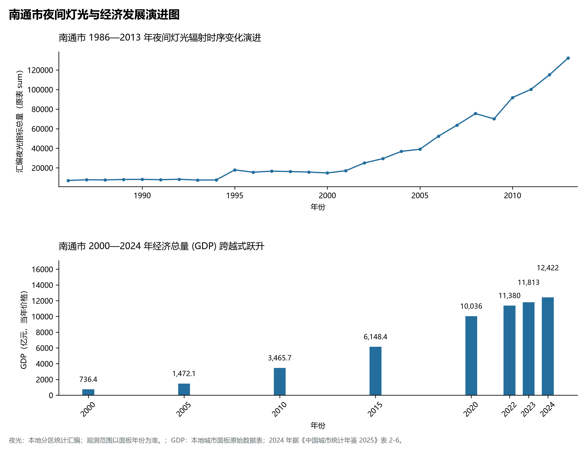

# 10.6 南通市

南通市，位于江苏省核心战略板块，其城市综合定位与发展愿景概括为：**中国近代第一城·江海门户·万亿之城·现代海洋船舶海工基地·长三角北翼经济中心**。2024 年常住人口 **775 万人**，常住人口城镇化率 **73.1%**，地区生产总值 **12,422 亿元**（当年价格），人均地区生产总值 **160,298 元**，三次产业构成为 **4.28 : 47.55 : 48.16**。

---

## 一、自然地理底盘与地貌水系机理

区域骨干控制性山峰与高程标高极点包括：

- **狼山主峰 (106.9m 江海名山·大势至菩萨道场)**（空间坐标约东经 120.890°、北纬 31.955°，海拔标高约 106.9 m）：构成区域地形骨架与水文视廊的关键基准控制点；
- **军山主峰 (108.5m 南通五山最高标高·气象台)**（空间坐标约东经 120.910°、北纬 31.940°，海拔标高约 108.5 m）：构成区域地形骨架与水文视廊的关键基准控制点；
- **剑山主峰 (87.3m 文殊菩萨道场)**（空间坐标约东经 120.895°、北纬 31.948°，海拔标高约 87.3 m）：构成区域地形骨架与水文视廊的关键基准控制点；
- **马鞍山与黄泥山 (沿江临流断崖奇观)**（空间坐标约东经 120.880°、北纬 31.960°，海拔标高约 60.0 m）：构成区域地形骨架与水文视廊的关键基准控制点；

水系水网与生态廊道方面，南通市江海湖荡相融，骨干河流水网密集：

- **长江入海口北岸 (万里长江浩瀚入海宽阔主航道)**（水域坐标约东经 121.200°、北纬 31.800°）：发挥生态调蓄、水源涵养、航运通商与防汛抗旱的核心枢纽功能；
- **濠河 (中国保存最完整的古护城河·翡翠项链)**（水域坐标约东经 120.865°、北纬 32.020°）：发挥生态调蓄、水源涵养、航运通商与防汛抗旱的核心枢纽功能；
- **黄海海域与辐射沙洲 (南通沿海浅滩与烂沙洋通道)**（水域坐标约东经 121.700°、北纬 32.400°）：发挥生态调蓄、水源涵养、航运通商与防汛抗旱的核心枢纽功能；
- **通吕运河与通扬运河 (江海通达内河航道网络)**（水域坐标约东经 121.000°、北纬 32.040°）：发挥生态调蓄、水源涵养、航运通商与防汛抗旱的核心枢纽功能；
- **如泰运河 (贯穿如皋如东水运与排涝主干)**（水域坐标约东经 120.800°、北纬 32.300°）：发挥生态调蓄、水源涵养、航运通商与防汛抗旱的核心枢纽功能；

---

## 二、行政区划沿革与城镇空间体系

南通市建置沿革悠久，人文底蕴深厚，自古为江淮吴越文化交流融合的核心枢纽。新中国成立特别是改革开放以来，伴随撤县设市、撤县设区与都市圈协同建设，形成了极核突出、县域强劲、产城深度融合的现代城镇空间体系：

- **南通市委市政府 (世纪大道/崇川区)**（驻地坐标：120.895°E, 32.010°N）：区域政治治理、高品质公共服务与综合经济管理的核心支撑极核；
- **崇川区政府 (濠河环绕/老城核心)**（驻地坐标：120.860°E, 32.025°N）：区域政治治理、高品质公共服务与综合经济管理的核心支撑极核；
- **通州区政府 (金沙街道/家纺新城)**（驻地坐标：121.070°E, 32.080°N）：区域政治治理、高品质公共服务与综合经济管理的核心支撑极核；
- **海门区政府 (海门街道/叠石桥家纺)**（驻地坐标：121.170°E, 31.890°N）：区域政治治理、高品质公共服务与综合经济管理的核心支撑极核；
- **启东市委市政府 (汇龙镇/出江入海门户)**（驻地坐标：121.660°E, 31.810°N）：区域政治治理、高品质公共服务与综合经济管理的核心支撑极核；
- **如皋市委市政府 (如城镇/世界长寿之乡)**（驻地坐标：120.560°E, 32.390°N）：区域政治治理、高品质公共服务与综合经济管理的核心支撑极核；
- **海安市委市政府 (海安街道/枢纽名城)**（驻地坐标：120.460°E, 32.530°N）：区域政治治理、高品质公共服务与综合经济管理的核心支撑极核；
- **如东县政府 (掘港镇/洋口港深水大港)**（驻地坐标：121.180°E, 32.330°N）：区域政治治理、高品质公共服务与综合经济管理的核心支撑极核；

在城镇空间总体布局上，南通市紧密衔接国土空间总体规划，坚持“集约紧凑、拥江抱湖、轴向拓展、生态筑底”战略，做优中心城区综合服务功能，提升县域特色产业集聚度，构筑全域协调的现代城乡发展格局。

---

## 三、综合立体交通网络与交通走廊

南通市地处江苏立体综合交通网络关键枢纽，依托高速铁路、骨干干线铁路、国家高速公路网与长江深水大港/内河港口/航空空港，构筑了通达全国、联通海外的现代化立体交通通道体系：

**核心综合客运与货运物流交通枢纽节点：**

- **南通西站 (沪苏通铁路枢纽·通州跨江枢纽)**（位置坐标：120.780°E, 32.080°N）：区域客货运流量组织、换乘集散与多式联运的核心节点；
- **南通火车站 (市区骨干普速与动车大站)**（位置坐标：120.875°E, 32.065°N）：区域客货运流量组织、换乘集散与多式联运的核心节点；
- **南通兴东国际机场 (4E级民航空港·国际货运基地)**（位置坐标：120.980°E, 32.070°N）：区域客货运流量组织、换乘集散与多式联运的核心节点；
- **洋口港与吕四港 (通州湾新出海口大宗散货深水港)**（位置坐标：121.550°E, 32.550°N）：区域客货运流量组织、换乘集散与多式联运的核心节点；
- **沪苏通长江公铁大桥 (世界首座千米级公铁两用斜拉桥)**（位置坐标：120.750°E, 32.010°N）：区域客货运流量组织、换乘集散与多式联运的核心节点；

**骨干高速通道走廊与快速干线网络：**

- **沪苏通高速铁路走廊 (南通快速跨江融入上海大都市圈)**（走廊控制点：120.780°E, 32.040°N）：对外快速互联互通的高速客货运通道与经济发展轴线；
- **盐通高速铁路 (沿海高铁通道北上盐城大动脉)**（走廊控制点：120.650°E, 32.250°N）：对外快速互联互通的高速客货运通道与经济发展轴线；
- **G15沈海高速公路 (沿海大动脉经苏通大桥跨江)**（走廊控制点：120.950°E, 31.900°N）：对外快速互联互通的高速客货运通道与经济发展轴线；
- **S28启扬高速公路 (贯穿南通东西骨干高速网)**（走廊控制点：121.100°E, 32.150°N）：对外快速互联互通的高速客货运通道与经济发展轴线；

---

## 四、现代产业体系与新质生产力布局

南通市坚定践行实体经济立市导向，抢抓新一轮科技革命和产业变革战略机遇，聚力发展新质生产力，加快构建具有国际竞争力的现代工业集群与高能级创新体系：

**重点先进制造业园区与产业创新高地：**

- **招商局重工海门基地与中远海运重工制造中心**（园区坐标：121.250°E, 31.850°N）：区域战略性新兴产业集聚与科技成果转化的核心战略承载平台；
- **通州湾示范区新出海口与绿色新材料高地**（园区坐标：121.350°E, 32.200°N）：区域战略性新兴产业集聚与科技成果转化的核心战略承载平台；
- **叠石桥与志浩世界级现代家纺制造集聚区**（园区坐标：121.200°E, 31.950°N）：区域战略性新兴产业集聚与科技成果转化的核心战略承载平台；
- **如东国家级海上风电产业母港与LNG接收站**（园区坐标：121.450°E, 32.520°N）：区域战略性新兴产业集聚与科技成果转化的核心战略承载平台；

**标志性特色主题要素与领航龙头优势：**

- **先贤张謇实业救国与“中国近代第一城”卓越规制**（空间坐标：120.860°E, 32.025°N）：大生纱厂近代工商业样本·一城三镇近代空间规划典范；
- **大国重器世界级豪华邮轮与深远海钻井海工制造母港**（空间坐标：121.250°E, 31.850°N）：全球最大起重船天鲲号建造地·极地科考探险邮轮与FPSO航母；
- **南通五山及滨江生态修复总书记视察点赞沧桑巨变**（空间坐标：120.890°E, 31.950°N）：码头退化生态还江·生态绿廊百里锦绣·面向长江鸟语花香；
- **千亿级家纺产业之都与通州湾新出海口江海联运战略**（空间坐标：121.200°E, 31.950°N）：全国过半床品产自南通·深水大港打通长江北翼通向全球出海口；

---

## 五、历史文化底蕴、名胜古迹与全域文旅地理

南通市江山胜迹璀璨，历史文脉绵延数千年，汇聚了世界文化遗产、国家 5A 级景区与全国重点文物保护单位：

- **濠河风景区 (5A·少女颈项翡翠项链·张謇博物苑)**（地标坐标：120.865°E, 32.020°N）：彰显吴韵汉风、运河文明与生态山水风情的名胜文旅地标；
- **狼山国家森林公园 (4A·南通五山·长江滨江绿廊)**（地标坐标：120.890°E, 31.950°N）：彰显吴韵汉风、运河文明与生态山水风情的名胜文旅地标；
- **如皋水绘园 (4A·江南名士冒辟疆与董小宛爱情圣地)**（地标坐标：120.560°E, 32.395°N）：彰显吴韵汉风、运河文明与生态山水风情的名胜文旅地标；
- **启东圆陀角景区 (长江黄海东海三水交汇处·旭日初升)**（地标坐标：121.900°E, 31.750°N）：彰显吴韵汉风、运河文明与生态山水风情的名胜文旅地标；
- **南通博物苑 (中国最早公共博物馆·全国重点文保)**（地标坐标：120.870°E, 32.015°N）：彰显吴韵汉风、运河文明与生态山水风情的名胜文旅地标；

南通市持续推动以文塑旅、以旅彰文，深化文化遗产系统性保护与活态传承，培育高品质全域旅游新消费场景，打造高辨识度城市文旅金名片。

---

## 六、夜间灯光辐射与跨世纪经济变化时序演进

本节夜光图的观测年份为 1986—2013 年，指标为行政区汇总值（原表 sum）。

| 年份 | 地区生产总值（亿元，当年价格） |
|:---|---:|
| 2000 年 | 736.4 |
| 2005 年 | 1,472.1 |
| 2010 年 | 3,465.7 |
| 2015 年 | 6,148.4 |
| 2020 年 | 10,036 |
| 2022 年 | 11,380 |
| 2023 年 | 11,813 |
| 2024 年 | 12,422 |

2024 年统计来源：《中国城市统计年鉴 2025》表 2-1、2-6、2-7（2024 年，全市）。其他年份 GDP 据本地城市面板“原始数据”表，单位为亿元、当年价格。
