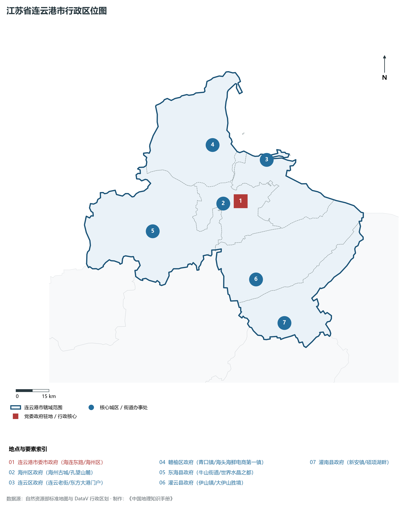
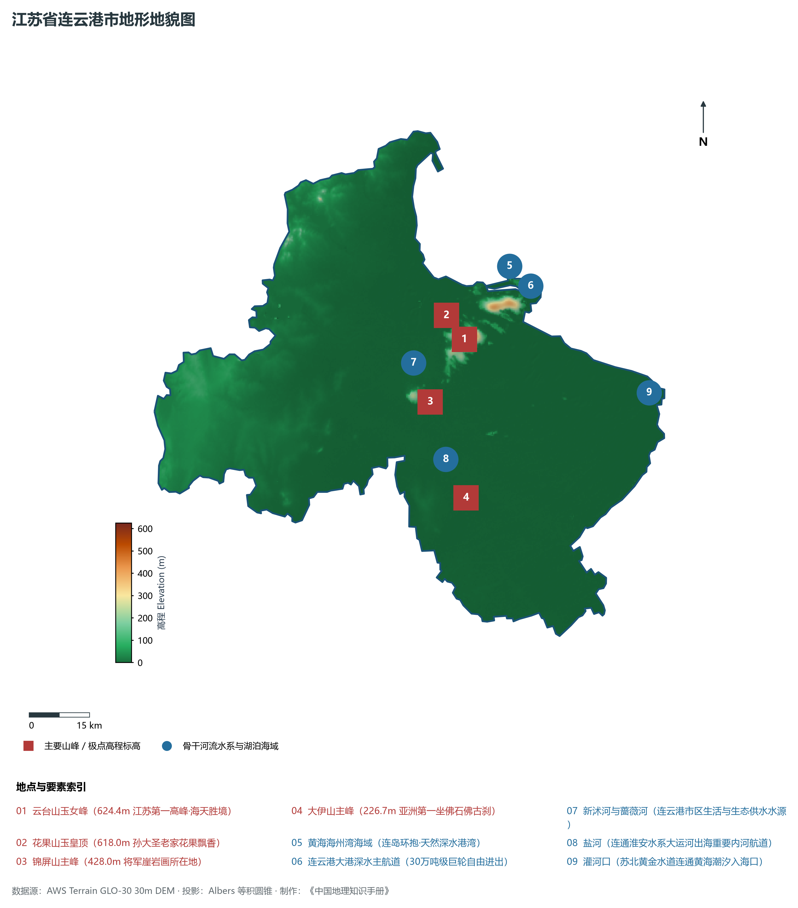
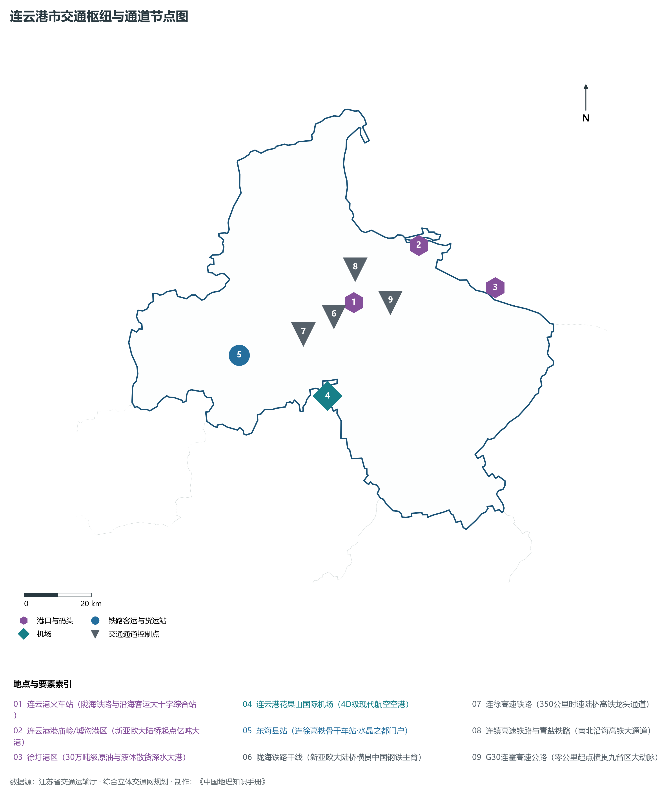
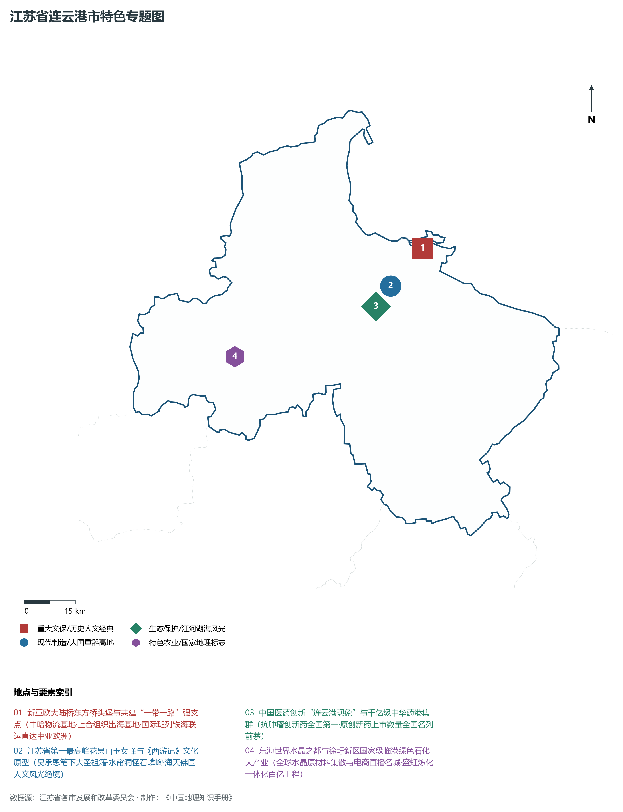
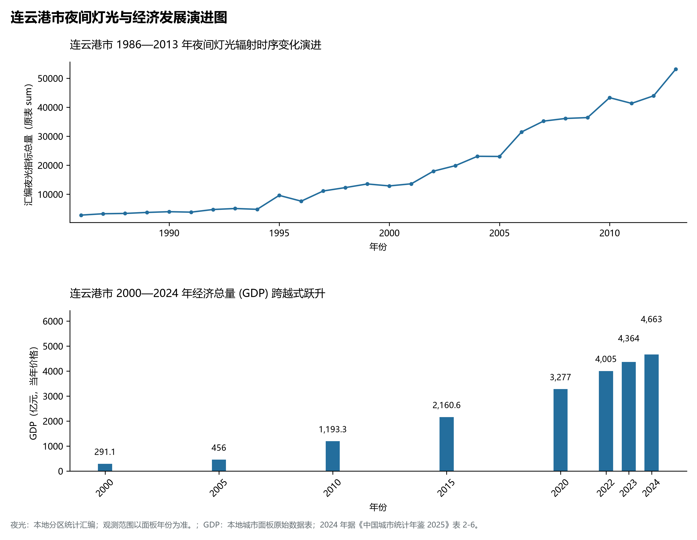

# 10.7 连云港市

连云港市，位于江苏省核心战略板块，其城市综合定位与发展愿景概括为：**新亚欧大陆桥东方桥头堡·“一带一路”强支点·中国中华药港·海港枢纽·《西游记》文化摇篮**。2024 年常住人口 **458 万人**，常住人口城镇化率 **64.5%**，地区生产总值 **4,663 亿元**（当年价格），人均地区生产总值 **101,641 元**，三次产业构成为 **9.86 : 44.15 : 45.99**。

---

## 一、自然地理底盘与地貌水系机理

区域骨干控制性山峰与高程标高极点包括：

- **云台山玉女峰 (624.4m 江苏第一高峰·海天胜境)**（空间坐标约东经 119.298°、北纬 34.655°，海拔标高约 624.4 m）：构成区域地形骨架与水文视廊的关键基准控制点；
- **花果山玉皇顶 (618.0m 孙大圣老家花果飘香)**（空间坐标约东经 119.290°、北纬 34.650°，海拔标高约 618.0 m）：构成区域地形骨架与水文视廊的关键基准控制点；
- **锦屏山主峰 (428.0m 将军崖岩画所在地)**（空间坐标约东经 119.180°、北纬 34.530°，海拔标高约 428.0 m）：构成区域地形骨架与水文视廊的关键基准控制点；
- **大伊山主峰 (226.7m 亚洲第一坐佛石佛古刹)**（空间坐标约东经 119.240°、北纬 34.310°，海拔标高约 226.7 m）：构成区域地形骨架与水文视廊的关键基准控制点；

水系水网与生态廊道方面，连云港市江海湖荡相融，骨干河流水网密集：

- **黄海海州湾海域 (连岛环抱·天然深水港湾)**（水域坐标约东经 119.450°、北纬 34.800°）：发挥生态调蓄、水源涵养、航运通商与防汛抗旱的核心枢纽功能；
- **连云港大港深水主航道 (30万吨级巨轮自由进出)**（水域坐标约东经 119.500°、北纬 34.750°）：发挥生态调蓄、水源涵养、航运通商与防汛抗旱的核心枢纽功能；
- **新沭河与蔷薇河 (连云港市区生活与生态供水水源)**（水域坐标约东经 119.150°、北纬 34.620°）：发挥生态调蓄、水源涵养、航运通商与防汛抗旱的核心枢纽功能；
- **盐河 (连通淮安水系大运河出海重要内河航道)**（水域坐标约东经 119.200°、北纬 34.400°）：发挥生态调蓄、水源涵养、航运通商与防汛抗旱的核心枢纽功能；
- **灌河口 (苏北黄金水道连通黄海潮汐入海口)**（水域坐标约东经 119.780°、北纬 34.480°）：发挥生态调蓄、水源涵养、航运通商与防汛抗旱的核心枢纽功能；

---

## 二、行政区划沿革与城镇空间体系

连云港市建置沿革悠久，人文底蕴深厚，自古为江淮吴越文化交流融合的核心枢纽。新中国成立特别是改革开放以来，伴随撤县设市、撤县设区与都市圈协同建设，形成了极核突出、县域强劲、产城深度融合的现代城镇空间体系：

- **连云港市委市政府 (海连东路/海州区)**（驻地坐标：119.220°E, 34.600°N）：区域政治治理、高品质公共服务与综合经济管理的核心支撑极核；
- **海州区政府 (海州古城/孔望山麓)**（驻地坐标：119.165°E, 34.580°N）：区域政治治理、高品质公共服务与综合经济管理的核心支撑极核；
- **连云区政府 (连云老街/东方大港门户)**（驻地坐标：119.380°E, 34.750°N）：区域政治治理、高品质公共服务与综合经济管理的核心支撑极核；
- **赣榆区政府 (青口镇/海头海鲜电商第一镇)**（驻地坐标：119.120°E, 34.840°N）：区域政治治理、高品质公共服务与综合经济管理的核心支撑极核；
- **东海县政府 (牛山街道/世界水晶之都)**（驻地坐标：118.760°E, 34.530°N）：区域政治治理、高品质公共服务与综合经济管理的核心支撑极核；
- **灌云县政府 (伊山镇/大伊山胜境)**（驻地坐标：119.240°E, 34.280°N）：区域政治治理、高品质公共服务与综合经济管理的核心支撑极核；
- **灌南县政府 (新安镇/硕项湖畔)**（驻地坐标：119.350°E, 34.090°N）：区域政治治理、高品质公共服务与综合经济管理的核心支撑极核；

在城镇空间总体布局上，连云港市紧密衔接国土空间总体规划，坚持“集约紧凑、拥江抱湖、轴向拓展、生态筑底”战略，做优中心城区综合服务功能，提升县域特色产业集聚度，构筑全域协调的现代城乡发展格局。

---

## 三、综合立体交通网络与交通走廊

连云港市地处江苏立体综合交通网络关键枢纽，依托高速铁路、骨干干线铁路、国家高速公路网与长江深水大港/内河港口/航空空港，构筑了通达全国、联通海外的现代化立体交通通道体系：

**核心综合客运与货运物流交通枢纽节点：**

- **连云港火车站 (陇海铁路与沿海客运大十字综合站)**（位置坐标：119.180°E, 34.615°N）：区域客货运流量组织、换乘集散与多式联运的核心节点；
- **连云港花果山国际机场 (4D级现代航空空港)**（位置坐标：119.050°E, 34.380°N）：区域客货运流量组织、换乘集散与多式联运的核心节点；
- **连云港港庙岭/墟沟港区 (新亚欧大陆桥起点亿吨大港)**（位置坐标：119.420°E, 34.740°N）：区域客货运流量组织、换乘集散与多式联运的核心节点；
- **徐圩港区 (30万吨级原油与液体散货深水大港)**（位置坐标：119.650°E, 34.600°N）：区域客货运流量组织、换乘集散与多式联运的核心节点；
- **东海县站 (连徐高铁骨干车站·水晶之都门户)**（位置坐标：118.780°E, 34.520°N）：区域客货运流量组织、换乘集散与多式联运的核心节点；

**骨干高速通道走廊与快速干线网络：**

- **陇海铁路干线 (新亚欧大陆桥横贯中国钢铁主脊)**（走廊控制点：119.150°E, 34.580°N）：对外快速互联互通的高速客货运通道与经济发展轴线；
- **连徐高速铁路 (350公里时速陆桥高铁龙头通道)**（走廊控制点：119.000°E, 34.550°N）：对外快速互联互通的高速客货运通道与经济发展轴线；
- **连镇高速铁路与青盐铁路 (南北沿海高铁大通道)**（走廊控制点：119.200°E, 34.700°N）：对外快速互联互通的高速客货运通道与经济发展轴线；
- **G30连霍高速公路 (零公里起点横贯九省区大动脉)**（走廊控制点：119.300°E, 34.600°N）：对外快速互联互通的高速客货运通道与经济发展轴线；

---

## 四、现代产业体系与新质生产力布局

连云港市坚定践行实体经济立市导向，抢抓新一轮科技革命和产业变革战略机遇，聚力发展新质生产力，加快构建具有国际竞争力的现代工业集群与高能级创新体系：

**重点先进制造业园区与产业创新高地：**

- **中华药港 (恒瑞医药/正大天晴/豪森/康缘创新高地)**（园区坐标：119.280°E, 34.620°N）：区域战略性新兴产业集聚与科技成果转化的核心战略承载平台；
- **中哈连云港物流合作基地 (一带一路实体旗舰项目)**（园区坐标：119.440°E, 34.720°N）：区域战略性新兴产业集聚与科技成果转化的核心战略承载平台；
- **徐圩新区国家级绿色石化产业基地 (盛虹石化航母)**（园区坐标：119.550°E, 34.550°N）：区域战略性新兴产业集聚与科技成果转化的核心战略承载平台；
- **中国东海水晶城 (全球最大水晶交易与加工集散地)**（园区坐标：118.750°E, 34.540°N）：区域战略性新兴产业集聚与科技成果转化的核心战略承载平台；

**标志性特色主题要素与领航龙头优势：**

- **新亚欧大陆桥东方桥头堡与共建“一带一路”强支点**（空间坐标：119.420°E, 34.740°N）：中哈物流基地·上合组织出海基地·国际班列铁海联运直达中亚欧洲；
- **江苏省第一最高峰花果山玉女峰与《西游记》文化原型**（空间坐标：119.298°E, 34.655°N）：吴承恩笔下大圣祖籍·水帘洞怪石嶙峋·海天佛国人文风光绝境；
- **中国医药创新“连云港现象”与千亿级中华药港集群**（空间坐标：119.280°E, 34.620°N）：抗肿瘤创新药全国第一·原创新药上市数量全国名列前茅；
- **东海世界水晶之都与徐圩新区国家级临港绿色石化大产业**（空间坐标：118.760°E, 34.530°N）：全球水晶原材料集散与电商直播名城·盛虹炼化一体化百亿工程；

---

## 五、历史文化底蕴、名胜古迹与全域文旅地理

连云港市江山胜迹璀璨，历史文脉绵延数千年，汇聚了世界文化遗产、国家 5A 级景区与全国重点文物保护单位：

- **花果山风景名胜区 (5A·孙悟空水帘洞·江苏第一峰)**（地标坐标：119.290°E, 34.650°N）：彰显吴韵汉风、运河文明与生态山水风情的名胜文旅地标；
- **连岛海滨旅游度假区 (4A·大沙湾/苏马湾·海滨避暑)**（地标坐标：119.460°E, 34.770°N）：彰显吴韵汉风、运河文明与生态山水风情的名胜文旅地标；
- **孔望山摩崖造像 (全国重点文保·汉代早期佛教艺术)**（地标坐标：119.190°E, 34.570°N）：彰显吴韵汉风、运河文明与生态山水风情的名胜文旅地标；
- **海州古城与钟鼓楼 (两千年海滨古城·临洪名胜)**（地标坐标：119.160°E, 34.580°N）：彰显吴韵汉风、运河文明与生态山水风情的名胜文旅地标；
- **大伊山景区 (4A·东方佛光石佛古寺)**（地标坐标：119.240°E, 34.310°N）：彰显吴韵汉风、运河文明与生态山水风情的名胜文旅地标；

连云港市持续推动以文塑旅、以旅彰文，深化文化遗产系统性保护与活态传承，培育高品质全域旅游新消费场景，打造高辨识度城市文旅金名片。

---

## 六、夜间灯光辐射与跨世纪经济变化时序演进

本节夜光图的观测年份为 1986—2013 年，指标为行政区汇总值（原表 sum）。

| 年份 | 地区生产总值（亿元，当年价格） |
|:---|---:|
| 2000 年 | 291.1 |
| 2005 年 | 456 |
| 2010 年 | 1,193.3 |
| 2015 年 | 2,160.6 |
| 2020 年 | 3,277 |
| 2022 年 | 4,005 |
| 2023 年 | 4,364 |
| 2024 年 | 4,663 |

2024 年统计来源：《中国城市统计年鉴 2025》表 2-1、2-6、2-7（2024 年，全市）。其他年份 GDP 据本地城市面板“原始数据”表，单位为亿元、当年价格。
