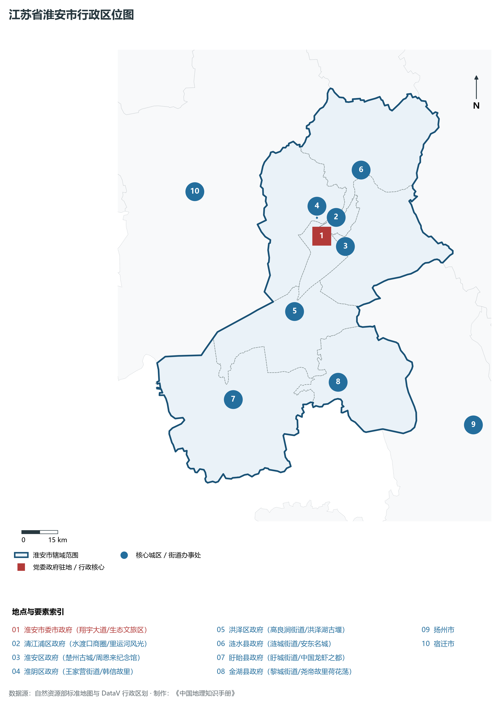
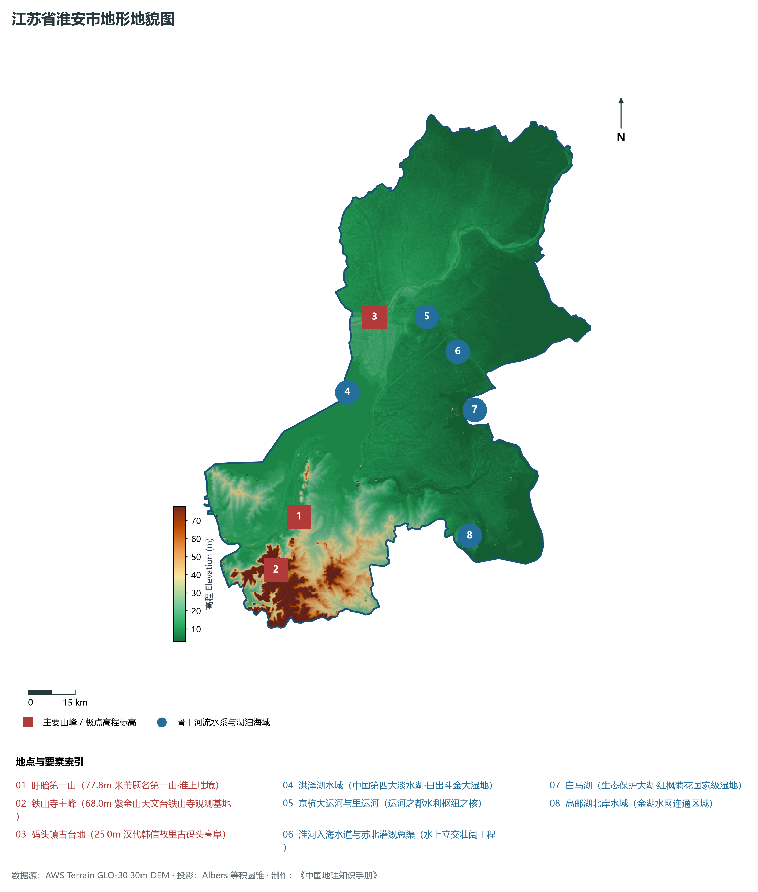
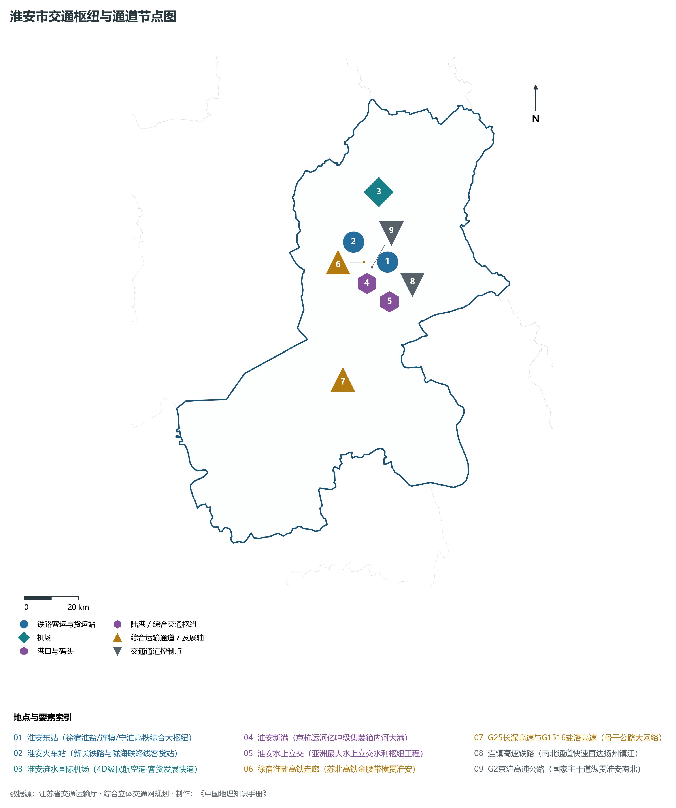
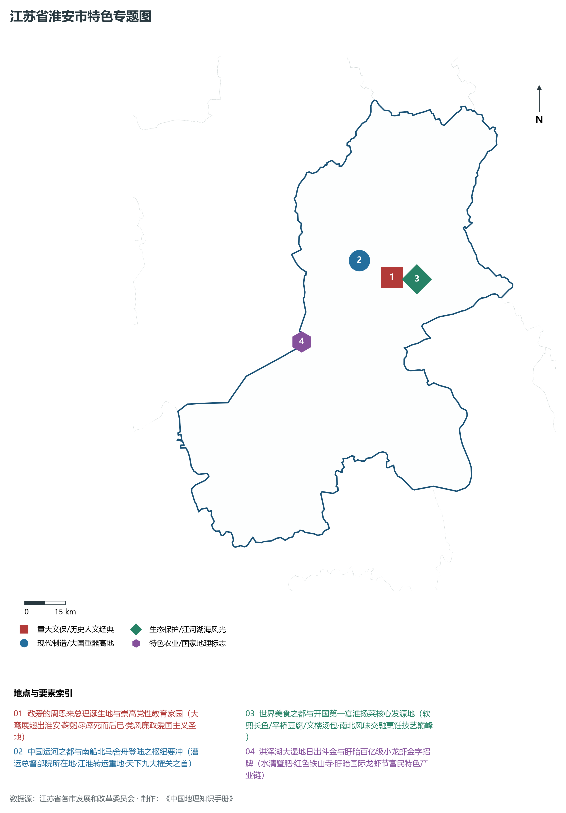
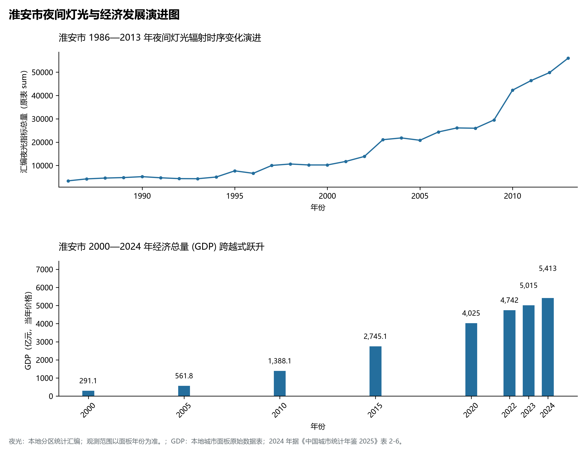

# 10.8 淮安市

淮安市，位于江苏省核心战略板块，其城市综合定位与发展愿景概括为：**运河之都·周恩来总理故乡·淮扬菜发源地·洪泽湖大湿地·苏北重要中心城市**。2024 年常住人口 **452 万人**，常住人口城镇化率 **68.45%**，地区生产总值 **5,413 亿元**（当年价格），人均地区生产总值 **119,473 元**，三次产业构成为 **8.89 : 38.81 : 52.29**。

---

## 一、自然地理底盘与地貌水系机理

区域骨干控制性山峰与高程标高极点包括：

- **盱眙第一山 (77.8m 米芾题名第一山·淮上胜境)**（空间坐标约东经 118.525°、北纬 33.020°，海拔标高约 77.8 m）：构成区域地形骨架与水文视廊的关键基准控制点；
- **铁山寺主峰 (68.0m 紫金山天文台铁山寺观测基地)**（空间坐标约东经 118.420°、北纬 32.880°，海拔标高约 68.0 m）：构成区域地形骨架与水文视廊的关键基准控制点；
- **码头镇古台地 (25.0m 汉代韩信故里古码头高阜)**（空间坐标约东经 118.880°、北纬 33.550°，海拔标高约 25.0 m）：构成区域地形骨架与水文视廊的关键基准控制点；

水系水网与生态廊道方面，淮安市江海湖荡相融，骨干河流水网密集：

- **洪泽湖水域 (中国第四大淡水湖·日出斗金大湿地)**（水域坐标约东经 118.750°、北纬 33.350°）：发挥生态调蓄、水源涵养、航运通商与防汛抗旱的核心枢纽功能；
- **京杭大运河与里运河 (运河之都水利枢纽之核)**（水域坐标约东经 119.060°、北纬 33.530°）：发挥生态调蓄、水源涵养、航运通商与防汛抗旱的核心枢纽功能；
- **淮河入海水道与苏北灌溉总渠 (水上立交壮阔工程)**（水域坐标约东经 119.150°、北纬 33.420°）：发挥生态调蓄、水源涵养、航运通商与防汛抗旱的核心枢纽功能；
- **白马湖 (生态保护大湖·红枫菊花国家级湿地)**（水域坐标约东经 119.180°、北纬 33.250°）：发挥生态调蓄、水源涵养、航运通商与防汛抗旱的核心枢纽功能；
- **高邮湖北岸水域 (金湖水网连通区域)**（水域坐标约东经 119.100°、北纬 32.900°）：发挥生态调蓄、水源涵养、航运通商与防汛抗旱的核心枢纽功能；

---

## 二、行政区划沿革与城镇空间体系

淮安市建置沿革悠久，人文底蕴深厚，自古为江淮吴越文化交流融合的核心枢纽。新中国成立特别是改革开放以来，伴随撤县设市、撤县设区与都市圈协同建设，形成了极核突出、县域强劲、产城深度融合的现代城镇空间体系：

- **淮安市委市政府 (翔宇大道/生态文旅区)**（驻地坐标：119.040°E, 33.560°N）：区域政治治理、高品质公共服务与综合经济管理的核心支撑极核；
- **清江浦区政府 (水渡口商圈/里运河风光)**（驻地坐标：119.020°E, 33.590°N）：区域政治治理、高品质公共服务与综合经济管理的核心支撑极核；
- **淮安区政府 (楚州古城/周恩来纪念馆)**（驻地坐标：119.140°E, 33.510°N）：区域政治治理、高品质公共服务与综合经济管理的核心支撑极核；
- **淮阴区政府 (王家营街道/韩信故里)**（驻地坐标：119.030°E, 33.630°N）：区域政治治理、高品质公共服务与综合经济管理的核心支撑极核；
- **洪泽区政府 (高良涧街道/洪泽湖古堰)**（驻地坐标：118.870°E, 33.300°N）：区域政治治理、高品质公共服务与综合经济管理的核心支撑极核；
- **涟水县政府 (涟城街道/安东名城)**（驻地坐标：119.260°E, 33.780°N）：区域政治治理、高品质公共服务与综合经济管理的核心支撑极核；
- **盱眙县政府 (盱城街道/中国龙虾之都)**（驻地坐标：118.540°E, 33.010°N）：区域政治治理、高品质公共服务与综合经济管理的核心支撑极核；
- **金湖县政府 (黎城街道/尧帝故里荷花荡)**（驻地坐标：119.020°E, 33.020°N）：区域政治治理、高品质公共服务与综合经济管理的核心支撑极核；

在城镇空间总体布局上，淮安市紧密衔接国土空间总体规划，坚持“集约紧凑、拥江抱湖、轴向拓展、生态筑底”战略，做优中心城区综合服务功能，提升县域特色产业集聚度，构筑全域协调的现代城乡发展格局。

---

## 三、综合立体交通网络与交通走廊

淮安市地处江苏立体综合交通网络关键枢纽，依托高速铁路、骨干干线铁路、国家高速公路网与长江深水大港/内河港口/航空空港，构筑了通达全国、联通海外的现代化立体交通通道体系：

**核心综合客运与货运物流交通枢纽节点：**

- **淮安东站 (徐宿淮盐/连镇/宁淮高铁综合大枢纽)**（位置坐标：119.145°E, 33.560°N）：区域客货运流量组织、换乘集散与多式联运的核心节点；
- **淮安火车站 (新长铁路与陇海联络线客货站)**（位置坐标：119.020°E, 33.640°N）：区域客货运流量组织、换乘集散与多式联运的核心节点；
- **淮安涟水国际机场 (4D级民航空港·客货发展快港)**（位置坐标：119.150°E, 33.790°N）：区域客货运流量组织、换乘集散与多式联运的核心节点；
- **淮安新港 (京杭运河亿吨级集装箱内河大港)**（位置坐标：119.050°E, 33.500°N）：区域客货运流量组织、换乘集散与多式联运的核心节点；
- **淮安水上立交 (亚洲最大水上立交水利枢纽工程)**（位置坐标：119.130°E, 33.430°N）：区域客货运流量组织、换乘集散与多式联运的核心节点；

**骨干高速通道走廊与快速干线网络：**

- **徐宿淮盐高铁走廊 (苏北高铁金腰带横贯淮安)**（走廊控制点：119.050°E, 33.570°N）：对外快速互联互通的高速客货运通道与经济发展轴线；
- **连镇高速铁路 (南北通道快速直达扬州镇江)**（走廊控制点：119.180°E, 33.480°N）：对外快速互联互通的高速客货运通道与经济发展轴线；
- **G2京沪高速公路 (国家主干道纵贯淮安南北)**（走廊控制点：119.080°E, 33.550°N）：对外快速互联互通的高速客货运通道与经济发展轴线；
- **G25长深高速与G1516盐洛高速 (骨干公路大网络)**（走廊控制点：118.900°E, 33.200°N）：对外快速互联互通的高速客货运通道与经济发展轴线；

---

## 四、现代产业体系与新质生产力布局

淮安市坚定践行实体经济立市导向，抢抓新一轮科技革命和产业变革战略机遇，聚力发展新质生产力，加快构建具有国际竞争力的现代工业集群与高能级创新体系：

**重点先进制造业园区与产业创新高地：**

- **中天钢铁超高强精品钢帘线智能制造基地**（园区坐标：119.100°E, 33.600°N）：区域战略性新兴产业集聚与科技成果转化的核心战略承载平台；
- **捷泰新能源高效太阳能电池绿色智造基地**（园区坐标：119.200°E, 33.800°N）：区域战略性新兴产业集聚与科技成果转化的核心战略承载平台；
- **淮安经济技术开发区国家级两岸台资集聚示范区**（园区坐标：119.080°E, 33.580°N）：区域战略性新兴产业集聚与科技成果转化的核心战略承载平台；
- **盱眙龙虾全产业链百亿级国家现代农业示范区**（园区坐标：118.550°E, 32.980°N）：区域战略性新兴产业集聚与科技成果转化的核心战略承载平台；

**标志性特色主题要素与领航龙头优势：**

- **敬爱的周恩来总理诞生地与崇高党性教育家园**（空间坐标：119.145°E, 33.515°N）：大鸾展翅出淮安·鞠躬尽瘁死而后已·党风廉政爱国主义圣地；
- **中国运河之都与南船北马舍舟登陆之枢纽要冲**（空间坐标：119.025°E, 33.585°N）：漕运总督部院所在地·江淮转运重地·天下九大榷关之首；
- **世界美食之都与开国第一宴淮扬菜核心发源地**（空间坐标：119.140°E, 33.510°N）：软兜长鱼/平桥豆腐/文楼汤包·南北风味交融烹饪技艺巅峰；
- **洪泽湖大湿地日出斗金与盱眙百亿级小龙虾金字招牌**（空间坐标：118.750°E, 33.350°N）：水清蟹肥·红色铁山寺·盱眙国际龙虾节富民特色产业链；

---

## 五、历史文化底蕴、名胜古迹与全域文旅地理

淮安市江山胜迹璀璨，历史文脉绵延数千年，汇聚了世界文化遗产、国家 5A 级景区与全国重点文物保护单位：

- **周恩来故里旅游区 (5A·一代伟人诞生地·纪念馆/故居)**（地标坐标：119.145°E, 33.515°N）：彰显吴韵汉风、运河文明与生态山水风情的名胜文旅地标；
- **淮安里运河文化长廊 (4A·清江浦闸·古运河游船夜景)**（地标坐标：119.025°E, 33.585°N）：彰显吴韵汉风、运河文明与生态山水风情的名胜文旅地标；
- **洪泽湖古堰景区 (4A·大活佛信步古堰·千年防汛石堤)**（地标坐标：118.860°E, 33.310°N）：彰显吴韵汉风、运河文明与生态山水风情的名胜文旅地标；
- **明祖陵 (全国重点文保·朱元璋祖陵地下玄宫)**（地标坐标：118.490°E, 33.090°N）：彰显吴韵汉风、运河文明与生态山水风情的名胜文旅地标；
- **吴承恩故居 (4A·西游记作者故里·猴王世家展馆)**（地标坐标：119.135°E, 33.510°N）：彰显吴韵汉风、运河文明与生态山水风情的名胜文旅地标；

淮安市持续推动以文塑旅、以旅彰文，深化文化遗产系统性保护与活态传承，培育高品质全域旅游新消费场景，打造高辨识度城市文旅金名片。

---

## 六、夜间灯光辐射与跨世纪经济变化时序演进

本节夜光图的观测年份为 1986—2013 年，指标为行政区汇总值（原表 sum）。

| 年份 | 地区生产总值（亿元，当年价格） |
|:---|---:|
| 2000 年 | 291.1 |
| 2005 年 | 561.8 |
| 2010 年 | 1,388.1 |
| 2015 年 | 2,745.1 |
| 2020 年 | 4,025 |
| 2022 年 | 4,742 |
| 2023 年 | 5,015 |
| 2024 年 | 5,413 |

2024 年统计来源：《中国城市统计年鉴 2025》表 2-1、2-6、2-7（2024 年，全市）。其他年份 GDP 据本地城市面板“原始数据”表，单位为亿元、当年价格。
