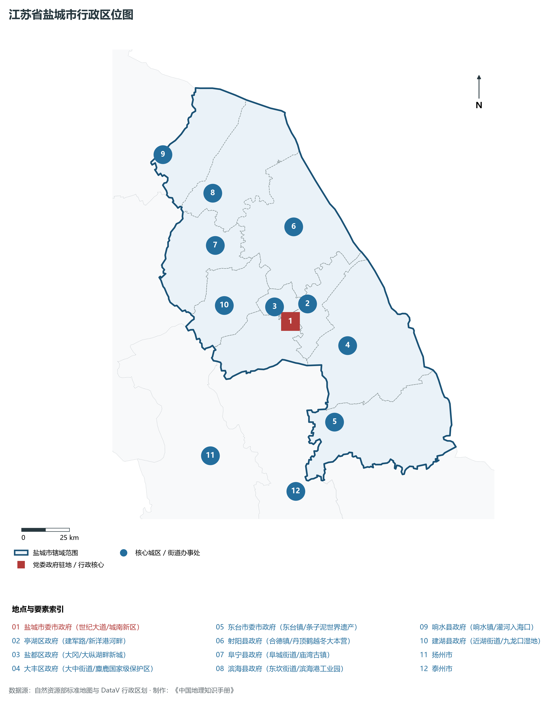
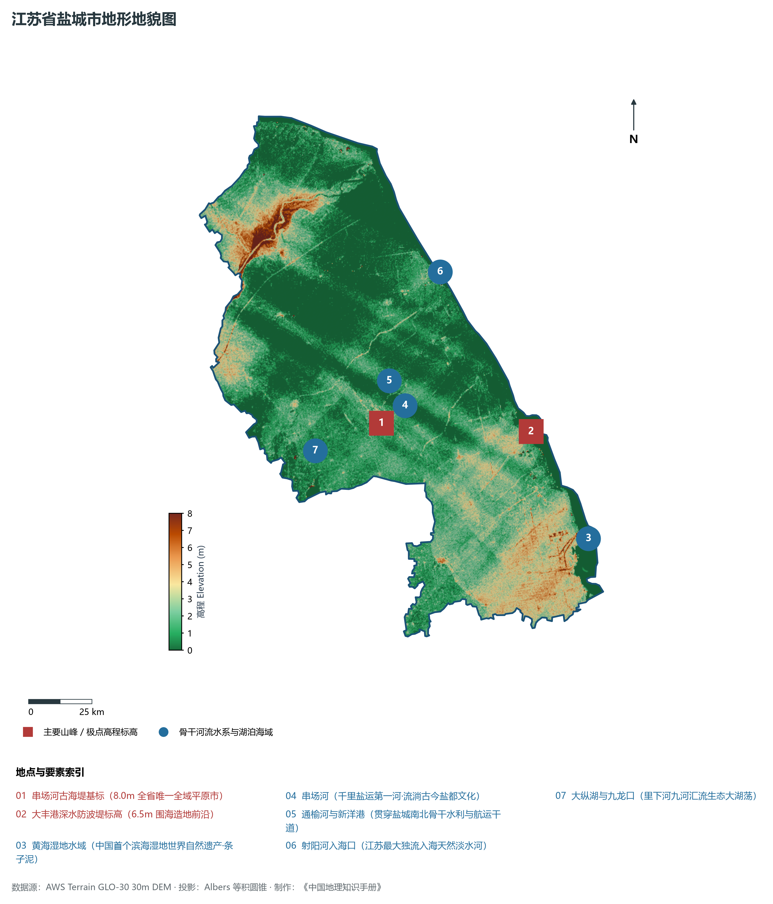
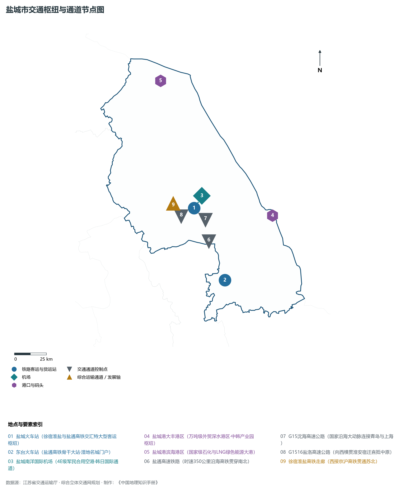
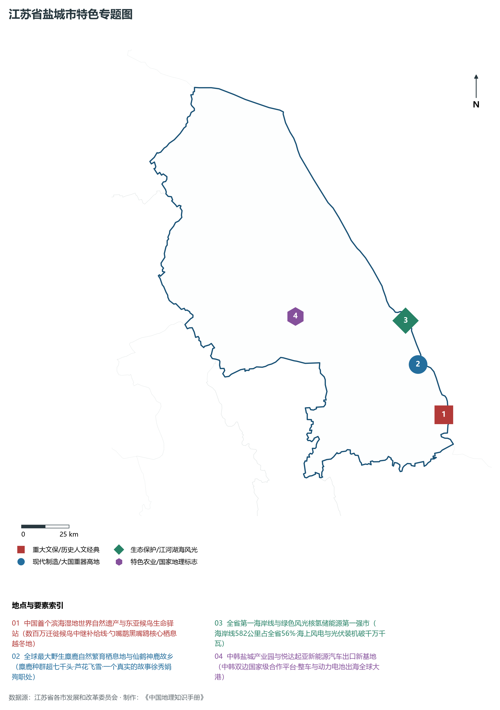
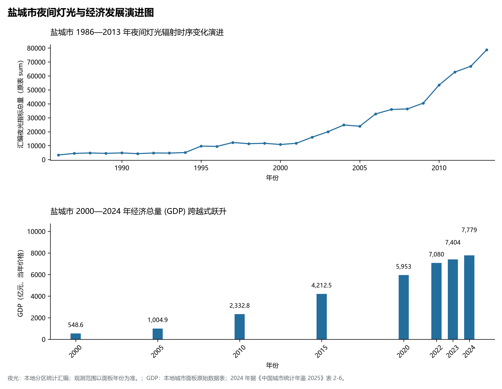

# 10.9 盐城市

盐城市，位于江苏省核心战略板块，其城市综合定位与发展愿景概括为：**东方湿地之都·仙鹤神鹿家园·黄海湿地世界自然遗产·全省最长海岸线·绿色能源第一市**。2024 年常住人口 **667 万人**，常住人口城镇化率 **67%**，地区生产总值 **7,779 亿元**（当年价格），人均地区生产总值 **116,455 元**，三次产业构成为 **10.87 : 38.72 : 50.41**。

---

## 一、自然地理底盘与地貌水系机理

区域骨干控制性山峰与高程标高极点包括：

- **串场河古海堤基标 (8.0m 全省唯一全域平原市)**（空间坐标约东经 120.150°、北纬 33.360°，海拔标高约 8.0 m）：构成区域地形骨架与水文视廊的关键基准控制点；
- **大丰港深水防波堤标高 (6.5m 围海造地前沿)**（空间坐标约东经 120.780°、北纬 33.250°，海拔标高约 6.5 m）：构成区域地形骨架与水文视廊的关键基准控制点；

水系水网与生态廊道方面，盐城市江海湖荡相融，骨干河流水网密集：

- **黄海湿地水域 (中国首个滨海湿地世界自然遗产·条子泥)**（水域坐标约东经 120.950°、北纬 32.850°）：发挥生态调蓄、水源涵养、航运通商与防汛抗旱的核心枢纽功能；
- **串场河 (千里盐运第一河·流淌古今盐都文化)**（水域坐标约东经 120.140°、北纬 33.370°）：发挥生态调蓄、水源涵养、航运通商与防汛抗旱的核心枢纽功能；
- **通榆河与新洋港 (贯穿盐城南北骨干水利与航运干道)**（水域坐标约东经 120.200°、北纬 33.450°）：发挥生态调蓄、水源涵养、航运通商与防汛抗旱的核心枢纽功能；
- **射阳河入海口 (江苏最大独流入海天然淡水河)**（水域坐标约东经 120.500°、北纬 33.850°）：发挥生态调蓄、水源涵养、航运通商与防汛抗旱的核心枢纽功能；
- **大纵湖与九龙口 (里下河九河汇流生态大湖荡)**（水域坐标约东经 119.850°、北纬 33.300°）：发挥生态调蓄、水源涵养、航运通商与防汛抗旱的核心枢纽功能；

---

## 二、行政区划沿革与城镇空间体系

盐城市建置沿革悠久，人文底蕴深厚，自古为江淮吴越文化交流融合的核心枢纽。新中国成立特别是改革开放以来，伴随撤县设市、撤县设区与都市圈协同建设，形成了极核突出、县域强劲、产城深度融合的现代城镇空间体系：

- **盐城市委市政府 (世纪大道/城南新区)**（驻地坐标：120.160°E, 33.350°N）：区域政治治理、高品质公共服务与综合经济管理的核心支撑极核；
- **亭湖区政府 (建军路/新洋港河畔)**（驻地坐标：120.150°E, 33.380°N）：区域政治治理、高品质公共服务与综合经济管理的核心支撑极核；
- **盐都区政府 (大冈/大纵湖畔新城)**（驻地坐标：120.130°E, 33.330°N）：区域政治治理、高品质公共服务与综合经济管理的核心支撑极核；
- **大丰区政府 (大中街道/麋鹿国家级保护区)**（驻地坐标：120.460°E, 33.200°N）：区域政治治理、高品质公共服务与综合经济管理的核心支撑极核；
- **东台市委市政府 (东台镇/条子泥世界遗产)**（驻地坐标：120.320°E, 32.860°N）：区域政治治理、高品质公共服务与综合经济管理的核心支撑极核；
- **射阳县政府 (合德镇/丹顶鹤越冬大本营)**（驻地坐标：120.260°E, 33.780°N）：区域政治治理、高品质公共服务与综合经济管理的核心支撑极核；
- **阜宁县政府 (阜城街道/庙湾古镇)**（驻地坐标：119.800°E, 33.750°N）：区域政治治理、高品质公共服务与综合经济管理的核心支撑极核；
- **滨海县政府 (东坎街道/滨海港工业园)**（驻地坐标：119.830°E, 33.990°N）：区域政治治理、高品质公共服务与综合经济管理的核心支撑极核；
- **响水县政府 (响水镇/灌河入海口)**（驻地坐标：119.580°E, 34.200°N）：区域政治治理、高品质公共服务与综合经济管理的核心支撑极核；
- **建湖县政府 (近湖街道/九龙口湿地)**（驻地坐标：119.800°E, 33.470°N）：区域政治治理、高品质公共服务与综合经济管理的核心支撑极核；

在城镇空间总体布局上，盐城市紧密衔接国土空间总体规划，坚持“集约紧凑、拥江抱湖、轴向拓展、生态筑底”战略，做优中心城区综合服务功能，提升县域特色产业集聚度，构筑全域协调的现代城乡发展格局。

---

## 三、综合立体交通网络与交通走廊

盐城市地处江苏立体综合交通网络关键枢纽，依托高速铁路、骨干干线铁路、国家高速公路网与长江深水大港/内河港口/航空空港，构筑了通达全国、联通海外的现代化立体交通通道体系：

**核心综合客运与货运物流交通枢纽节点：**

- **盐城火车站 (徐宿淮盐与盐通高铁交汇特大型客运枢纽)**（位置坐标：120.170°E, 33.395°N）：区域客货运流量组织、换乘集散与多式联运的核心节点；
- **盐城南洋国际机场 (4E级军民合用空港·韩日国际通道)**（位置坐标：120.210°E, 33.430°N）：区域客货运流量组织、换乘集散与多式联运的核心节点；
- **盐城港大丰港区 (万吨级外贸深水港区·中韩产业园枢纽)**（位置坐标：120.820°E, 33.260°N）：区域客货运流量组织、换乘集散与多式联运的核心节点；
- **盐城港滨海港区 (国家级石化与LNG绿色能源大港)**（位置坐标：120.050°E, 34.300°N）：区域客货运流量组织、换乘集散与多式联运的核心节点；
- **东台火车站 (盐通高铁骨干大站·湿地名城门户)**（位置坐标：120.335°E, 32.870°N）：区域客货运流量组织、换乘集散与多式联运的核心节点；

**骨干高速通道走廊与快速干线网络：**

- **盐通高速铁路 (时速350公里沿海高铁贯穿南北)**（走廊控制点：120.250°E, 33.150°N）：对外快速互联互通的高速客货运通道与经济发展轴线；
- **徐宿淮盐高铁走廊 (西接京沪高铁贯通苏北)**（走廊控制点：120.000°E, 33.450°N）：对外快速互联互通的高速客货运通道与经济发展轴线；
- **G15沈海高速公路 (国家沿海大动脉连接青岛与上海)**（走廊控制点：120.250°E, 33.300°N）：对外快速互联互通的高速客货运通道与经济发展轴线；
- **G1516盐洛高速公路 (向西横贯淮安宿迁直抵中原)**（走廊控制点：120.050°E, 33.350°N）：对外快速互联互通的高速客货运通道与经济发展轴线；

---

## 四、现代产业体系与新质生产力布局

盐城市坚定践行实体经济立市导向，抢抓新一轮科技革命和产业变革战略机遇，聚力发展新质生产力，加快构建具有国际竞争力的现代工业集群与高能级创新体系：

**重点先进制造业园区与产业创新高地：**

- **悦达起亚汽车智能制造基地 (全国乘用车主要出口基地)**（园区坐标：120.200°E, 33.360°N）：区域战略性新兴产业集聚与科技成果转化的核心战略承载平台；
- **通威太阳能与晶澳科技百亿级高效光伏基地**（园区坐标：120.100°E, 33.420°N）：区域战略性新兴产业集聚与科技成果转化的核心战略承载平台；
- **国家级海上风电装备产业基地 (远景/金风大丰港)**（园区坐标：120.750°E, 33.220°N）：区域战略性新兴产业集聚与科技成果转化的核心战略承载平台；
- **SK On锂离子动力电池超级生产基地**（园区坐标：120.240°E, 33.330°N）：区域战略性新兴产业集聚与科技成果转化的核心战略承载平台；

**标志性特色主题要素与领航龙头优势：**

- **中国首个滨海湿地世界自然遗产与东亚候鸟生命驿站**（空间坐标：120.950°E, 32.800°N）：数百万迁徙候鸟中继补给线·勺嘴鹬黑嘴鸥核心栖息越冬地；
- **全球最大野生麋鹿自然繁育栖息地与仙鹤神鹿故乡**（空间坐标：120.850°E, 33.050°N）：麋鹿种群超七千头·芦花飞雪·一个真实的故事徐秀娟殉职处；
- **全省第一海岸线与绿色风光核氢储能源第一强市**（空间坐标：120.820°E, 33.260°N）：海岸线582公里占全省56%·海上风电与光伏装机破千万千瓦；
- **中韩盐城产业园与悦达起亚新能源汽车出口新基地**（空间坐标：120.200°E, 33.360°N）：中韩双边国家级合作平台·整车与动力电池出海全球大港；

---

## 五、历史文化底蕴、名胜古迹与全域文旅地理

盐城市江山胜迹璀璨，历史文脉绵延数千年，汇聚了世界文化遗产、国家 5A 级景区与全国重点文物保护单位：

- **大丰中华麋鹿园 (5A·全球最大野态麋鹿种群庇护所)**（地标坐标：120.850°E, 33.050°N）：彰显吴韵汉风、运河文明与生态山水风情的名胜文旅地标；
- **中国黄海候鸟栖息地东台条子泥 (世界自然遗产·观鸟圣地)**（地标坐标：120.950°E, 32.800°N）：彰显吴韵汉风、运河文明与生态山水风情的名胜文旅地标；
- **盐城丹顶鹤湿地生态旅游区 (4A·一个真实的故事发源地)**（地标坐标：120.600°E, 33.580°N）：彰显吴韵汉风、运河文明与生态山水风情的名胜文旅地标；
- **新四军纪念馆 (全国爱国主义教育示范基地·铁军精神)**（地标坐标：120.170°E, 33.380°N）：彰显吴韵汉风、运河文明与生态山水风情的名胜文旅地标；
- **建湖九龙口旅游度假区 (4A·九条银河汇一珠生态奇观)**（地标坐标：119.720°E, 33.380°N）：彰显吴韵汉风、运河文明与生态山水风情的名胜文旅地标；

盐城市持续推动以文塑旅、以旅彰文，深化文化遗产系统性保护与活态传承，培育高品质全域旅游新消费场景，打造高辨识度城市文旅金名片。

---

## 六、夜间灯光辐射与跨世纪经济变化时序演进

本节夜光图的观测年份为 1986—2013 年，指标为行政区汇总值（原表 sum）。

| 年份 | 地区生产总值（亿元，当年价格） |
|:---|---:|
| 2000 年 | 548.6 |
| 2005 年 | 1,004.9 |
| 2010 年 | 2,332.8 |
| 2015 年 | 4,212.5 |
| 2020 年 | 5,953 |
| 2022 年 | 7,080 |
| 2023 年 | 7,404 |
| 2024 年 | 7,779 |

2024 年统计来源：《中国城市统计年鉴 2025》表 2-1、2-6、2-7（2024 年，全市）。其他年份 GDP 据本地城市面板“原始数据”表，单位为亿元、当年价格。
