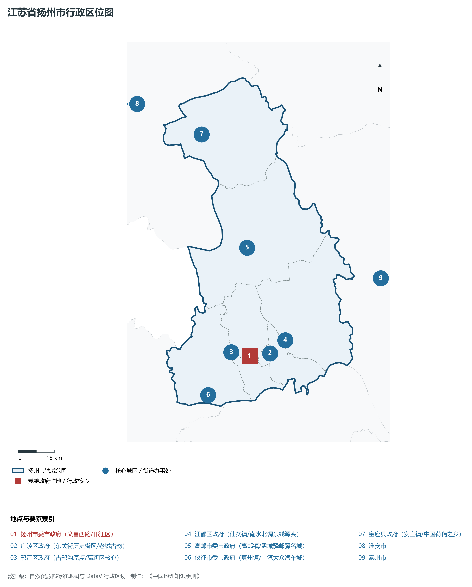
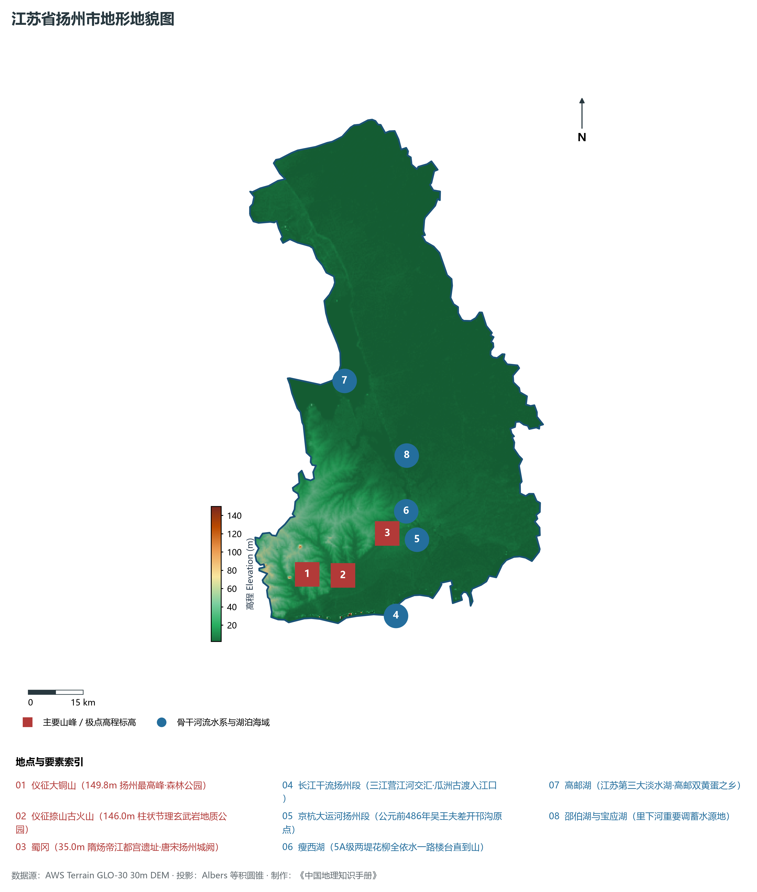
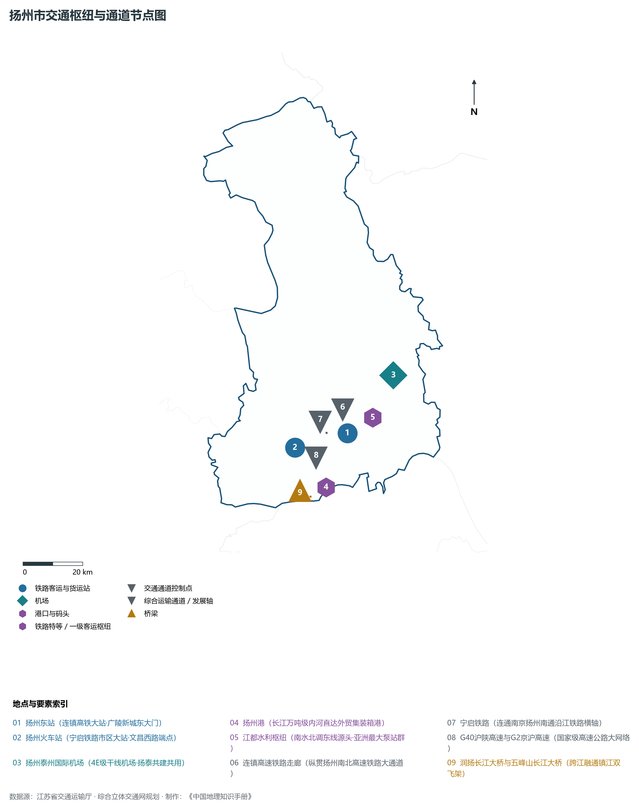
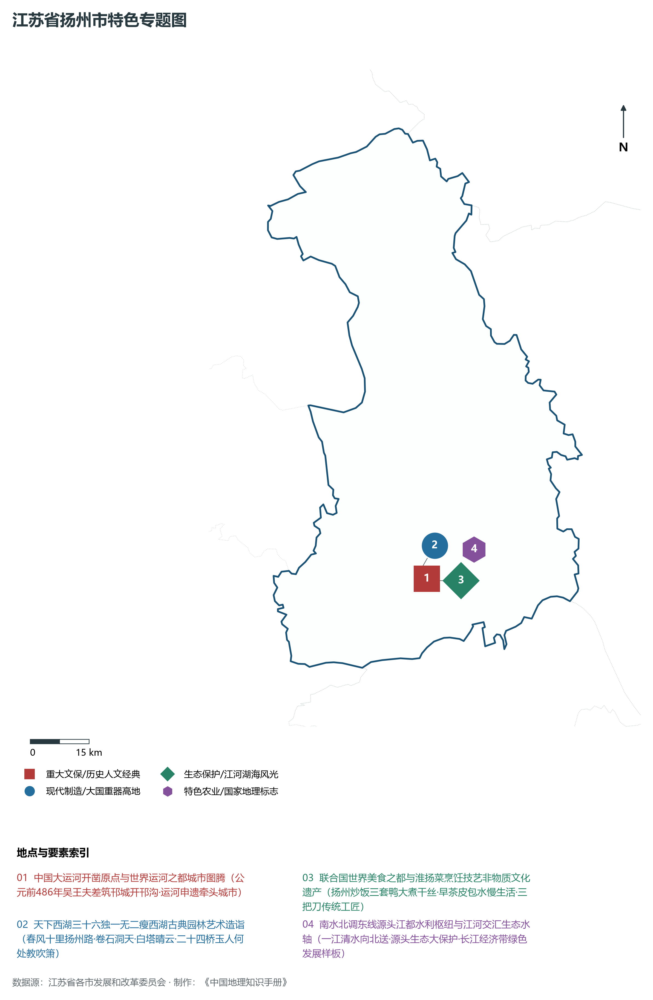
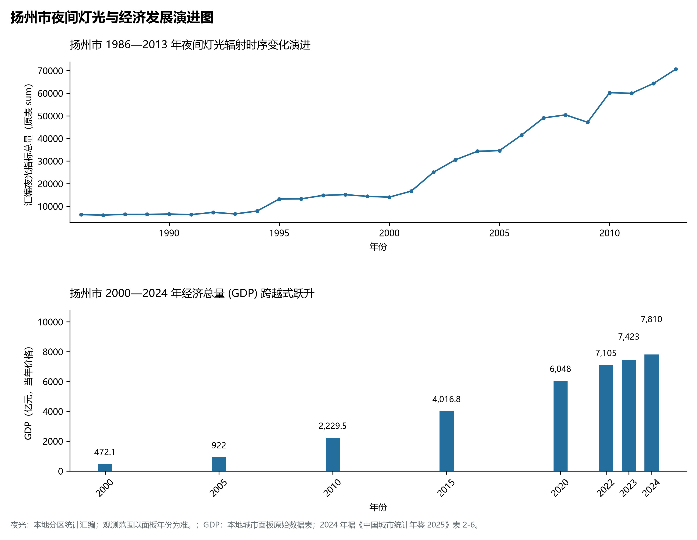

# 10.10 扬州市

扬州市，位于江苏省核心战略板块，其城市综合定位与发展愿景概括为：**淮左名都·竹西佳处·中国大运河原点城市·世界运河之都与美食之都·东亚文化之都**。2024 年常住人口 **459 万人**，常住人口城镇化率 **73.5%**，地区生产总值 **7,810 亿元**（当年价格），人均地区生产总值 **170,297 元**，三次产业构成为 **4.44 : 46.78 : 48.78**。

---

## 一、自然地理底盘与地貌水系机理

区域骨干控制性山峰与高程标高极点包括：

- **仪征大铜山 (149.8m 扬州最高峰·森林公园)**（空间坐标约东经 119.160°、北纬 32.350°，海拔标高约 149.8 m）：构成区域地形骨架与水文视廊的关键基准控制点；
- **仪征捺山古火山 (146.0m 柱状节理玄武岩地质公园)**（空间坐标约东经 119.220°、北纬 32.340°，海拔标高约 146.0 m）：构成区域地形骨架与水文视廊的关键基准控制点；
- **蜀冈 (35.0m 隋炀帝江都宫遗址·唐宋扬州城阙)**（空间坐标约东经 119.410°、北纬 32.420°，海拔标高约 35.0 m）：构成区域地形骨架与水文视廊的关键基准控制点；

水系水网与生态廊道方面，扬州市江海湖荡相融，骨干河流水网密集：

- **长江干流扬州段 (三江营江河交汇·瓜洲古渡入江口)**（水域坐标约东经 119.400°、北纬 32.220°）：发挥生态调蓄、水源涵养、航运通商与防汛抗旱的核心枢纽功能；
- **京杭大运河扬州段 (公元前486年吴王夫差开邗沟原点)**（水域坐标约东经 119.450°、北纬 32.400°）：发挥生态调蓄、水源涵养、航运通商与防汛抗旱的核心枢纽功能；
- **瘦西湖 (5A级两堤花柳全依水一路楼台直到山)**（水域坐标约东经 119.420°、北纬 32.410°）：发挥生态调蓄、水源涵养、航运通商与防汛抗旱的核心枢纽功能；
- **高邮湖 (江苏第三大淡水湖·高邮双黄蛋之乡)**（水域坐标约东经 119.350°、北纬 32.800°）：发挥生态调蓄、水源涵养、航运通商与防汛抗旱的核心枢纽功能；
- **邵伯湖与宝应湖 (里下河重要调蓄水源地)**（水域坐标约东经 119.500°、北纬 32.600°）：发挥生态调蓄、水源涵养、航运通商与防汛抗旱的核心枢纽功能；

---

## 二、行政区划沿革与城镇空间体系

扬州市建置沿革悠久，人文底蕴深厚，自古为江淮吴越文化交流融合的核心枢纽。新中国成立特别是改革开放以来，伴随撤县设市、撤县设区与都市圈协同建设，形成了极核突出、县域强劲、产城深度融合的现代城镇空间体系：

- **扬州市委市政府 (文昌西路/邗江区)**（驻地坐标：119.390°E, 32.390°N）：区域政治治理、高品质公共服务与综合经济管理的核心支撑极核；
- **广陵区政府 (东关街历史街区/老城古韵)**（驻地坐标：119.440°E, 32.395°N）：区域政治治理、高品质公共服务与综合经济管理的核心支撑极核；
- **邗江区政府 (古邗沟原点/高新区核心)**（驻地坐标：119.380°E, 32.370°N）：区域政治治理、高品质公共服务与综合经济管理的核心支撑极核；
- **江都区政府 (仙女镇/南水北调东线源头)**（驻地坐标：119.560°E, 32.430°N）：区域政治治理、高品质公共服务与综合经济管理的核心支撑极核；
- **高邮市委市政府 (高邮镇/盂城驿邮驿名城)**（驻地坐标：119.450°E, 32.790°N）：区域政治治理、高品质公共服务与综合经济管理的核心支撑极核；
- **仪征市委市政府 (真州镇/上汽大众汽车城)**（驻地坐标：119.180°E, 32.270°N）：区域政治治理、高品质公共服务与综合经济管理的核心支撑极核；
- **宝应县政府 (安宜镇/中国荷藕之乡)**（驻地坐标：119.320°E, 33.230°N）：区域政治治理、高品质公共服务与综合经济管理的核心支撑极核；

在城镇空间总体布局上，扬州市紧密衔接国土空间总体规划，坚持“集约紧凑、拥江抱湖、轴向拓展、生态筑底”战略，做优中心城区综合服务功能，提升县域特色产业集聚度，构筑全域协调的现代城乡发展格局。

---

## 三、综合立体交通网络与交通走廊

扬州市地处江苏立体综合交通网络关键枢纽，依托高速铁路、骨干干线铁路、国家高速公路网与长江深水大港/内河港口/航空空港，构筑了通达全国、联通海外的现代化立体交通通道体系：

**核心综合客运与货运物流交通枢纽节点：**

- **扬州东站 (连镇高铁大站·广陵新城东大门)**（位置坐标：119.525°E, 32.410°N）：区域客货运流量组织、换乘集散与多式联运的核心节点；
- **扬州火车站 (宁启铁路市区大站·文昌西路端点)**（位置坐标：119.330°E, 32.390°N）：区域客货运流量组织、换乘集散与多式联运的核心节点；
- **扬州泰州国际机场 (4E级干线机场·扬泰共建共用)**（位置坐标：119.720°E, 32.560°N）：区域客货运流量组织、换乘集散与多式联运的核心节点；
- **扬州港 (长江万吨级内河直达外贸集装箱港)**（位置坐标：119.420°E, 32.260°N）：区域客货运流量组织、换乘集散与多式联运的核心节点；
- **江都水利枢纽 (南水北调东线源头·亚洲最大泵站群)**（位置坐标：119.580°E, 32.450°N）：区域客货运流量组织、换乘集散与多式联运的核心节点；

**骨干高速通道走廊与快速干线网络：**

- **连镇高速铁路走廊 (纵贯扬州南北高速铁路大通道)**（走廊控制点：119.520°E, 32.480°N）：对外快速互联互通的高速客货运通道与经济发展轴线；
- **宁启铁路 (连通南京扬州南通沿江铁路横轴)**（走廊控制点：119.450°E, 32.420°N）：对外快速互联互通的高速客货运通道与经济发展轴线；
- **G40沪陕高速与G2京沪高速 (国家级高速公路大网络)**（走廊控制点：119.400°E, 32.350°N）：对外快速互联互通的高速客货运通道与经济发展轴线；
- **润扬长江大桥与五峰山长江大桥 (跨江融通镇江双飞架)**（走廊控制点：119.360°E, 32.240°N）：对外快速互联互通的高速客货运通道与经济发展轴线；

---

## 四、现代产业体系与新质生产力布局

扬州市坚定践行实体经济立市导向，抢抓新一轮科技革命和产业变革战略机遇，聚力发展新质生产力，加快构建具有国际竞争力的现代工业集群与高能级创新体系：

**重点先进制造业园区与产业创新高地：**

- **上汽大众仪征整车制造基地 (百万辆级现代汽车城)**（园区坐标：119.200°E, 32.290°N）：区域战略性新兴产业集聚与科技成果转化的核心战略承载平台；
- **中航工业扬州航空协同创新中心 (机载系统高地)**（园区坐标：119.480°E, 32.410°N）：区域战略性新兴产业集聚与科技成果转化的核心战略承载平台；
- **晶澳太阳能扬州高效光伏研发制造基地**（园区坐标：119.380°E, 32.340°N）：区域战略性新兴产业集聚与科技成果转化的核心战略承载平台；
- **扬州高新技术产业开发区 (数控机床与生物医药)**（园区坐标：119.360°E, 32.330°N）：区域战略性新兴产业集聚与科技成果转化的核心战略承载平台；

**标志性特色主题要素与领航龙头优势：**

- **中国大运河开凿原点与世界运河之都城市图腾**（空间坐标：119.440°E, 32.400°N）：公元前486年吴王夫差筑邗城开邗沟·运河申遗牵头城市；
- **天下西湖三十六独一无二瘦西湖古典园林艺术造诣**（空间坐标：119.420°E, 32.415°N）：春风十里扬州路·卷石洞天·白塔晴云·二十四桥玉人何处教吹箫；
- **联合国世界美食之都与淮扬菜烹饪技艺非物质文化遗产**（空间坐标：119.445°E, 32.395°N）：扬州炒饭三套鸭大煮干丝·早茶皮包水慢生活·三把刀传统工匠；
- **南水北调东线源头江都水利枢纽与江河交汇生态水轴**（空间坐标：119.580°E, 32.450°N）：一江清水向北送·源头生态大保护·长江经济带绿色发展样板；

---

## 五、历史文化底蕴、名胜古迹与全域文旅地理

扬州市江山胜迹璀璨，历史文脉绵延数千年，汇聚了世界文化遗产、国家 5A 级景区与全国重点文物保护单位：

- **瘦西湖风景名胜区 (5A·二十四桥明月夜·五亭桥)**（地标坐标：119.420°E, 32.415°N）：彰显吴韵汉风、运河文明与生态山水风情的名胜文旅地标；
- **个园与何园 (4A·中国四大名园·四季假山与晚清第一园)**（地标坐标：119.445°E, 32.395°N）：彰显吴韵汉风、运河文明与生态山水风情的名胜文旅地标；
- **扬州中国大运河博物馆 (三湾湿地·全景沉浸式运河国宝)**（地标坐标：119.440°E, 32.360°N）：彰显吴韵汉风、运河文明与生态山水风情的名胜文旅地标；
- **高邮盂城驿 (世界文化遗产·全国规模最大古代邮驿)**（地标坐标：119.445°E, 32.785°N）：彰显吴韵汉风、运河文明与生态山水风情的名胜文旅地标；
- **东关街历史文化街区 (全国历史文化名街·非遗传统老字号)**（地标坐标：119.450°E, 32.400°N）：彰显吴韵汉风、运河文明与生态山水风情的名胜文旅地标；

扬州市持续推动以文塑旅、以旅彰文，深化文化遗产系统性保护与活态传承，培育高品质全域旅游新消费场景，打造高辨识度城市文旅金名片。

---

## 六、夜间灯光辐射与跨世纪经济变化时序演进

本节夜光图的观测年份为 1986—2013 年，指标为行政区汇总值（原表 sum）。

| 年份 | 地区生产总值（亿元，当年价格） |
|:---|---:|
| 2000 年 | 472.1 |
| 2005 年 | 922 |
| 2010 年 | 2,229.5 |
| 2015 年 | 4,016.8 |
| 2020 年 | 6,048 |
| 2022 年 | 7,105 |
| 2023 年 | 7,423 |
| 2024 年 | 7,810 |

2024 年统计来源：《中国城市统计年鉴 2025》表 2-1、2-6、2-7（2024 年，全市）。其他年份 GDP 据本地城市面板“原始数据”表，单位为亿元、当年价格。
