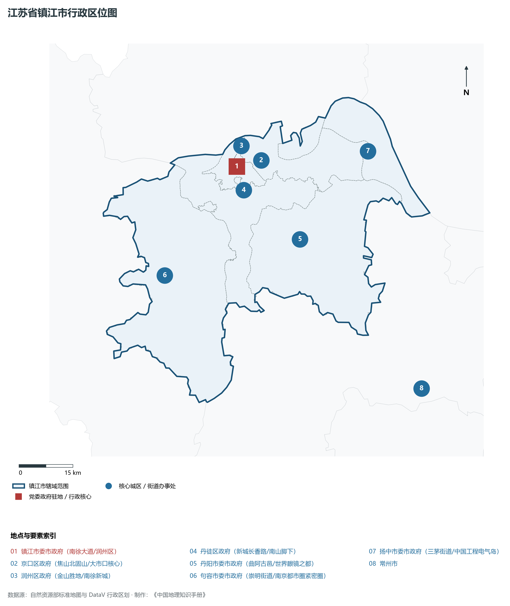
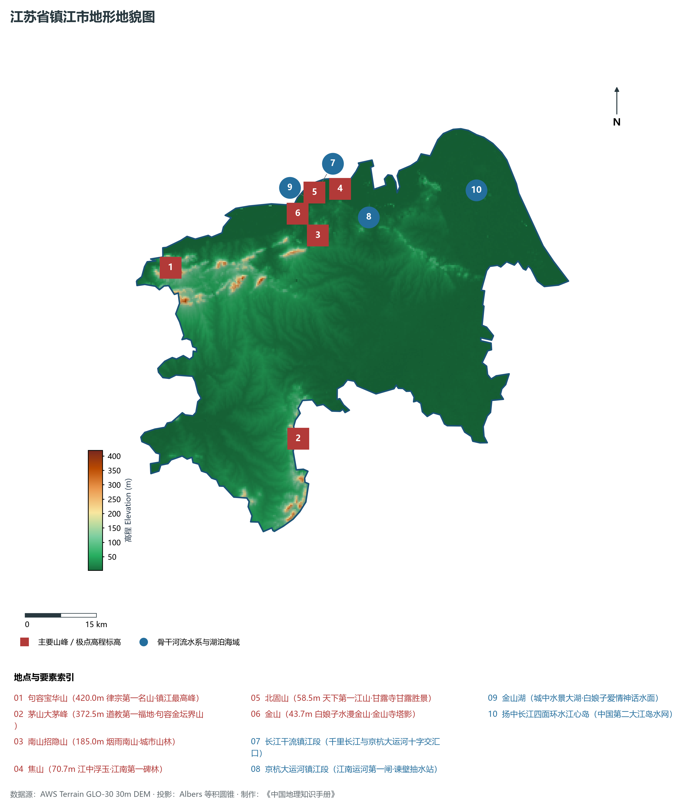
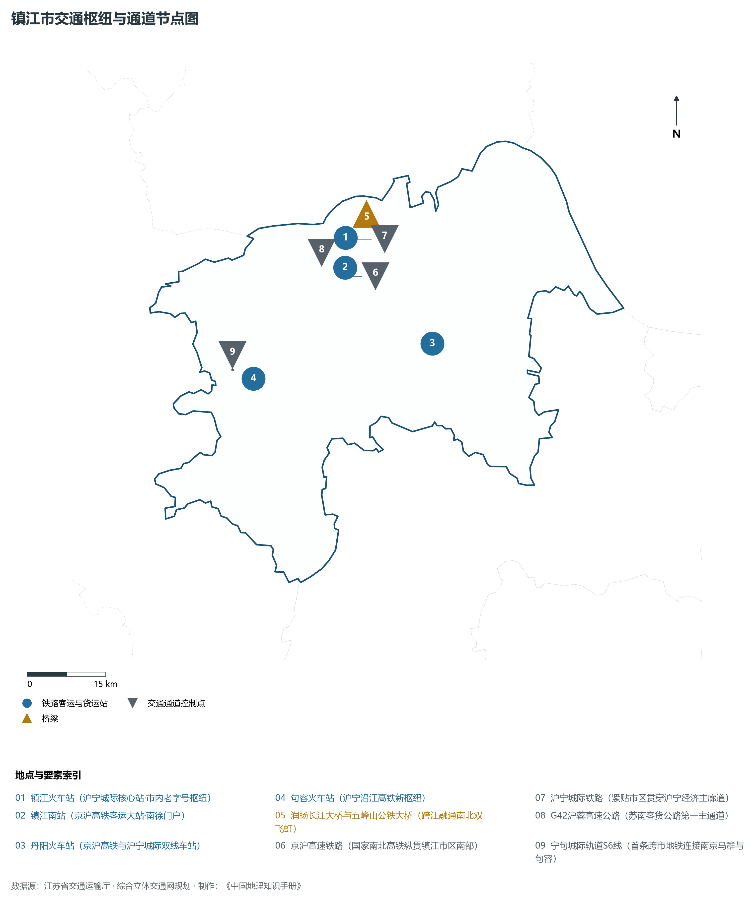
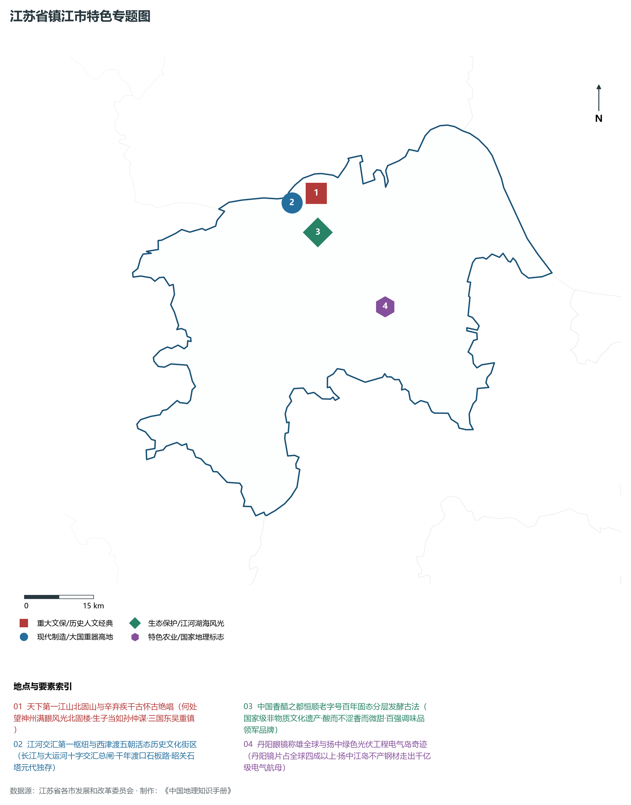
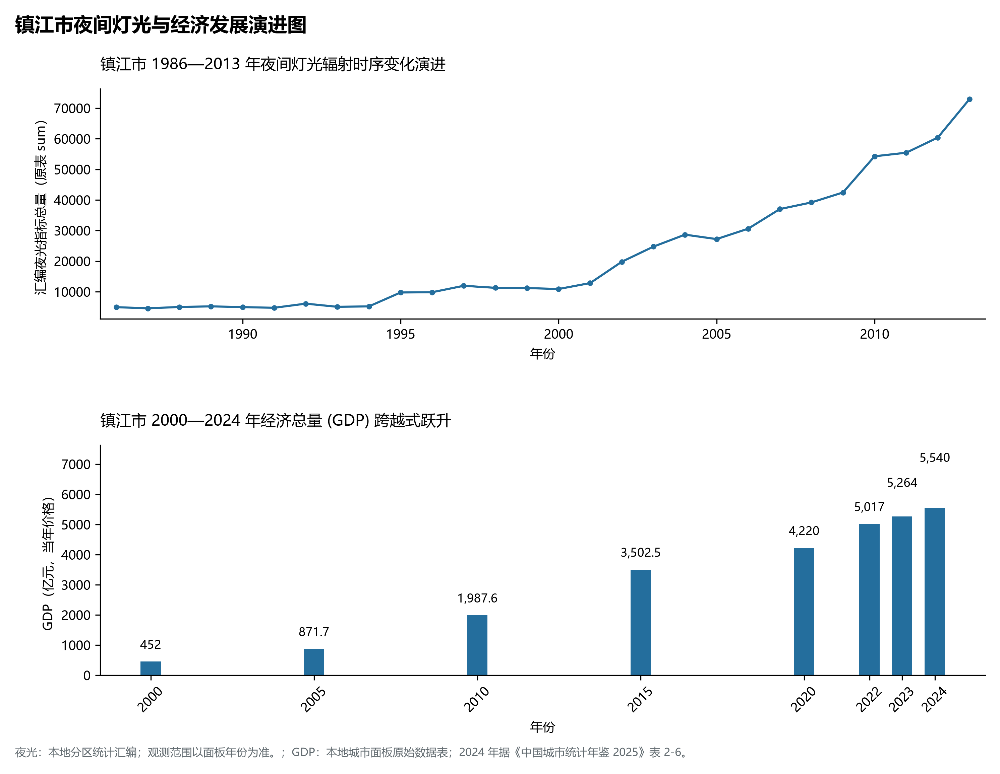

# 10.11 镇江市

镇江市，位于江苏省核心战略板块，其城市综合定位与发展愿景概括为：**城市山林·大江风貌·江河交汇第一枢纽·金山焦山北固山三山名胜·中国香醋之都**。2024 年常住人口 **323 万人**，常住人口城镇化率 **81.1%**，地区生产总值 **5,540 亿元**（当年价格），人均地区生产总值 **171,677 元**，三次产业构成为 **3.12 : 45.91 : 50.97**。

---

## 一、自然地理底盘与地貌水系机理

区域骨干控制性山峰与高程标高极点包括：

- **句容宝华山 (420.0m 律宗第一名山·镇江最高峰)**（空间坐标约东经 119.090°、北纬 32.140°，海拔标高约 420.0 m）：构成区域地形骨架与水文视廊的关键基准控制点；
- **茅山大茅峰 (372.5m 道教第一福地·句容金坛界山)**（空间坐标约东经 119.320°、北纬 31.790°，海拔标高约 372.5 m）：构成区域地形骨架与水文视廊的关键基准控制点；
- **南山招隐山 (185.0m 烟雨南山·城市山林)**（空间坐标约东经 119.430°、北纬 32.160°，海拔标高约 185.0 m）：构成区域地形骨架与水文视廊的关键基准控制点；
- **焦山 (70.7m 江中浮玉·江南第一碑林)**（空间坐标约东经 119.495°、北纬 32.240°，海拔标高约 70.7 m）：构成区域地形骨架与水文视廊的关键基准控制点；
- **北固山 (58.5m 天下第一江山·甘露寺甘露胜景)**（空间坐标约东经 119.460°、北纬 32.225°，海拔标高约 58.5 m）：构成区域地形骨架与水文视廊的关键基准控制点；
- **金山 (43.7m 白娘子水漫金山·金山寺塔影)**（空间坐标约东经 119.420°、北纬 32.215°，海拔标高约 43.7 m）：构成区域地形骨架与水文视廊的关键基准控制点；

水系水网与生态廊道方面，镇江市江海湖荡相融，骨干河流水网密集：

- **长江干流镇江段 (千里长江与京杭大运河十字交汇口)**（水域坐标约东经 119.450°、北纬 32.250°）：发挥生态调蓄、水源涵养、航运通商与防汛抗旱的核心枢纽功能；
- **京杭大运河镇江段 (江南运河第一闸·谏壁抽水站)**（水域坐标约东经 119.550°、北纬 32.180°）：发挥生态调蓄、水源涵养、航运通商与防汛抗旱的核心枢纽功能；
- **金山湖 (城中水景大湖·白娘子爱情神话水面)**（水域坐标约东经 119.430°、北纬 32.225°）：发挥生态调蓄、水源涵养、航运通商与防汛抗旱的核心枢纽功能；
- **扬中长江四面环水江心岛 (中国第二大江岛水网)**（水域坐标约东经 119.800°、北纬 32.200°）：发挥生态调蓄、水源涵养、航运通商与防汛抗旱的核心枢纽功能；

---

## 二、行政区划沿革与城镇空间体系

镇江市建置沿革悠久，人文底蕴深厚，自古为江淮吴越文化交流融合的核心枢纽。新中国成立特别是改革开放以来，伴随撤县设市、撤县设区与都市圈协同建设，形成了极核突出、县域强劲、产城深度融合的现代城镇空间体系：

- **镇江市委市政府 (南徐大道/润州区)**（驻地坐标：119.425°E, 32.190°N）：区域政治治理、高品质公共服务与综合经济管理的核心支撑极核；
- **京口区政府 (焦山北固山/大市口核心)**（驻地坐标：119.470°E, 32.200°N）：区域政治治理、高品质公共服务与综合经济管理的核心支撑极核；
- **润州区政府 (金山胜地/南徐新城)**（驻地坐标：119.410°E, 32.200°N）：区域政治治理、高品质公共服务与综合经济管理的核心支撑极核；
- **丹徒区政府 (新城长香路/南山脚下)**（驻地坐标：119.435°E, 32.130°N）：区域政治治理、高品质公共服务与综合经济管理的核心支撑极核；
- **丹阳市委市政府 (曲阿古邑/世界眼镜之都)**（驻地坐标：119.580°E, 31.990°N）：区域政治治理、高品质公共服务与综合经济管理的核心支撑极核；
- **句容市委市政府 (崇明街道/南京都市圈紧密圈)**（驻地坐标：119.165°E, 31.950°N）：区域政治治理、高品质公共服务与综合经济管理的核心支撑极核；
- **扬中市委市政府 (三茅街道/中国工程电气岛)**（驻地坐标：119.820°E, 32.180°N）：区域政治治理、高品质公共服务与综合经济管理的核心支撑极核；

在城镇空间总体布局上，镇江市紧密衔接国土空间总体规划，坚持“集约紧凑、拥江抱湖、轴向拓展、生态筑底”战略，做优中心城区综合服务功能，提升县域特色产业集聚度，构筑全域协调的现代城乡发展格局。

---

## 三、综合立体交通网络与交通走廊

镇江市地处江苏立体综合交通网络关键枢纽，依托高速铁路、骨干干线铁路、国家高速公路网与长江深水大港/内河港口/航空空港，构筑了通达全国、联通海外的现代化立体交通通道体系：

**核心综合客运与货运物流交通枢纽节点：**

- **镇江火车站 (沪宁城际核心站·市内老字号枢纽)**（位置坐标：119.430°E, 32.195°N）：区域客货运流量组织、换乘集散与多式联运的核心节点；
- **镇江南站 (京沪高铁客运大站·南徐门户)**（位置坐标：119.420°E, 32.145°N）：区域客货运流量组织、换乘集散与多式联运的核心节点；
- **丹阳火车站 (京沪高铁与沪宁城际双线车站)**（位置坐标：119.575°E, 31.995°N）：区域客货运流量组织、换乘集散与多式联运的核心节点；
- **句容火车站 (沪宁沿江高铁新枢纽)**（位置坐标：119.200°E, 31.980°N）：区域客货运流量组织、换乘集散与多式联运的核心节点；
- **润扬长江大桥与五峰山公铁大桥 (跨江融通南北双飞虹)**（位置坐标：119.480°E, 32.230°N）：区域客货运流量组织、换乘集散与多式联运的核心节点；

**骨干高速通道走廊与快速干线网络：**

- **京沪高速铁路 (国家南北高铁纵贯镇江市区南部)**（走廊控制点：119.420°E, 32.130°N）：对外快速互联互通的高速客货运通道与经济发展轴线；
- **沪宁城际铁路 (紧贴市区贯穿沪宁经济主廊道)**（走廊控制点：119.450°E, 32.190°N）：对外快速互联互通的高速客货运通道与经济发展轴线；
- **G42沪蓉高速公路 (苏南客货公路第一主通道)**（走廊控制点：119.400°E, 32.160°N）：对外快速互联互通的高速客货运通道与经济发展轴线；
- **宁句城际轨道S6线 (首条跨市地铁连接南京马群与句容)**（走廊控制点：119.160°E, 32.000°N）：对外快速互联互通的高速客货运通道与经济发展轴线；

---

## 四、现代产业体系与新质生产力布局

镇江市坚定践行实体经济立市导向，抢抓新一轮科技革命和产业变革战略机遇，聚力发展新质生产力，加快构建具有国际竞争力的现代工业集群与高能级创新体系：

**重点先进制造业园区与产业创新高地：**

- **恒顺醋业国家级非遗酿造与调味品产业基地**（园区坐标：119.450°E, 32.150°N）：区域战略性新兴产业集聚与科技成果转化的核心战略承载平台；
- **丹阳全球最大眼镜制造与视光产业集群**（园区坐标：119.590°E, 31.980°N）：区域战略性新兴产业集聚与科技成果转化的核心战略承载平台；
- **扬中大全集团与智能电网特种电气制造基地**（园区坐标：119.820°E, 32.190°N）：区域战略性新兴产业集聚与科技成果转化的核心战略承载平台；
- **镇江航空航天产业园 (C919大型客机机体结构部件部件基地)**（园区坐标：119.600°E, 32.150°N）：区域战略性新兴产业集聚与科技成果转化的核心战略承载平台；

**标志性特色主题要素与领航龙头优势：**

- **天下第一江山北固山与辛弃疾千古怀古绝唱**（空间坐标：119.460°E, 32.225°N）：何处望神州满眼风光北固楼·生子当如孙仲谋·三国东吴重镇；
- **江河交汇第一枢纽与西津渡五朝活态历史文化街区**（空间坐标：119.430°E, 32.210°N）：长江与大运河十字交汇总闸·千年渡口石板路·昭关石塔元代独存；
- **中国香醋之都恒顺老字号百年固态分层发酵古法**（空间坐标：119.450°E, 32.150°N）：国家级非物质文化遗产·酸而不涩香而微甜·百强调味品领军品牌；
- **丹阳眼镜称雄全球与扬中绿色光伏工程电气岛奇迹**（空间坐标：119.580°E, 31.990°N）：丹阳镜片占全球四成以上·扬中江岛不产钢材走出千亿级电气航母；

---

## 五、历史文化底蕴、名胜古迹与全域文旅地理

镇江市江山胜迹璀璨，历史文脉绵延数千年，汇聚了世界文化遗产、国家 5A 级景区与全国重点文物保护单位：

- **镇江三山风景名胜区 (5A·金山/焦山/北固山雄踞大江)**（地标坐标：119.450°E, 32.230°N）：彰显吴韵汉风、运河文明与生态山水风情的名胜文旅地标；
- **句容茅山风景名胜区 (5A·第一福地第八洞天·新四军纪念馆)**（地标坐标：119.320°E, 31.790°N）：彰显吴韵汉风、运河文明与生态山水风情的名胜文旅地标；
- **西津渡历史文化街区 (4A·一眼看千年·唐宋元明清五朝古渡)**（地标坐标：119.430°E, 32.210°N）：彰显吴韵汉风、运河文明与生态山水风情的名胜文旅地标；
- **镇江南山国家森林公园 (4A·招隐寺·米芾米氏云山)**（地标坐标：119.435°E, 32.165°N）：彰显吴韵汉风、运河文明与生态山水风情的名胜文旅地标；
- **宝华山国家森林公园 (4A·隆昌寺千僧受戒道场)**（地标坐标：119.090°E, 32.140°N）：彰显吴韵汉风、运河文明与生态山水风情的名胜文旅地标；

镇江市持续推动以文塑旅、以旅彰文，深化文化遗产系统性保护与活态传承，培育高品质全域旅游新消费场景，打造高辨识度城市文旅金名片。

---

## 六、夜间灯光辐射与跨世纪经济变化时序演进

本节夜光图的观测年份为 1986—2013 年，指标为行政区汇总值（原表 sum）。

| 年份 | 地区生产总值（亿元，当年价格） |
|:---|---:|
| 2000 年 | 452 |
| 2005 年 | 871.7 |
| 2010 年 | 1,987.6 |
| 2015 年 | 3,502.5 |
| 2020 年 | 4,220 |
| 2022 年 | 5,017 |
| 2023 年 | 5,264 |
| 2024 年 | 5,540 |

2024 年统计来源：《中国城市统计年鉴 2025》表 2-1、2-6、2-7（2024 年，全市）。其他年份 GDP 据本地城市面板“原始数据”表，单位为亿元、当年价格。
