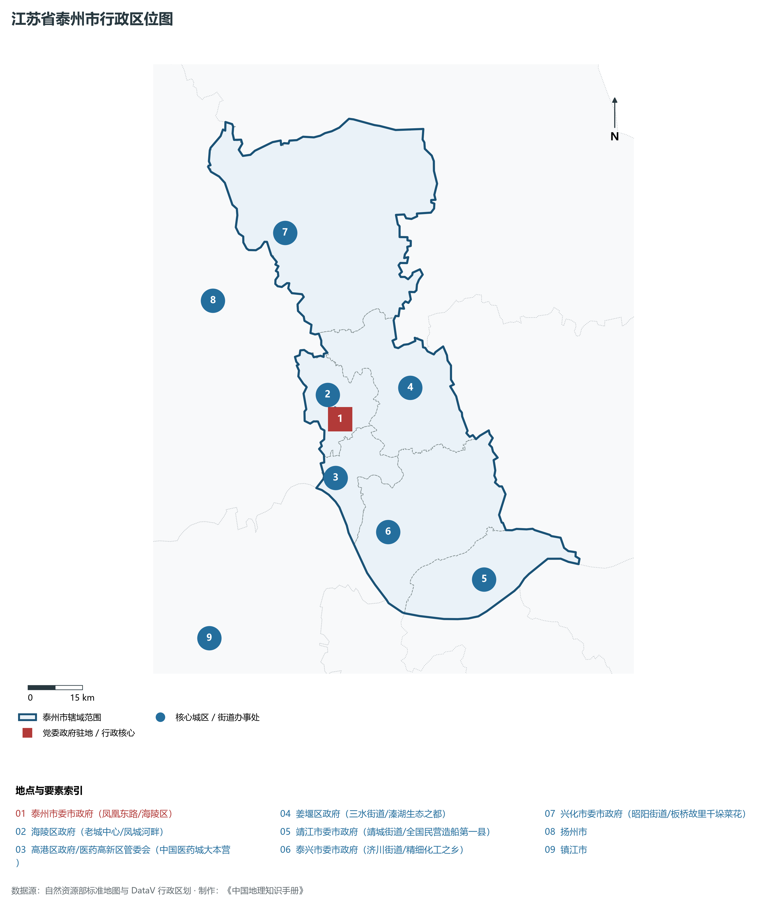
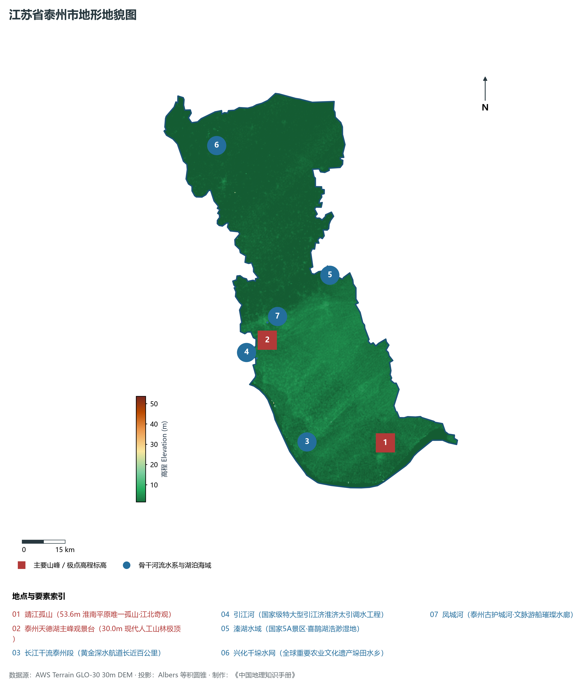
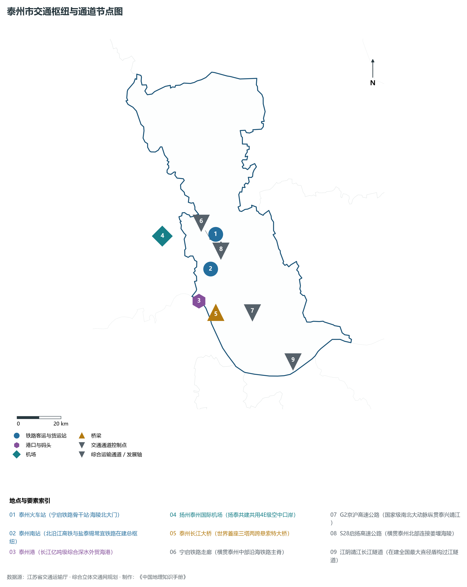
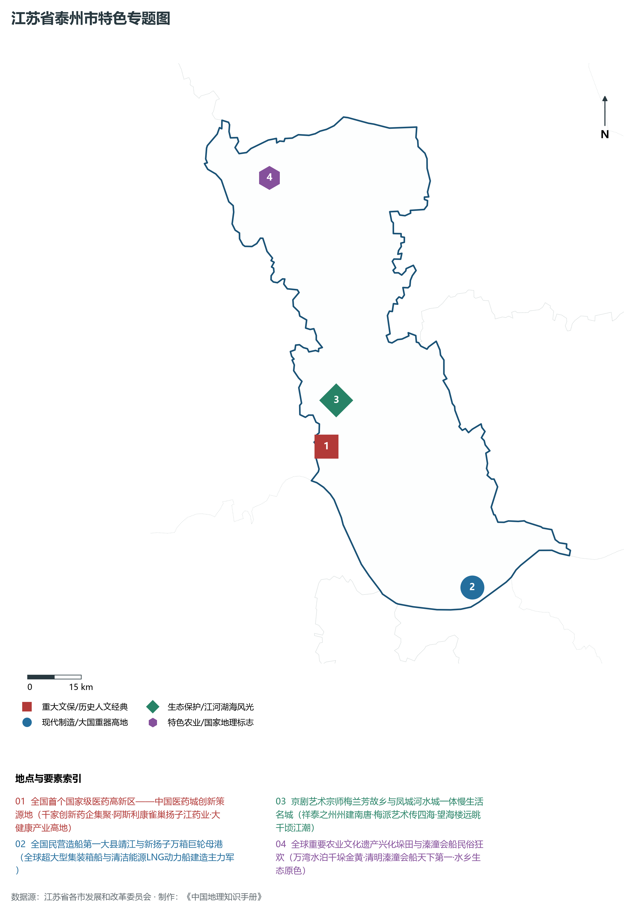
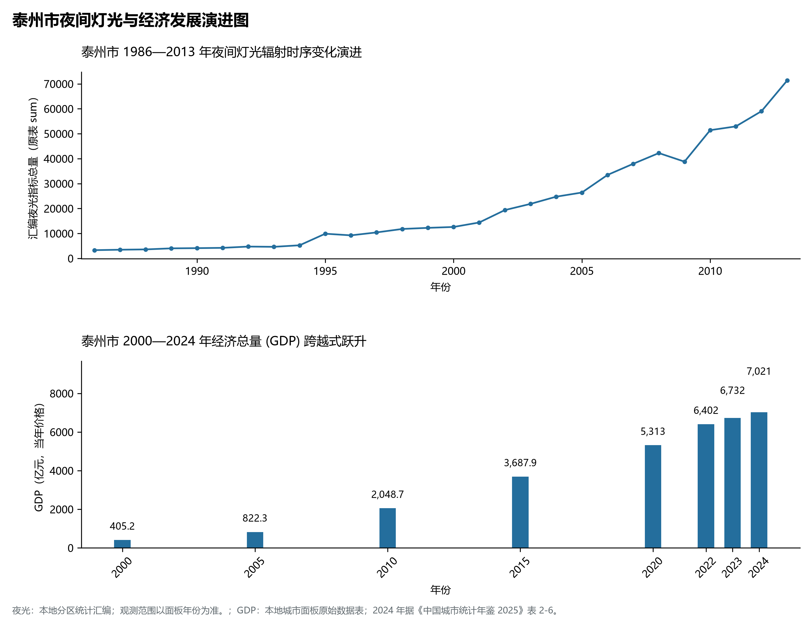

# 10.12 泰州市

泰州市，位于江苏省核心战略板块，其城市综合定位与发展愿景概括为：**祥泰之州·儒风之盛·中国医药城·梅兰芳大师故里·全国第一大型民营造船基地**。2024 年常住人口 **447 万人**，常住人口城镇化率 **70.88%**，地区生产总值 **7,021 亿元**（当年价格），人均地区生产总值 **156,351 元**，三次产业构成为 **5.06 : 4,732 : 47.62**。

---

## 一、自然地理底盘与地貌水系机理

区域骨干控制性山峰与高程标高极点包括：

- **靖江孤山 (53.6m 淮南平原唯一孤山·江北奇观)**（空间坐标约东经 120.290°、北纬 32.060°，海拔标高约 53.6 m）：构成区域地形骨架与水文视廊的关键基准控制点；
- **泰州天德湖主峰观景台 (30.0m 现代人工山林极顶)**（空间坐标约东经 119.910°、北纬 32.430°，海拔标高约 30.0 m）：构成区域地形骨架与水文视廊的关键基准控制点；

水系水网与生态廊道方面，泰州市江海湖荡相融，骨干河流水网密集：

- **长江干流泰州段 (黄金深水航道长近百公里)**（水域坐标约东经 120.000°、北纬 32.100°）：发挥生态调蓄、水源涵养、航运通商与防汛抗旱的核心枢纽功能；
- **引江河 (国家级特大型引江济淮济太引调水工程)**（水域坐标约东经 119.860°、北纬 32.380°）：发挥生态调蓄、水源涵养、航运通商与防汛抗旱的核心枢纽功能；
- **溱湖水域 (国家5A景区·喜鹊湖浩渺湿地)**（水域坐标约东经 120.180°、北纬 32.600°）：发挥生态调蓄、水源涵养、航运通商与防汛抗旱的核心枢纽功能；
- **兴化千垛水网 (全球重要农业文化遗产垛田水乡)**（水域坐标约东经 119.830°、北纬 33.050°）：发挥生态调蓄、水源涵养、航运通商与防汛抗旱的核心枢纽功能；
- **凤城河 (泰州古护城河·文脉游船璀璨水廊)**（水域坐标约东经 119.920°、北纬 32.485°）：发挥生态调蓄、水源涵养、航运通商与防汛抗旱的核心枢纽功能；

---

## 二、行政区划沿革与城镇空间体系

泰州市建置沿革悠久，人文底蕴深厚，自古为江淮吴越文化交流融合的核心枢纽。新中国成立特别是改革开放以来，伴随撤县设市、撤县设区与都市圈协同建设，形成了极核突出、县域强劲、产城深度融合的现代城镇空间体系：

- **泰州市委市政府 (凤凰东路/海陵区)**（驻地坐标：119.920°E, 32.460°N）：区域政治治理、高品质公共服务与综合经济管理的核心支撑极核；
- **海陵区政府 (老城中心/凤城河畔)**（驻地坐标：119.910°E, 32.490°N）：区域政治治理、高品质公共服务与综合经济管理的核心支撑极核；
- **高港区政府/医药高新区管委会 (中国医药城大本营)**（驻地坐标：119.880°E, 32.320°N）：区域政治治理、高品质公共服务与综合经济管理的核心支撑极核；
- **姜堰区政府 (三水街道/溱湖生态之都)**（驻地坐标：120.140°E, 32.510°N）：区域政治治理、高品质公共服务与综合经济管理的核心支撑极核；
- **靖江市委市政府 (靖城街道/全国民营造船第一县)**（驻地坐标：120.270°E, 32.020°N）：区域政治治理、高品质公共服务与综合经济管理的核心支撑极核；
- **泰兴市委市政府 (济川街道/精细化工之乡)**（驻地坐标：120.010°E, 32.170°N）：区域政治治理、高品质公共服务与综合经济管理的核心支撑极核；
- **兴化市委市政府 (昭阳街道/板桥故里千垛菜花)**（驻地坐标：119.840°E, 32.930°N）：区域政治治理、高品质公共服务与综合经济管理的核心支撑极核；

在城镇空间总体布局上，泰州市紧密衔接国土空间总体规划，坚持“集约紧凑、拥江抱湖、轴向拓展、生态筑底”战略，做优中心城区综合服务功能，提升县域特色产业集聚度，构筑全域协调的现代城乡发展格局。

---

## 三、综合立体交通网络与交通走廊

泰州市地处江苏立体综合交通网络关键枢纽，依托高速铁路、骨干干线铁路、国家高速公路网与长江深水大港/内河港口/航空空港，构筑了通达全国、联通海外的现代化立体交通通道体系：

**核心综合客运与货运物流交通枢纽节点：**

- **泰州火车站 (宁启铁路骨干站·海陵北大门)**（位置坐标：119.980°E, 32.535°N）：区域客货运流量组织、换乘集散与多式联运的核心节点；
- **泰州南站 (北沿江高铁与盐泰锡常宜铁路在建总枢纽)**（位置坐标：119.930°E, 32.400°N）：区域客货运流量组织、换乘集散与多式联运的核心节点；
- **泰州港 (长江亿吨级综合深水外贸海港)**（位置坐标：119.850°E, 32.280°N）：区域客货运流量组织、换乘集散与多式联运的核心节点；
- **扬州泰州国际机场 (扬泰共建共用4E级空中口岸)**（位置坐标：119.720°E, 32.560°N）：区域客货运流量组织、换乘集散与多式联运的核心节点；
- **泰州长江大桥 (世界首座三塔两跨悬索特大桥)**（位置坐标：119.880°E, 32.230°N）：区域客货运流量组织、换乘集散与多式联运的核心节点；

**骨干高速通道走廊与快速干线网络：**

- **宁启铁路走廊 (横贯泰州中部沿海铁路主脊)**（走廊控制点：119.950°E, 32.520°N）：对外快速互联互通的高速客货运通道与经济发展轴线；
- **G2京沪高速公路 (国家级南北大动脉纵贯泰兴靖江)**（走廊控制点：120.100°E, 32.200°N）：对外快速互联互通的高速客货运通道与经济发展轴线；
- **S28启扬高速公路 (横贯泰州北部连接姜堰海陵)**（走廊控制点：120.000°E, 32.500°N）：对外快速互联互通的高速客货运通道与经济发展轴线；
- **江阴靖江长江隧道 (在建全国最大直径盾构过江隧道)**（走廊控制点：120.260°E, 31.980°N）：对外快速互联互通的高速客货运通道与经济发展轴线；

---

## 四、现代产业体系与新质生产力布局

泰州市坚定践行实体经济立市导向，抢抓新一轮科技革命和产业变革战略机遇，聚力发展新质生产力，加快构建具有国际竞争力的现代工业集群与高能级创新体系：

**重点先进制造业园区与产业创新高地：**

- **中国医药城 (泰州国家医药高新区·全国首个国家级)**（园区坐标：119.880°E, 32.380°N）：区域战略性新兴产业集聚与科技成果转化的核心战略承载平台；
- **扬子江药业集团总部与现代中药生产基地**（园区坐标：119.860°E, 32.320°N）：区域战略性新兴产业集聚与科技成果转化的核心战略承载平台；
- **新扬子造船与新时代造船基地 (全国民营造船第一县)**（园区坐标：120.250°E, 31.980°N）：区域战略性新兴产业集聚与科技成果转化的核心战略承载平台；
- **泰兴经济开发区世界级精细化工产业园**（园区坐标：120.020°E, 32.140°N）：区域战略性新兴产业集聚与科技成果转化的核心战略承载平台；

**标志性特色主题要素与领航龙头优势：**

- **全国首个国家级医药高新区——中国医药城创新策源地**（空间坐标：119.880°E, 32.380°N）：千家创新药企集聚·阿斯利康雀巢扬子江药业·大健康产业高地；
- **全国民营造船第一大县靖江与新扬子万箱巨轮母港**（空间坐标：120.250°E, 31.980°N）：全球超大型集装箱船与清洁能源LNG动力船建造主力军；
- **京剧艺术宗师梅兰芳故乡与凤城河水城一体慢生活名城**（空间坐标：119.930°E, 32.490°N）：祥泰之州州建南唐·梅派艺术传四海·望海楼远眺千顷江潮；
- **全球重要农业文化遗产兴化垛田与溱潼会船民俗狂欢**（空间坐标：119.830°E, 33.060°N）：万湾水泊千垛金黄·清明溱潼会船天下第一·水乡生态原色；

---

## 五、历史文化底蕴、名胜古迹与全域文旅地理

泰州市江山胜迹璀璨，历史文脉绵延数千年，汇聚了世界文化遗产、国家 5A 级景区与全国重点文物保护单位：

- **溱湖国家湿地公园 (5A·溱潼会船万舟齐发·古镇八喜)**（地标坐标：120.180°E, 32.610°N）：彰显吴韵汉风、运河文明与生态山水风情的名胜文旅地标；
- **兴化千垛景区 (4A·垛田油菜花海·世界农业文化遗产)**（地标坐标：119.830°E, 33.060°N）：彰显吴韵汉风、运河文明与生态山水风情的名胜文旅地标；
- **凤城河风景区 (4A·望海楼·桃园孔尚任桃花扇)**（地标坐标：119.925°E, 32.485°N）：彰显吴韵汉风、运河文明与生态山水风情的名胜文旅地标；
- **梅兰芳纪念馆 (梅苑·京剧一代宗师艺术圣殿)**（地标坐标：119.930°E, 32.490°N）：彰显吴韵汉风、运河文明与生态山水风情的名胜文旅地标；
- **郑板桥故居与李中水上森林 (4A·扬州八怪水上森林奇观)**（地标坐标：119.850°E, 32.950°N）：彰显吴韵汉风、运河文明与生态山水风情的名胜文旅地标；

泰州市持续推动以文塑旅、以旅彰文，深化文化遗产系统性保护与活态传承，培育高品质全域旅游新消费场景，打造高辨识度城市文旅金名片。

---

## 六、夜间灯光辐射与跨世纪经济变化时序演进

本节夜光图的观测年份为 1986—2013 年，指标为行政区汇总值（原表 sum）。

| 年份 | 地区生产总值（亿元，当年价格） |
|:---|---:|
| 2000 年 | 405.2 |
| 2005 年 | 822.3 |
| 2010 年 | 2,048.7 |
| 2015 年 | 3,687.9 |
| 2020 年 | 5,313 |
| 2022 年 | 6,402 |
| 2023 年 | 6,732 |
| 2024 年 | 7,021 |

2024 年统计来源：《中国城市统计年鉴 2025》表 2-1、2-6、2-7（2024 年，全市）。其他年份 GDP 据本地城市面板“原始数据”表，单位为亿元、当年价格。
