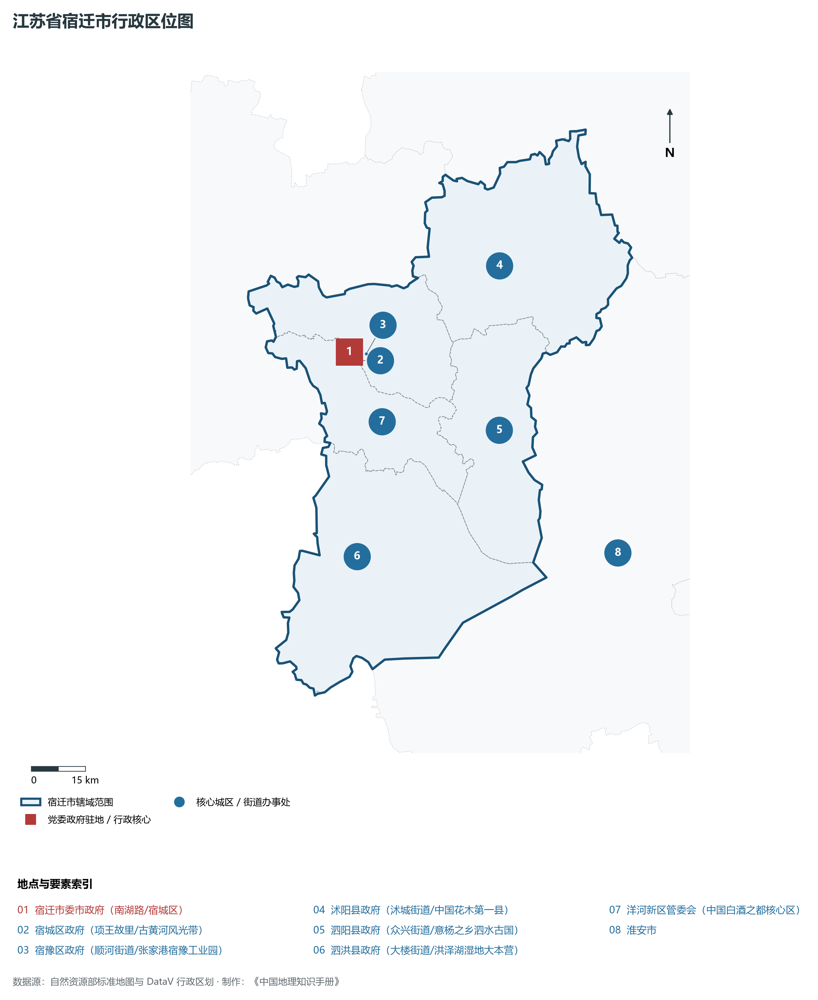
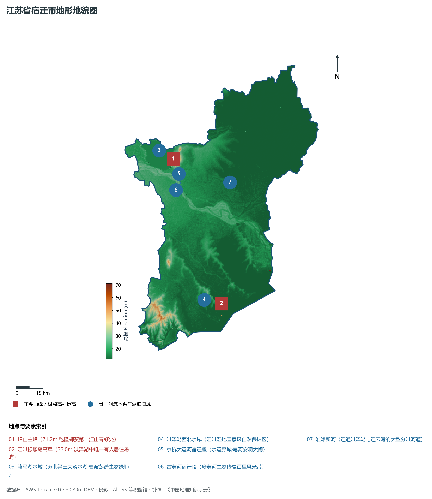
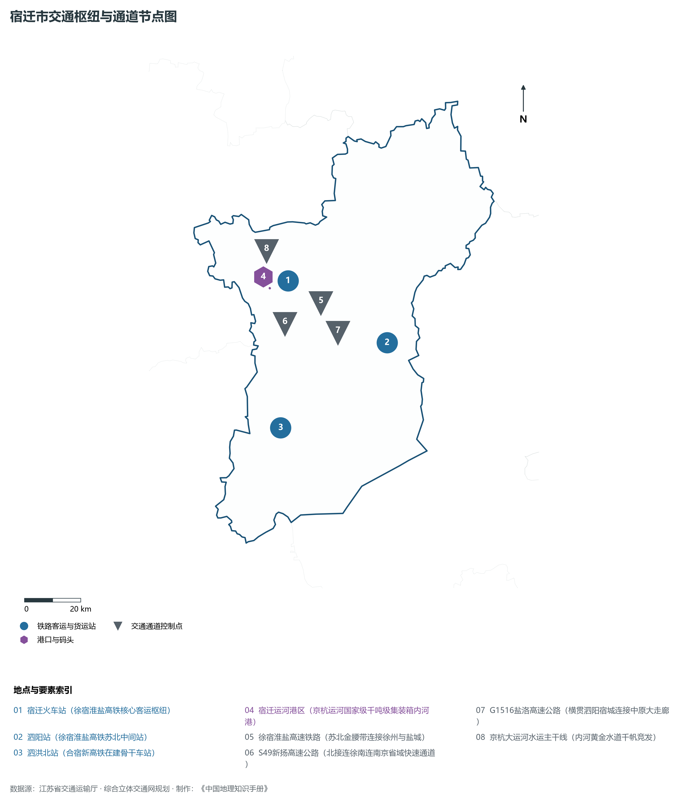
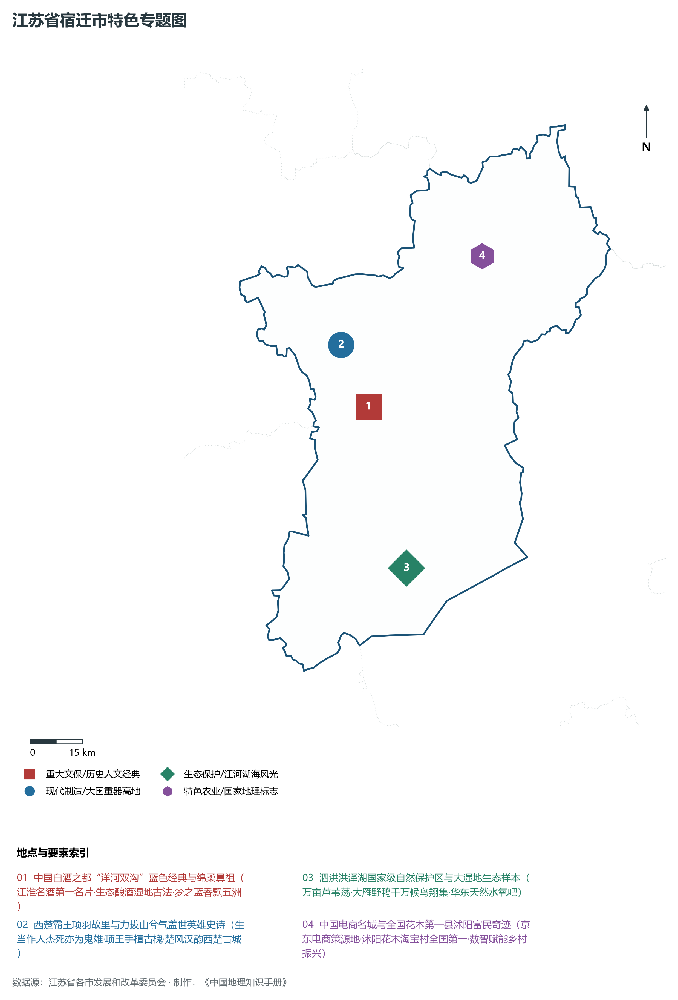
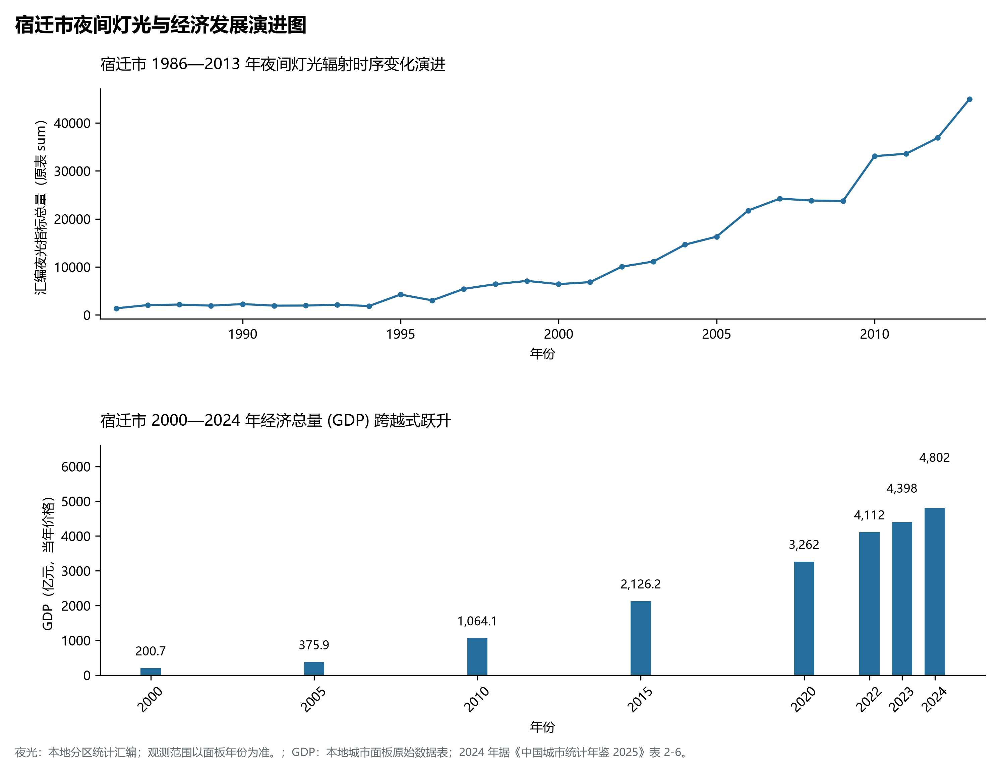

# 10.13 宿迁市

宿迁市，位于江苏省核心战略板块，其城市综合定位与发展愿景概括为：**西楚霸王故里·中国白酒之都·华东生态明珠·骆马湖与洪泽湖双明珠·中国电商名城**。2024 年常住人口 **498 万人**，常住人口城镇化率 **65.6%**，地区生产总值 **4,802 亿元**（当年价格），人均地区生产总值 **96,447 元**，三次产业构成为 **8.6 : 42.42 : 48.98**。

---

## 一、自然地理底盘与地貌水系机理

区域骨干控制性山峰与高程标高极点包括：

- **嶂山主峰 (71.2m 乾隆御赞第一江山春好处)**（空间坐标约东经 118.280°、北纬 34.050°，海拔标高约 71.2 m）：构成区域地形骨架与水文视廊的关键基准控制点；
- **泗洪穆墩岛高阜 (22.0m 洪泽湖中唯一有人居住岛屿)**（空间坐标约东经 118.450°、北纬 33.320°，海拔标高约 22.0 m）：构成区域地形骨架与水文视廊的关键基准控制点；

水系水网与生态廊道方面，宿迁市江海湖荡相融，骨干河流水网密集：

- **骆马湖水域 (苏北第三大淡水湖·碧波荡漾生态绿肺)**（水域坐标约东经 118.200°、北纬 34.100°）：发挥生态调蓄、水源涵养、航运通商与防汛抗旱的核心枢纽功能；
- **洪泽湖西北水域 (泗洪湿地国家级自然保护区)**（水域坐标约东经 118.350°、北纬 33.350°）：发挥生态调蓄、水源涵养、航运通商与防汛抗旱的核心枢纽功能；
- **京杭大运河宿迁段 (水运穿城·皂河安澜大闸)**（水域坐标约东经 118.250°、北纬 33.980°）：发挥生态调蓄、水源涵养、航运通商与防汛抗旱的核心枢纽功能；
- **古黄河宿迁段 (废黄河生态修复百里风光带)**（水域坐标约东经 118.300°、北纬 33.930°）：发挥生态调蓄、水源涵养、航运通商与防汛抗旱的核心枢纽功能；
- **淮沭新河 (连通洪泽湖与连云港的大型分洪河道)**（水域坐标约东经 118.600°、北纬 33.900°）：发挥生态调蓄、水源涵养、航运通商与防汛抗旱的核心枢纽功能；

---

## 二、行政区划沿革与城镇空间体系

宿迁市建置沿革悠久，人文底蕴深厚，自古为江淮吴越文化交流融合的核心枢纽。新中国成立特别是改革开放以来，伴随撤县设市、撤县设区与都市圈协同建设，形成了极核突出、县域强劲、产城深度融合的现代城镇空间体系：

- **宿迁市委市政府 (南湖路/宿城区)**（驻地坐标：118.280°E, 33.960°N）：区域政治治理、高品质公共服务与综合经济管理的核心支撑极核；
- **宿城区政府 (项王故里/古黄河风光带)**（驻地坐标：118.270°E, 33.940°N）：区域政治治理、高品质公共服务与综合经济管理的核心支撑极核；
- **宿豫区政府 (顺河街道/张家港宿豫工业园)**（驻地坐标：118.330°E, 33.950°N）：区域政治治理、高品质公共服务与综合经济管理的核心支撑极核；
- **沭阳县政府 (沭城街道/中国花木第一县)**（驻地坐标：118.770°E, 34.120°N）：区域政治治理、高品质公共服务与综合经济管理的核心支撑极核；
- **泗阳县政府 (众兴街道/意杨之乡泗水古国)**（驻地坐标：118.700°E, 33.720°N）：区域政治治理、高品质公共服务与综合经济管理的核心支撑极核；
- **泗洪县政府 (大楼街道/洪泽湖湿地大本营)**（驻地坐标：118.220°E, 33.460°N）：区域政治治理、高品质公共服务与综合经济管理的核心支撑极核；
- **洋河新区管委会 (中国白酒之都核心区)**（驻地坐标：118.350°E, 33.780°N）：区域政治治理、高品质公共服务与综合经济管理的核心支撑极核；

在城镇空间总体布局上，宿迁市紧密衔接国土空间总体规划，坚持“集约紧凑、拥江抱湖、轴向拓展、生态筑底”战略，做优中心城区综合服务功能，提升县域特色产业集聚度，构筑全域协调的现代城乡发展格局。

---

## 三、综合立体交通网络与交通走廊

宿迁市地处江苏立体综合交通网络关键枢纽，依托高速铁路、骨干干线铁路、国家高速公路网与长江深水大港/内河港口/航空空港，构筑了通达全国、联通海外的现代化立体交通通道体系：

**核心综合客运与货运物流交通枢纽节点：**

- **宿迁火车站 (徐宿淮盐高铁核心客运枢纽)**（位置坐标：118.335°E, 33.935°N）：区域客货运流量组织、换乘集散与多式联运的核心节点；
- **泗阳站 (徐宿淮盐高铁苏北中间站)**（位置坐标：118.685°E, 33.700°N）：区域客货运流量组织、换乘集散与多式联运的核心节点；
- **泗洪北站 (合宿新高铁在建骨干车站)**（位置坐标：118.230°E, 33.480°N）：区域客货运流量组织、换乘集散与多式联运的核心节点；
- **宿迁运河港区 (京杭运河国家级千吨级集装箱内河港)**（位置坐标：118.260°E, 33.920°N）：区域客货运流量组织、换乘集散与多式联运的核心节点；

**骨干高速通道走廊与快速干线网络：**

- **徐宿淮盐高速铁路 (苏北金腰带连接徐州与盐城)**（走廊控制点：118.450°E, 33.850°N）：对外快速互联互通的高速客货运通道与经济发展轴线；
- **S49新扬高速公路 (北接连徐南连南京省域快速通道)**（走廊控制点：118.300°E, 33.800°N）：对外快速互联互通的高速客货运通道与经济发展轴线；
- **G1516盐洛高速公路 (横贯泗阳宿城连接中原大走廊)**（走廊控制点：118.500°E, 33.750°N）：对外快速互联互通的高速客货运通道与经济发展轴线；
- **京杭大运河水运主干线 (内河黄金水道千帆竞发)**（走廊控制点：118.220°E, 34.020°N）：对外快速互联互通的高速客货运通道与经济发展轴线；

---

## 四、现代产业体系与新质生产力布局

宿迁市坚定践行实体经济立市导向，抢抓新一轮科技革命和产业变革战略机遇，聚力发展新质生产力，加快构建具有国际竞争力的现代工业集群与高能级创新体系：

**重点先进制造业园区与产业创新高地：**

- **洋河股份与双沟酒业中国白酒之都酿造基地**（园区坐标：118.360°E, 33.780°N）：区域战略性新兴产业集聚与科技成果转化的核心战略承载平台；
- **京东全国客户服务中心与宿迁电商产业园**（园区坐标：118.300°E, 33.990°N）：区域战略性新兴产业集聚与科技成果转化的核心战略承载平台；
- **沭阳全国最大花木电商产业集聚区**（园区坐标：118.800°E, 34.150°N）：区域战略性新兴产业集聚与科技成果转化的核心战略承载平台；
- **天合光能宿迁高效太阳能电池硅片大基地**（园区坐标：118.240°E, 33.910°N）：区域战略性新兴产业集聚与科技成果转化的核心战略承载平台；

**标志性特色主题要素与领航龙头优势：**

- **中国白酒之都“洋河双沟”蓝色经典与绵柔鼻祖**（空间坐标：118.350°E, 33.780°N）：江淮名酒第一名片·生态酿酒湿地古法·梦之蓝香飘五洲；
- **西楚霸王项羽故里与力拔山兮气盖世英雄史诗**（空间坐标：118.290°E, 33.945°N）：生当作人杰死亦为鬼雄·项王手植古槐·楚风汉韵西楚古城；
- **泗洪洪泽湖国家级自然保护区与大湿地生态样本**（空间坐标：118.400°E, 33.360°N）：万亩芦苇荡·大雁野鸭千万候鸟翔集·华东天然水氧吧；
- **中国电商名城与全国花木第一县沭阳富民奇迹**（空间坐标：118.770°E, 34.120°N）：京东电商策源地·沭阳花木淘宝村全国第一·数智赋能乡村振兴；

---

## 五、历史文化底蕴、名胜古迹与全域文旅地理

宿迁市江山胜迹璀璨，历史文脉绵延数千年，汇聚了世界文化遗产、国家 5A 级景区与全国重点文物保护单位：

- **泗洪洪泽湖湿地景区 (5A·华东最大芦苇迷宫·荷花大观园)**（地标坐标：118.400°E, 33.360°N）：彰显吴韵汉风、运河文明与生态山水风情的名胜文旅地标；
- **项王故里景区 (4A·西楚霸王项羽诞生地·盖世英雄)**（地标坐标：118.290°E, 33.945°N）：彰显吴韵汉风、运河文明与生态山水风情的名胜文旅地标；
- **三台山国家森林公园 (4A·第一江山春好处·衲田花海)**（地标坐标：118.280°E, 34.040°N）：彰显吴韵汉风、运河文明与生态山水风情的名胜文旅地标；
- **乾隆行宫与皂河古镇 (全国重点文保·京杭运河第一镇)**（地标坐标：118.150°E, 34.080°N）：彰显吴韵汉风、运河文明与生态山水风情的名胜文旅地标；
- **洋河酒文化旅游区 (4A·地下酒窖百年地下古酿法)**（地标坐标：118.350°E, 33.775°N）：彰显吴韵汉风、运河文明与生态山水风情的名胜文旅地标；

宿迁市持续推动以文塑旅、以旅彰文，深化文化遗产系统性保护与活态传承，培育高品质全域旅游新消费场景，打造高辨识度城市文旅金名片。

---

## 六、夜间灯光辐射与跨世纪经济变化时序演进

本节夜光图的观测年份为 1986—2013 年，指标为行政区汇总值（原表 sum）。

| 年份 | 地区生产总值（亿元，当年价格） |
|:---|---:|
| 2000 年 | 200.7 |
| 2005 年 | 375.9 |
| 2010 年 | 1,064.1 |
| 2015 年 | 2,126.2 |
| 2020 年 | 3,262 |
| 2022 年 | 4,112 |
| 2023 年 | 4,398 |
| 2024 年 | 4,802 |

2024 年统计来源：《中国城市统计年鉴 2025》表 2-1、2-6、2-7（2024 年，全市）。其他年份 GDP 据本地城市面板“原始数据”表，单位为亿元、当年价格。
