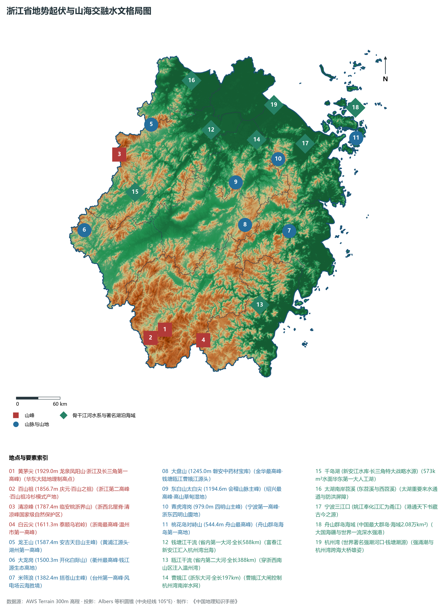
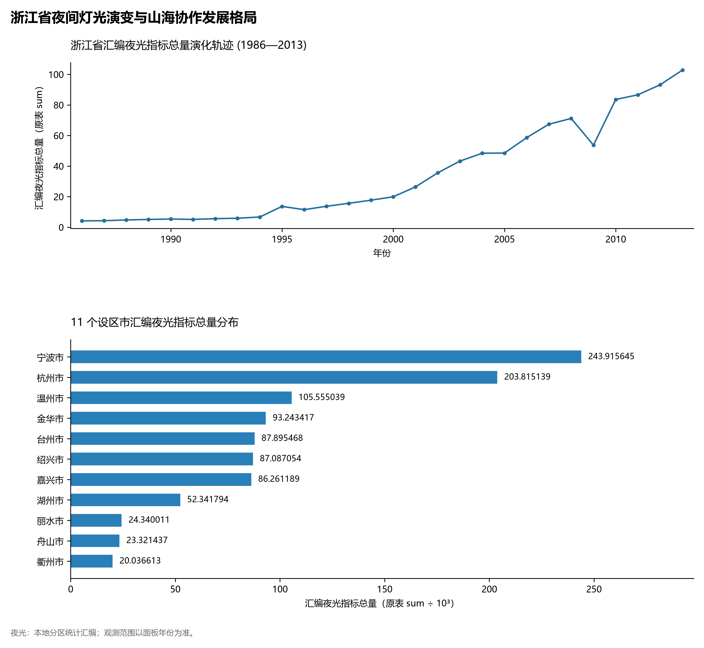
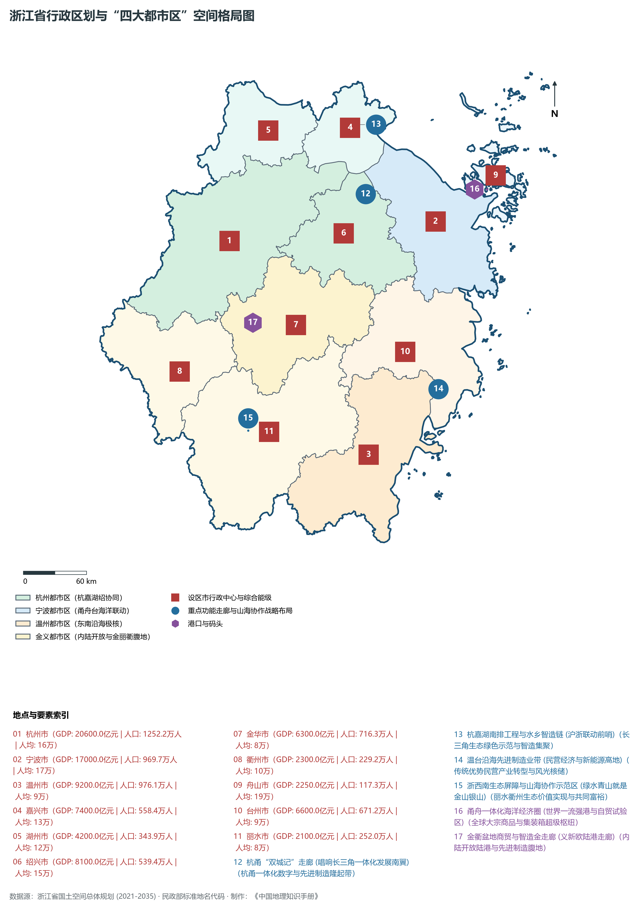
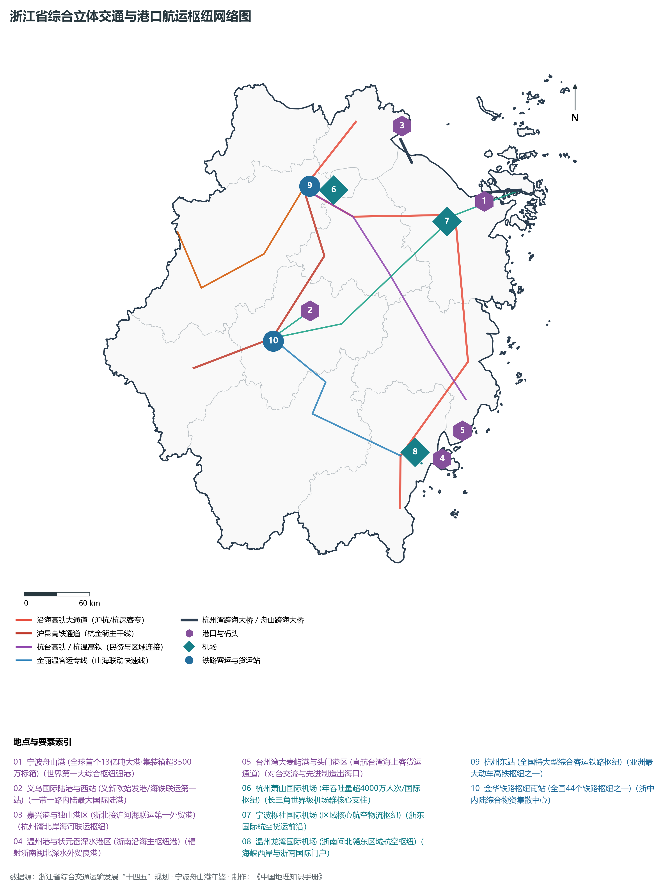
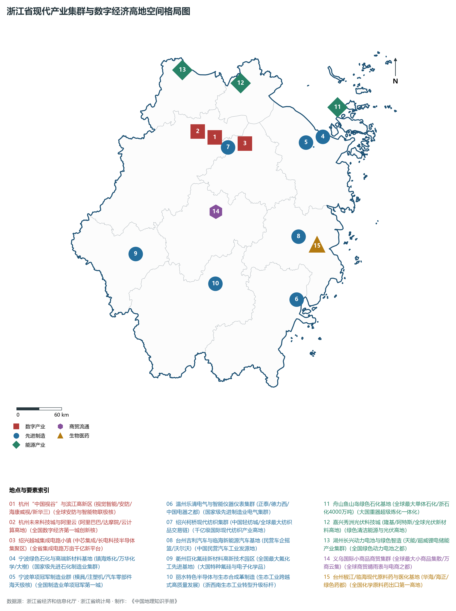

# 11.0 浙江省地理统揽

浙江省，简称“浙”，省会杭州市，位于中国东南沿海、长江三角洲南翼，东临东海，南接福建，西与江西、安徽相连，北与上海、江苏毗邻，地处东经 118° 01' ～ 123° 10'、北纬 27° 02' ～ 31° 11' 之间。全省陆域总面积达 **10.55 × 10⁴ km²**，海域面积达 **26.00 × 10⁴ km²**，大陆海岸线总长达 **6486 km**（居全国各省区第一位），面积大于 500 m² 的海岛达 **4333 个**（居全国各省区第一位），是名副其实的海洋大省与千岛之境。浙江历史悠久，自古享有“鱼米之乡、丝茶之府、文物之邦、旅游胜地”之盛誉，更是中国古代吴越文化发祥地、中国革命红船起航地、“绿水青山就是金山银山”科学理念发源地，以及中国当代民营经济最富活力、数字化变革最深最广的高质量发展建设共同富裕示范区。

全省地貌宏观上呈现极为典型的**“七山一水二分田”**山海交融地理格局。地势由西南向东北倾斜，西南崇山峻岭、层峦叠嶂，东北平原坦荡、水网如织。全省现辖 11 个地级市（杭州市、宁波市、温州市、嘉兴市、湖州市、绍兴市、金华市、衢州市、舟山市、台州市、丽水市），其中包括副省级特大城市兼省会杭州市、副省级计划单列市宁波市。截至 2024 年末，全省常住人口达到 **6640 万人**，城镇化率达 **74.2%**。2024 年全省实现地区生产总值（GDP）突破 **8.60 万亿元**（达 86,016 亿元），居全国各省区第四位；人均 GDP 达到 **12.95 万元**；城乡居民人均可支配收入分别连续 24 年和 40 年稳居全国各省区第一位，城乡收入倍差缩小至 1.86，是全国发展最均衡、百姓最富裕的区域之一。当前，浙江正锚定“勇当先行者、谱写新篇章”新定位新使命，深入实施“八八战略”，强力推进创新深化、改革攻坚、开放提升，高标准构建“一湾引领、双核共振、四区联动、山海协同”空间治理格局，全力书写中国式现代化的浙江精彩答卷。

---

## 一、地质地貌演化与“七山一水二分田”山海交融宏观底盘

浙江省地质构造演化跨越扬子准地台（浙西北）与华南褶皱系（浙东南）两大构造板块，以江山—绍兴深大断裂带为天然缝合线。元古代以来的多次强烈造山旋回与中生代剧烈的中酸性火山喷发与花岗岩侵入活动，奠定了全省以流纹岩、凝灰岩和花岗岩为主体的坚硬山地骨架；新生代以来，浙西南断块强烈断块隆升形成高耸中山，浙东北沿海构造下沉堆积出广阔的冲积平原与滨海滩涂：

全省地表高程极值跨度介于沿海潮间带海涂的 **0.0 m** 至丽水市龙泉市境内黄茅尖的 **1929.0 m** 之间：

- **全省乃至长三角最高峰**：位于丽水市龙泉市境内的**黄茅尖（海拔 1929.0 m）**，属于洞宫山脉北支，也是华东大陆地理制高点；其邻近的百山祖（海拔 1856.7 m）为全省第二高峰；
- **浙西北第一高峰**：位于杭州市临安区与安徽交界的**清凉峰（海拔 1787.4 m）**，苍茫雄伟，为天目山脉最高峰；
- **沿海岛屿高程**：舟山群岛桃花岛安期峰（对峙山，海拔 544.4 m）为全省海岛最高极点；
- **东北平原高程**：杭嘉湖平原和宁绍平原平均地面标高仅 **2～ 6 m**，地势低平，河网密布。

依据成因与地势起伏形态，浙江省宏观地貌可清晰划分为六大特色区域：

1. **浙西南中高山区**：以洞宫山、仙霞岭为主体，千米以上高峰林立（黄茅尖 1929 m、百山祖 1856.7 m），河谷幽深，植被茂密，构筑了浙江乃至华东生态绿谷与江河源头水源涵养屏障；
2. **浙中红层金衢盆地**：位于千里岗山脉与仙霞岭之间，长达 200 余公里，为白垩纪红色砂岩断陷盆地，地势平缓开阔，是全省最重要的内陆农业与商贸走廊；
3. **浙西北中低山丘陵区**：由天目山、昱岭、白际山等组成（清凉峰 1787.4 m、龙王山 1587.4 m），石灰岩溶洞发育（金华双龙洞、桐庐瑶琳仙境），森林覆盖率高；
4. **浙东低山丘陵盆地区**：会稽山、四明山、天台山、括苍山纵贯其间（米筛浪 1382.4 m、东白山 1194.6 m、青虎湾岗 979 m），山丘之间错落分布着嵊州、新昌、天台、仙居等众多构造小盆地；
5. **浙北与沿海平原水网区**：杭嘉湖平原（中国三大水网平原之一）、宁绍平原与温黄平原，土地肥沃，自古有“苏湖熟，天下足”美誉；
6. **舟山群岛与海岛海岸区**：第四纪海侵沉降形成的大陆架基岩岛群，岸线曲折，港湾深入，坐拥深水优良航道。

**浙江省宏观地势阶梯与山海空间剖面示意表**

| 浙西南生态第一屏障 | 金衢红色盆地走廊 | 浙东丘陵山海走廊 | 浙北水网平原粮仓 | 大国海疆千岛强港 |
| --- | --- | --- | --- | --- |
| (黄茅尖 1929m)；百山祖 1856.7m；华东氧吧·瓯江之源 | (金华/衢州/义乌)；红层低丘·义新欧；内陆开放·制造基地 | (括苍山/四明山)；米筛浪 1382m；唐诗之路·单项冠军 | (杭嘉湖/钱塘江口)；海拔 2~6m·水乡泽国；丝绸之府·数字经济 | (舟山群岛/海域深槽)；4333座海岛·万亿石化；世界第一大港·鱼山岛 |

西南 (浙西南洞宫山中山) · → 中西 (仙霞岭/金衢盆地) · → 中东 (天台/四明/会稽丘陵) · → 东北 (杭嘉湖/宁绍平原) · → 东 (东海舟山群岛)

---

## 二、中亚热带季风气候与“八大水系”江海交汇水文脉络

浙江省全境位于**中亚热带季风气候区**，季风气候显著，四季分明，雨热同期，光温互补，气候资源极其优越：

- **气温水热充沛**：全省年平均气温在 **15°C ～ 18°C** 之间，极端最高温多出现在金衢盆地内陆，极端最低温出现在高海拔山区。年日照时数 1700～ 2100 h，无霜期达 230～ 300 d；
- **降水时空分异**：全省年平均降水量达 **1200～ 2000 mm**，是全国降水量最为丰富的省份之一。其中雁荡山、括苍山等迎风坡年降水量甚至超过 2200 mm，形成降水中心。春雨、梅雨（6月中旬至7月上旬）和台风雨（7—9月）构成了全省三大主要汛期，防御台风洪涝是浙江水利防灾减灾的长期重任。

浙江水系发达，俗称“八大水系”（钱塘江、瓯江、曹娥江、甬江、椒江、飞云江、鳌江以及太湖苕溪水系），水资源总量丰富，多年平均水资源总量近千亿立方米：

1. **钱塘江水系（全省第一大河）**：
   - 干流全长 **588.73 km**，流域面积占全省面积的近一半。上游源于浙皖赣交界，新安江、兰江于建德三江口汇合为富春江，至萧山闻堰以下称为钱塘江，穿杭州主城注入杭州湾。钱塘江口以喇叭形强潮河口闻名于世，海宁盐官“天下第一潮”气壮山河；新安江水库（千岛湖）库容达 216 亿立方米，水质长年保持 I 类，是华东地区最重要的战略饮用水源；
2. **瓯江水系（全省第二大河）**：
   - 全长 **388 km**，发源于庆元百山祖与龙泉凤阳山，流经丽水、温州，于温州湾注入东海。两岸奇峰耸立，水清滩险，自古有“山水诗源”之誉；
3. **浙东诸河与运河水网**：
   - **曹娥江**：全长 197 km，曹娥江大闸控制浙东潮水倒灌；
   - **甬江**：姚江、奉化江在宁波三江口交汇注入东海，是“港通天下”的母亲河；
   - **椒江、飞云江、鳌江**：自西向东注入台州湾、温州湾与鳌江口，冲积出富饶的滨海平原；
   - **京杭运河与浙东大运河**：世界文化遗产大运河的重要组成部分，千百年来沟通钱塘江与长江水系，促进了江浙物资文化大繁荣。

---

## 三、行政区划、人口与“四大都市区”协同空间格局

浙江省现辖 11 个地级市，下辖 37 个市辖区、20 个县级市、32 个县（含 1 个景宁畲族自治县），共 89 个县级行政区。2024 年末全省常住人口突破 6640 万人，人口密度达 630人/km²，高素质人口持续流入。

围绕高质量发展建设共同富裕示范区，浙江省在空间治理上统筹实施**“一湾引领、双核共振、四区联动、山海协同”**战略体系：

1. **“一湾引领”：环杭州湾经济区**：
   - 以杭州湾为核心引擎，聚集了全省六成以上的人口与七成以上的经济总量，高水平建设国家自主创新示范区、数字经济创新策源地和先进制造高地；
2. **“双核共振”：杭甬“双城记”**：
   - 充分发挥省会杭州作为数字经济第一城、综合性国家科学中心的创新辐射功能，与副省级计划单列市宁波作为全球第一强港核心区、国家制造业单项冠军第一城的实体智造优势，错位协同、唱响杭甬“双城记”；
3. **“四区联动”：四大都市区协同发展**：
   - **杭州都市区**：涵盖杭州、嘉兴、湖州、绍兴，打造全球数字经济创新高地与亚太国际门户；
   - **宁波都市区**：涵盖宁波、舟山，并辐射带动台州，打造世界一流强港与全球先进制造基地；
   - **温州都市区**：以温州为主体，协同台州南部，打造民营经济高质量发展示范区与海西前沿区域极核；
   - **金义都市区**：以金华、义乌为核心，联动衢州、丽水，打造世界小商品贸易之都与“一带一路”内陆开放枢纽；
4. **“山海协同”：陆海统筹与山海协作工程**：
   - 深入践行“绿水青山就是金山银山”理念，推动浙北沿海发达市县与浙西南山区、海岛县结对帮扶，实施产业飞地、消薄飞地与科创飞地，把生态资源优势转化为经济发展胜势，在全国率先探索共同富裕路径。

---

## 四、综合立体交通网络与全球第一强港超级枢纽

浙江地处国家沿海综合立体交通大通道与长江经济带战略交汇点，建成了陆海空统筹、通达全球的现代化立体交通大网络：

1. **“轨道上的浙江”与干线铁路网**：
   - 全省高铁运营里程突破 **2600 km**，全面实现“市市通高铁”。沪昆高铁、沪杭高铁、杭深铁路、杭黄高铁、杭台高铁（全国首条民资控股高铁）、杭温高铁、金丽温高铁、甬金铁路密布全境；以杭州东站（亚洲特大型动车高铁枢纽）、杭州西站、宁波站、温州南站、金华站为核心的高铁枢纽网络四通八达；
2. **世界第一大港：宁波舟山港**：
   - 宁波舟山港拥有深水泊位群与集装箱超级岸线，年货物吞吐量连续 **15 年位居全球第一位**（突破 **13.5 亿吨**），年集装箱吞吐量突破 **3500 万标准箱（TEU）**（位居全球第三位），航线通达全球 200 多个国家和地区的 600 多个港口，是维护国家能源矿石大宗商品供应链安全的世界级强港底座；
3. **跨海超级工程与高速公路网络**：
   - 全省高速公路通车里程突破 **5400 km**。杭州湾跨海大桥（长达 36 公里，跨越杭州湾天堑）、舟山跨海大桥（五桥连岛工程金塘/西堠门大桥）、台州湾大桥、瓯江北口大桥等一系列大国工程惊艳全球，甬舟铁路金塘海底高铁隧道（在建世界最长海底高铁隧道）全面拉开群岛通高铁序幕；
4. **国际航空港群与内陆开放陆港**：
   - 杭州萧山国际机场（4F 级，年旅客吞吐量超 4000 万人次，洲际骨干机场）、宁波栎社国际机场、温州龙湾国际机场、义乌/台州/舟山/衢州机场形成现代化多层级机场集群；
   - 义乌国际陆港开行的“义新欧”中欧班列常年稳定开行，辐射亚欧大陆 50 多个国家和地区，打通了新时代内陆联通丝路的黄金大动脉。

---

## 五、现代产业体系与国家新质生产力高地

浙江是全国民营经济最活跃、创业创新氛围最浓厚的省份，民营经济贡献了全省 67% 的 GDP、73% 的税收、82% 的进出口和 88% 的就业：

1. **数字经济第一城与数字化变革高地（杭州）**：
   - 杭州聚集了阿里巴巴、海康威视、新华三、安恒信息等全球领军科技巨头，数字安防产业规模全球第一，云计算、电商物流、视觉智能、人工智能产业生态生机勃勃，“数字经济核心产业增加值”占全省近三成；
2. **国家制造业单项冠军第一城（宁波）**：
   - 宁波累计拥有国家级制造业单项冠军企业和产品数量连续多年位居全国城市首位，在大型注塑机、高精度模具、汽车核心零部件、稀土永磁材料、密封件等细分领域独步全球；
3. **全球最大单体石化与战略储运基地（舟山）**：
   - 岱山鱼山岛绿色石化基地实现 4000 万吨/年炼化一体化产能，单体规模全球第一，支撑起国家基础化工原料与高端合成树脂大底座；
4. **世界小商品贸易之都与影视基地（金华义乌/东阳）**：
   - 义乌国际商贸城营业面积超 640 万平方米，汇聚 210 万种单品，被称为“全球小商品贸易晴雨表”；东阳横店影视城为全球规模最大的实景拍摄基地，被称为“中国好莱坞”；
5. **民营经济摇篮与先进制造业集群（温州、台州、嘉兴、湖州、绍兴、衢州、丽水）**：
   - 温州乐清“中国电器之都”与鞋服轻工；台州民营汽车整车（吉利汽车发源地）与原料药药都；绍兴柯桥中国轻纺城（全球最大纺织集散中心）与越城集成电路；嘉兴秀洲光伏科技城与海宁皮革经编；湖州长兴绿色动力电池集群（天能/超威）；衢州巨化氟硅新材料高地；丽水特色半导体与长三角生态产业体系，百花齐放、生机盎然。
