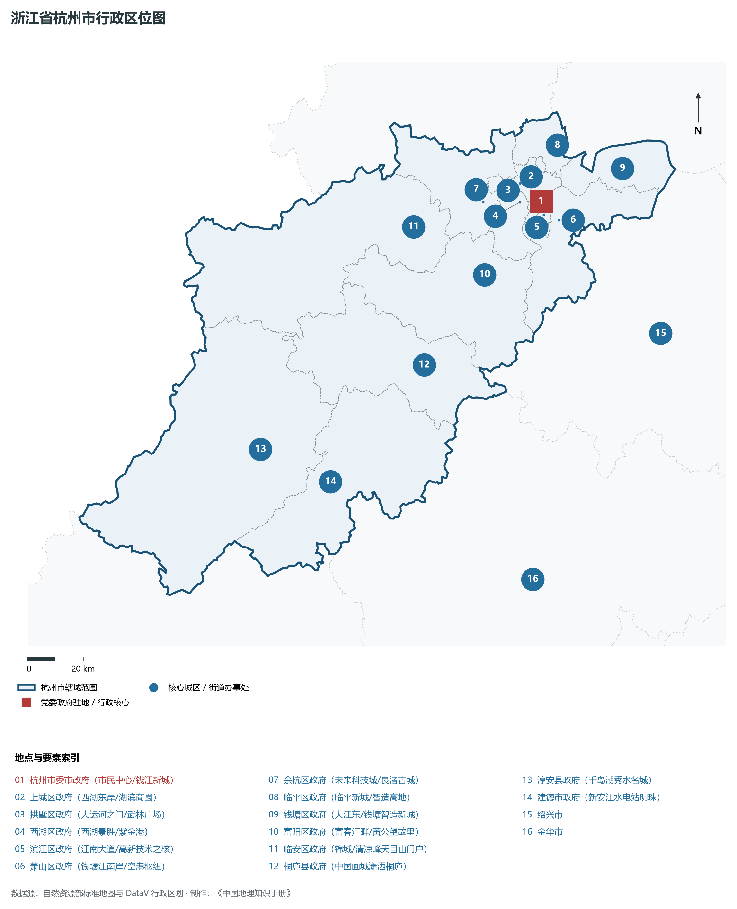
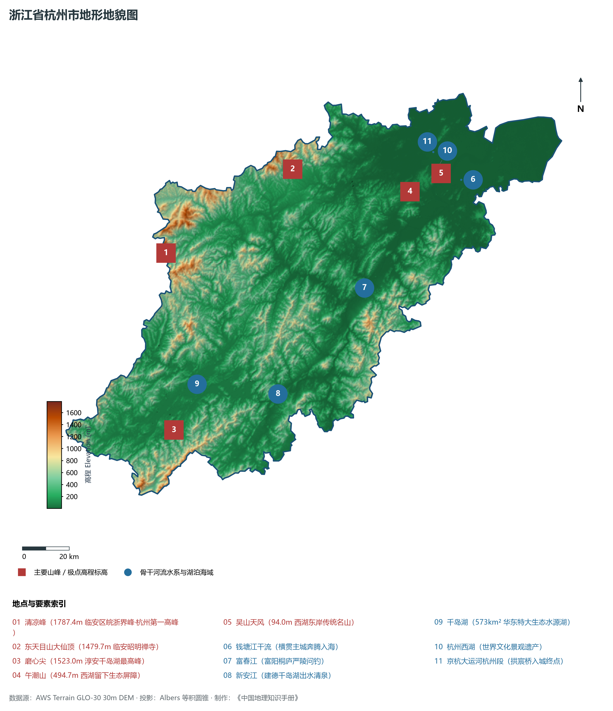
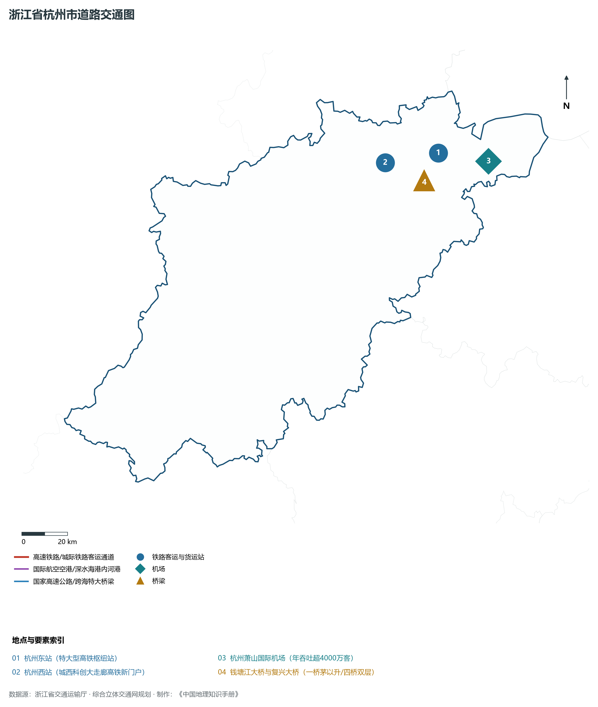
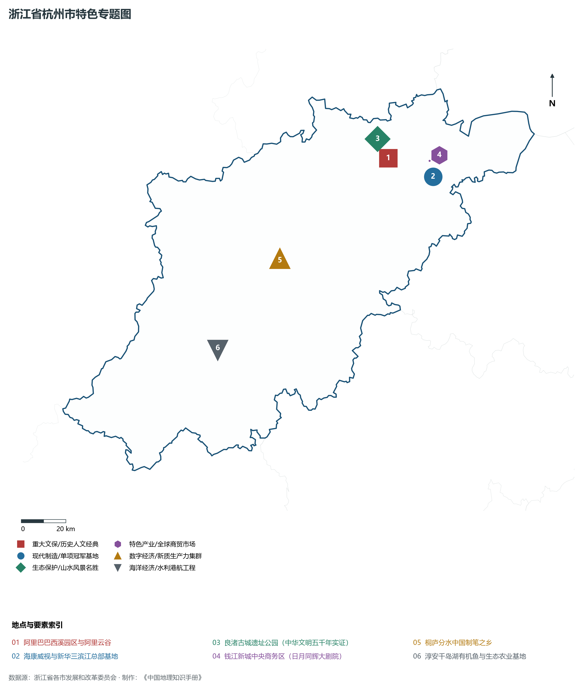
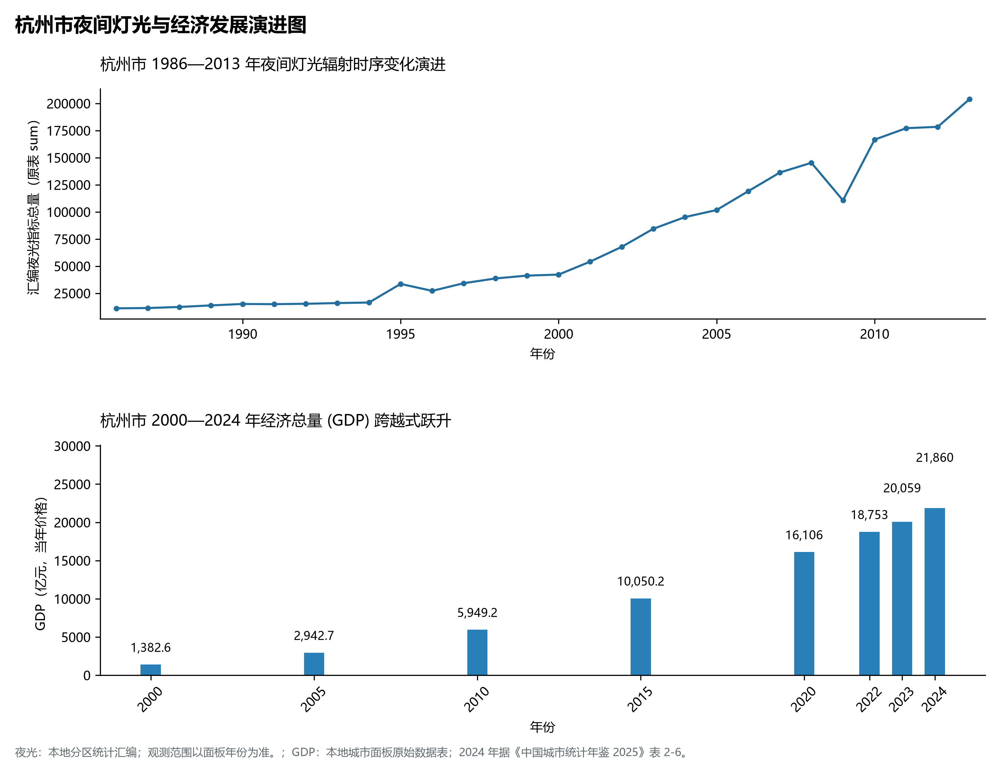

# 11.1 杭州市

杭州市，位于浙江省关键战略版图，其城市综合定位与发展愿景概括为：**浙江省省会·副省级城市·长三角南翼中心·全国数字经济第一城·良渚五千年文明实证与西湖文化景观**。2024 年常住人口 **1,262 万人**，常住人口城镇化率 **84.8%**，地区生产总值 **21,860 亿元**（当年价格），人均地区生产总值 **173,867 元**，三次产业构成为 **1.69 : 25.29 : 73.02**。

---

## 一、自然地理底盘与山川水系机理

在气候水热配置方面，杭州市属于典型的中亚热带季风气候区，温暖湿润、雨热同期。年平均气温在 16.0°C ～ 18.5°C 之间，无霜期达 230 ～ 280 d，年日照时数达 1700 ～ 2050 h。多年平均降水量达 1300 ～ 1900 mm，梅雨与台风雨是汛期降水主导形态，山溪性河流暴涨暴落，构筑起山洪防范、海堤加固与水资源科学调度协同运行的防灾减灾水利大格局。

区域骨干控制性山峰与高程标高极点包括：

- **清凉峰 (1787.4m 临安区皖浙界峰·杭州第一高峰)**（空间坐标约东经 118.895°、北纬 30.089°，海拔标高约 1787.4 m）：构成区域地形骨架与水文生态屏障的关键控制极点，发挥区域小气候调节与动植物基因库功能；
- **东天目山大仙顶 (1479.7m 临安昭明禅寺)**（空间坐标约东经 119.510°、北纬 30.335°，海拔标高约 1479.7 m）：构成区域地形骨架与水文生态屏障的关键控制极点，发挥区域小气候调节与动植物基因库功能；
- **磨心尖 (1523.0m 淳安千岛湖最高峰)**（空间坐标约东经 118.820°、北纬 29.420°，海拔标高约 1523.0 m）：构成区域地形骨架与水文生态屏障的关键控制极点，发挥区域小气候调节与动植物基因库功能；
- **午潮山 (494.7m 西湖留下生态屏障)**（空间坐标约东经 120.015°、北纬 30.185°，海拔标高约 494.7 m）：构成区域地形骨架与水文生态屏障的关键控制极点，发挥区域小气候调节与动植物基因库功能；
- **吴山天风 (94.0m 西湖东岸传统名山)**（空间坐标约东经 120.165°、北纬 30.235°，海拔标高约 94.0 m）：构成区域地形骨架与水文生态屏障的关键控制极点，发挥区域小气候调节与动植物基因库功能；

水系水网与河海生态廊道方面，杭州市江河湖海互通，骨干水网密集，构筑了独具特色的水文循环系统：

- **钱塘江干流 (横贯主城奔腾入海)**（水域坐标约东经 120.250°、北纬 30.200°）：发挥防洪排涝、生态调蓄、高品质水源涵养、江河海运集疏运与湿地生境保护的核心功能；
- **富春江 (富阳桐庐严陵问钓)**（水域坐标约东经 119.750°、北纬 29.850°）：发挥防洪排涝、生态调蓄、高品质水源涵养、江河海运集疏运与湿地生境保护的核心功能；
- **新安江 (建德千岛湖出水清泉)**（水域坐标约东经 119.300°、北纬 29.500°）：发挥防洪排涝、生态调蓄、高品质水源涵养、江河海运集疏运与湿地生境保护的核心功能；
- **千岛湖 (573km² 华东特大生态水源湖)**（水域坐标约东经 118.950°、北纬 29.580°）：发挥防洪排涝、生态调蓄、高品质水源涵养、江河海运集疏运与湿地生境保护的核心功能；
- **杭州西湖 (世界文化景观遗产)**（水域坐标约东经 120.142°、北纬 30.246°）：发挥防洪排涝、生态调蓄、高品质水源涵养、江河海运集疏运与湿地生境保护的核心功能；
- **京杭大运河杭州段 (拱宸桥入城终点)**（水域坐标约东经 120.145°、北纬 30.320°）：发挥防洪排涝、生态调蓄、高品质水源涵养、江河海运集疏运与湿地生境保护的核心功能；

---

## 二、行政区划沿革与城镇空间体系

杭州市建置沿革源远流长，文脉绵延数千年，自古即为东南沿海农耕文明、手工业繁荣、海丝通商或士大夫耕读传家的核心重镇。新中国成立特别是改革开放以来，伴随撤地设市、撤县设区、中心城区扩容提质与大都市区一体化推进，构建了市辖区与经济强县（市）协同并进、极核辐射强劲、城镇网络紧凑密集的现代空间体系：

- **杭州市委市政府 (市民中心/钱江新城)**（驻地坐标：120.210°E, 30.252°N）：区域公共治理中心、高品质公共服务供给极核与新型城镇化战略支点；
- **上城区政府 (西湖东岸/湖滨商圈)**（驻地坐标：120.170°E, 30.245°N）：区域公共治理中心、高品质公共服务供给极核与新型城镇化战略支点；
- **拱墅区政府 (大运河之门/武林广场)**（驻地坐标：120.142°E, 30.318°N）：区域公共治理中心、高品质公共服务供给极核与新型城镇化战略支点；
- **西湖区政府 (西湖景胜/紫金港)**（驻地坐标：120.130°E, 30.260°N）：区域公共治理中心、高品质公共服务供给极核与新型城镇化战略支点；
- **滨江区政府 (江南大道/高新技术之核)**（驻地坐标：120.211°E, 30.208°N）：区域公共治理中心、高品质公共服务供给极核与新型城镇化战略支点；
- **萧山区政府 (钱塘江南岸/空港枢纽)**（驻地坐标：120.264°E, 30.185°N）：区域公共治理中心、高品质公共服务供给极核与新型城镇化战略支点；
- **余杭区政府 (未来科技城/良渚古城)**（驻地坐标：119.995°E, 30.278°N）：区域公共治理中心、高品质公共服务供给极核与新型城镇化战略支点；
- **临平区政府 (临平新城/智造高地)**（驻地坐标：120.301°E, 30.419°N）：区域公共治理中心、高品质公共服务供给极核与新型城镇化战略支点；
- **钱塘区政府 (大江东/钱塘智造新城)**（驻地坐标：120.528°E, 30.315°N）：区域公共治理中心、高品质公共服务供给极核与新型城镇化战略支点；
- **富阳区政府 (富春江畔/黄公望故里)**（驻地坐标：119.960°E, 30.050°N）：区域公共治理中心、高品质公共服务供给极核与新型城镇化战略支点；
- **临安区政府 (锦城/清凉峰天目山门户)**（驻地坐标：119.725°E, 30.233°N）：区域公共治理中心、高品质公共服务供给极核与新型城镇化战略支点；
- **桐庐县政府 (中国画城潇洒桐庐)**（驻地坐标：119.688°E, 29.797°N）：区域公共治理中心、高品质公共服务供给极核与新型城镇化战略支点；
- **淳安县政府 (千岛湖秀水名城)**（驻地坐标：119.043°E, 29.608°N）：区域公共治理中心、高品质公共服务供给极核与新型城镇化战略支点；
- **建德市政府 (新安江水电站明珠)**（驻地坐标：119.282°E, 29.475°N）：区域公共治理中心、高品质公共服务供给极核与新型城镇化战略支点；

在国土空间总体规划指引下，杭州市坚决守牢耕地红线、永久基本农田、生态保护红线与城镇开发边界三条控制线，优化城市组团空间结构，推动产业与人口科学集聚，促进城乡基础设施互联互通与公共服务优质均衡共享，构筑宜居宜业宜游的现代和美之城。

---

## 三、综合立体交通网络与对外国土开放

杭州市地处浙江综合立体交通网与长三角海陆对外开放大通道关键枢纽，依托高速铁路客运大通道、骨干干线铁路、国家高速公路网、世界级深水海港/内河大港区与现代化民航航空港，构筑了通达全省、连接全国、融入全球的立体交通大网络：

**核心综合交通客运与货运物流枢纽节点：**

- **杭州东站 (特大型高铁枢纽站)**（位置坐标：120.213°E, 30.291°N）：旅客换乘集散、大宗物资组织、铁公水多式联运与国际贸易往来的战略性枢纽支撑；
- **杭州萧山国际机场 (年吞吐超4000万客)**（位置坐标：120.435°E, 30.229°N）：旅客换乘集散、大宗物资组织、铁公水多式联运与国际贸易往来的战略性枢纽支撑；
- **杭州西站 (城西科创大走廊高铁新门户)**（位置坐标：119.965°E, 30.285°N）：旅客换乘集散、大宗物资组织、铁公水多式联运与国际贸易往来的战略性枢纽支撑；
- **钱塘江大桥与复兴大桥 (一桥茅以升/四桥双层)**（位置坐标：120.130°E, 30.195°N）：旅客换乘集散、大宗物资组织、铁公水多式联运与国际贸易往来的战略性枢纽支撑；

当前，杭州市持续加快交通基础设施数字化转型与绿色低碳升级，重点攻坚高等级快速路网闭环、轨道交通网络化运营与枢纽集疏运体系优化，全面融入长三角“1小时交通圈”与四大都市区核心骨架，打造外畅内密、安全韧性、绿色智能的现代化立体交通强市。

---

## 四、现代产业体系与新质生产力布局

杭州市坚定不移走新型工业化发展之路，充分发挥民营经济发达、市场反应敏锐、创业创新活跃的体制机制优势，大力实施“八八战略”产业升级工程，聚力发展战略性新兴产业与新质生产力，加快构建具有国际竞争力的现代工业集群与高能级创新平台矩阵：

**标志性先进制造园区、特色小镇、龙头集群与重大产业地标：**

- **阿里巴巴西溪园区与阿里云谷**（空间坐标：120.025°E, 30.280°N）：区域战略性新兴产业集聚与科技创新赋能的核心高地；
- **海康威视与新华三滨江总部基地**（空间坐标：120.220°E, 30.180°N）：区域战略性新兴产业集聚与科技创新赋能的核心高地；
- **良渚古城遗址公园 (中华文明五千年实证)**（空间坐标：119.988°E, 30.362°N）：区域战略性新兴产业集聚与科技创新赋能的核心高地；
- **钱江新城中央商务区 (日月同辉大剧院)**（空间坐标：120.215°E, 30.245°N）：区域战略性新兴产业集聚与科技创新赋能的核心高地；
- **桐庐分水中国制笔之乡**（空间坐标：119.450°E, 29.950°N）：区域战略性新兴产业集聚与科技创新赋能的核心高地；
- **淳安千岛湖有机鱼与生态农业基地**（空间坐标：119.100°E, 29.620°N）：区域战略性新兴产业集聚与科技创新赋能的核心高地；

通过全面推进“腾笼换鸟、凤凰涅槃”与产业数字化赋能，杭州市大力实施链长制，梯度培育国家级制造业单项冠军企业、专精特新“小巨人”与科技领军型雄鹰企业，在集成电路、人工智能、高端装备、绿色石化、生物医药、新能源等关键产业链赛道上抢占制高点，筑牢实体经济基本盘。

---

## 五、历史文化名胜、人文底蕴与全域文旅地理

杭州市江山胜迹璀璨，历史文脉绵延数千年，汇聚了世界文化遗产、国家 5A 级风景名胜区与国家重点文物保护单位，是诗画浙江、山水风雅与红色精神交相辉映的文化沃土：

- **阿里巴巴西溪园区与阿里云谷**：承载深厚人文积淀，彰显吴越风骨、宋韵典雅、海丝远航与耕读传家的鲜明文化地标；
- **海康威视与新华三滨江总部基地**：承载深厚人文积淀，彰显吴越风骨、宋韵典雅、海丝远航与耕读传家的鲜明文化地标；
- **良渚古城遗址公园 (中华文明五千年实证)**：承载深厚人文积淀，彰显吴越风骨、宋韵典雅、海丝远航与耕读传家的鲜明文化地标；
- **钱江新城中央商务区 (日月同辉大剧院)**：承载深厚人文积淀，彰显吴越风骨、宋韵典雅、海丝远航与耕读传家的鲜明文化地标；
- **桐庐分水中国制笔之乡**：承载深厚人文积淀，彰显吴越风骨、宋韵典雅、海丝远航与耕读传家的鲜明文化地标；
- **淳安千岛湖有机鱼与生态农业基地**：承载深厚人文积淀，彰显吴越风骨、宋韵典雅、海丝远航与耕读传家的鲜明文化地标；

围绕高品质全域旅游与文化强省战略，杭州市深入推动“以文塑旅、以旅彰文”，高标准贯通大运河诗路、钱塘江诗路、浙东唐诗之路或瓯江山水诗路文化带，深化乡村休闲旅游与生态康养度假场景融合，打造享誉海内外的世界级文旅金名片。

---

## 六、夜间灯光辐射与跨世纪经济变化时序演进

本节夜光图的观测年份为 1986—2013 年，指标为行政区汇总值（原表 sum）。

| 年份 | 地区生产总值（亿元，当年价格） |
|:---|---:|
| 2000 年 | 1,382.6 |
| 2005 年 | 2,942.7 |
| 2010 年 | 5,949.2 |
| 2015 年 | 10,050.2 |
| 2020 年 | 16,106 |
| 2022 年 | 18,753 |
| 2023 年 | 20,059 |
| 2024 年 | 21,860 |

2024 年统计来源：《中国城市统计年鉴 2025》表 2-1、2-6、2-7（2024 年，全市）。其他年份 GDP 据本地城市面板“原始数据”表，单位为亿元、当年价格。
