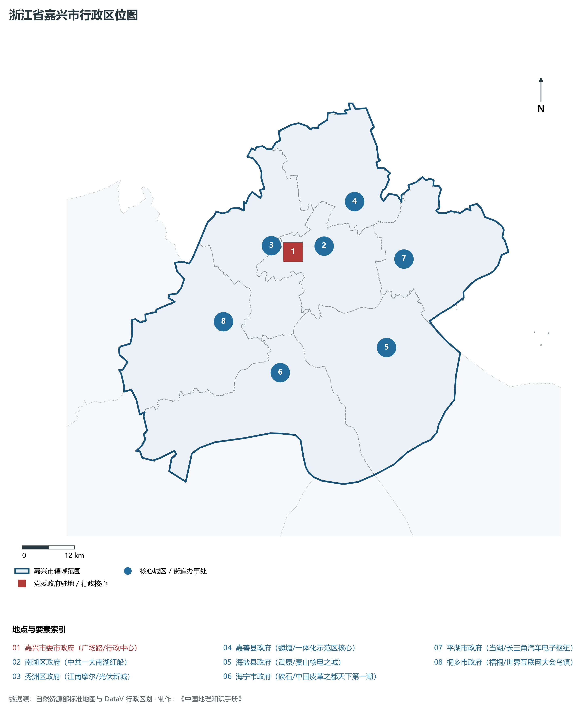
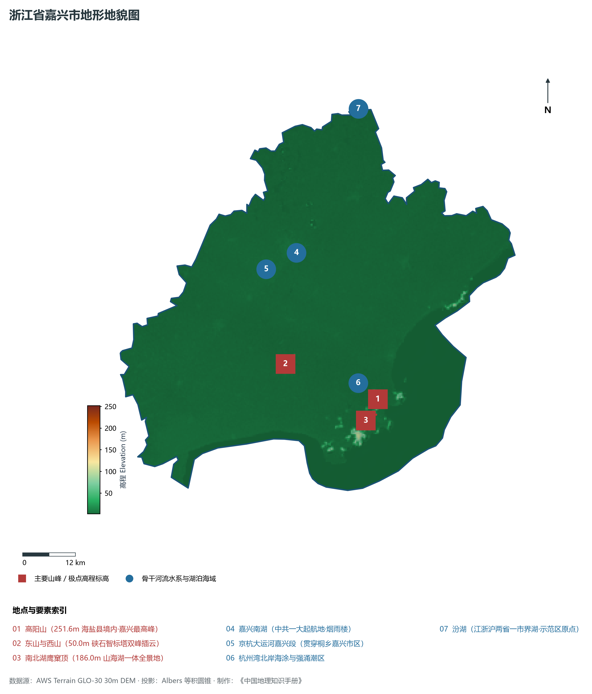
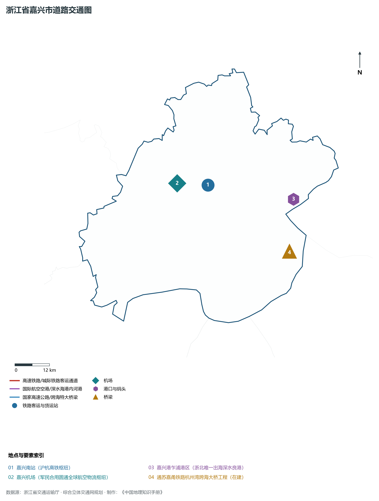
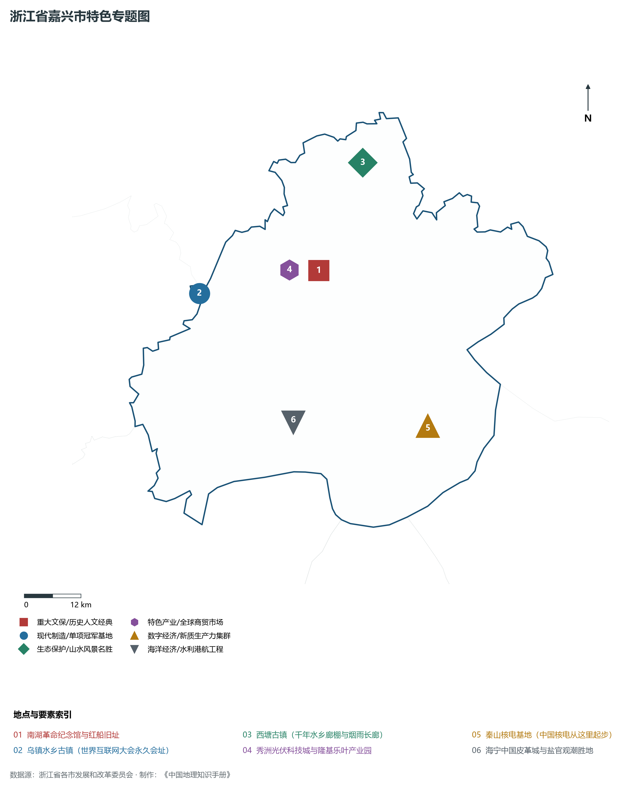
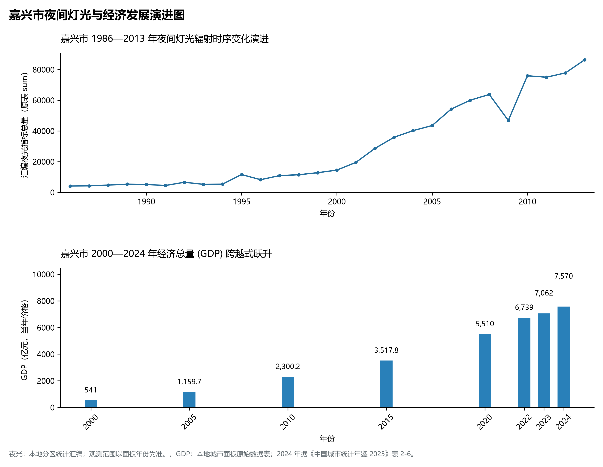

# 11.4 嘉兴市

嘉兴市，位于浙江省关键战略版图，其城市综合定位与发展愿景概括为：**红船精神起航地·接轨上海第一站·长三角生态绿色一体化示范区·江南水乡泽国乌镇西塘与海宁潮**。2024 年常住人口 **561 万人**，常住人口城镇化率 **74.47%**，地区生产总值 **7,570 亿元**（当年价格），人均地区生产总值 **135,267 元**，三次产业构成为 **1.96 : 49.56 : 48.47**。

---

## 一、自然地理底盘与山川水系机理

在气候水热配置方面，嘉兴市属于典型的中亚热带季风气候区，温暖湿润、雨热同期。年平均气温在 16.0°C ～ 18.5°C 之间，无霜期达 230 ～ 280 d，年日照时数达 1700 ～ 2050 h。多年平均降水量达 1300 ～ 1900 mm，梅雨与台风雨是汛期降水主导形态，山溪性河流暴涨暴落，构筑起山洪防范、海堤加固与水资源科学调度协同运行的防灾减灾水利大格局。

区域骨干控制性山峰与高程标高极点包括：

- **高阳山 (251.6m 海盐县境内·嘉兴最高峰)**（空间坐标约东经 120.895°、北纬 30.435°，海拔标高约 251.6 m）：构成区域地形骨架与水文生态屏障的关键控制极点，发挥区域小气候调节与动植物基因库功能；
- **东山与西山 (50.0m 硖石智标塔双峰插云)**（空间坐标约东经 120.690°、北纬 30.535°，海拔标高约 50.0 m）：构成区域地形骨架与水文生态屏障的关键控制极点，发挥区域小气候调节与动植物基因库功能；
- **南北湖鹰窠顶 (186.0m 山海湖一体全景地)**（空间坐标约东经 120.885°、北纬 30.405°，海拔标高约 186.0 m）：构成区域地形骨架与水文生态屏障的关键控制极点，发挥区域小气候调节与动植物基因库功能；

水系水网与河海生态廊道方面，嘉兴市江河湖海互通，骨干水网密集，构筑了独具特色的水文循环系统：

- **嘉兴南湖 (中共一大起航地·烟雨楼)**（水域坐标约东经 120.758°、北纬 30.753°）：发挥防洪排涝、生态调蓄、高品质水源涵养、江河海运集疏运与湿地生境保护的核心功能；
- **京杭大运河嘉兴段 (贯穿桐乡嘉兴市区)**（水域坐标约东经 120.680°、北纬 30.730°）：发挥防洪排涝、生态调蓄、高品质水源涵养、江河海运集疏运与湿地生境保护的核心功能；
- **杭州湾北岸海涂与强涌潮区**（水域坐标约东经 120.850°、北纬 30.450°）：发挥防洪排涝、生态调蓄、高品质水源涵养、江河海运集疏运与湿地生境保护的核心功能；
- **汾湖 (江浙沪两省一市界湖·示范区原点)**（水域坐标约东经 120.960°、北纬 31.020°）：发挥防洪排涝、生态调蓄、高品质水源涵养、江河海运集疏运与湿地生境保护的核心功能；

---

## 二、行政区划沿革与城镇空间体系

嘉兴市建置沿革源远流长，文脉绵延数千年，自古即为东南沿海农耕文明、手工业繁荣、海丝通商或士大夫耕读传家的核心重镇。新中国成立特别是改革开放以来，伴随撤地设市、撤县设区、中心城区扩容提质与大都市区一体化推进，构建了市辖区与经济强县（市）协同并进、极核辐射强劲、城镇网络紧凑密集的现代空间体系：

- **嘉兴市委市政府 (广场路/行政中心)**（驻地坐标：120.758°E, 30.748°N）：区域公共治理中心、高品质公共服务供给极核与新型城镇化战略支点；
- **南湖区政府 (中共一大南湖红船)**（驻地坐标：120.778°E, 30.758°N）：区域公共治理中心、高品质公共服务供给极核与新型城镇化战略支点；
- **秀洲区政府 (江南摩尔/光伏新城)**（驻地坐标：120.708°E, 30.768°N）：区域公共治理中心、高品质公共服务供给极核与新型城镇化战略支点；
- **嘉善县政府 (魏塘/一体化示范区核心)**（驻地坐标：120.925°E, 30.830°N）：区域公共治理中心、高品质公共服务供给极核与新型城镇化战略支点；
- **海盐县政府 (武原/秦山核电之城)**（驻地坐标：120.945°E, 30.525°N）：区域公共治理中心、高品质公共服务供给极核与新型城镇化战略支点；
- **海宁市政府 (硖石/中国皮革之都天下第一潮)**（驻地坐标：120.681°E, 30.509°N）：区域公共治理中心、高品质公共服务供给极核与新型城镇化战略支点；
- **平湖市政府 (当湖/长三角汽车电子枢纽)**（驻地坐标：121.021°E, 30.698°N）：区域公共治理中心、高品质公共服务供给极核与新型城镇化战略支点；
- **桐乡市政府 (梧桐/世界互联网大会乌镇)**（驻地坐标：120.564°E, 30.630°N）：区域公共治理中心、高品质公共服务供给极核与新型城镇化战略支点；

在国土空间总体规划指引下，嘉兴市坚决守牢耕地红线、永久基本农田、生态保护红线与城镇开发边界三条控制线，优化城市组团空间结构，推动产业与人口科学集聚，促进城乡基础设施互联互通与公共服务优质均衡共享，构筑宜居宜业宜游的现代和美之城。

---

## 三、综合立体交通网络与对外国土开放

嘉兴市地处浙江综合立体交通网与长三角海陆对外开放大通道关键枢纽，依托高速铁路客运大通道、骨干干线铁路、国家高速公路网、世界级深水海港/内河大港区与现代化民航航空港，构筑了通达全省、连接全国、融入全球的立体交通大网络：

**核心综合交通客运与货运物流枢纽节点：**

- **嘉兴南站 (沪杭高铁枢纽)**（位置坐标：120.795°E, 30.690°N）：旅客换乘集散、大宗物资组织、铁公水多式联运与国际贸易往来的战略性枢纽支撑；
- **嘉兴机场 (军民合用圆通全球航空物流枢纽)**（位置坐标：120.685°E, 30.710°N）：旅客换乘集散、大宗物资组织、铁公水多式联运与国际贸易往来的战略性枢纽支撑；
- **嘉兴港乍浦港区 (浙北唯一出海深水良港)**（位置坐标：121.095°E, 30.605°N）：旅客换乘集散、大宗物资组织、铁公水多式联运与国际贸易往来的战略性枢纽支撑；
- **通苏嘉甬铁路杭州湾跨海大桥工程 (在建)**（位置坐标：121.050°E, 30.450°N）：旅客换乘集散、大宗物资组织、铁公水多式联运与国际贸易往来的战略性枢纽支撑；

当前，嘉兴市持续加快交通基础设施数字化转型与绿色低碳升级，重点攻坚高等级快速路网闭环、轨道交通网络化运营与枢纽集疏运体系优化，全面融入长三角“1小时交通圈”与四大都市区核心骨架，打造外畅内密、安全韧性、绿色智能的现代化立体交通强市。

---

## 四、现代产业体系与新质生产力布局

嘉兴市坚定不移走新型工业化发展之路，充分发挥民营经济发达、市场反应敏锐、创业创新活跃的体制机制优势，大力实施“八八战略”产业升级工程，聚力发展战略性新兴产业与新质生产力，加快构建具有国际竞争力的现代工业集群与高能级创新平台矩阵：

**标志性先进制造园区、特色小镇、龙头集群与重大产业地标：**

- **南湖革命纪念馆与红船旧址**（空间坐标：120.760°E, 30.755°N）：区域战略性新兴产业集聚与科技创新赋能的核心高地；
- **乌镇水乡古镇 (世界互联网大会永久会址)**（空间坐标：120.488°E, 30.748°N）：区域战略性新兴产业集聚与科技创新赋能的核心高地；
- **西塘古镇 (千年水乡廊棚与烟雨长廊)**（空间坐标：120.895°E, 30.942°N）：区域战略性新兴产业集聚与科技创新赋能的核心高地；
- **秀洲光伏科技城与隆基乐叶产业园**（空间坐标：120.695°E, 30.765°N）：区域战略性新兴产业集聚与科技创新赋能的核心高地；
- **秦山核电基地 (中国核电从这里起步)**（空间坐标：120.945°E, 30.435°N）：区域战略性新兴产业集聚与科技创新赋能的核心高地；
- **海宁中国皮革城与盐官观潮胜地**（空间坐标：120.650°E, 30.480°N）：区域战略性新兴产业集聚与科技创新赋能的核心高地；

通过全面推进“腾笼换鸟、凤凰涅槃”与产业数字化赋能，嘉兴市大力实施链长制，梯度培育国家级制造业单项冠军企业、专精特新“小巨人”与科技领军型雄鹰企业，在集成电路、人工智能、高端装备、绿色石化、生物医药、新能源等关键产业链赛道上抢占制高点，筑牢实体经济基本盘。

---

## 五、历史文化名胜、人文底蕴与全域文旅地理

嘉兴市江山胜迹璀璨，历史文脉绵延数千年，汇聚了世界文化遗产、国家 5A 级风景名胜区与国家重点文物保护单位，是诗画浙江、山水风雅与红色精神交相辉映的文化沃土：

- **南湖革命纪念馆与红船旧址**：承载深厚人文积淀，彰显吴越风骨、宋韵典雅、海丝远航与耕读传家的鲜明文化地标；
- **乌镇水乡古镇 (世界互联网大会永久会址)**：承载深厚人文积淀，彰显吴越风骨、宋韵典雅、海丝远航与耕读传家的鲜明文化地标；
- **西塘古镇 (千年水乡廊棚与烟雨长廊)**：承载深厚人文积淀，彰显吴越风骨、宋韵典雅、海丝远航与耕读传家的鲜明文化地标；
- **秀洲光伏科技城与隆基乐叶产业园**：承载深厚人文积淀，彰显吴越风骨、宋韵典雅、海丝远航与耕读传家的鲜明文化地标；
- **秦山核电基地 (中国核电从这里起步)**：承载深厚人文积淀，彰显吴越风骨、宋韵典雅、海丝远航与耕读传家的鲜明文化地标；
- **海宁中国皮革城与盐官观潮胜地**：承载深厚人文积淀，彰显吴越风骨、宋韵典雅、海丝远航与耕读传家的鲜明文化地标；

围绕高品质全域旅游与文化强省战略，嘉兴市深入推动“以文塑旅、以旅彰文”，高标准贯通大运河诗路、钱塘江诗路、浙东唐诗之路或瓯江山水诗路文化带，深化乡村休闲旅游与生态康养度假场景融合，打造享誉海内外的世界级文旅金名片。

---

## 六、夜间灯光辐射与跨世纪经济变化时序演进

本节夜光图的观测年份为 1986—2013 年，指标为行政区汇总值（原表 sum）。

| 年份 | 地区生产总值（亿元，当年价格） |
|:---|---:|
| 2000 年 | 541 |
| 2005 年 | 1,159.7 |
| 2010 年 | 2,300.2 |
| 2015 年 | 3,517.8 |
| 2020 年 | 5,510 |
| 2022 年 | 6,739 |
| 2023 年 | 7,062 |
| 2024 年 | 7,570 |

2024 年统计来源：《中国城市统计年鉴 2025》表 2-1、2-6、2-7（2024 年，全市）。其他年份 GDP 据本地城市面板“原始数据”表，单位为亿元、当年价格。
