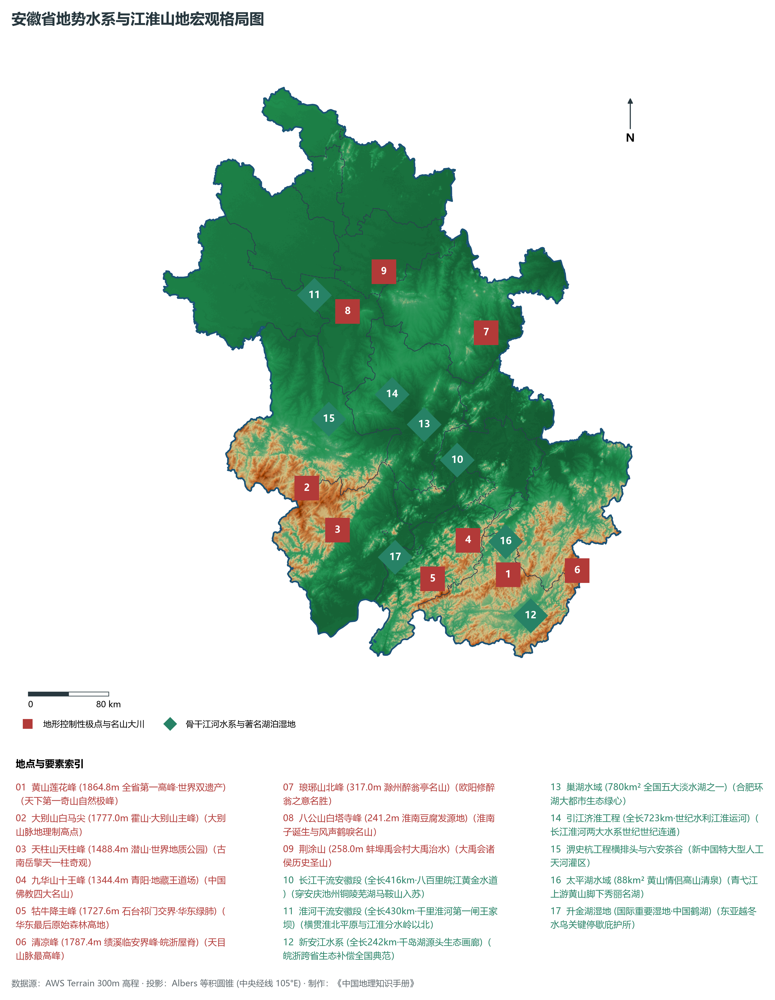
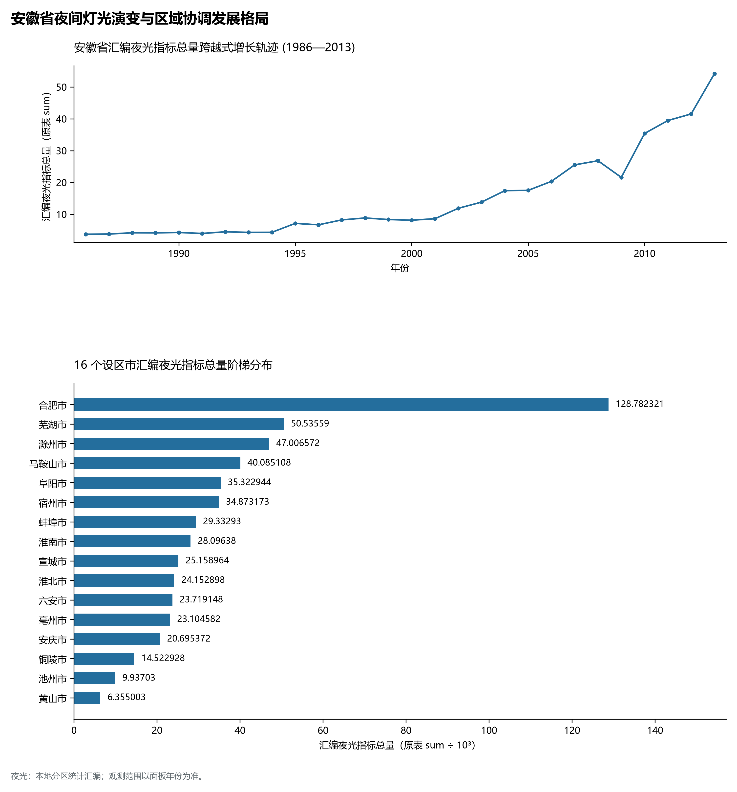
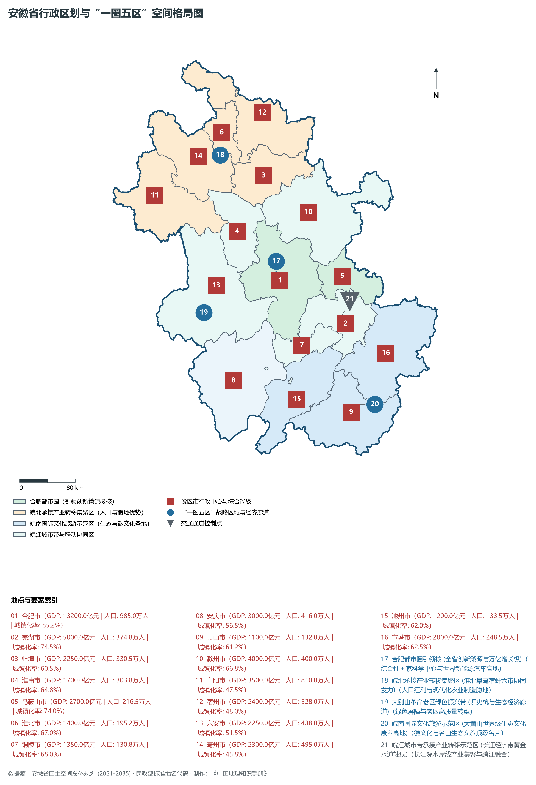
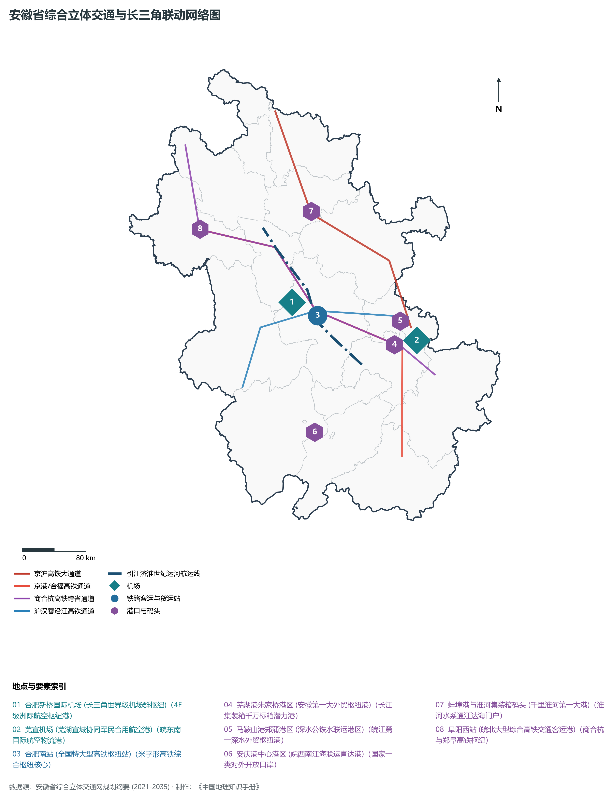
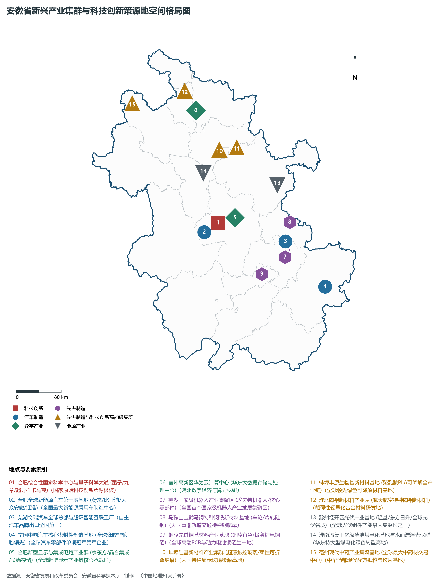

# 12.0 安徽省地理统揽

安徽省，简称“皖”，省会合肥市，位于中国华东腹地、长江三角洲西翼，跨越长江、淮河、新安江三大水系，地处东经 114° 54' ～ 119° 37'、北纬 29° 41' ～ 34° 38' 之间。全省陆域总面积达 **14.01 × 10⁴ km²**，占全国国土总面积的 1.46%。安徽东连江苏、浙江，西接河南、湖北，南邻江西，北靠山东，具有“承东启西、连南接北”的卓越地缘枢纽优势。安徽历史底蕴深厚，自古享有“江淮名邦、人文鼎盛”之美誉，是华夏农耕文明与水利治理的重要策源地之一，孕育了博大精深的徽文化、淮河文化、皖江文化与道家哲学思想，更是中国农村改革发源地（凤阳小岗村）、大国水利“人间天河”（淠史杭工程）与“世纪运河”（引江济淮工程）的承载地。

全省地貌宏观上呈现极为丰富且过渡性极强的**“平原、台地、丘陵、山地交错”**自然地理格局。地势自西北向东南波状起伏，北有坦荡广袤的黄淮冲积平原，中有岗冲起伏的江淮分水岭丘陵，西南耸立着雄伟险峻的大别山脉，东南盘踞着奇峰绝壁的皖南山区。全省现辖 16 个地级市（合肥市、芜湖市、蚌埠市、淮南市、马鞍山市、淮北市、铜陵市、安庆市、黄山市、滁州市、阜阳市、宿州市、六安市、亳州市、池州市、宣城市）。截至 2024 年末，全省常住人口达到 **6121.0 万人**，常住人口城镇化率达 **61.5%**。2024 年全省实现地区生产总值（GDP）突破 **4.95 万亿元**（达 49,450 亿元），人均 GDP 达 **80,780 元**。安徽在科技创新、先进制造、绿色生态和区域协同三大国家战略交汇叠加下，实现了从“传统农业大省”向“新兴工业大省”乃至“全球科技创新策源地”的历史性跨越，成为长三角一体化发展国家战略中极具发展潜力与增长爆发力的关键增长极。

---

## 一、地貌地质演化与“平原、丘陵、山地”三大地貌阶梯

安徽省地质构造演化宏观上横跨中国东部两大构造单元——北部隶属于**华北准地台**，南部隶属于**扬子准地台**，其交界带为著名的秦岭—大别造山带与郯庐深大断裂带华东段。中生代以来剧烈的印支运动与燕山运动导致强烈的断块差异升降与大规模花岗岩浆侵入活动，造就了皖南黄山、九华山奇峰林立的花岗岩地貌与大别山深变质岩高中山；第四纪以来，淮河与长江干流及其支流的大规模泥沙冲积，堆积形成了广阔肥沃的淮北平原与沿江冲积平原：

全省地表高程极值跨度介于长江出境段江面的 **4.5 m** 至黄山风景区主峰莲花峰的 **1864.8 m** 之间：

- **全省陆地自然最高峰**：位于黄山市境内的**黄山莲花峰（海拔 1864.8 m）**，属于黄山山脉主峰，峰峦峭拔，怪石嶙峋，为全省第一绝顶；与其相邻的光明顶（海拔 1860.0 m）和天都峰（海拔 1810.0 m）并称为黄山三大主峰；
- **皖西大别山第一高峰**：位于六安市霍山县境内的**白马尖（海拔 1777.0 m）**，是大别山主峰与华东生态屏障的重要制高点；其邻近的天堂寨（海拔 1729.1 m）横跨皖鄂两省；
- **皖西南世界地质名山**：潜山市境内**天柱峰（海拔 1488.4 m）**，古称南岳，为大别山超高压变质带的典型花岗岩峰丛奇观；
- **中国佛教四大名山之一**：池州市青阳县境内**九华山十王峰（海拔 1344.4 m）**，为地藏菩萨道场所在地；
- **全省地表最低极点**：位于马鞍山市境内长江出境处江面及江心洲边缘，地面标高仅约 **4.5 m**。

依据地势起伏、地质构造与地貌形态，安徽省宏观地形可系统划分为五大特色地貌单元：

1. **淮北冲积平原地貌区**：淮河以北地区，属于华北大平原南缘的黄淮冲积平原主体，地势平坦开阔，海拔多在 20～ 40 m 之间，自西北向东南微倾，分布着厚达数十米至数百米的第四纪松散堆积物，土地连片肥沃，是全省粮食棉油高产稳产的核心农业基底；
2. **江淮波状丘陵与分水岭区**：位于淮河以南、长江以北，低丘起伏，海拔多在 50～ 200 m 之间。岗冲相间，红层与下蜀黄土覆盖广泛。江淮分水岭横贯东西，将全省水系天然切分为淮河与长江两大系统，也是“引江济淮”世纪工程横穿克难的关键地带；
3. **皖西大别山中高山区**：位于省境西部，属大别山脉东段，山体主要由前寒武纪深变质岩和燕山期花岗岩构成，海拔普遍在 500～ 1500 m 以上，沟谷纵横，水流湍急，六大骨干大型水库棋布其间，构成了安徽乃至华东最重要的水源涵养与生态屏障；
4. **沿江冲积平原与湿地水网区**：沿八百里皖江分布，包括安庆平原、巢湖平原与芜湖—马鞍山沿江平原，地势低平，海拔多在 5～ 15 m 之间，江河湖泊交织，河港密布，水产丰饶，自古享有“江南鱼米之乡”美称；
5. **皖南中低山与山间盆地区**：位于长江以南，包括九华山、黄山、白际山、天目山余脉等，山势巍峨，峰峦叠翠，山间错落分布着休宁盆地、歙县盆地、屯溪盆地等断陷红层构造小盆地，是古徽州文化与山水生态旅游的核心摇篮。

**安徽省宏观地势阶梯与山水空间纵剖面示意表**

| 淮北坦荡黄淮平原 | 淮河深厚冲积漫滩 | 江淮分水岭丘陵带 | 沿江水网巢湖平原 | 皖南黄山九华中山 |
| --- | --- | --- | --- | --- |
| (亳州/阜阳/宿州)；海拔 20~40m·平原；千里沃野·粮仓药都 | (蚌埠/淮南/凤台)；海拔 14~25m·王家坝；治淮重镇·能源之都 | (合肥/滁州/定远)；海拔 50~200m·分水岭；世纪工程引江济淮 | (芜湖/马鞍山/安庆)；海拔 5~15m·黄金水道；皖江走廊·整车智造 | (黄山/池州/宣城)；莲花峰 1864.8m 绝顶；徽文化发祥·世界遗产 |

北 (淮北黄淮平原) · → 中北 (淮河低湿漫滩) · → 中 (江淮波状丘陵) · → 中南 (沿江冲积平原) · → 南 (皖南黄山中山)

---

## 二、过渡性气候水热特征与“淮河、长江、新安江”三大水系格局

安徽省地处中国南北气候过渡带，以**淮河干流**为天然地理分界线：

- **淮河以北**：属于**暖温带半湿润季风气候区**，四季分明，冬季寒冷干燥，夏季高温多雨，年平均气温在 14.0°C ～ 15.5°C 之间，极端最低温常低于 -15°C。年降水量在 750 ～ 900 mm 之间，降水年际变化大且年内分配高度集中；
- **淮河以南**：属于典型的**亚热带湿润季风气候区**，气候温和，雨量充沛，光照充足，年平均气温在 15.5°C ～ 17.5°C 之间，无霜期达 220 ～ 260 d。年降水量达 1000 ～ 1800 mm，黄山、大别山山地迎风坡年降水量甚至超过 2000 mm，是全省著名的暴雨与丰水中心。梅雨季节（6月中旬至7月上旬）降水集中，极易产生流域性洪涝与山洪地质灾害。

安徽水网发达，跨越淮河、长江和新安江三大水系，多年平均地表水资源总量达 **680 亿立方米**，更拥有全国五大淡水湖之一的巢湖与大国超级调水运河：

1. **淮河水系（省内干流全长 430 km）**：
   - 淮河发源于河南桐柏山，自阜南县王家坝入境，横贯皖北与江淮，经蚌埠、五河出境注入洪泽湖。流域面积占全省总面积的近一半。淮河落差小，行洪不畅，新中国成立以来通过大兴水利，建设了千里淮河第一闸王家坝闸、临淮岗洪水控制工程、茨淮新河、怀洪新河等战略性防洪减灾枢纽；
2. **长江水系（省内干流全长 416 km）**：
   - 长江自宿松入境，横穿安庆、池州、铜陵、芜湖、马鞍山五市，俗称“八百里皖江”。江面宽阔，水深浪平，万吨海轮常年通达，是国家黄金水道的核心承载区。沿江支流汇聚青弋江、水阳江、秋浦河、皖河等重要水系；
3. **巢湖（水面面积达 780 km²）**：
   - 中国五大淡水湖之一，环抱合肥主城，水域浩瀚，烟波浩渺，素称“八百里巢湖”。南淝河、派河、杭埠河等河流注入湖盆，经裕溪河流入长江，是合肥都市圈生态安全的核心命脉；
4. **新安江水系（省内干流长 242 km）**：
   - 发源于休宁与祁门界山，率水、横江汇聚于屯溪后东流，经歙县街口出境汇入浙江千岛湖。两岸奇峰夹峙，绿水澄澈，两省共同开创的“新安江流域跨省生态补偿机制”成为全国生态文明体制机制创新的时代标杆；
5. **世纪战略水利工程：引江济淮工程（全长 723 km）**：
   - 沟通长江与淮河两江水系的“世纪运河”，北起淮河流域，南接长江黄金水道，通过江淮运河实现了淮河与长江的高等级千吨级航运直通，一举结束了皖淮两江水系数千年隔绝的历史，改写了华东内河航运与水资源配置宏观版图。

---

## 三、行政区划、人口与“一圈五区”空间发展格局

安徽省现辖 16 个地级市，下辖 45 个市辖区、9 个县级市、50 个县，共 104 个县级行政区。2024 年末全省常住人口为 6121.0 万人，人口密度达 437 人/km²，城镇化率稳步提升至 61.5%。

立足资源禀赋与区域发展差异，安徽省高标准构筑**“一圈五区”**国土空间战略协同发展格局：

1. **合肥都市圈（全省创新引领核心圈）**：
   - 以省会合肥为核心，联动芜湖、滁州、六安、淮南、马鞍山、蚌埠等协同发展，集聚了综合性国家科学中心与世界一流创新企业，构筑全省高质量发展的第一动力源；
2. **皖江城市带承接产业转移示范区（沿江制造创新走廊）**：
   - 涵盖芜湖、马鞍山、铜陵、池州、安庆等沿江城市，依托长江黄金水道和产业基础，成为长三角高端制造、汽车及零部件、特种钢铁、铜基新材料的重要聚集走廊；
3. **皖北承接产业转移集聚区（皖北四市两区崛起增长极）**：
   - 涵盖阜阳、亳州、宿州、淮北、蚌埠、淮南六市，依托丰富的人口资源、广袤土地和农业煤炭底盘，全力打造成长三角绿色农产品生产加工供应基地与新型工业承接高地；
4. **皖西大别山革命老区（绿色生态屏障与振兴示范区）**：
   - 以六安、安庆山区为核心，坚决守牢华东水资源与生态安全屏障，大力发展红色旅游、绿色康养与生态特色农业；
5. **皖南国际文化旅游示范区（世界级文旅与生态示范区）**：
   - 涵盖黄山、池州、宣城三市全境及安庆、芜湖、铜陵、马鞍山部分区域，依托黄山、九华山双绝与徽州世界遗产古村落，打造具有国际竞争力的世界一流文化旅游目的地。

---

## 四、综合立体交通网络与长三角互联互通

安徽地处国家综合立体交通网的主骨架交汇节点，全面推进“轨道上的安徽”、“水运上的安徽”与“翅膀上的安徽”重大战略建设：

1. **高速铁路客运骨干网络**：
   - 形成了以合肥为中心的“米字型”高铁综合枢纽网络，京沪高铁、京港高铁、合福高铁、商合杭高铁、郑阜高铁、合武高铁等在此交汇，全省 16 个地级市实现了“市市通高铁”，动车组列车通达全国绝大多数省会城市；
2. **高速公路与干线公路走廊**：
   - G3京台高速、G40沪陕高速、G42沪蓉高速、G50沪渝高速、G36宁洛高速纵横交织，打通了数十条对接江苏、浙江的省际断头路和高等级扩容快速路通道；
3. **江河海联运水运网络**：
   - 依托“八百里皖江”长江干线与江淮运河千吨级骨干航道，芜湖朱家桥港、马鞍山郑蒲港、安庆长风港、池州江口港、蚌埠新港等大港全面迈向亿吨级和现代集装箱多式联运大港；
4. **现代化民航机场布局**：
   - 合肥新桥国际机场（4E级，正实施二期航站区扩建）发挥核心引领作用，芜湖宣州机场、黄山屯溪国际机场、阜阳西关机场、安庆天柱山机场、池州九华山机场协同联动，构筑起辐射全国、联通海外的航空运输网络。

---

## 五、现代化产业体系与新质生产力空间布局

新时代以来，安徽坚定不移践行创新驱动发展战略，实现了从“传统农业大省”向“先进制造强省”与“科技创新策源地”的历史巨变：

1. **全球科技创新策源地与大科学装置集群**：
   - 合肥综合性国家科学中心布局了一批大国重器：EAST“全超导托卡马克人造太阳”、稳态强磁场实验装置、合肥先进光源、深空探测实验室等；量子通信、量子计算与量子精密测量领跑全球；
2. **“首位产业”新能源汽车与智能网联汽车集群**：
   - 全省将新能源汽车作为“首位产业”，构建了以合肥、芜湖为核心的整车研发与制造双高地，集聚了奇瑞汽车、蔚来汽车、比亚迪、大众安徽、江淮汽车、长安汽车等国内外整车巨头，2024 年全省汽车产量突破 300 万辆，新能源汽车产量突破 120 万辆，汽车出口量稳居全国各省区第一位；
3. **先进制造业与新材料支柱体系**：
   - **新型显示与集成电路**：合肥集聚京东方、维信诺、晶合集成、长鑫存储，打造中国“IC之都”与新型显示全球重镇；
   - **先进光伏与新能源**：滁州打造“世界光伏之都”，聚集隆基、东方日升、晶科、福斯特等全产业链；
   - **高端金属与化工新材料**：马鞍山宝武马钢特种高速车轮、铜陵先进铜基材料、淮北陶铝新材料、蚌埠超薄浮法与光伏玻璃、安庆现代石油化工；
   - **现代中药与大健康**：亳州打造“中华药都”，拥有全球最大的中药材专业交易市场与中药饮片生产基地。

---

## 六、夜间灯光遥感时序与跨越式区域协调演变

本节夜光图的观测年份为 1986—2013 年，指标为行政区汇总值（原表 sum）。

- **1980—1990年代（传统工矿点轴孤立集聚）**：
- **2000—2010年代（中心城市跨越拓展与走廊成网）**：
- **2010—2024年（融入长三角极核爆发与全域连片跃迁）**：

安徽，正以蓬勃的创新创造活力和昂扬的奋进姿态，在长江两岸、淮河两畔的壮丽画卷上，奋力书写中国式现代化的崭新篇章！
