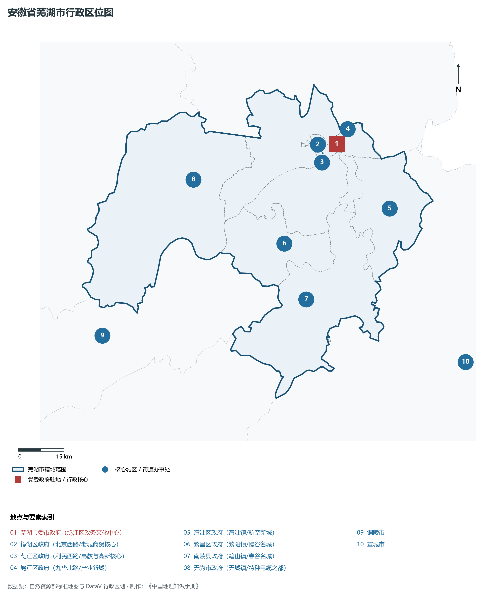
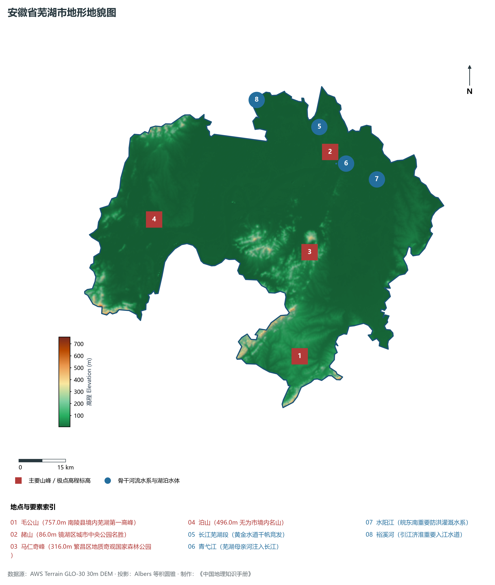
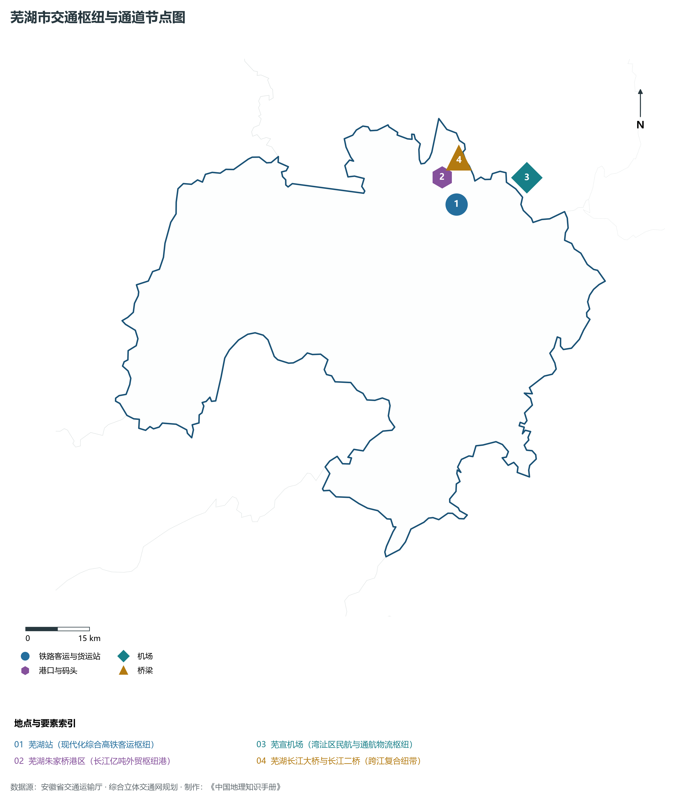
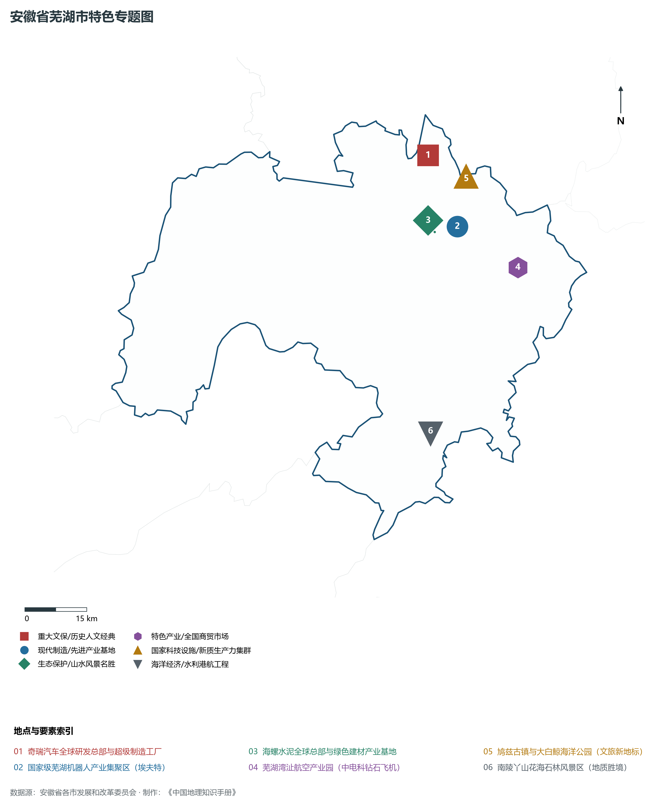
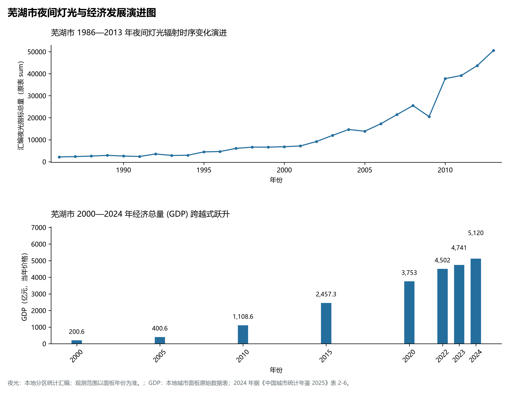

# 12.2 芜湖市

芜湖市，位于安徽省关键战略版图，其城市综合定位与发展愿景概括为：**安徽省域副中心·长江经济带节点·全国综合交通枢纽·中国自主汽车品牌创新摇篮与现代航空城**。2024 年常住人口 **380 万人**，常住人口城镇化率 **75.22%**，地区生产总值 **5,120 亿元**（当年价格），人均地区生产总值 **135,588 元**，三次产业构成为 **3.68 : 44.84 : 51.48**。

---

## 一、自然地理底盘与山川水系机理

芜湖市在大地构造演化史上跨越深大构造单元断裂带，中生代以来的剧烈构造升降与长期的江淮河流侵蚀堆积作用，造就了低山丘陵、构造断陷盆地、冲积漫滩或广袤平原交织错落的地貌格局。全境地表最低标高为 **5.0 m**，最高隆起山峰或高地控制海拔达 **757.0 m**，多梯度的地貌格局为生态涵养、水源调蓄、现代特色农业开发与先进制造业集群布局提供了坚实的自然地理载体。

在气候水热配置方面，芜湖市受季风环流控制显著，温暖湿润、四季分明、雨热同季。年平均气温在 14.5°C ～ 17.5°C 之间，无霜期达 210 ～ 260 d，年日照时数达 1800 ～ 2200 h。多年平均降水量达 800 ～ 1600 mm，梅雨暴雨与汛期洪涝防御是水利工程长期运行的核心课题，构筑起堤防加固、水库调蓄与水资源科学调配协同推进的防灾减灾大格局。

区域骨干控制性山峰与高程标高极点包括：

- **毛公山 (757.0m 南陵县境内芜湖第一高峰)**（空间坐标约东经 118.180°、北纬 30.780°，海拔标高约 757.0 m）：构成区域地形骨架与水文生态屏障的关键控制极点，发挥区域小气候调节与动植物生境保护功能；
- **赭山 (86.0m 镜湖区城市中央公园名胜)**（空间坐标约东经 118.375°、北纬 31.345°，海拔标高约 86.0 m）：构成区域地形骨架与水文生态屏障的关键控制极点，发挥区域小气候调节与动植物生境保护功能；
- **马仁奇峰 (316.0m 繁昌区地质奇观国家森林公园)**（空间坐标约东经 118.260°、北纬 31.070°，海拔标高约 316.0 m）：构成区域地形骨架与水文生态屏障的关键控制极点，发挥区域小气候调节与动植物生境保护功能；
- **泊山 (496.0m 无为市境内名山)**（空间坐标约东经 117.750°、北纬 31.220°，海拔标高约 496.0 m）：构成区域地形骨架与水文生态屏障的关键控制极点，发挥区域小气候调节与动植物生境保护功能；

水系水网与生态湿地廊道方面，芜湖市河流交织、水源充沛，构筑了独具特色的水文水资源循环体系：

- **长江芜湖段 (黄金水道千帆竞发)**（水系坐标约东经 118.350°、北纬 31.420°）：发挥防洪排涝、农业灌溉、优质生活水源涵养、航运通航与江淮水网生态安全的核心功能；
- **青弋江 (芜湖母亲河注入长江)**（水系坐标约东经 118.390°、北纬 31.310°）：发挥防洪排涝、农业灌溉、优质生活水源涵养、航运通航与江淮水网生态安全的核心功能；
- **水阳江 (皖东南重要防洪灌溉水系)**（水系坐标约东经 118.520°、北纬 31.250°）：发挥防洪排涝、农业灌溉、优质生活水源涵养、航运通航与江淮水网生态安全的核心功能；
- **裕溪河 (引江济淮重要入江水道)**（水系坐标约东经 118.150°、北纬 31.520°）：发挥防洪排涝、农业灌溉、优质生活水源涵养、航运通航与江淮水网生态安全的核心功能；

---

## 二、行政区划沿革与城镇空间体系

芜湖市建置沿革源远流长，文脉绵延数千年，自古即为江淮流域农耕文明、水陆通衢、兵家要冲或商贸通商的核心重地。新中国成立特别是改革开放以来，伴随撤地设市、行政区划调整、中心城区扩容提质与大都市区一体化推进，构建了市辖区与经济强县（市）协同并进、主中心引领辐射、次中心各展所长的现代空间开发保护格局：

- **芜湖市委市政府 (鸠江区政务文化中心)**（驻地坐标：118.428°E, 31.352°N）：区域公共治理中心、高品质公共服务供给极核与新型城镇化战略支点；
- **镜湖区政府 (北京西路/老城商贸核心)**（驻地坐标：118.375°E, 31.332°N）：区域公共治理中心、高品质公共服务供给极核与新型城镇化战略支点；
- **弋江区政府 (利民西路/高教与高新核心)**（驻地坐标：118.368°E, 31.305°N）：区域公共治理中心、高品质公共服务供给极核与新型城镇化战略支点；
- **鸠江区政府 (九华北路/产业新城)**（驻地坐标：118.410°E, 31.370°N）：区域公共治理中心、高品质公共服务供给极核与新型城镇化战略支点；
- **湾沚区政府 (湾沚镇/航空新城)**（驻地坐标：118.580°E, 31.145°N）：区域公共治理中心、高品质公共服务供给极核与新型城镇化战略支点；
- **繁昌区政府 (繁阳镇/慢谷名城)**（驻地坐标：118.200°E, 31.085°N）：区域公共治理中心、高品质公共服务供给极核与新型城镇化战略支点；
- **南陵县政府 (籍山镇/春谷名城)**（驻地坐标：118.250°E, 30.915°N）：区域公共治理中心、高品质公共服务供给极核与新型城镇化战略支点；
- **无为市政府 (无城镇/特种电缆之都)**（驻地坐标：117.915°E, 31.305°N）：区域公共治理中心、高品质公共服务供给极核与新型城镇化战略支点；

在国土空间总体规划指引下，芜湖市坚决守牢耕地红线、永久基本农田、生态保护红线与城镇开发边界三条控制线，优化城市组团空间结构，推动产业与人口科学集聚，促进城乡基础设施互联互通与公共服务优质均衡共享，构筑宜居宜业宜游的现代和美之城。

---

## 三、综合立体交通网络与长三角互联互通

芜湖市地处安徽综合立体交通网与长三角海陆空对外开放大通道关键枢纽，依托高速铁路客运大通道、骨干干线铁路、国家高速公路网、内河高等级航道港口与现代民航空港，构筑了通达全省、连接全国、融入长三角的立体交通大网络：

**核心综合交通客运与货运物流枢纽节点：**

- **芜湖站 (现代化综合高铁客运枢纽)**（位置坐标：118.392°E, 31.350°N）：旅客快捷换乘集散、大宗物资组织、多式联运中转与区域经济往来的战略性交通支撑；
- **芜湖朱家桥港区 (长江亿吨外贸枢纽港)**（位置坐标：118.365°E, 31.410°N）：旅客快捷换乘集散、大宗物资组织、多式联运中转与区域经济往来的战略性交通支撑；
- **芜宣机场 (湾沚区民航与通航物流枢纽)**（位置坐标：118.575°E, 31.385°N）：旅客快捷换乘集散、大宗物资组织、多式联运中转与区域经济往来的战略性交通支撑；
- **芜湖长江大桥与长江二桥 (跨江复合纽带)**（位置坐标：118.380°E, 31.450°N）：旅客快捷换乘集散、大宗物资组织、多式联运中转与区域经济往来的战略性交通支撑；

当前，芜湖市持续加快交通基础设施数字化转型与绿色低碳升级，重点攻坚高等级快速路网无缝衔接、高等级航道通江达海与枢纽集疏运体系优化，全面融入长三角“1小时交通圈”与全省“一圈五区”综合骨架，打造外畅内密、安全韧性、绿色智能的现代化立体交通强市。

---

## 四、现代产业体系与新质生产力布局

芜湖市坚定不移走新型工业化发展之路，充分发挥产业基础扎实、创新资源丰富、腹地广阔与长三角产业转移集聚的综合优势，聚力发展战略性新兴产业与新质生产力，加快构建具有国际国内竞争力的现代产业集群与高能级技术创新平台体系：

**标志性先进制造园区、创新集聚基地、龙头集群与重大产业地标：**

- **奇瑞汽车全球研发总部与超级制造工厂**（空间坐标：118.370°E, 31.445°N）：区域战略性新兴产业集聚与科技创新赋能的核心高地；
- **国家级芜湖机器人产业集聚区 (埃夫特)**（空间坐标：118.420°E, 31.285°N）：区域战略性新兴产业集聚与科技创新赋能的核心高地；
- **海螺水泥全球总部与绿色建材产业基地**（空间坐标：118.360°E, 31.280°N）：区域战略性新兴产业集聚与科技创新赋能的核心高地；
- **芜湖湾沚航空产业园 (中电科钻石飞机)**（空间坐标：118.560°E, 31.180°N）：区域战略性新兴产业集聚与科技创新赋能的核心高地；
- **鸠兹古镇与大白鲸海洋公园 (文旅新地标)**（空间坐标：118.460°E, 31.390°N）：区域战略性新兴产业集聚与科技创新赋能的核心高地；
- **南陵丫山花海石林风景区 (地质胜境)**（空间坐标：118.280°E, 30.850°N）：区域战略性新兴产业集聚与科技创新赋能的核心高地；

通过全面实施产业链“链长制”与科技赋能工程，芜湖市大力培育国家级制造业单项冠军企业、专精特新“小巨人”与高成长型科技创新领军企业，在新材料、高端装备、新能源汽车及零部件、电子信息、现代中药、绿色食品等关键赛道上全力筑牢实体经济基本盘。

---

## 五、历史文化名胜、人文底蕴与全域文旅地理

芜湖市江淮胜迹璀璨，历史文脉连绵数千年，汇聚了世界文化遗产、国家 5A 级风景名胜区、国家级历史文化名城与国家重点文物保护单位，是江淮风骨、名山灵秀与红色精神交相辉映的文化沃土：

- **奇瑞汽车全球研发总部与超级制造工厂**：承载深厚人文积淀，彰显华夏文明源流、名胜山川绝景与当代建设成就的鲜明文化地标；
- **国家级芜湖机器人产业集聚区 (埃夫特)**：承载深厚人文积淀，彰显华夏文明源流、名胜山川绝景与当代建设成就的鲜明文化地标；
- **海螺水泥全球总部与绿色建材产业基地**：承载深厚人文积淀，彰显华夏文明源流、名胜山川绝景与当代建设成就的鲜明文化地标；
- **芜湖湾沚航空产业园 (中电科钻石飞机)**：承载深厚人文积淀，彰显华夏文明源流、名胜山川绝景与当代建设成就的鲜明文化地标；
- **鸠兹古镇与大白鲸海洋公园 (文旅新地标)**：承载深厚人文积淀，彰显华夏文明源流、名胜山川绝景与当代建设成就的鲜明文化地标；
- **南陵丫山花海石林风景区 (地质胜境)**：承载深厚人文积淀，彰显华夏文明源流、名胜山川绝景与当代建设成就的鲜明文化地标；

围绕高品质全域旅游与文化强省战略，芜湖市深入推动“以文塑旅、以旅彰文”，推进大运河文化带、长江国家文化公园与长三角生态文旅康养基地高标准建设，深化文旅深度融合，打造享誉海内外的特色文旅金名片。

---

## 六、夜间灯光辐射与跨世纪经济变化时序演进

本节夜光图的观测年份为 1986—2013 年，指标为行政区汇总值（原表 sum）。

| 年份 | 地区生产总值（亿元，当年价格） |
|:---|---:|
| 2000 年 | 200.6 |
| 2005 年 | 400.6 |
| 2010 年 | 1,108.6 |
| 2015 年 | 2,457.3 |
| 2020 年 | 3,753 |
| 2022 年 | 4,502 |
| 2023 年 | 4,741 |
| 2024 年 | 5,120 |

2024 年统计来源：《中国城市统计年鉴 2025》表 2-1、2-6、2-7（2024 年，全市）。其他年份 GDP 据本地城市面板“原始数据”表，单位为亿元、当年价格。
