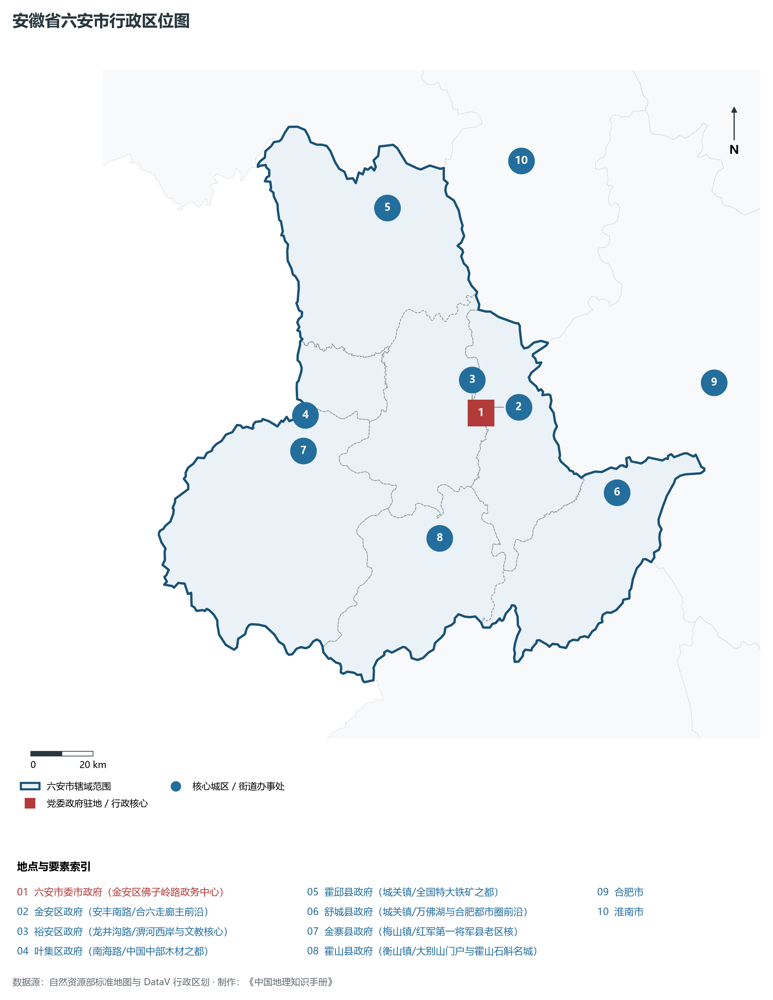
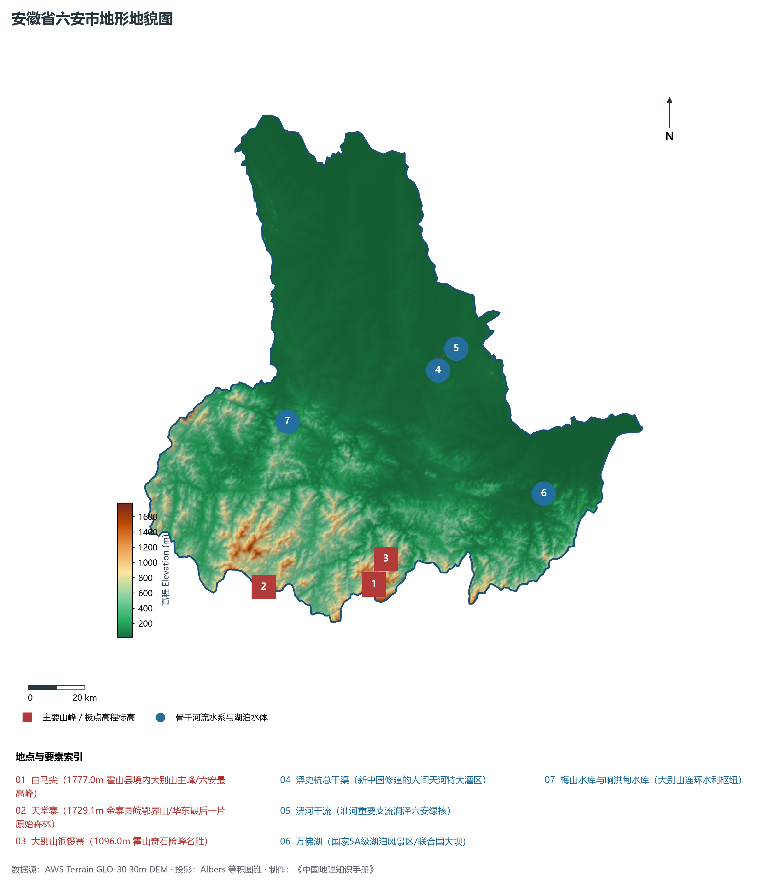
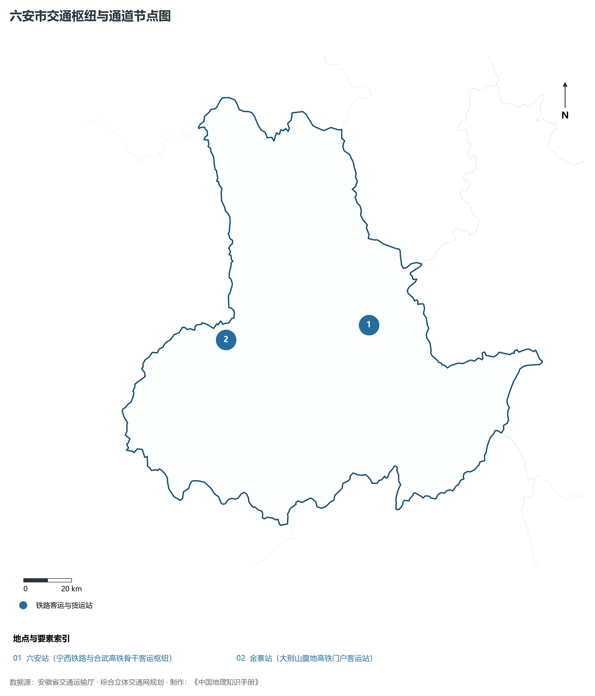
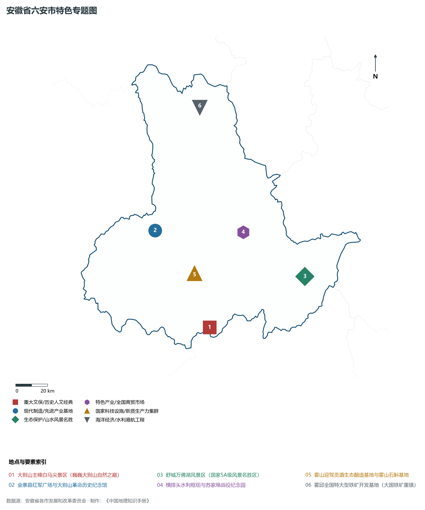
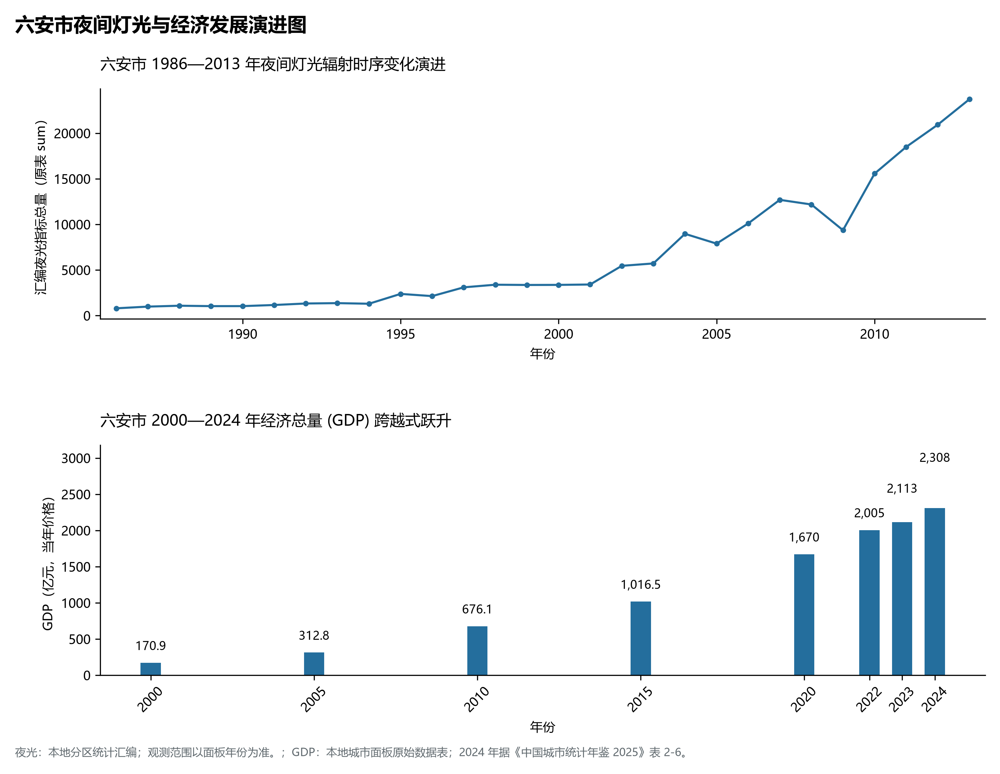

# 12.13 六安市

六安市，位于安徽省关键战略版图，其城市综合定位与发展愿景概括为：**大别山革命老区核心·合六同城化主阵地·中国红军第一将军县·国家级生态屏障与淠史杭水利天河**。2024 年常住人口 **430 万人**，常住人口城镇化率 **52.47%**，地区生产总值 **2,308 亿元**（当年价格），人均地区生产总值 **53,371 元**，三次产业构成为 **12.42 : 36.25 : 51.33**。

---

## 一、自然地理底盘与山川水系机理

六安市在大地构造演化史上跨越深大构造单元断裂带，中生代以来的剧烈构造升降与长期的江淮河流侵蚀堆积作用，造就了低山丘陵、构造断陷盆地、冲积漫滩或广袤平原交织错落的地貌格局。全境地表最低标高为 **18.0 m**，最高隆起山峰或高地控制海拔达 **1777.0 m**，多梯度的地貌格局为生态涵养、水源调蓄、现代特色农业开发与先进制造业集群布局提供了坚实的自然地理载体。

在气候水热配置方面，六安市受季风环流控制显著，温暖湿润、四季分明、雨热同季。年平均气温在 14.5°C ～ 17.5°C 之间，无霜期达 210 ～ 260 d，年日照时数达 1800 ～ 2200 h。多年平均降水量达 800 ～ 1600 mm，梅雨暴雨与汛期洪涝防御是水利工程长期运行的核心课题，构筑起堤防加固、水库调蓄与水资源科学调配协同推进的防灾减灾大格局。

区域骨干控制性山峰与高程标高极点包括：

- **白马尖 (1777.0m 霍山县境内大别山主峰/六安最高峰)**（空间坐标约东经 116.185°、北纬 31.115°，海拔标高约 1777.0 m）：构成区域地形骨架与水文生态屏障的关键控制极点，发挥区域小气候调节与动植物生境保护功能；
- **天堂寨 (1729.1m 金寨县皖鄂界山/华东最后一片原始森林)**（空间坐标约东经 115.775°、北纬 31.145°，海拔标高约 1729.1 m）：构成区域地形骨架与水文生态屏障的关键控制极点，发挥区域小气候调节与动植物生境保护功能；
- **大别山铜锣寨 (1096.0m 霍山奇石险峰名胜)**（空间坐标约东经 116.240°、北纬 31.190°，海拔标高约 1096.0 m）：构成区域地形骨架与水文生态屏障的关键控制极点，发挥区域小气候调节与动植物生境保护功能；

水系水网与生态湿地廊道方面，六安市河流交织、水源充沛，构筑了独具特色的水文水资源循环体系：

- **淠史杭总干渠 (新中国修建的人间天河特大灌区)**（水系坐标约东经 116.515°、北纬 31.755°）：发挥防洪排涝、农业灌溉、优质生活水源涵养、航运通航与江淮水网生态安全的核心功能；
- **淠河干流 (淮河重要支流润泽六安绿核)**（水系坐标约东经 116.490°、北纬 31.780°）：发挥防洪排涝、农业灌溉、优质生活水源涵养、航运通航与江淮水网生态安全的核心功能；
- **万佛湖 (国家5A级湖泊风景区/联合国大坝)**（水系坐标约东经 116.855°、北纬 31.335°）：发挥防洪排涝、农业灌溉、优质生活水源涵养、航运通航与江淮水网生态安全的核心功能；
- **梅山水库与响洪甸水库 (大别山连环水利枢纽)**（水系坐标约东经 115.930°、北纬 31.650°）：发挥防洪排涝、农业灌溉、优质生活水源涵养、航运通航与江淮水网生态安全的核心功能；

---

## 二、行政区划沿革与城镇空间体系

六安市建置沿革源远流长，文脉绵延数千年，自古即为江淮流域农耕文明、水陆通衢、兵家要冲或商贸通商的核心重地。新中国成立特别是改革开放以来，伴随撤地设市、行政区划调整、中心城区扩容提质与大都市区一体化推进，构建了市辖区与经济强县（市）协同并进、主中心引领辐射、次中心各展所长的现代空间开发保护格局：

- **六安市委市政府 (金安区佛子岭路政务中心)**（驻地坐标：116.515°E, 31.735°N）：区域公共治理中心、高品质公共服务供给极核与新型城镇化战略支点；
- **金安区政府 (安丰南路/合六走廊主前沿)**（驻地坐标：116.535°E, 31.750°N）：区域公共治理中心、高品质公共服务供给极核与新型城镇化战略支点；
- **裕安区政府 (龙井沟路/淠河西岸与文教核心)**（驻地坐标：116.485°E, 31.740°N）：区域公共治理中心、高品质公共服务供给极核与新型城镇化战略支点；
- **叶集区政府 (南海路/中国中部木材之都)**（驻地坐标：115.915°E, 31.785°N）：区域公共治理中心、高品质公共服务供给极核与新型城镇化战略支点；
- **霍邱县政府 (城关镇/全国特大铁矿之都)**（驻地坐标：116.275°E, 32.345°N）：区域公共治理中心、高品质公共服务供给极核与新型城镇化战略支点；
- **舒城县政府 (城关镇/万佛湖与合肥都市圈前沿)**（驻地坐标：116.945°E, 31.465°N）：区域公共治理中心、高品质公共服务供给极核与新型城镇化战略支点；
- **金寨县政府 (梅山镇/红军第一将军县老区核)**（驻地坐标：115.895°E, 31.685°N）：区域公共治理中心、高品质公共服务供给极核与新型城镇化战略支点；
- **霍山县政府 (衡山镇/大别山门户与霍山石斛名城)**（驻地坐标：116.325°E, 31.395°N）：区域公共治理中心、高品质公共服务供给极核与新型城镇化战略支点；

在国土空间总体规划指引下，六安市坚决守牢耕地红线、永久基本农田、生态保护红线与城镇开发边界三条控制线，优化城市组团空间结构，推动产业与人口科学集聚，促进城乡基础设施互联互通与公共服务优质均衡共享，构筑宜居宜业宜游的现代和美之城。

---

## 三、综合立体交通网络与长三角互联互通

六安市地处安徽综合立体交通网与长三角海陆空对外开放大通道关键枢纽，依托高速铁路客运大通道、骨干干线铁路、国家高速公路网、内河高等级航道港口与现代民航空港，构筑了通达全省、连接全国、融入长三角的立体交通大网络：

**核心综合交通客运与货运物流枢纽节点：**

- **六安站 (宁西铁路与合武高铁骨干客运枢纽)**（位置坐标：116.505°E, 31.710°N）：旅客快捷换乘集散、大宗物资组织、多式联运中转与区域经济往来的战略性交通支撑；
- **金寨站 (大别山腹地高铁门户客运站)**（位置坐标：115.865°E, 31.715°N）：旅客快捷换乘集散、大宗物资组织、多式联运中转与区域经济往来的战略性交通支撑；

当前，六安市持续加快交通基础设施数字化转型与绿色低碳升级，重点攻坚高等级快速路网无缝衔接、高等级航道通江达海与枢纽集疏运体系优化，全面融入长三角“1小时交通圈”与全省“一圈五区”综合骨架，打造外畅内密、安全韧性、绿色智能的现代化立体交通强市。

---

## 四、现代产业体系与新质生产力布局

六安市坚定不移走新型工业化发展之路，充分发挥产业基础扎实、创新资源丰富、腹地广阔与长三角产业转移集聚的综合优势，聚力发展战略性新兴产业与新质生产力，加快构建具有国际国内竞争力的现代产业集群与高能级技术创新平台体系：

**标志性先进制造园区、创新集聚基地、龙头集群与重大产业地标：**

- **大别山主峰白马尖景区 (巍巍大别山自然之巅)**（空间坐标：116.185°E, 31.115°N）：区域战略性新兴产业集聚与科技创新赋能的核心高地；
- **金寨县红军广场与大别山革命历史纪念馆**（空间坐标：115.895°E, 31.685°N）：区域战略性新兴产业集聚与科技创新赋能的核心高地；
- **舒城万佛湖风景区 (国家5A级风景名胜区)**（空间坐标：116.855°E, 31.335°N）：区域战略性新兴产业集聚与科技创新赋能的核心高地；
- **横排头水利枢纽与苏家埠战役纪念园**（空间坐标：116.480°E, 31.620°N）：区域战略性新兴产业集聚与科技创新赋能的核心高地；
- **霍山迎驾贡酒生态酿造基地与霍山石斛基地**（空间坐标：116.125°E, 31.425°N）：区域战略性新兴产业集聚与科技创新赋能的核心高地；
- **霍邱全国特大型铁矿开发基地 (大国铁矿重镇)**（空间坐标：116.285°E, 32.335°N）：区域战略性新兴产业集聚与科技创新赋能的核心高地；

通过全面实施产业链“链长制”与科技赋能工程，六安市大力培育国家级制造业单项冠军企业、专精特新“小巨人”与高成长型科技创新领军企业，在新材料、高端装备、新能源汽车及零部件、电子信息、现代中药、绿色食品等关键赛道上全力筑牢实体经济基本盘。

---

## 五、历史文化名胜、人文底蕴与全域文旅地理

六安市江淮胜迹璀璨，历史文脉连绵数千年，汇聚了世界文化遗产、国家 5A 级风景名胜区、国家级历史文化名城与国家重点文物保护单位，是江淮风骨、名山灵秀与红色精神交相辉映的文化沃土：

- **大别山主峰白马尖景区 (巍巍大别山自然之巅)**：承载深厚人文积淀，彰显华夏文明源流、名胜山川绝景与当代建设成就的鲜明文化地标；
- **金寨县红军广场与大别山革命历史纪念馆**：承载深厚人文积淀，彰显华夏文明源流、名胜山川绝景与当代建设成就的鲜明文化地标；
- **舒城万佛湖风景区 (国家5A级风景名胜区)**：承载深厚人文积淀，彰显华夏文明源流、名胜山川绝景与当代建设成就的鲜明文化地标；
- **横排头水利枢纽与苏家埠战役纪念园**：承载深厚人文积淀，彰显华夏文明源流、名胜山川绝景与当代建设成就的鲜明文化地标；
- **霍山迎驾贡酒生态酿造基地与霍山石斛基地**：承载深厚人文积淀，彰显华夏文明源流、名胜山川绝景与当代建设成就的鲜明文化地标；
- **霍邱全国特大型铁矿开发基地 (大国铁矿重镇)**：承载深厚人文积淀，彰显华夏文明源流、名胜山川绝景与当代建设成就的鲜明文化地标；

围绕高品质全域旅游与文化强省战略，六安市深入推动“以文塑旅、以旅彰文”，推进大运河文化带、长江国家文化公园与长三角生态文旅康养基地高标准建设，深化文旅深度融合，打造享誉海内外的特色文旅金名片。

---

## 六、夜间灯光辐射与跨世纪经济变化时序演进

本节夜光图的观测年份为 1986—2013 年，指标为行政区汇总值（原表 sum）。

| 年份 | 地区生产总值（亿元，当年价格） |
|:---|---:|
| 2000 年 | 170.9 |
| 2005 年 | 312.8 |
| 2010 年 | 676.1 |
| 2015 年 | 1,016.5 |
| 2020 年 | 1,670 |
| 2022 年 | 2,005 |
| 2023 年 | 2,113 |
| 2024 年 | 2,308 |

2024 年统计来源：《中国城市统计年鉴 2025》表 2-1、2-6、2-7（2024 年，全市）。其他年份 GDP 据本地城市面板“原始数据”表，单位为亿元、当年价格。
