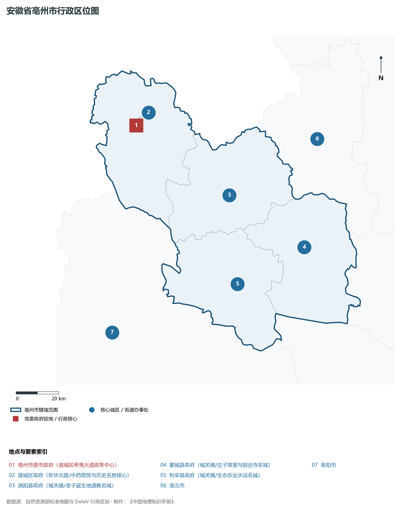
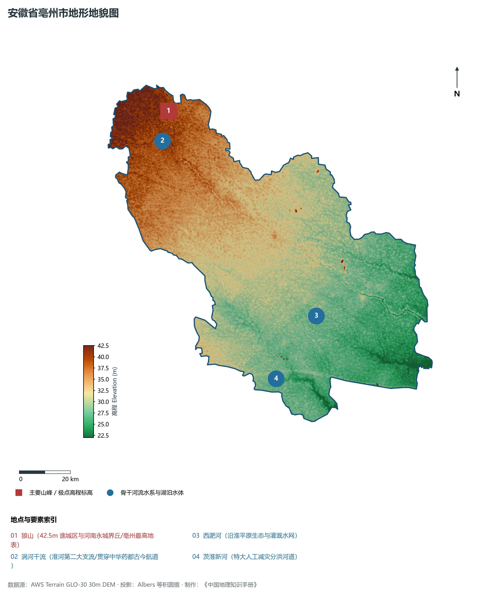
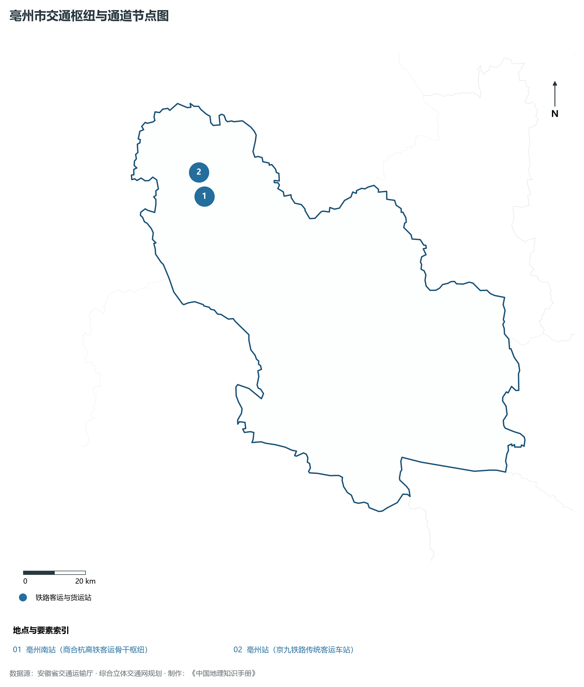
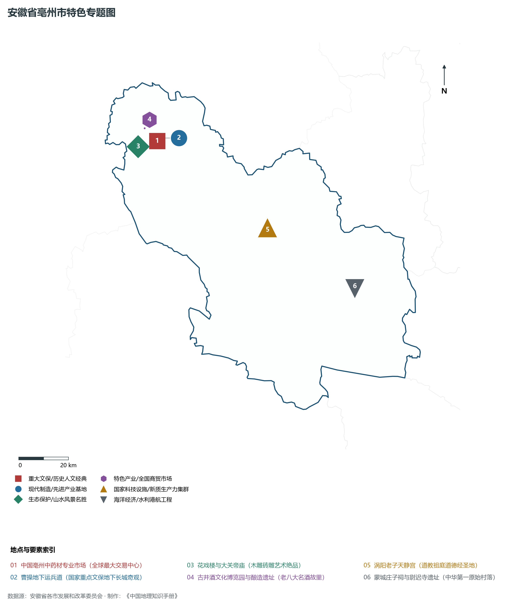
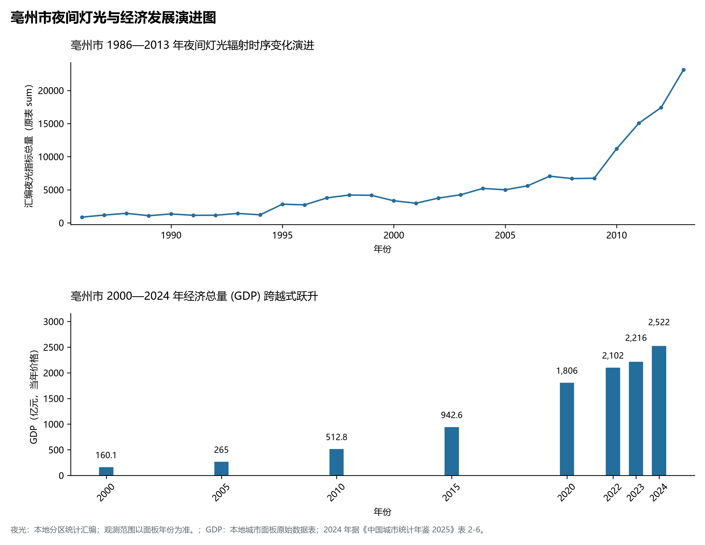

# 12.14 亳州市

亳州市，位于安徽省关键战略版图，其城市综合定位与发展愿景概括为：**中华药都·全球最大中药材集散中心·华佗与曹操故里·老子庄子道家思想源流·古井贡酒故里**。2024 年常住人口 **486 万人**，常住人口城镇化率 **47.02%**，地区生产总值 **2,522 亿元**（当年价格），人均地区生产总值 **51,662 元**，三次产业构成为 **12.09 : 35.06 : 52.85**。

---

## 一、自然地理底盘与山川水系机理

亳州市在大地构造演化史上跨越深大构造单元断裂带，中生代以来的剧烈构造升降与长期的江淮河流侵蚀堆积作用，造就了低山丘陵、构造断陷盆地、冲积漫滩或广袤平原交织错落的地貌格局。全境地表最低标高为 **22.0 m**，最高隆起山峰或高地控制海拔达 **42.5 m**，多梯度的地貌格局为生态涵养、水源调蓄、现代特色农业开发与先进制造业集群布局提供了坚实的自然地理载体。

在气候水热配置方面，亳州市受季风环流控制显著，温暖湿润、四季分明、雨热同季。年平均气温在 14.5°C ～ 17.5°C 之间，无霜期达 210 ～ 260 d，年日照时数达 1800 ～ 2200 h。多年平均降水量达 800 ～ 1600 mm，梅雨暴雨与汛期洪涝防御是水利工程长期运行的核心课题，构筑起堤防加固、水库调蓄与水资源科学调配协同推进的防灾减灾大格局。

区域骨干控制性山峰与高程标高极点包括：

- **狼山 (42.5m 谯城区与河南永城界丘/亳州最高地表)**（空间坐标约东经 115.820°、北纬 33.980°，海拔标高约 42.5 m）：构成区域地形骨架与水文生态屏障的关键控制极点，发挥区域小气候调节与动植物生境保护功能；

水系水网与生态湿地廊道方面，亳州市河流交织、水源充沛，构筑了独具特色的水文水资源循环体系：

- **涡河干流 (淮河第二大支流/贯穿中华药都古今航道)**（水系坐标约东经 115.780°、北纬 33.880°）：发挥防洪排涝、农业灌溉、优质生活水源涵养、航运通航与江淮水网生态安全的核心功能；
- **西淝河 (沿淮平原生态与灌溉水网)**（水系坐标约东经 116.350°、北纬 33.220°）：发挥防洪排涝、农业灌溉、优质生活水源涵养、航运通航与江淮水网生态安全的核心功能；
- **茨淮新河 (特大人工减灾分洪河道)**（水系坐标约东经 116.150°、北纬 33.020°）：发挥防洪排涝、农业灌溉、优质生活水源涵养、航运通航与江淮水网生态安全的核心功能；

---

## 二、行政区划沿革与城镇空间体系

亳州市建置沿革源远流长，文脉绵延数千年，自古即为江淮流域农耕文明、水陆通衢、兵家要冲或商贸通商的核心重地。新中国成立特别是改革开放以来，伴随撤地设市、行政区划调整、中心城区扩容提质与大都市区一体化推进，构建了市辖区与经济强县（市）协同并进、主中心引领辐射、次中心各展所长的现代空间开发保护格局：

- **亳州市委市政府 (谯城区希夷大道政务中心)**（驻地坐标：115.780°E, 33.845°N）：区域公共治理中心、高品质公共服务供给极核与新型城镇化战略支点；
- **谯城区政府 (新华北路/中药商贸与历史名胜核心)**（驻地坐标：115.770°E, 33.865°N）：区域公共治理中心、高品质公共服务供给极核与新型城镇化战略支点；
- **涡阳县政府 (城关镇/老子诞生地道教名城)**（驻地坐标：116.215°E, 33.515°N）：区域公共治理中心、高品质公共服务供给极核与新型城镇化战略支点；
- **蒙城县政府 (城关镇/庄子故里与尉迟寺名城)**（驻地坐标：116.565°E, 33.265°N）：区域公共治理中心、高品质公共服务供给极核与新型城镇化战略支点；
- **利辛县政府 (城关镇/生态农业水运名城)**（驻地坐标：116.205°E, 33.145°N）：区域公共治理中心、高品质公共服务供给极核与新型城镇化战略支点；

在国土空间总体规划指引下，亳州市坚决守牢耕地红线、永久基本农田、生态保护红线与城镇开发边界三条控制线，优化城市组团空间结构，推动产业与人口科学集聚，促进城乡基础设施互联互通与公共服务优质均衡共享，构筑宜居宜业宜游的现代和美之城。

---

## 三、综合立体交通网络与长三角互联互通

亳州市地处安徽综合立体交通网与长三角海陆空对外开放大通道关键枢纽，依托高速铁路客运大通道、骨干干线铁路、国家高速公路网、内河高等级航道港口与现代民航空港，构筑了通达全省、连接全国、融入长三角的立体交通大网络：

**核心综合交通客运与货运物流枢纽节点：**

- **亳州南站 (商合杭高铁客运骨干枢纽)**（位置坐标：115.795°E, 33.805°N）：旅客快捷换乘集散、大宗物资组织、多式联运中转与区域经济往来的战略性交通支撑；
- **亳州站 (京九铁路传统客运车站)**（位置坐标：115.785°E, 33.875°N）：旅客快捷换乘集散、大宗物资组织、多式联运中转与区域经济往来的战略性交通支撑；

当前，亳州市持续加快交通基础设施数字化转型与绿色低碳升级，重点攻坚高等级快速路网无缝衔接、高等级航道通江达海与枢纽集疏运体系优化，全面融入长三角“1小时交通圈”与全省“一圈五区”综合骨架，打造外畅内密、安全韧性、绿色智能的现代化立体交通强市。

---

## 四、现代产业体系与新质生产力布局

亳州市坚定不移走新型工业化发展之路，充分发挥产业基础扎实、创新资源丰富、腹地广阔与长三角产业转移集聚的综合优势，聚力发展战略性新兴产业与新质生产力，加快构建具有国际国内竞争力的现代产业集群与高能级技术创新平台体系：

**标志性先进制造园区、创新集聚基地、龙头集群与重大产业地标：**

- **中国亳州中药材专业市场 (全球最大交易中心)**（空间坐标：115.775°E, 33.865°N）：区域战略性新兴产业集聚与科技创新赋能的核心高地；
- **曹操地下运兵道 (国家重点文保地下长城奇观)**（空间坐标：115.785°E, 33.875°N）：区域战略性新兴产业集聚与科技创新赋能的核心高地；
- **花戏楼与大关帝庙 (木雕砖雕艺术绝品)**（空间坐标：115.775°E, 33.845°N）：区域战略性新兴产业集聚与科技创新赋能的核心高地；
- **古井酒文化博览园与酿造遗址 (老八大名酒故里)**（空间坐标：115.725°E, 33.915°N）：区域战略性新兴产业集聚与科技创新赋能的核心高地；
- **涡阳老子天静宫 (道教祖庭道德经圣地)**（空间坐标：116.215°E, 33.515°N）：区域战略性新兴产业集聚与科技创新赋能的核心高地；
- **蒙城庄子祠与尉迟寺遗址 (中华第一原始村落)**（空间坐标：116.565°E, 33.265°N）：区域战略性新兴产业集聚与科技创新赋能的核心高地；

通过全面实施产业链“链长制”与科技赋能工程，亳州市大力培育国家级制造业单项冠军企业、专精特新“小巨人”与高成长型科技创新领军企业，在新材料、高端装备、新能源汽车及零部件、电子信息、现代中药、绿色食品等关键赛道上全力筑牢实体经济基本盘。

---

## 五、历史文化名胜、人文底蕴与全域文旅地理

亳州市江淮胜迹璀璨，历史文脉连绵数千年，汇聚了世界文化遗产、国家 5A 级风景名胜区、国家级历史文化名城与国家重点文物保护单位，是江淮风骨、名山灵秀与红色精神交相辉映的文化沃土：

- **中国亳州中药材专业市场 (全球最大交易中心)**：承载深厚人文积淀，彰显华夏文明源流、名胜山川绝景与当代建设成就的鲜明文化地标；
- **曹操地下运兵道 (国家重点文保地下长城奇观)**：承载深厚人文积淀，彰显华夏文明源流、名胜山川绝景与当代建设成就的鲜明文化地标；
- **花戏楼与大关帝庙 (木雕砖雕艺术绝品)**：承载深厚人文积淀，彰显华夏文明源流、名胜山川绝景与当代建设成就的鲜明文化地标；
- **古井酒文化博览园与酿造遗址 (老八大名酒故里)**：承载深厚人文积淀，彰显华夏文明源流、名胜山川绝景与当代建设成就的鲜明文化地标；
- **涡阳老子天静宫 (道教祖庭道德经圣地)**：承载深厚人文积淀，彰显华夏文明源流、名胜山川绝景与当代建设成就的鲜明文化地标；
- **蒙城庄子祠与尉迟寺遗址 (中华第一原始村落)**：承载深厚人文积淀，彰显华夏文明源流、名胜山川绝景与当代建设成就的鲜明文化地标；

围绕高品质全域旅游与文化强省战略，亳州市深入推动“以文塑旅、以旅彰文”，推进大运河文化带、长江国家文化公园与长三角生态文旅康养基地高标准建设，深化文旅深度融合，打造享誉海内外的特色文旅金名片。

---

## 六、夜间灯光辐射与跨世纪经济变化时序演进

本节夜光图的观测年份为 1986—2013 年，指标为行政区汇总值（原表 sum）。

| 年份 | 地区生产总值（亿元，当年价格） |
|:---|---:|
| 2000 年 | 160.1 |
| 2005 年 | 265 |
| 2010 年 | 512.8 |
| 2015 年 | 942.6 |
| 2020 年 | 1,806 |
| 2022 年 | 2,102 |
| 2023 年 | 2,216 |
| 2024 年 | 2,522 |

2024 年统计来源：《中国城市统计年鉴 2025》表 2-1、2-6、2-7（2024 年，全市）。其他年份 GDP 据本地城市面板“原始数据”表，单位为亿元、当年价格。
