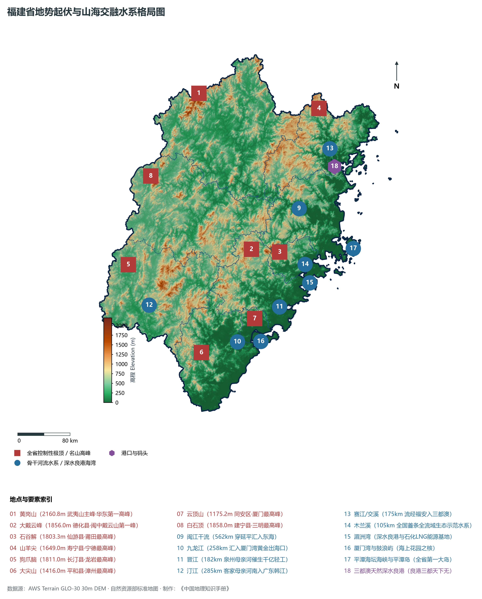
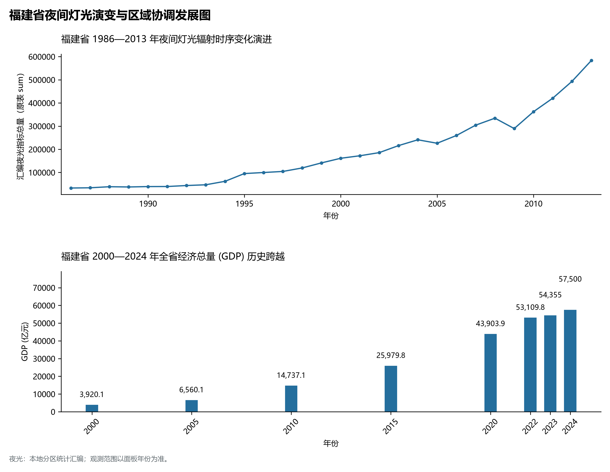
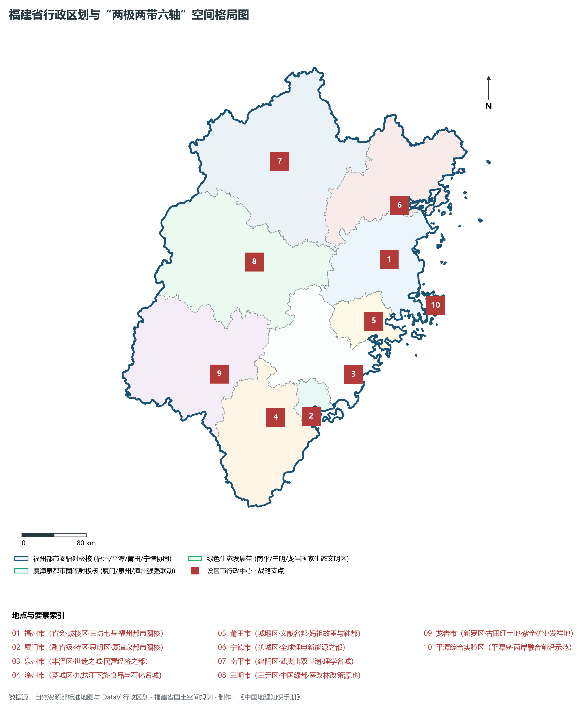
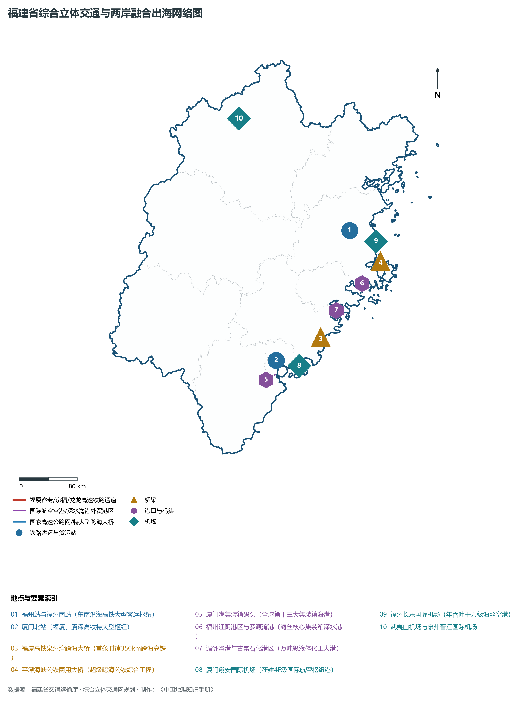
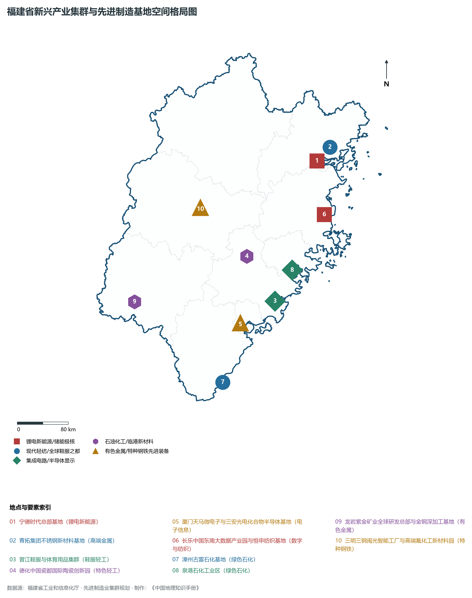

# 13.0 福建省地理统揽

福建省，简称“闽”，省会福州市，位于中国东南沿海、台湾海峡西岸，地处东经 115° 50' ～ 120° 40'、北纬 23° 33' ～ 28° 20' 之间。全省陆域总面积达 **12.40 × 10⁴ km²**，海域面积达 **13.60 × 10⁴ km²**。福建东北与浙江省毗邻，西北与江西省接壤，西南与广东省相连，东隔台湾海峡与台湾岛相望，大陆海岸线长达 **3752 km**（居全国各省区第二位），曲折率达 1:7.01（居全国首位），拥有大小海岛 **2214 个**（居全国第二位），平潭岛（陆域面积 324 km²）为全省第一大岛、全国第五大岛。福建自古山海交融、文风昌盛，享有“海滨邹鲁”之盛誉，是古代海上丝绸之路东方起点、21世纪海上丝绸之路核心区、海峡两岸融合发展示范区，更是当代民营经济蓬勃活跃、绿色生态底色极为鲜明的生态文明先行省。

全省地貌宏观上呈现极为典型的**“八山一水一分田”**山海交融地理格局。地势西北高、东南低，武夷山脉与戴云山脉两列弧形山系斜贯全省，峰峦叠翠、峡谷深幽，沿海港湾深邃、岛礁罗列。全省现辖 9 个设区市（福州市、厦门市、莆田市、三明市、泉州市、漳州市、南平市、龙岩市、宁德市）以及平潭综合实验区，其中包括副省级城市兼计划单列市厦门市。截至 2024 年末，全省常住人口达到 **4188.0 万人**，城镇化率达 **71.0%**。2024 年全省实现地区生产总值（GDP）突破 **5.75 万亿元**（达 57,500 亿元），人均 GDP 突破 **13.7 万元**（稳居全国各省区前列）。福建森林覆盖率达到 **65.12%**，连续 45 年稳居全国各省区第一位，水、大气和生态环境质量长年保持全优。当前，福建正紧扣“四个更大”重要要求，全方位推进高质量发展超越，深入实施新时代“八闽楷模”与“晋江经验”，高水平建设海峡两岸融合发展示范区，谱写中国式现代化的福建新篇章。

---

## 一、地质地貌演化与“八山一水一分田”山海交融宏观底盘

福建省大地构造演化隶属于华南褶皱系浙闽变质褶皱带，元古代形成的古老变质结晶基底历经加里东运动、印支运动与燕山造山运动的多期叠加改造。特别是中生代侏罗纪至白垩纪剧烈的中酸性火山喷发与花岗岩岩浆侵入活动，构成了全省以流纹岩、凝灰岩和坚硬花岗岩为主体的山体骨架。新生代以来的差异性断块抬升与断陷下沉，奠定了全省“两列大山脉横贯、众多小盆地错落、港湾深入曲折”的宏观地貌特征：

全省地表高程极值跨度介于台湾海峡沿岸海潮线的 **0.0 m** 至武夷山脉主峰黄岗山的 **2160.8 m** 之间：

- **全省乃至华东大陆自然最高峰**：位于南平市武夷山市与江西省铅山县交界处的**黄岗山（海拔 2160.8 m）**，属于武夷山脉主峰，雄踞东南，傲视华东，也是闽江与赣江水系的天然分水岭；
- **闽中戴云山第一高峰**：位于泉州市德化县境内的**大戴云峰（海拔 1856.0 m）**，苍茫巍峨，素称“闽中屋脊”，是晋江水系的重要发源地；
- **全省第三高峰与莆田最高绝顶**：位于仙游县境内的**石谷解（海拔 1803.3 m）**；
- **闽东鹫峰山脉最高极顶**：位于宁德市寿宁县境内的**山羊尖（海拔 1649.0 m）**；
- **闽西武夷山南段高峰**：长汀县境内**狗爪脑（海拔 1811.0 m）**与上杭梅花山（1778.0 m）；
- **全省最低点**：沿海海潮线及广阔的潮间带海涂，海拔标高为 **0.0 m**。

福建省宏观地貌由西北向东南呈现规律性的三级阶梯递降与五大特色地貌单元：

1. **西北武夷山脉中山区**：包括武夷山脉与杉岭，由花岗岩与古老变质岩构成，千米以上高山连绵成带（黄岗山 2160.8 m），深谷陡崖发育，构筑起抵御北方寒潮、涵养江河水源的西北天然生态巨屏；
2. **闽中鹫峰—戴云—博平岭中低山区**：自东北向西南斜贯全省中部，构成福建第二列高耸弧形山系，大戴云（1856.0 m）、石谷解（1803.3 m）等巨峰耸立其间，将全省水系天然分隔为闽江、九龙江等内流水系与沿海外流水系；
3. **闽中与闽西北断陷构造盆地区**：夹持在两大山系之间，分布着邵武盆地、永安盆地、三明盆地、龙岩盆地等一系列白垩纪红层断陷盆地与丹霞地貌（泰宁大金湖水上丹霞、连城冠豸山丹霞），地势平缓，土壤肥沃，是全省重要的工农业生产走廊；
4. **沿海低山丘陵与冲积平原区**：沿漫长海岸线分布，江河在入海口泥沙沉积冲积出漳州平原（全省第一大平原，面积约 566 km²）、福州平原、兴化平原与泉州平原，水网密布，自古商贸繁荣；
5. **曲折滨海港湾与海岛海岸区**：基岩海岸极度曲折，沉降型溺谷港湾深入陆地，形成三都澳（世界天然深水良港“良港三都天下无”）、罗源湾、湄洲湾、厦门湾、兴化湾、东山湾等众多深水不冻避风良港。

**福建省宏观地势阶梯与山海交融纵剖面示意表**

| 武夷山国家公园屏障 | 闽中山间红层盆地 | 闽中戴云山脉屋脊 | 滨海平原沃野水网 | 大国海疆深水良港 |
| --- | --- | --- | --- | --- |
| (黄岗山 2160.8m)；华东屋脊·天然氧吧；世界文化与自然双遗产 | (三明/永安/泰宁)；水上丹霞·沙县小吃；老工业基地绿色转型 | (大戴云峰 1856m)；石谷解 1803m；水源涵养·德化白瓷 | (漳州/泉州/福州平原)；晋江经验·千亿鞋服；海丝起点·外贸重镇 | (三都澳/湄洲湾/厦门湾)；2214座海岛·万亿石化；跨海高铁·两岸融合 |

西北 (武夷山中山山地) · → 中北 (构造红层盆地) · → 中 (闽中戴云山中低山) · → 东南 (沿海冲积平原) · → 东 (东海与台湾海峡海岛)

---

## 二、中南亚热带海洋性季风气候与“五大水系”江海交汇水文脉络

福建省全境位于**中亚热带与南亚热带海洋性季风气候区**，依山傍海，温暖湿润，光热充沛，海洋调节作用显著：

- **热量资源丰富**：全省年平均气温在 **17.0°C ～ 21.5°C** 之间，自西北山区向东南沿海递增。无霜期长达 250～ 336 d，东南沿海终年基本无冬。年日照时数达 1700～ 2200 h，农作物可一年三熟；
- **降水充沛与时空分异**：全省多年平均降水量达 **1400～ 2000 mm**，是全国降水量最为丰富的省份之一。武夷山山脉迎风坡年降水量甚至超过 2500 mm，形成全省乃至华东暴雨中心。5—6 月梅雨水汽磅礴，7—9 月台风雨暴烈频密，沿江防洪、海堤御潮与山洪地质灾害防御是水利工程的永恒使命。

福建河网密布，俗称“五大水系”（闽江、九龙江、晋江、汀江、赛江）与木兰溪水系，多年平均地表水资源总量达 **1168 亿立方米**，人均水资源占有量居全国各省区前列：

1. **闽江水系（全省第一大河）**：
   - 干流全长 **562 km**，流域面积达 **6.09 × 10⁴ km²**，占全省总面积的一半以上。上游建溪、富屯溪、沙溪在南平延平三江口汇流，穿闽江峡谷切过戴云山脉，在福州盆地分流为乌龙江和白龙江，穿闽江口注入东海。闽江水量充沛，年径流量达 600 余亿立方米，仅次于长江、珠海，是八闽大地的生命之源；
2. **九龙江水系（全省第二大河）**：
   - 全长 **258 km**，西溪与北溪在龙海汇合注入厦门湾，冲积出全省最大的漳州平原，是厦漳泉同城化生态供水与绿色出海的核心走廊；
3. **晋江水系（泉州母亲河）**：
   - 全长 **182 km**，东溪与西溪在南安双溪口汇合，穿泉州主城注入泉州湾，千百年来滋润泉州万亩农田，下游更催生了举世闻名的“晋江经验”与千亿制造业集群；
4. **汀江水系（“客家母亲河”）**：
   - 全长 **285 km**，发源于长汀县武夷山脉南段，南流经上杭、永定出境入广东韩江，哺育了坚韧不拔的客家先民；
5. **赛江与木兰溪**：
   - **赛江（交溪）**：闽东最大河流，流经周宁、福安注入三都澳，滋养闽东山海沃土；
   - **木兰溪**：全长 105 km，北宋公元1083年筑建的“木兰陂”为世界灌溉工程遗产，新时代更成为全国首条全流域系统治理的水利生态文明典范。

---

## 三、行政区划、人口与“两极两带六轴”空间协同格局

福建省现辖 9 个设区市，下辖 31 个市辖区、11 个县级市、42 个县（含金门县），共 84 个县级行政区，以及平潭综合实验区。2024 年末全省常住人口达到 4188.0 万人，人口密度达 338人/km²，高素质现代产业人口持续汇聚。

立足资源禀赋与山海差异，福建省在国土空间总体规划中高标准构筑**“两极两带六轴”**区域协调空间大格局：

1. **“两极引领”：福州都市圈与厦漳泉都市圈双核共振**：
   - **福州都市圈**：以省会福州为核心，联动平潭、莆田、宁德、南平协同发展，打造海丝门户、数字高地与现代化海滨大都市；
   - **厦漳泉都市圈**：以厦门特区为龙头，推动厦漳泉金协同发展，打造世界级先进制造中心、东南国际航运中心与两岸融合核心区；
2. **“两带联动”：沿海高质量发展带与绿色生态发展带**：
   - **沿海高质量发展带**：串联宁德、福州、平潭、莆田、泉州、厦门、漳州沿海港湾平原，集聚全省八成以上的经济增量与制造业龙头；
   - **绿色生态发展带**：涵盖南平、三明、龙岩及沿海山区腹地，筑牢全省生态屏障，探索生态产品价值实现新机制；
3. **“六轴协同”：跨山通海协同走廊**：
   - 依托福银、厦蓉、泉南、京台等骨干综合交通廊道，推动沿海先进产业向内陆山区梯次转移辐射，促进山海互补、共同繁荣。

---

## 四、综合立体交通网络与海丝核心区海陆出海门户

福建全面推进“轨道上的福建”、“海丝国际港航”与“现代空港体系”建设，构筑了通达全省、连接海峡、拥抱全球的综合交通大动脉：

1. **高速铁路与客专骨干网**：
   - 沿海高铁大通道（温福、福厦、厦深高铁）、合福高铁、向莆铁路、南龙高铁、龙龙高铁纵横交错，实现了“设区市市市通高铁”；福厦高铁（2023年通车）是中国首条设计时速 350 公里的跨海高铁，福州厦门实现“1小时生活圈”；
2. **深水国际航运海港群**：
   - 厦门港（全球第十三大集装箱海港）、福州港（江阴与罗源湾深水大港）、湄洲湾港、古雷港四大港区协同发展，通达全球 140 多个国家和地区的数百个港口，万吨巨轮通江达海；
3. **现代航空物流港**：
   - 厦门高崎国际机场与福州长乐国际机场年旅客吞吐量均超千万人次；厦门翔安国际机场（4F级超级海岛空港）加速建设；晋江、武夷山、三明、连城等支线空港协同互补；
4. **跨海超级交通工程**：
   - 平潭海峡公铁两用大桥（全长 16.34 公里，世界最长公铁两用跨海峡大桥）、泉州湾跨海高铁大桥、集美大桥、海沧隧道展现大国水下与跨海工程雄强实力。

---

## 五、现代化产业体系与新质生产力空间布局

新时代以来，福建坚持“以实体经济为根本”，大力传承弘扬“晋江经验”，全面推进新型工业化，打造了一批具有全球顶尖竞争力的战略性产业集群：

1. **全球锂电新能源之都**：
   - 宁德时代（CATL）动力电池与储能电池使用量连续多年稳居全球第一，带动宁德、厦门、泉州形成数千亿级新能源汽车与储能动力全产业链；
2. **全球现代轻纺与体育装备制造基地**：
   - 泉州晋江涌现出安踏、特步、361度、中踏等全球著名体育装备巨头；恒申集团、百宏聚纤等掌握锦纶化纤核心科技；德化白瓷享誉海内外；
3. **世界最大不锈钢产业基地**：
   - 宁德福安青拓集团掌握全球领先的红土镍矿冶炼与不锈钢连铸工艺，不锈钢产量突破千万吨级，全球领跑；
4. **国家级现代临港石油化工基地**：
   - 漳州古雷石化基地与泉港湄洲湾石化园区双雄并进，形成乙烯、PX、精细化工全产业链闭环；
5. **电子信息、半导体与数字经济**：
   - 厦门天马微电子、冠捷科技、三安光电化合物半导体领跑全国；数字中国建设峰会永久落户福州，长乐中国东南大数据产业园集聚算力底座；
6. **有色金属与绿色生态农业**：
   - 龙岩紫金矿业崛起为全球特大型跨国矿业巨头；武夷岩茶、安溪铁观音、福鼎白茶、古田食用菌成为全国地理标志产业标杆。

---

## 六、夜间灯光遥感时序与跨越式区域协调演变

本节夜光图的观测年份为 1986—2013 年，指标为行政区汇总值（原表 sum）。

- **1980—1990年代（特区破浪与海岛孤岛点状集聚）**：
- **2000—2010年代（“晋江经验”引领民营经济爆发，沿海城市带连绵成片）**：
- **2010—2024年（“宁德时代”神话崛起、高铁成网与两岸融合示范区全域绽放）**：

八闽大地，江山如画；海丝腾飞，勇立潮头！四千一百万福建儿女在绿水青山与万顷碧海之间劈波斩浪、奋发图强，正以昂扬的姿态，奋力书写中国式现代化的福建壮丽篇章！
