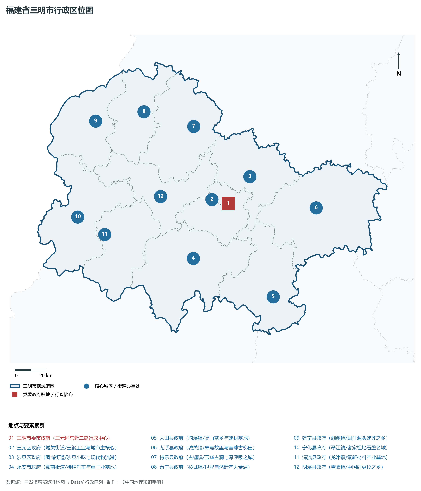
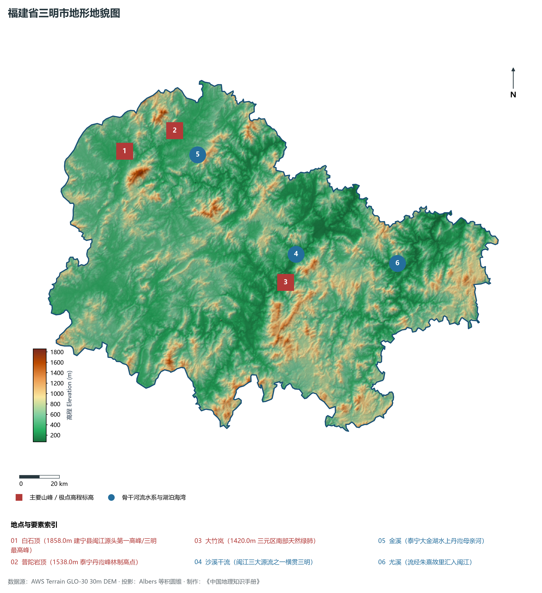
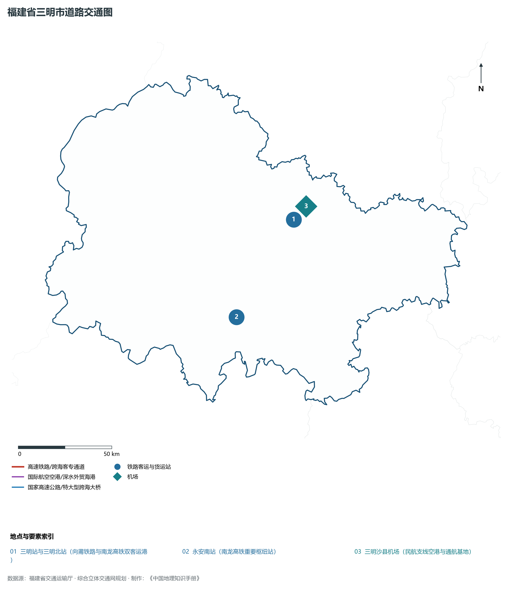
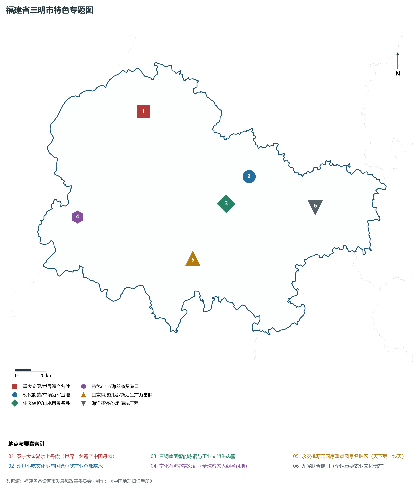
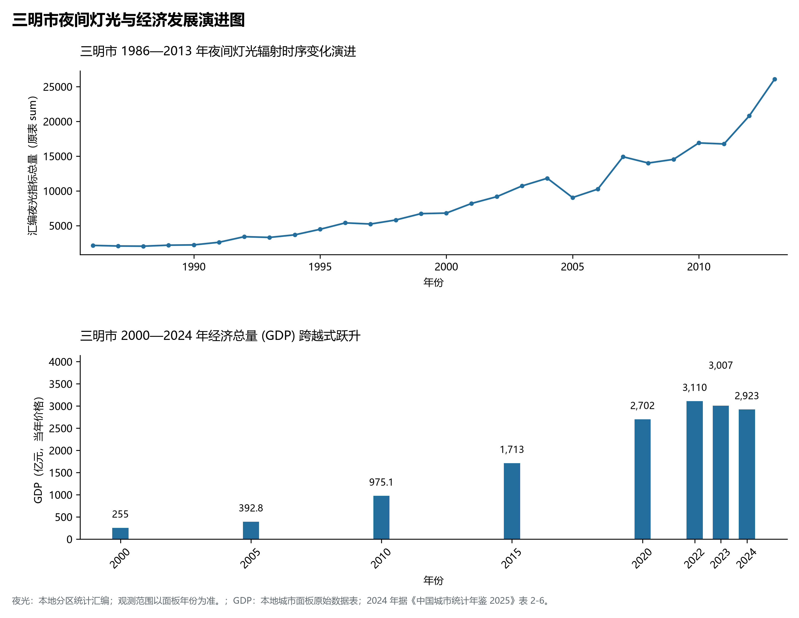

# 13.4 三明市

三明市，位于福建省关键战略版图，其城市综合定位与发展愿景概括为：**老工业基地转型典范·中国绿都·医改林改策源地·沙县小吃发源地·泰宁世界自然遗产丹霞**。2024 年常住人口 **242 万人**，常住人口城镇化率 **67.34%**，地区生产总值 **2,923 亿元**（当年价格），人均地区生产总值 **120,583 元**，三次产业构成为 **12.85 : 42.58 : 44.57**。

---

## 一、自然地理底盘与山川水系机理

在气候水热配置方面，三明市属于典型的海洋性亚热带季风气候区，温暖湿润、冬暖夏热、光热充沛、雨热同期。年平均气温在 16.5°C ～ 21.0°C 之间，无霜期达 260 ～ 330 d，年日照时数达 1750 ～ 2200 h。多年平均降水量达 1300 ～ 2200 mm，梅雨与台风雨是汛期降水主导形态，山溪性河流短小湍急，构筑起山洪防范、海堤御潮防台与水资源科学调配协同推进的防灾减灾大格局。

区域骨干控制性山峰与高程标高极点包括：

- **白石顶 (1858.0m 建宁县闽江源头第一高峰/三明最高峰)**（空间坐标约东经 116.855°、北纬 26.855°，海拔标高约 1858.0 m）：构成区域地形骨架与水文生态屏障的关键控制极点，发挥区域小气候调节与动植物生境保护功能；
- **普陀岩顶 (1538.0m 泰宁丹霞峰林制高点)**（空间坐标约东经 117.120°、北纬 26.920°，海拔标高约 1538.0 m）：构成区域地形骨架与水文生态屏障的关键控制极点，发挥区域小气候调节与动植物生境保护功能；
- **大竹岚 (1420.0m 三元区南部天然绿肺)**（空间坐标约东经 117.580°、北纬 26.180°，海拔标高约 1420.0 m）：构成区域地形骨架与水文生态屏障的关键控制极点，发挥区域小气候调节与动植物生境保护功能；

水系水网与生态湿地廊道方面，三明市江河湖海互通、水网纵横，构筑了独具特色的水文水资源循环体系：

- **沙溪干流 (闽江三大源流之一横贯三明)**（水系坐标约东经 117.650°、北纬 26.300°）：发挥防洪排涝、农业灌溉、优质生活饮用水源涵养、航运通航与滨海湿地生态保护的核心功能；
- **金溪 (泰宁大金湖水上丹霞母亲河)**（水系坐标约东经 117.220°、北纬 26.800°）：发挥防洪排涝、农业灌溉、优质生活饮用水源涵养、航运通航与滨海湿地生态保护的核心功能；
- **尤溪 (流经朱熹故里汇入闽江)**（水系坐标约东经 118.150°、北纬 26.200°）：发挥防洪排涝、农业灌溉、优质生活饮用水源涵养、航运通航与滨海湿地生态保护的核心功能；

---

## 二、行政区划沿革与城镇空间体系

三明市建置沿革源远流长，文脉绵延数千年，自古即为海上丝绸之路通商贸易、中原先民南迁定居、手工业技艺繁盛或海防军事防御的核心重镇。新中国成立特别是改革开放以来，伴随撤地设市、行政区划调整、中心城区组团式跨越与现代都市区一体化推进，构建了市辖区与经济强县（市）协同并进、极核辐射强劲、港产城深度融合的现代城镇空间体系：

- **三明市委市政府 (三元区东新二路行政中心)**（驻地坐标：117.635°E, 26.265°N）：区域公共治理中心、高品质公共服务供给极核与新型城镇化战略支点；
- **三元区政府 (城关街道/三钢工业与城市主核心)**（驻地坐标：117.615°E, 26.245°N）：区域公共治理中心、高品质公共服务供给极核与新型城镇化战略支点；
- **沙县区政府 (凤岗街道/沙县小吃与现代物流港)**（驻地坐标：117.795°E, 26.405°N）：区域公共治理中心、高品质公共服务供给极核与新型城镇化战略支点；
- **永安市政府 (燕南街道/特种汽车与重工业基地)**（驻地坐标：117.365°E, 25.975°N）：区域公共治理中心、高品质公共服务供给极核与新型城镇化战略支点；
- **大田县政府 (均溪镇/高山茶乡与建材基地)**（驻地坐标：117.845°E, 25.695°N）：区域公共治理中心、高品质公共服务供给极核与新型城镇化战略支点；
- **尤溪县政府 (城关镇/朱熹故里与全球古梯田)**（驻地坐标：118.195°E, 26.175°N）：区域公共治理中心、高品质公共服务供给极核与新型城镇化战略支点；
- **将乐县政府 (古镛镇/玉华古洞与深呼吸之城)**（驻地坐标：117.475°E, 26.735°N）：区域公共治理中心、高品质公共服务供给极核与新型城镇化战略支点；
- **泰宁县政府 (杉城镇/世界自然遗产大金湖)**（驻地坐标：117.165°E, 26.855°N）：区域公共治理中心、高品质公共服务供给极核与新型城镇化战略支点；
- **建宁县政府 (濉溪镇/闽江源头建莲之乡)**（驻地坐标：116.845°E, 26.835°N）：区域公共治理中心、高品质公共服务供给极核与新型城镇化战略支点；
- **宁化县政府 (翠江镇/客家祖地石壁名城)**（驻地坐标：116.655°E, 26.295°N）：区域公共治理中心、高品质公共服务供给极核与新型城镇化战略支点；
- **清流县政府 (龙津镇/氟新材料产业基地)**（驻地坐标：116.815°E, 26.175°N）：区域公共治理中心、高品质公共服务供给极核与新型城镇化战略支点；
- **明溪县政府 (雪峰镇/中国红豆杉之乡)**（驻地坐标：117.205°E, 26.355°N）：区域公共治理中心、高品质公共服务供给极核与新型城镇化战略支点；

在国土空间总体规划指引下，三明市坚决守牢耕地红线、永久基本农田、生态保护红线与城镇开发边界三条控制线，优化城市组团空间结构，推动产业与人口科学集聚，促进城乡基础设施互联互通与公共服务优质均衡共享，构筑宜居宜业宜游的现代生态海滨和美之城。

---

## 三、综合立体交通网络与海丝核心区互联互通

三明市地处福建综合立体交通网与海峡两岸出海大通道关键枢纽，依托高速铁路客运大通道、骨干干线铁路、国家高速公路网、深水海港码头与现代民航航空港，构筑了通达全省、连接全国、辐射海峡、拥抱全球的立体交通大网络：

**核心综合交通客运与货运物流枢纽节点：**

- **三明站与三明北站 (向莆铁路与南龙高铁双客运港)**（位置坐标：117.750°E, 26.380°N）：旅客快捷换乘集散、大宗集装箱货物中转、多式联运枢纽与国际海丝贸易往来的战略性交通支撑；
- **三明沙县机场 (民航支线空港与通航基地)**（位置坐标：117.825°E, 26.435°N）：旅客快捷换乘集散、大宗集装箱货物中转、多式联运枢纽与国际海丝贸易往来的战略性交通支撑；
- **永安南站 (南龙高铁重要枢纽站)**（位置坐标：117.380°E, 25.950°N）：旅客快捷换乘集散、大宗集装箱货物中转、多式联运枢纽与国际海丝贸易往来的战略性交通支撑；

当前，三明市持续加快交通基础设施数字化转型与绿色低碳升级，重点攻坚高等级跨海快速通道闭环、高等级深水航道常态化通航与枢纽集疏运体系优化，全面融入长三角与粤港澳大湾区高速通道网络，打造外畅内密、安全韧性、绿色智能的现代化综合立体交通强市。

---

## 四、现代产业体系与新质生产力布局

三明市坚定不移走新型工业化发展之路，充分发挥民营经济发达、海丝商贸活跃、侨资侨智丰富与港口岸线优越的综合优势，深入践行“晋江经验”，聚力发展战略性新兴产业与新质生产力，加快构建具有国际竞争力的现代工业集群与高能级技术创新平台体系：

**标志性先进制造园区、特色产业小镇、龙头集群与重大产业地标：**

- **泰宁大金湖水上丹霞 (世界自然遗产中国丹霞)**（空间坐标：117.165°E, 26.855°N）：区域战略性新兴产业集聚与科技创新赋能的核心高地；
- **沙县小吃文化城与国际小吃产业总部基地**（空间坐标：117.795°E, 26.405°N）：区域战略性新兴产业集聚与科技创新赋能的核心高地；
- **三钢集团智能炼钢与工业文旅生态园**（空间坐标：117.625°E, 26.265°N）：区域战略性新兴产业集聚与科技创新赋能的核心高地；
- **宁化石壁客家公祠 (全球客家人朝圣祖地)**（空间坐标：116.655°E, 26.295°N）：区域战略性新兴产业集聚与科技创新赋能的核心高地；
- **永安桃源洞国家重点风景名胜区 (天下第一线天)**（空间坐标：117.365°E, 25.975°N）：区域战略性新兴产业集聚与科技创新赋能的核心高地；
- **尤溪联合梯田 (全球重要农业文化遗产)**（空间坐标：118.195°E, 26.175°N）：区域战略性新兴产业集聚与科技创新赋能的核心高地；

通过全面实施产业链“链长制”与数字化赋能工程，三明市大力梯度培育国家级制造业单项冠军企业、专精特新“小巨人”与具有行业主导力的全球领军型跨国企业，在锂电新能源、新材料、先进装备、电子信息、现代石化、现代轻工等关键赛道上抢占制高点，筑牢实体经济基本盘。

---

## 五、历史文化名胜、人文底蕴与全域文旅地理

三明市江山胜迹璀璨，历史文脉连绵数千年，汇聚了世界文化遗产、国家 5A 级风景名胜区、国家级历史文化名城与国家重点文物保护单位，是海丝文化、闽南风华、客家祖地与红色精神交相辉映的文化沃土：

- **泰宁大金湖水上丹霞 (世界自然遗产中国丹霞)**：承载深厚人文积淀，彰显海纳百川、敢拼会赢、崇文重教与爱国爱乡的鲜明文化地标；
- **沙县小吃文化城与国际小吃产业总部基地**：承载深厚人文积淀，彰显海纳百川、敢拼会赢、崇文重教与爱国爱乡的鲜明文化地标；
- **三钢集团智能炼钢与工业文旅生态园**：承载深厚人文积淀，彰显海纳百川、敢拼会赢、崇文重教与爱国爱乡的鲜明文化地标；
- **宁化石壁客家公祠 (全球客家人朝圣祖地)**：承载深厚人文积淀，彰显海纳百川、敢拼会赢、崇文重教与爱国爱乡的鲜明文化地标；
- **永安桃源洞国家重点风景名胜区 (天下第一线天)**：承载深厚人文积淀，彰显海纳百川、敢拼会赢、崇文重教与爱国爱乡的鲜明文化地标；
- **尤溪联合梯田 (全球重要农业文化遗产)**：承载深厚人文积淀，彰显海纳百川、敢拼会赢、崇文重教与爱国爱乡的鲜明文化地标；

围绕高品质全域旅游与文化强省战略，三明市深入推动“以文塑旅、以旅彰文”，推进海丝国家文化公园与长三角、粤港澳大湾区客源地对接，深化山海生态文旅康养场景融合，打造享誉海内外的世界级文旅金名片。

---

## 六、夜间灯光辐射与跨世纪经济变化时序演进

本节夜光图的观测年份为 1986—2013 年，指标为行政区汇总值（原表 sum）。

| 年份 | 地区生产总值（亿元，当年价格） |
|:---|---:|
| 2000 年 | 255 |
| 2005 年 | 392.8 |
| 2010 年 | 975.1 |
| 2015 年 | 1,713 |
| 2020 年 | 2,702 |
| 2022 年 | 3,110 |
| 2023 年 | 3,007 |
| 2024 年 | 2,923 |

2024 年统计来源：《中国城市统计年鉴 2025》表 2-1、2-6、2-7（2024 年，全市）。其他年份 GDP 据本地城市面板“原始数据”表，单位为亿元、当年价格。
