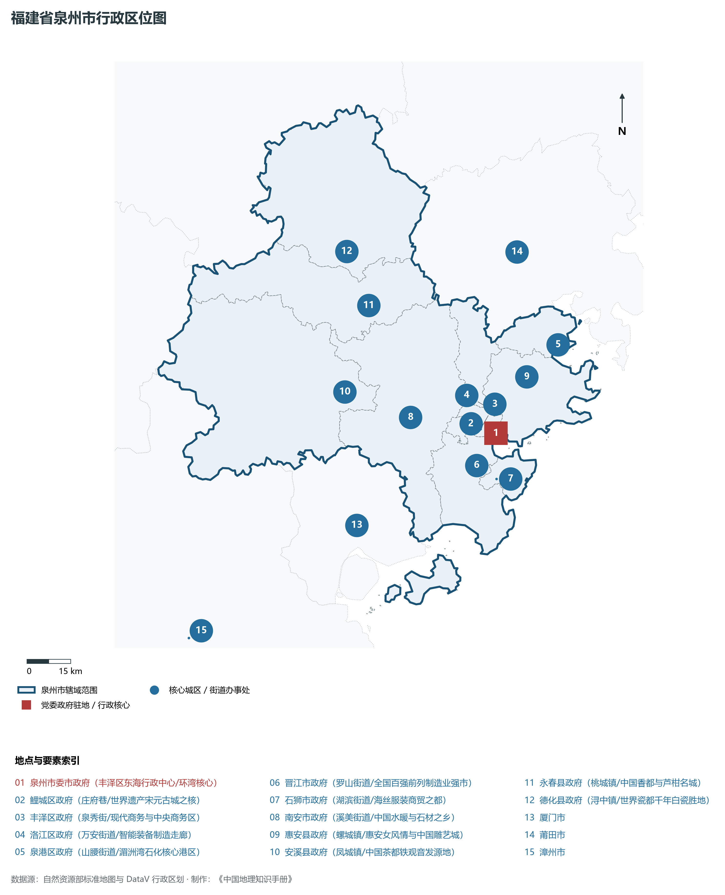
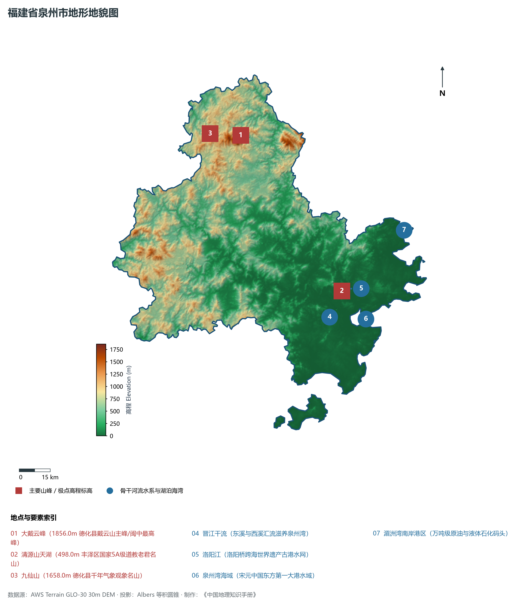
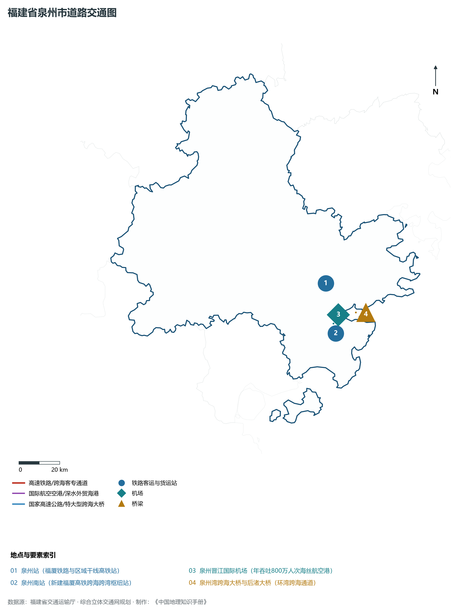
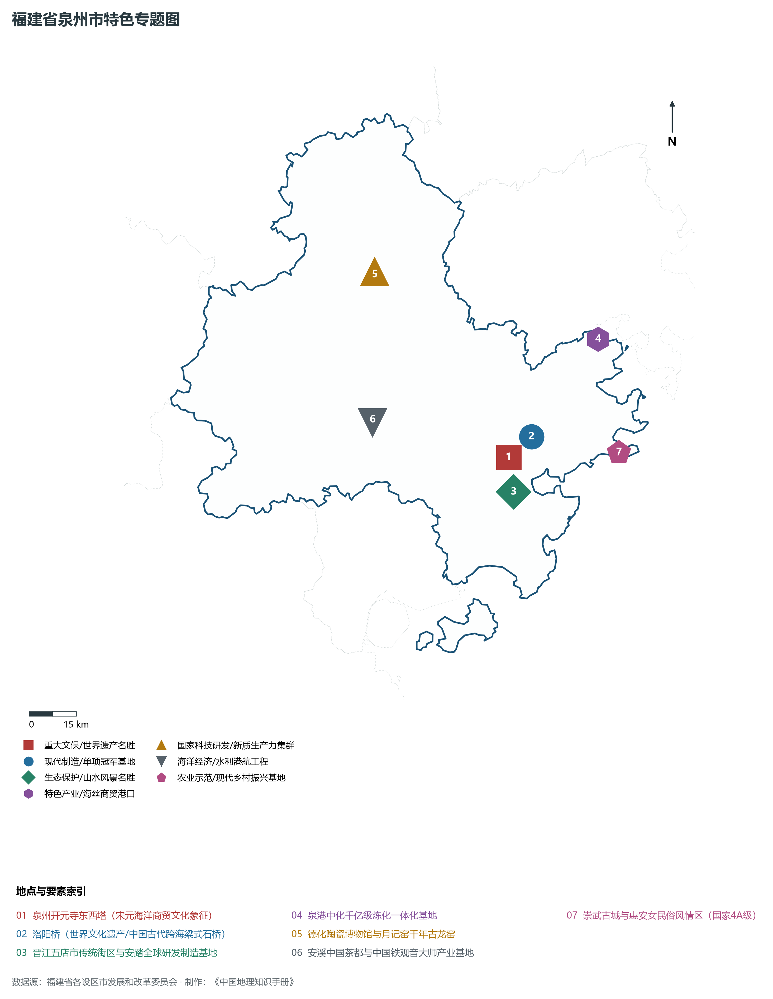
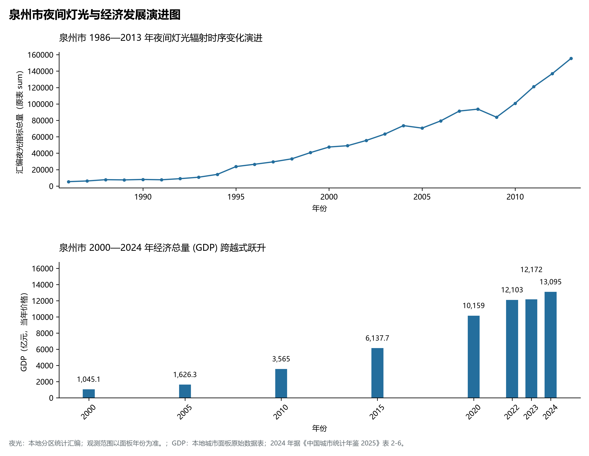

# 13.5 泉州市

泉州市，位于福建省关键战略版图，其城市综合定位与发展愿景概括为：**宋元中国的世界海洋商贸中心·世遗之城·民营经济之都·“晋江经验”发祥地·万亿级制造强市**。2024 年常住人口 **891 万人**，常住人口城镇化率 **71.19%**，地区生产总值 **13,095 亿元**（当年价格），人均地区生产总值 **147,158 元**，三次产业构成为 **2.01 : 51.74 : 46.25**。

---

## 一、自然地理底盘与山川水系机理

在气候水热配置方面，泉州市属于典型的海洋性亚热带季风气候区，温暖湿润、冬暖夏热、光热充沛、雨热同期。年平均气温在 16.5°C ～ 21.0°C 之间，无霜期达 260 ～ 330 d，年日照时数达 1750 ～ 2200 h。多年平均降水量达 1300 ～ 2200 mm，梅雨与台风雨是汛期降水主导形态，山溪性河流短小湍急，构筑起山洪防范、海堤御潮防台与水资源科学调配协同推进的防灾减灾大格局。

区域骨干控制性山峰与高程标高极点包括：

- **大戴云峰 (1856.0m 德化县戴云山主峰/闽中最高峰)**（空间坐标约东经 118.245°、北纬 25.685°，海拔标高约 1856.0 m）：构成区域地形骨架与水文生态屏障的关键控制极点，发挥区域小气候调节与动植物生境保护功能；
- **清源山天湖 (498.0m 丰泽区国家5A级道教老君名山)**（空间坐标约东经 118.625°、北纬 24.955°，海拔标高约 498.0 m）：构成区域地形骨架与水文生态屏障的关键控制极点，发挥区域小气候调节与动植物生境保护功能；
- **九仙山 (1658.0m 德化县千年气象观象名山)**（空间坐标约东经 118.100°、北纬 25.710°，海拔标高约 1658.0 m）：构成区域地形骨架与水文生态屏障的关键控制极点，发挥区域小气候调节与动植物生境保护功能；

水系水网与生态湿地廊道方面，泉州市江河湖海互通、水网纵横，构筑了独具特色的水文水资源循环体系：

- **晋江干流 (东溪与西溪汇流滋养泉州湾)**（水系坐标约东经 118.550°、北纬 24.850°）：发挥防洪排涝、农业灌溉、优质生活饮用水源涵养、航运通航与滨海湿地生态保护的核心功能；
- **洛阳江 (洛阳桥跨海世界遗产古港水网)**（水系坐标约东经 118.670°、北纬 24.960°）：发挥防洪排涝、农业灌溉、优质生活饮用水源涵养、航运通航与滨海湿地生态保护的核心功能；
- **泉州湾海域 (宋元中国东方第一大港水域)**（水系坐标约东经 118.720°、北纬 24.820°）：发挥防洪排涝、农业灌溉、优质生活饮用水源涵养、航运通航与滨海湿地生态保护的核心功能；
- **湄洲湾南岸港区 (万吨级原油与液体石化码头)**（水系坐标约东经 118.960°、北纬 25.180°）：发挥防洪排涝、农业灌溉、优质生活饮用水源涵养、航运通航与滨海湿地生态保护的核心功能；

---

## 二、行政区划沿革与城镇空间体系

泉州市建置沿革源远流长，文脉绵延数千年，自古即为海上丝绸之路通商贸易、中原先民南迁定居、手工业技艺繁盛或海防军事防御的核心重镇。新中国成立特别是改革开放以来，伴随撤地设市、行政区划调整、中心城区组团式跨越与现代都市区一体化推进，构建了市辖区与经济强县（市）协同并进、极核辐射强劲、港产城深度融合的现代城镇空间体系：

- **泉州市委市政府 (丰泽区东海行政中心/环湾核心)**（驻地坐标：118.665°E, 24.875°N）：区域公共治理中心、高品质公共服务供给极核与新型城镇化战略支点；
- **鲤城区政府 (庄府巷/世界遗产宋元古城之核)**（驻地坐标：118.585°E, 24.915°N）：区域公共治理中心、高品质公共服务供给极核与新型城镇化战略支点；
- **丰泽区政府 (泉秀街/现代商务与中央商务区)**（驻地坐标：118.615°E, 24.895°N）：区域公共治理中心、高品质公共服务供给极核与新型城镇化战略支点；
- **洛江区政府 (万安街道/智能装备制造走廊)**（驻地坐标：118.660°E, 24.950°N）：区域公共治理中心、高品质公共服务供给极核与新型城镇化战略支点；
- **泉港区政府 (山腰街道/湄洲湾石化核心港区)**（驻地坐标：118.915°E, 25.120°N）：区域公共治理中心、高品质公共服务供给极核与新型城镇化战略支点；
- **晋江市政府 (罗山街道/全国百强前列制造业强市)**（驻地坐标：118.585°E, 24.785°N）：区域公共治理中心、高品质公共服务供给极核与新型城镇化战略支点；
- **石狮市政府 (湖滨街道/海丝服装商贸之都)**（驻地坐标：118.645°E, 24.735°N）：区域公共治理中心、高品质公共服务供给极核与新型城镇化战略支点；
- **南安市政府 (溪美街道/中国水暖与石材之乡)**（驻地坐标：118.385°E, 24.960°N）：区域公共治理中心、高品质公共服务供给极核与新型城镇化战略支点；
- **惠安县政府 (螺城镇/惠安女风情与中国雕艺城)**（驻地坐标：118.795°E, 25.035°N）：区域公共治理中心、高品质公共服务供给极核与新型城镇化战略支点；
- **安溪县政府 (凤城镇/中国茶都铁观音发源地)**（驻地坐标：118.175°E, 25.065°N）：区域公共治理中心、高品质公共服务供给极核与新型城镇化战略支点；
- **永春县政府 (桃城镇/中国香都与芦柑名城)**（驻地坐标：118.295°E, 25.320°N）：区域公共治理中心、高品质公共服务供给极核与新型城镇化战略支点；
- **德化县政府 (浔中镇/世界瓷都千年白瓷胜地)**（驻地坐标：118.245°E, 25.495°N）：区域公共治理中心、高品质公共服务供给极核与新型城镇化战略支点；

在国土空间总体规划指引下，泉州市坚决守牢耕地红线、永久基本农田、生态保护红线与城镇开发边界三条控制线，优化城市组团空间结构，推动产业与人口科学集聚，促进城乡基础设施互联互通与公共服务优质均衡共享，构筑宜居宜业宜游的现代生态海滨和美之城。

---

## 三、综合立体交通网络与海丝核心区互联互通

泉州市地处福建综合立体交通网与海峡两岸出海大通道关键枢纽，依托高速铁路客运大通道、骨干干线铁路、国家高速公路网、深水海港码头与现代民航航空港，构筑了通达全省、连接全国、辐射海峡、拥抱全球的立体交通大网络：

**核心综合交通客运与货运物流枢纽节点：**

- **泉州站 (福厦铁路与区域干线高铁站)**（位置坐标：118.575°E, 24.975°N）：旅客快捷换乘集散、大宗集装箱货物中转、多式联运枢纽与国际海丝贸易往来的战略性交通支撑；
- **泉州南站 (新建福厦高铁跨海跨湾枢纽站)**（位置坐标：118.590°E, 24.750°N）：旅客快捷换乘集散、大宗集装箱货物中转、多式联运枢纽与国际海丝贸易往来的战略性交通支撑；
- **泉州晋江国际机场 (年吞吐800万人次海丝航空港)**（位置坐标：118.585°E, 24.795°N）：旅客快捷换乘集散、大宗集装箱货物中转、多式联运枢纽与国际海丝贸易往来的战略性交通支撑；
- **泉州湾跨海大桥与后渚大桥 (环湾跨海通道)**（位置坐标：118.700°E, 24.830°N）：旅客快捷换乘集散、大宗集装箱货物中转、多式联运枢纽与国际海丝贸易往来的战略性交通支撑；

当前，泉州市持续加快交通基础设施数字化转型与绿色低碳升级，重点攻坚高等级跨海快速通道闭环、高等级深水航道常态化通航与枢纽集疏运体系优化，全面融入长三角与粤港澳大湾区高速通道网络，打造外畅内密、安全韧性、绿色智能的现代化综合立体交通强市。

---

## 四、现代产业体系与新质生产力布局

泉州市坚定不移走新型工业化发展之路，充分发挥民营经济发达、海丝商贸活跃、侨资侨智丰富与港口岸线优越的综合优势，深入践行“晋江经验”，聚力发展战略性新兴产业与新质生产力，加快构建具有国际竞争力的现代工业集群与高能级技术创新平台体系：

**标志性先进制造园区、特色产业小镇、龙头集群与重大产业地标：**

- **泉州开元寺东西塔 (宋元海洋商贸文化象征)**（空间坐标：118.585°E, 24.915°N）：区域战略性新兴产业集聚与科技创新赋能的核心高地；
- **洛阳桥 (世界文化遗产/中国古代跨海梁式石桥)**（空间坐标：118.665°E, 24.965°N）：区域战略性新兴产业集聚与科技创新赋能的核心高地；
- **晋江五店市传统街区与安踏全球研发制造基地**（空间坐标：118.585°E, 24.815°N）：区域战略性新兴产业集聚与科技创新赋能的核心高地；
- **泉港中化千亿级炼化一体化基地**（空间坐标：118.915°E, 25.215°N）：区域战略性新兴产业集聚与科技创新赋能的核心高地；
- **德化陶瓷博物馆与月记窑千年古龙窑**（空间坐标：118.245°E, 25.495°N）：区域战略性新兴产业集聚与科技创新赋能的核心高地；
- **安溪中国茶都与中国铁观音大师产业基地**（空间坐标：118.175°E, 25.065°N）：区域战略性新兴产业集聚与科技创新赋能的核心高地；
- **崇武古城与惠安女民俗风情区 (国家4A级)**（空间坐标：118.930°E, 24.885°N）：区域战略性新兴产业集聚与科技创新赋能的核心高地；

通过全面实施产业链“链长制”与数字化赋能工程，泉州市大力梯度培育国家级制造业单项冠军企业、专精特新“小巨人”与具有行业主导力的全球领军型跨国企业，在锂电新能源、新材料、先进装备、电子信息、现代石化、现代轻工等关键赛道上抢占制高点，筑牢实体经济基本盘。

---

## 五、历史文化名胜、人文底蕴与全域文旅地理

泉州市江山胜迹璀璨，历史文脉连绵数千年，汇聚了世界文化遗产、国家 5A 级风景名胜区、国家级历史文化名城与国家重点文物保护单位，是海丝文化、闽南风华、客家祖地与红色精神交相辉映的文化沃土：

- **泉州开元寺东西塔 (宋元海洋商贸文化象征)**：承载深厚人文积淀，彰显海纳百川、敢拼会赢、崇文重教与爱国爱乡的鲜明文化地标；
- **洛阳桥 (世界文化遗产/中国古代跨海梁式石桥)**：承载深厚人文积淀，彰显海纳百川、敢拼会赢、崇文重教与爱国爱乡的鲜明文化地标；
- **晋江五店市传统街区与安踏全球研发制造基地**：承载深厚人文积淀，彰显海纳百川、敢拼会赢、崇文重教与爱国爱乡的鲜明文化地标；
- **泉港中化千亿级炼化一体化基地**：承载深厚人文积淀，彰显海纳百川、敢拼会赢、崇文重教与爱国爱乡的鲜明文化地标；
- **德化陶瓷博物馆与月记窑千年古龙窑**：承载深厚人文积淀，彰显海纳百川、敢拼会赢、崇文重教与爱国爱乡的鲜明文化地标；
- **安溪中国茶都与中国铁观音大师产业基地**：承载深厚人文积淀，彰显海纳百川、敢拼会赢、崇文重教与爱国爱乡的鲜明文化地标；
- **崇武古城与惠安女民俗风情区 (国家4A级)**：承载深厚人文积淀，彰显海纳百川、敢拼会赢、崇文重教与爱国爱乡的鲜明文化地标；

围绕高品质全域旅游与文化强省战略，泉州市深入推动“以文塑旅、以旅彰文”，推进海丝国家文化公园与长三角、粤港澳大湾区客源地对接，深化山海生态文旅康养场景融合，打造享誉海内外的世界级文旅金名片。

---

## 六、夜间灯光辐射与跨世纪经济变化时序演进

本节夜光图的观测年份为 1986—2013 年，指标为行政区汇总值（原表 sum）。

| 年份 | 地区生产总值（亿元，当年价格） |
|:---|---:|
| 2000 年 | 1,045.1 |
| 2005 年 | 1,626.3 |
| 2010 年 | 3,565 |
| 2015 年 | 6,137.7 |
| 2020 年 | 10,159 |
| 2022 年 | 12,103 |
| 2023 年 | 12,172 |
| 2024 年 | 13,095 |

2024 年统计来源：《中国城市统计年鉴 2025》表 2-1、2-6、2-7（2024 年，全市）。其他年份 GDP 据本地城市面板“原始数据”表，单位为亿元、当年价格。
