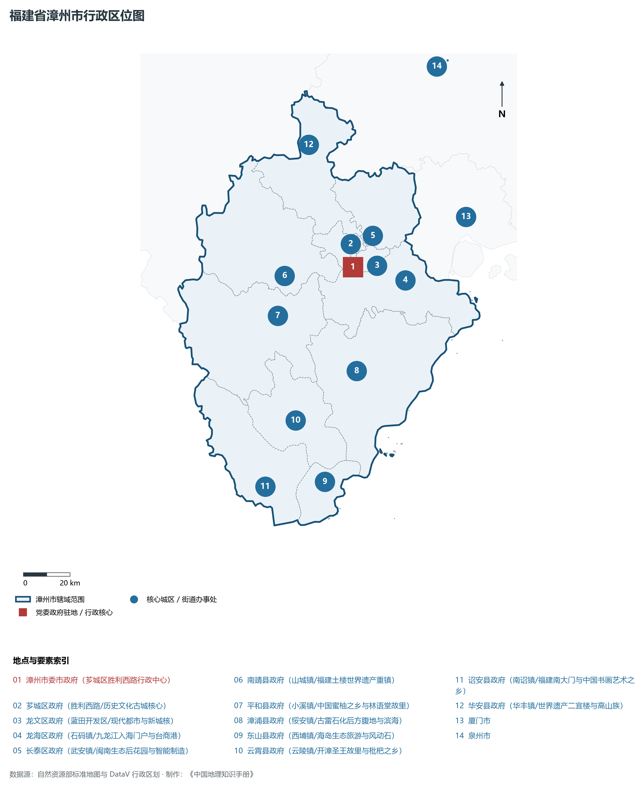
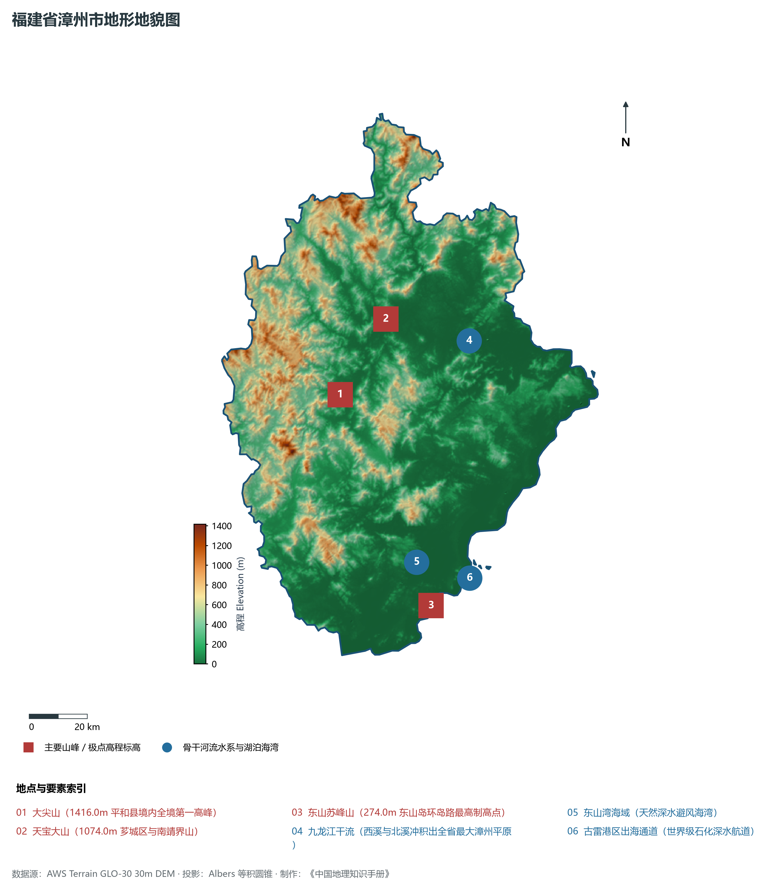
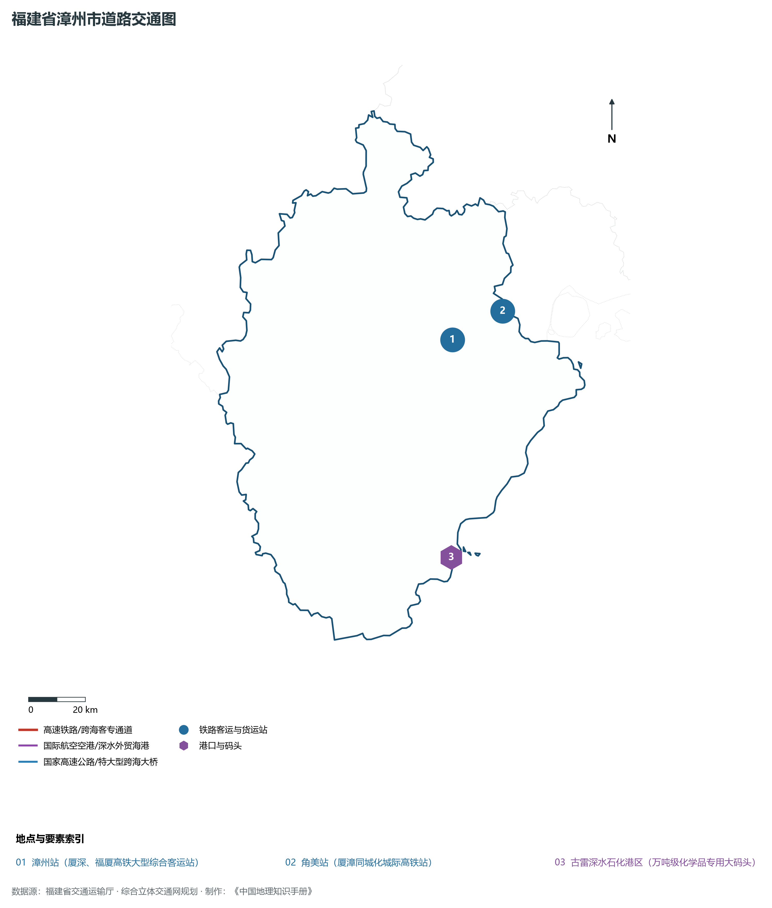
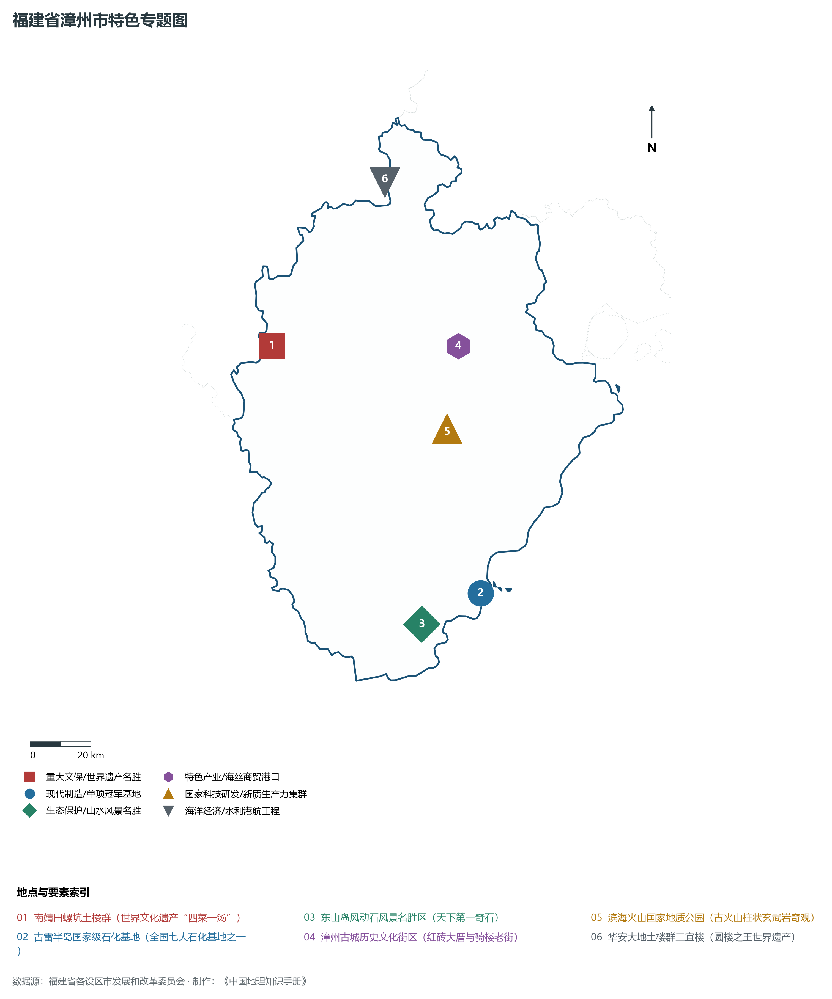
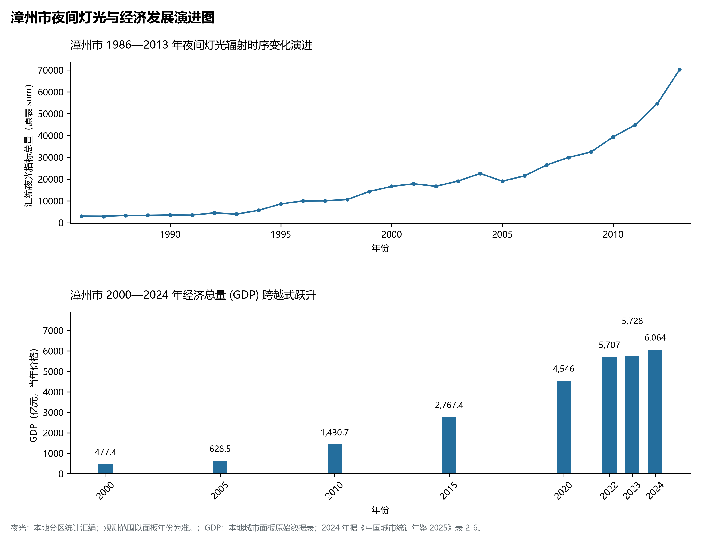

# 13.6 漳州市

漳州市，位于福建省关键战略版图，其城市综合定位与发展愿景概括为：**中国食品名城·水仙花之乡·闽南金三角支点·古雷世界级石化基地·世界文化遗产福建土楼**。2024 年常住人口 **508 万人**，常住人口城镇化率 **65.2%**，地区生产总值 **6,064 亿元**（当年价格），人均地区生产总值 **119,611 元**，三次产业构成为 **10.14 : 44.99 : 44.86**。

---

## 一、自然地理底盘与山川水系机理

在气候水热配置方面，漳州市属于典型的海洋性亚热带季风气候区，温暖湿润、冬暖夏热、光热充沛、雨热同期。年平均气温在 16.5°C ～ 21.0°C 之间，无霜期达 260 ～ 330 d，年日照时数达 1750 ～ 2200 h。多年平均降水量达 1300 ～ 2200 mm，梅雨与台风雨是汛期降水主导形态，山溪性河流短小湍急，构筑起山洪防范、海堤御潮防台与水资源科学调配协同推进的防灾减灾大格局。

区域骨干控制性山峰与高程标高极点包括：

- **大尖山 (1416.0m 平和县境内全境第一高峰)**（空间坐标约东经 117.295°、北纬 24.365°，海拔标高约 1416.0 m）：构成区域地形骨架与水文生态屏障的关键控制极点，发挥区域小气候调节与动植物生境保护功能；
- **天宝大山 (1074.0m 芗城区与南靖界山)**（空间坐标约东经 117.480°、北纬 24.580°，海拔标高约 1074.0 m）：构成区域地形骨架与水文生态屏障的关键控制极点，发挥区域小气候调节与动植物生境保护功能；
- **东山苏峰山 (274.0m 东山岛环岛路最高制高点)**（空间坐标约东经 117.510°、北纬 23.680°，海拔标高约 274.0 m）：构成区域地形骨架与水文生态屏障的关键控制极点，发挥区域小气候调节与动植物生境保护功能；

水系水网与生态湿地廊道方面，漳州市江河湖海互通、水网纵横，构筑了独具特色的水文水资源循环体系：

- **九龙江干流 (西溪与北溪冲积出全省最大漳州平原)**（水系坐标约东经 117.750°、北纬 24.480°）：发挥防洪排涝、农业灌溉、优质生活饮用水源涵养、航运通航与滨海湿地生态保护的核心功能；
- **东山湾海域 (天然深水避风海湾)**（水系坐标约东经 117.480°、北纬 23.820°）：发挥防洪排涝、农业灌溉、优质生活饮用水源涵养、航运通航与滨海湿地生态保护的核心功能；
- **古雷港区出海通道 (世界级石化深水航道)**（水系坐标约东经 117.650°、北纬 23.750°）：发挥防洪排涝、农业灌溉、优质生活饮用水源涵养、航运通航与滨海湿地生态保护的核心功能；

---

## 二、行政区划沿革与城镇空间体系

漳州市建置沿革源远流长，文脉绵延数千年，自古即为海上丝绸之路通商贸易、中原先民南迁定居、手工业技艺繁盛或海防军事防御的核心重镇。新中国成立特别是改革开放以来，伴随撤地设市、行政区划调整、中心城区组团式跨越与现代都市区一体化推进，构建了市辖区与经济强县（市）协同并进、极核辐射强劲、港产城深度融合的现代城镇空间体系：

- **漳州市委市政府 (芗城区胜利西路行政中心)**（驻地坐标：117.655°E, 24.515°N）：区域公共治理中心、高品质公共服务供给极核与新型城镇化战略支点；
- **芗城区政府 (胜利西路/历史文化古城核心)**（驻地坐标：117.645°E, 24.510°N）：区域公共治理中心、高品质公共服务供给极核与新型城镇化战略支点；
- **龙文区政府 (蓝田开发区/现代都市与新城核)**（驻地坐标：117.705°E, 24.515°N）：区域公共治理中心、高品质公共服务供给极核与新型城镇化战略支点；
- **龙海区政府 (石码镇/九龙江入海门户与台商港)**（驻地坐标：117.815°E, 24.445°N）：区域公共治理中心、高品质公共服务供给极核与新型城镇化战略支点；
- **长泰区政府 (武安镇/闽南生态后花园与智能制造)**（驻地坐标：117.755°E, 24.625°N）：区域公共治理中心、高品质公共服务供给极核与新型城镇化战略支点；
- **南靖县政府 (山城镇/福建土楼世界遗产重镇)**（驻地坐标：117.365°E, 24.515°N）：区域公共治理中心、高品质公共服务供给极核与新型城镇化战略支点；
- **平和县政府 (小溪镇/中国蜜柚之乡与林语堂故里)**（驻地坐标：117.315°E, 24.365°N）：区域公共治理中心、高品质公共服务供给极核与新型城镇化战略支点；
- **漳浦县政府 (绥安镇/古雷石化后方腹地与滨海)**（驻地坐标：117.615°E, 24.115°N）：区域公共治理中心、高品质公共服务供给极核与新型城镇化战略支点；
- **东山县政府 (西埔镇/海岛生态旅游与风动石)**（驻地坐标：117.425°E, 23.705°N）：区域公共治理中心、高品质公共服务供给极核与新型城镇化战略支点；
- **云霄县政府 (云陵镇/开漳圣王故里与枇杷之乡)**（驻地坐标：117.335°E, 23.955°N）：区域公共治理中心、高品质公共服务供给极核与新型城镇化战略支点；
- **诏安县政府 (南诏镇/福建南大门与中国书画艺术之乡)**（驻地坐标：117.175°E, 23.715°N）：区域公共治理中心、高品质公共服务供给极核与新型城镇化战略支点；
- **华安县政府 (华丰镇/世界遗产二宜楼与高山族)**（驻地坐标：117.535°E, 25.005°N）：区域公共治理中心、高品质公共服务供给极核与新型城镇化战略支点；

在国土空间总体规划指引下，漳州市坚决守牢耕地红线、永久基本农田、生态保护红线与城镇开发边界三条控制线，优化城市组团空间结构，推动产业与人口科学集聚，促进城乡基础设施互联互通与公共服务优质均衡共享，构筑宜居宜业宜游的现代生态海滨和美之城。

---

## 三、综合立体交通网络与海丝核心区互联互通

漳州市地处福建综合立体交通网与海峡两岸出海大通道关键枢纽，依托高速铁路客运大通道、骨干干线铁路、国家高速公路网、深水海港码头与现代民航航空港，构筑了通达全省、连接全国、辐射海峡、拥抱全球的立体交通大网络：

**核心综合交通客运与货运物流枢纽节点：**

- **漳州站 (厦深、福厦高铁大型综合客运站)**（位置坐标：117.725°E, 24.460°N）：旅客快捷换乘集散、大宗集装箱货物中转、多式联运枢纽与国际海丝贸易往来的战略性交通支撑；
- **角美站 (厦漳同城化城际高铁站)**（位置坐标：117.910°E, 24.530°N）：旅客快捷换乘集散、大宗集装箱货物中转、多式联运枢纽与国际海丝贸易往来的战略性交通支撑；
- **古雷深水石化港区 (万吨级化学品专用大码头)**（位置坐标：117.625°E, 23.775°N）：旅客快捷换乘集散、大宗集装箱货物中转、多式联运枢纽与国际海丝贸易往来的战略性交通支撑；

当前，漳州市持续加快交通基础设施数字化转型与绿色低碳升级，重点攻坚高等级跨海快速通道闭环、高等级深水航道常态化通航与枢纽集疏运体系优化，全面融入长三角与粤港澳大湾区高速通道网络，打造外畅内密、安全韧性、绿色智能的现代化综合立体交通强市。

---

## 四、现代产业体系与新质生产力布局

漳州市坚定不移走新型工业化发展之路，充分发挥民营经济发达、海丝商贸活跃、侨资侨智丰富与港口岸线优越的综合优势，深入践行“晋江经验”，聚力发展战略性新兴产业与新质生产力，加快构建具有国际竞争力的现代工业集群与高能级技术创新平台体系：

**标志性先进制造园区、特色产业小镇、龙头集群与重大产业地标：**

- **南靖田螺坑土楼群 (世界文化遗产“四菜一汤”)**（空间坐标：117.055°E, 24.585°N）：区域战略性新兴产业集聚与科技创新赋能的核心高地；
- **古雷半岛国家级石化基地 (全国七大石化基地之一)**（空间坐标：117.625°E, 23.775°N）：区域战略性新兴产业集聚与科技创新赋能的核心高地；
- **东山岛风动石风景名胜区 (天下第一奇石)**（空间坐标：117.425°E, 23.705°N）：区域战略性新兴产业集聚与科技创新赋能的核心高地；
- **漳州古城历史文化街区 (红砖大厝与骑楼老街)**（空间坐标：117.655°E, 24.515°N）：区域战略性新兴产业集聚与科技创新赋能的核心高地；
- **滨海火山国家地质公园 (古火山柱状玄武岩奇观)**（空间坐标：117.585°E, 24.275°N）：区域战略性新兴产业集聚与科技创新赋能的核心高地；
- **华安大地土楼群二宜楼 (圆楼之王世界遗产)**（空间坐标：117.485°E, 25.025°N）：区域战略性新兴产业集聚与科技创新赋能的核心高地；

通过全面实施产业链“链长制”与数字化赋能工程，漳州市大力梯度培育国家级制造业单项冠军企业、专精特新“小巨人”与具有行业主导力的全球领军型跨国企业，在锂电新能源、新材料、先进装备、电子信息、现代石化、现代轻工等关键赛道上抢占制高点，筑牢实体经济基本盘。

---

## 五、历史文化名胜、人文底蕴与全域文旅地理

漳州市江山胜迹璀璨，历史文脉连绵数千年，汇聚了世界文化遗产、国家 5A 级风景名胜区、国家级历史文化名城与国家重点文物保护单位，是海丝文化、闽南风华、客家祖地与红色精神交相辉映的文化沃土：

- **南靖田螺坑土楼群 (世界文化遗产“四菜一汤”)**：承载深厚人文积淀，彰显海纳百川、敢拼会赢、崇文重教与爱国爱乡的鲜明文化地标；
- **古雷半岛国家级石化基地 (全国七大石化基地之一)**：承载深厚人文积淀，彰显海纳百川、敢拼会赢、崇文重教与爱国爱乡的鲜明文化地标；
- **东山岛风动石风景名胜区 (天下第一奇石)**：承载深厚人文积淀，彰显海纳百川、敢拼会赢、崇文重教与爱国爱乡的鲜明文化地标；
- **漳州古城历史文化街区 (红砖大厝与骑楼老街)**：承载深厚人文积淀，彰显海纳百川、敢拼会赢、崇文重教与爱国爱乡的鲜明文化地标；
- **滨海火山国家地质公园 (古火山柱状玄武岩奇观)**：承载深厚人文积淀，彰显海纳百川、敢拼会赢、崇文重教与爱国爱乡的鲜明文化地标；
- **华安大地土楼群二宜楼 (圆楼之王世界遗产)**：承载深厚人文积淀，彰显海纳百川、敢拼会赢、崇文重教与爱国爱乡的鲜明文化地标；

围绕高品质全域旅游与文化强省战略，漳州市深入推动“以文塑旅、以旅彰文”，推进海丝国家文化公园与长三角、粤港澳大湾区客源地对接，深化山海生态文旅康养场景融合，打造享誉海内外的世界级文旅金名片。

---

## 六、夜间灯光辐射与跨世纪经济变化时序演进

本节夜光图的观测年份为 1986—2013 年，指标为行政区汇总值（原表 sum）。

| 年份 | 地区生产总值（亿元，当年价格） |
|:---|---:|
| 2000 年 | 477.4 |
| 2005 年 | 628.5 |
| 2010 年 | 1,430.7 |
| 2015 年 | 2,767.4 |
| 2020 年 | 4,546 |
| 2022 年 | 5,707 |
| 2023 年 | 5,728 |
| 2024 年 | 6,064 |

2024 年统计来源：《中国城市统计年鉴 2025》表 2-1、2-6、2-7（2024 年，全市）。其他年份 GDP 据本地城市面板“原始数据”表，单位为亿元、当年价格。
