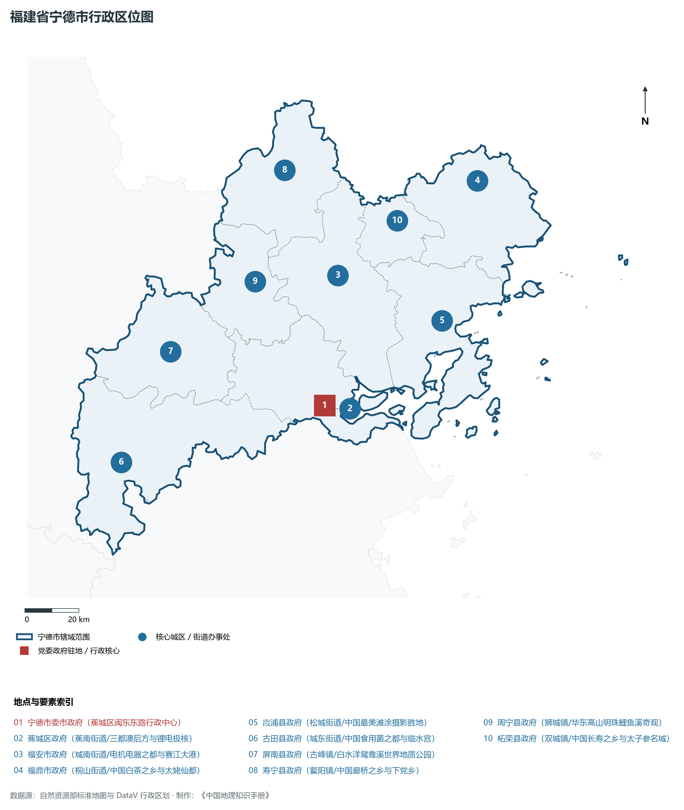
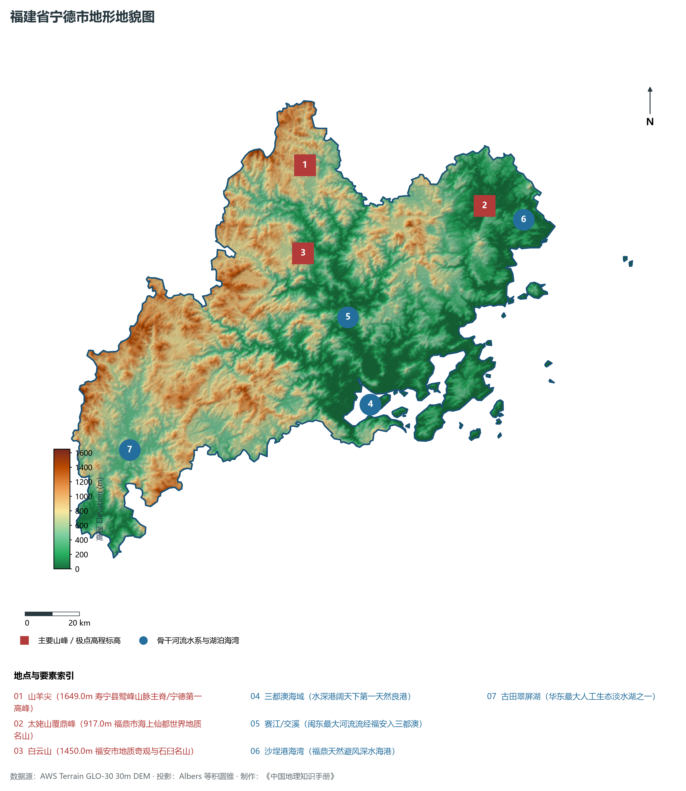
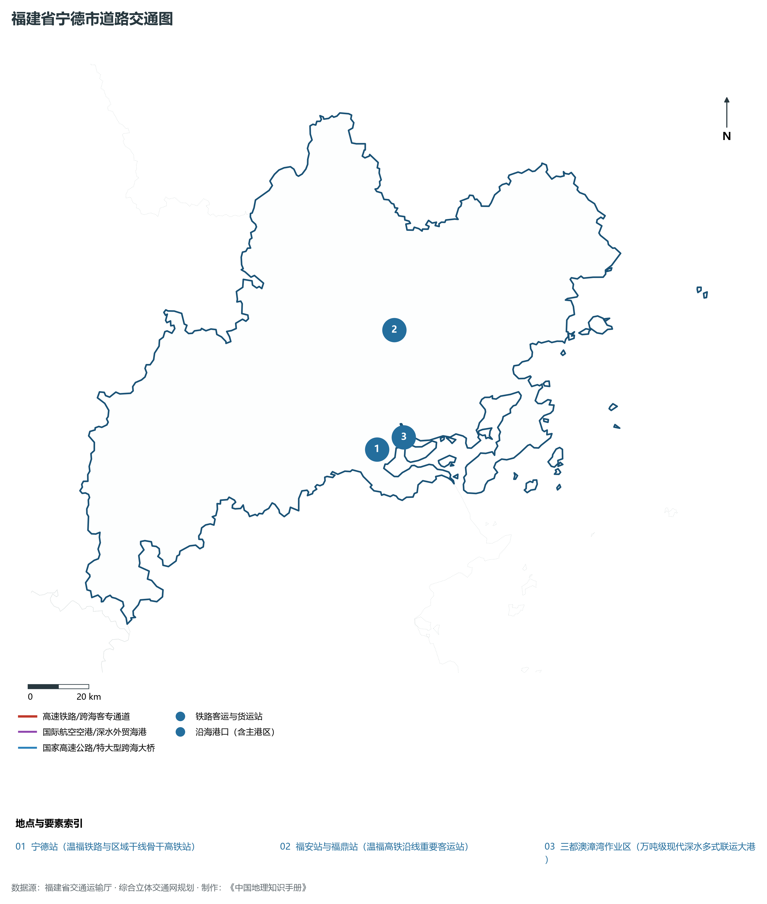
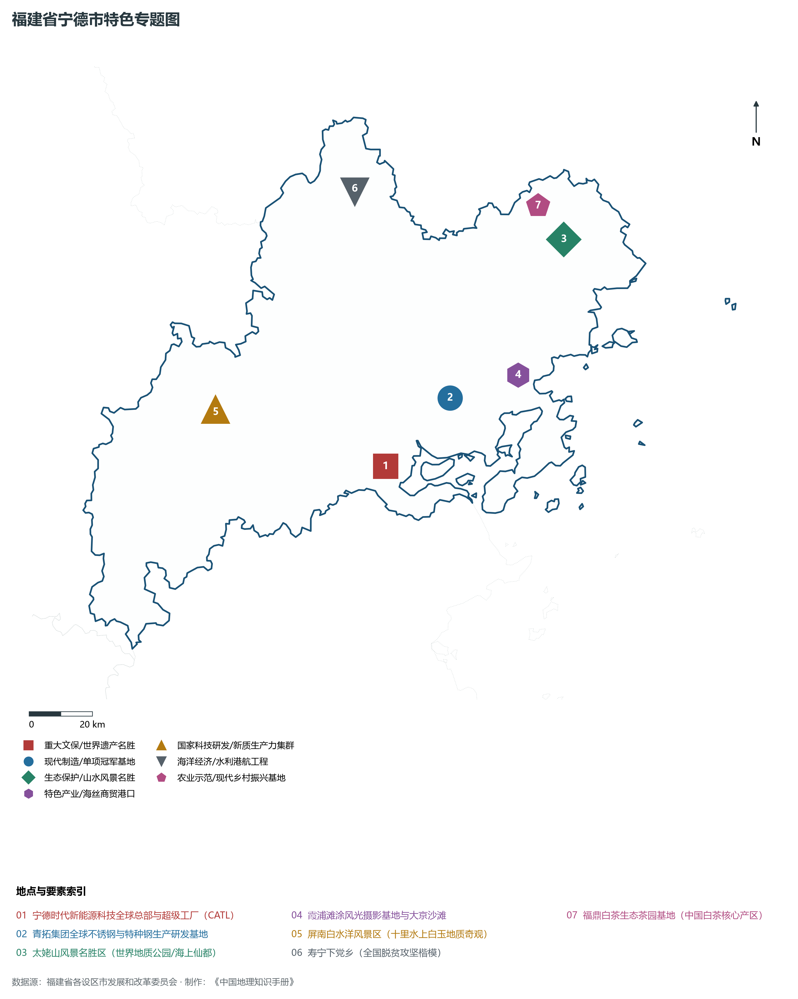
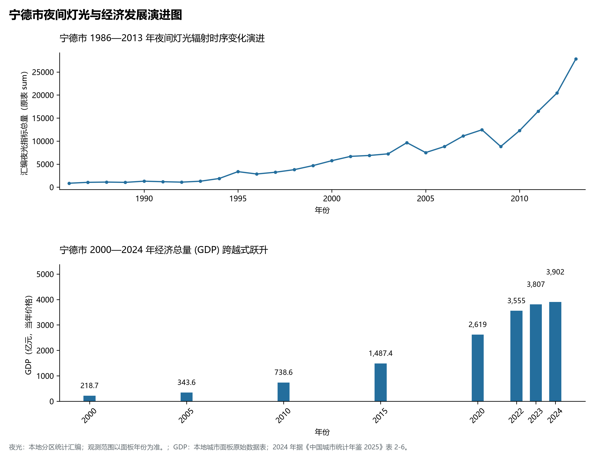

# 13.9 宁德市

宁德市，位于福建省关键战略版图，其城市综合定位与发展愿景概括为：**精准扶贫重要理念发祥地·全球锂电新能源之都·世界不锈钢巨头青拓基地·三都澳天下天然良港**。2024 年常住人口 **317 万人**，常住人口城镇化率 **65.08%**，地区生产总值 **3,902 亿元**（当年价格），人均地区生产总值 **123,403 元**，三次产业构成为 **10.66 : 52.32 : 37.02**。

---

## 一、自然地理底盘与山川水系机理

在气候水热配置方面，宁德市属于典型的海洋性亚热带季风气候区，温暖湿润、冬暖夏热、光热充沛、雨热同期。年平均气温在 16.5°C ～ 21.0°C 之间，无霜期达 260 ～ 330 d，年日照时数达 1750 ～ 2200 h。多年平均降水量达 1300 ～ 2200 mm，梅雨与台风雨是汛期降水主导形态，山溪性河流短小湍急，构筑起山洪防范、海堤御潮防台与水资源科学调配协同推进的防灾减灾大格局。

区域骨干控制性山峰与高程标高极点包括：

- **山羊尖 (1649.0m 寿宁县鹫峰山脉主脊/宁德第一高峰)**（空间坐标约东经 119.575°、北纬 27.465°，海拔标高约 1649.0 m）：构成区域地形骨架与水文生态屏障的关键控制极点，发挥区域小气候调节与动植物生境保护功能；
- **太姥山覆鼎峰 (917.0m 福鼎市海上仙都世界地质名山)**（空间坐标约东经 120.215°、北纬 27.245°，海拔标高约 917.0 m）：构成区域地形骨架与水文生态屏障的关键控制极点，发挥区域小气候调节与动植物生境保护功能；
- **白云山 (1450.0m 福安市地质奇观与石臼名山)**（空间坐标约东经 119.520°、北纬 27.180°，海拔标高约 1450.0 m）：构成区域地形骨架与水文生态屏障的关键控制极点，发挥区域小气候调节与动植物生境保护功能；

水系水网与生态湿地廊道方面，宁德市江河湖海互通、水网纵横，构筑了独具特色的水文水资源循环体系：

- **三都澳海域 (水深港阔天下第一天然良港)**（水系坐标约东经 119.685°、北纬 26.655°）：发挥防洪排涝、农业灌溉、优质生活饮用水源涵养、航运通航与滨海湿地生态保护的核心功能；
- **赛江/交溪 (闽东最大河流流经福安入三都澳)**（水系坐标约东经 119.650°、北纬 26.950°）：发挥防洪排涝、农业灌溉、优质生活饮用水源涵养、航运通航与滨海湿地生态保护的核心功能；
- **沙埕港海湾 (福鼎天然避风深水海港)**（水系坐标约东经 120.350°、北纬 27.180°）：发挥防洪排涝、农业灌溉、优质生活饮用水源涵养、航运通航与滨海湿地生态保护的核心功能；
- **古田翠屏湖 (华东最大人工生态淡水湖之一)**（水系坐标约东经 118.780°、北纬 26.620°）：发挥防洪排涝、农业灌溉、优质生活饮用水源涵养、航运通航与滨海湿地生态保护的核心功能；

---

## 二、行政区划沿革与城镇空间体系

宁德市建置沿革源远流长，文脉绵延数千年，自古即为海上丝绸之路通商贸易、中原先民南迁定居、手工业技艺繁盛或海防军事防御的核心重镇。新中国成立特别是改革开放以来，伴随撤地设市、行政区划调整、中心城区组团式跨越与现代都市区一体化推进，构建了市辖区与经济强县（市）协同并进、极核辐射强劲、港产城深度融合的现代城镇空间体系：

- **宁德市委市政府 (蕉城区闽东东路行政中心)**（驻地坐标：119.525°E, 26.665°N）：区域公共治理中心、高品质公共服务供给极核与新型城镇化战略支点；
- **蕉城区政府 (蕉南街道/三都澳后方与锂电极核)**（驻地坐标：119.520°E, 26.655°N）：区域公共治理中心、高品质公共服务供给极核与新型城镇化战略支点；
- **福安市政府 (城南街道/电机电器之都与赛江大港)**（驻地坐标：119.645°E, 27.085°N）：区域公共治理中心、高品质公共服务供给极核与新型城镇化战略支点；
- **福鼎市政府 (桐山街道/中国白茶之乡与太姥仙都)**（驻地坐标：120.215°E, 27.325°N）：区域公共治理中心、高品质公共服务供给极核与新型城镇化战略支点；
- **霞浦县政府 (松城街道/中国最美滩涂摄影胜地)**（驻地坐标：120.005°E, 26.885°N）：区域公共治理中心、高品质公共服务供给极核与新型城镇化战略支点；
- **古田县政府 (城东街道/中国食用菌之都与临水宫)**（驻地坐标：118.745°E, 26.575°N）：区域公共治理中心、高品质公共服务供给极核与新型城镇化战略支点；
- **屏南县政府 (古峰镇/白水洋鸳鸯溪世界地质公园)**（驻地坐标：118.985°E, 26.915°N）：区域公共治理中心、高品质公共服务供给极核与新型城镇化战略支点；
- **寿宁县政府 (鳌阳镇/中国廊桥之乡与下党乡)**（驻地坐标：119.505°E, 27.455°N）：区域公共治理中心、高品质公共服务供给极核与新型城镇化战略支点；
- **周宁县政府 (狮城镇/华东高山明珠鲤鱼溪奇观)**（驻地坐标：119.335°E, 27.105°N）：区域公共治理中心、高品质公共服务供给极核与新型城镇化战略支点；
- **柘荣县政府 (双城镇/中国长寿之乡与太子参名城)**（驻地坐标：119.895°E, 27.235°N）：区域公共治理中心、高品质公共服务供给极核与新型城镇化战略支点；

在国土空间总体规划指引下，宁德市坚决守牢耕地红线、永久基本农田、生态保护红线与城镇开发边界三条控制线，优化城市组团空间结构，推动产业与人口科学集聚，促进城乡基础设施互联互通与公共服务优质均衡共享，构筑宜居宜业宜游的现代生态海滨和美之城。

---

## 三、综合立体交通网络与海丝核心区互联互通

宁德市地处福建综合立体交通网与海峡两岸出海大通道关键枢纽，依托高速铁路客运大通道、骨干干线铁路、国家高速公路网、深水海港码头与现代民航航空港，构筑了通达全省、连接全国、辐射海峡、拥抱全球的立体交通大网络：

**核心综合交通客运与货运物流枢纽节点：**

- **宁德站 (温福铁路与区域干线骨干高铁站)**（位置坐标：119.565°E, 26.680°N）：旅客快捷换乘集散、大宗集装箱货物中转、多式联运枢纽与国际海丝贸易往来的战略性交通支撑；
- **福安站与福鼎站 (温福高铁沿线重要客运站)**（位置坐标：119.680°E, 27.020°N）：旅客快捷换乘集散、大宗集装箱货物中转、多式联运枢纽与国际海丝贸易往来的战略性交通支撑；
- **三都澳漳湾作业区 (万吨级现代深水多式联运大港)**（位置坐标：119.610°E, 26.710°N）：旅客快捷换乘集散、大宗集装箱货物中转、多式联运枢纽与国际海丝贸易往来的战略性交通支撑；

当前，宁德市持续加快交通基础设施数字化转型与绿色低碳升级，重点攻坚高等级跨海快速通道闭环、高等级深水航道常态化通航与枢纽集疏运体系优化，全面融入长三角与粤港澳大湾区高速通道网络，打造外畅内密、安全韧性、绿色智能的现代化综合立体交通强市。

---

## 四、现代产业体系与新质生产力布局

宁德市坚定不移走新型工业化发展之路，充分发挥民营经济发达、海丝商贸活跃、侨资侨智丰富与港口岸线优越的综合优势，深入践行“晋江经验”，聚力发展战略性新兴产业与新质生产力，加快构建具有国际竞争力的现代工业集群与高能级技术创新平台体系：

**标志性先进制造园区、特色产业小镇、龙头集群与重大产业地标：**

- **宁德时代新能源科技全球总部与超级工厂 (CATL)**（空间坐标：119.545°E, 26.685°N）：区域战略性新兴产业集聚与科技创新赋能的核心高地；
- **青拓集团全球不锈钢与特种钢生产研发基地**（空间坐标：119.780°E, 26.850°N）：区域战略性新兴产业集聚与科技创新赋能的核心高地；
- **太姥山风景名胜区 (世界地质公园/海上仙都)**（空间坐标：120.215°E, 27.245°N）：区域战略性新兴产业集聚与科技创新赋能的核心高地；
- **霞浦滩涂风光摄影基地与大京沙滩**（空间坐标：120.005°E, 26.885°N）：区域战略性新兴产业集聚与科技创新赋能的核心高地；
- **屏南白水洋风景区 (十里水上白玉地质奇观)**（空间坐标：119.035°E, 26.915°N）：区域战略性新兴产业集聚与科技创新赋能的核心高地；
- **寿宁下党乡 (全国脱贫攻坚楷模)**（空间坐标：119.575°E, 27.465°N）：区域战略性新兴产业集聚与科技创新赋能的核心高地；
- **福鼎白茶生态茶园基地 (中国白茶核心产区)**（空间坐标：120.150°E, 27.350°N）：区域战略性新兴产业集聚与科技创新赋能的核心高地；

通过全面实施产业链“链长制”与数字化赋能工程，宁德市大力梯度培育国家级制造业单项冠军企业、专精特新“小巨人”与具有行业主导力的全球领军型跨国企业，在锂电新能源、新材料、先进装备、电子信息、现代石化、现代轻工等关键赛道上抢占制高点，筑牢实体经济基本盘。

---

## 五、历史文化名胜、人文底蕴与全域文旅地理

宁德市江山胜迹璀璨，历史文脉连绵数千年，汇聚了世界文化遗产、国家 5A 级风景名胜区、国家级历史文化名城与国家重点文物保护单位，是海丝文化、闽南风华、客家祖地与红色精神交相辉映的文化沃土：

- **宁德时代新能源科技全球总部与超级工厂 (CATL)**：承载深厚人文积淀，彰显海纳百川、敢拼会赢、崇文重教与爱国爱乡的鲜明文化地标；
- **青拓集团全球不锈钢与特种钢生产研发基地**：承载深厚人文积淀，彰显海纳百川、敢拼会赢、崇文重教与爱国爱乡的鲜明文化地标；
- **太姥山风景名胜区 (世界地质公园/海上仙都)**：承载深厚人文积淀，彰显海纳百川、敢拼会赢、崇文重教与爱国爱乡的鲜明文化地标；
- **霞浦滩涂风光摄影基地与大京沙滩**：承载深厚人文积淀，彰显海纳百川、敢拼会赢、崇文重教与爱国爱乡的鲜明文化地标；
- **屏南白水洋风景区 (十里水上白玉地质奇观)**：承载深厚人文积淀，彰显海纳百川、敢拼会赢、崇文重教与爱国爱乡的鲜明文化地标；
- **寿宁下党乡 (全国脱贫攻坚楷模)**：承载深厚人文积淀，彰显海纳百川、敢拼会赢、崇文重教与爱国爱乡的鲜明文化地标；
- **福鼎白茶生态茶园基地 (中国白茶核心产区)**：承载深厚人文积淀，彰显海纳百川、敢拼会赢、崇文重教与爱国爱乡的鲜明文化地标；

围绕高品质全域旅游与文化强省战略，宁德市深入推动“以文塑旅、以旅彰文”，推进海丝国家文化公园与长三角、粤港澳大湾区客源地对接，深化山海生态文旅康养场景融合，打造享誉海内外的世界级文旅金名片。

---

## 六、夜间灯光辐射与跨世纪经济变化时序演进

本节夜光图的观测年份为 1986—2013 年，指标为行政区汇总值（原表 sum）。

| 年份 | 地区生产总值（亿元，当年价格） |
|:---|---:|
| 2000 年 | 218.7 |
| 2005 年 | 343.6 |
| 2010 年 | 738.6 |
| 2015 年 | 1,487.4 |
| 2020 年 | 2,619 |
| 2022 年 | 3,555 |
| 2023 年 | 3,807 |
| 2024 年 | 3,902 |

2024 年统计来源：《中国城市统计年鉴 2025》表 2-1、2-6、2-7（2024 年，全市）。其他年份 GDP 据本地城市面板“原始数据”表，单位为亿元、当年价格。
