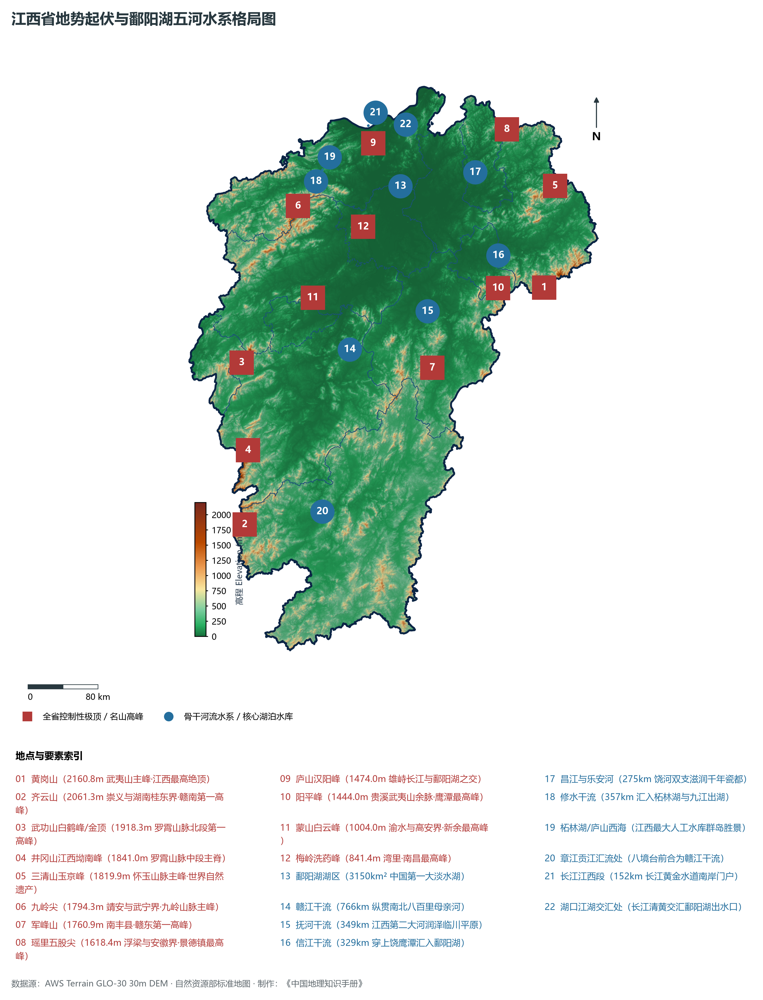
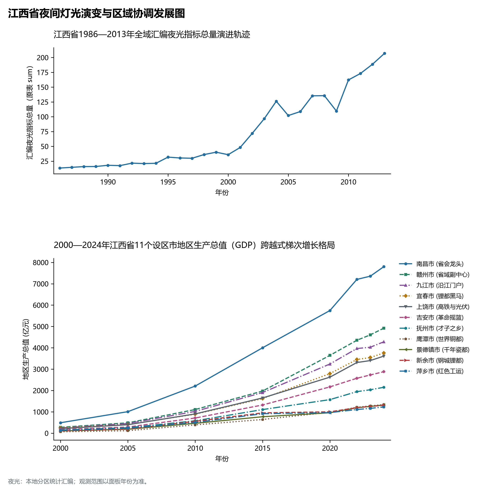
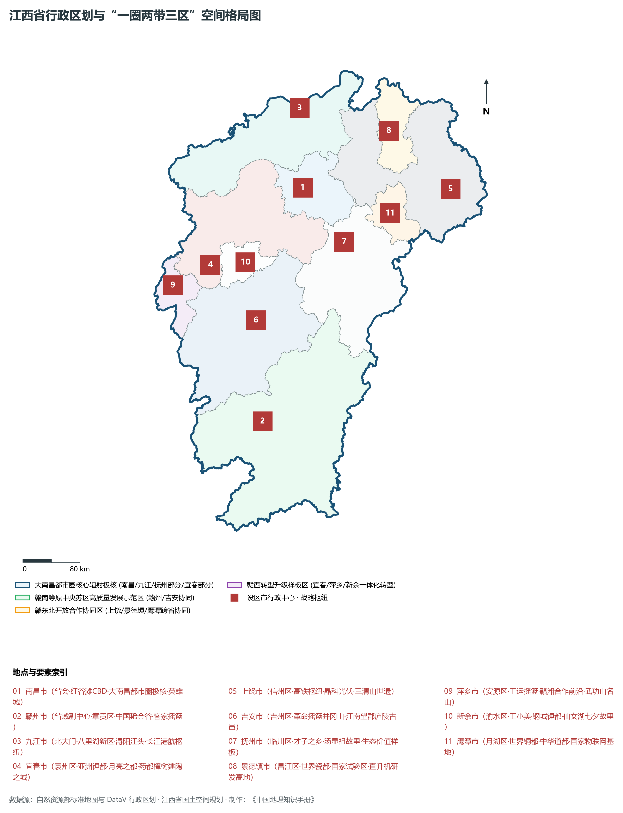
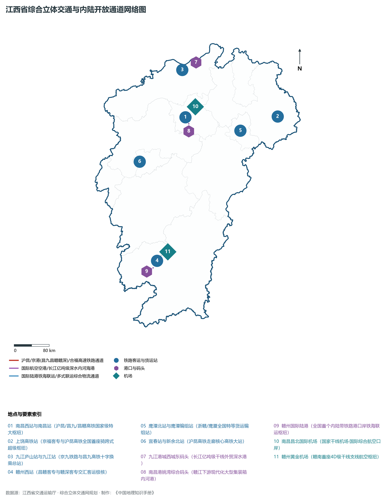
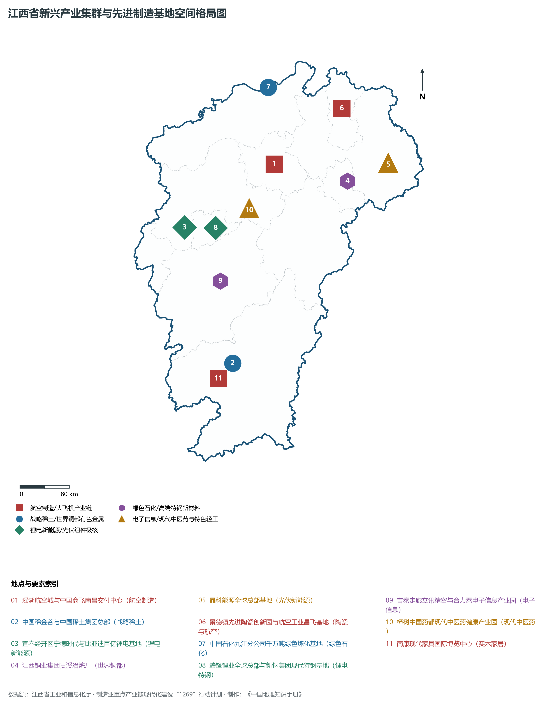

# 14.0 江西省地理统揽

江西省，简称“赣”，省会南昌市，地处中国东南部、长江中下游南岸，位于东经 113° 34' ～ 118° 28'、北纬 24° 29' ～ 30° 04' 之间。全省陆域总面积达 **16.69 × 10⁴ km²**，占全国国土总面积的 1.74%。江西东邻浙江、福建，南连广东，西靠湖南，北毗湖北、安徽而共接长江，自古享有“物华天宝，人杰地灵”、“襟三江而带五湖，控蛮荆而引瓯越”之盛誉。全省森林覆盖率达 **63.1%**，长年稳居全国第二位，是中国首批生态文明先行示范区、国家生态文明试验区。境内坐拥中国第一大淡水湖——**鄱阳湖**，全省水系如叶脉般汇注于湖、北入长江，形成了完整封闭而又生机盎然的向心盆地水文生态系统。

全省地貌宏观上呈现极为典型的**“三面环山、一湖汇流、众水归江”**的巨型向心盆地格局。东面怀玉山脉与武夷山脉巍峨耸立，南面九连山与大庾岭（南岭）苍茫横亘，西面罗霄山脉与幕阜山拔地而起，北部开阔低平，由南向北向鄱阳湖倾斜。全省现辖 11 个设区市（南昌市、景德镇市、萍乡市、九江市、新余市、鹰潭市、赣州市、吉安市、宜春市、抚州市、上饶市）。截至 2024 年末，全省常住人口达到 **4515.0 万人**，常住人口城镇化率达 **62.5%**。2024 年全省实现地区生产总值（GDP）突破 **3.42 万亿元**（达 34,200 亿元），人均 GDP 突破 **7.57 万元**。当前，江西正牢牢把握“作示范、勇争先”目标定位，深入推进“一圈两带三区”空间格局建设，奋力谱写中国式现代化的江西新篇章。

---

## 一、地质地貌演化与“三面环山、一盆向北”宏观向心底盘

江西省地处扬子地块与华夏地块的结合部位，大地构造演化历经晋宁期江绍断裂带碰撞拼合、加里东运动、印支造山运动与燕山期极其强烈的岩浆侵入活动。中生代以来，太平洋构造板块向欧亚板块俯冲挤压，全省形成了极为强烈的断块隆升与拉张断陷，塑造了三面高山合围、内部红层盆地错落、中北部鄱阳湖盆地下沉蓄水的经典地貌总纲：

全省地表高程极值跨度介于湖口长江交汇处沙滩的 **10.0 m** 至武夷山脉主峰黄岗山的 **2160.8 m** 之间：

- **全省乃至华东大陆自然最高峰**：位于上饶市铅山县与福建省武夷山市交界处的**黄岗山（海拔 2160.8 m）**，属于武夷山脉主脊绝顶，雄踞东南，傲视华东，也是江西信江水系与福建闽江水系的天然分水岭；
- **赣南罗霄与南岭交汇第一高峰**：位于赣州市崇义县与湖南省桂东县交界处的**齐云山（海拔 2061.3 m）**，峰峦叠嶂，为赣南第一高峰；
- **罗霄山脉北段最高峰**：位于萍乡市芦溪县与吉安市安福县交界处的**武功山白鹤峰/金顶（海拔 1918.3 m）**，以绵延数十万亩的高山草甸名扬中外；
- **罗霄山脉中段主脊**：吉安市井冈山境内的**江西坳南峰（海拔 1841.0 m）**与百元人民币背景图案雄峰**五指峰（1586.0 m）**；
- **怀玉山脉主峰**：上饶市玉山县与德兴市交界处的**三清山玉京峰（海拔 1819.9 m）**，世界自然遗产，西太平洋边缘最奇特的花岗岩峰林；
- **九岭山脉主峰**：宜春市靖安县与九江市武宁县交界处的**九岭尖（海拔 1794.3 m）**；
- **赣东群山之冠**：抚州市南丰县境内的**军峰山（海拔 1760.9 m）**；
- **江汉江右世界名山**：九江市境内的**庐山汉阳峰（海拔 1474.0 m）**，雄峙长江南岸与鄱阳湖之滨；
- **全省最低点**：九江市湖口县鄱阳湖入长江交汇处水际与湿地沙滩，海拔标高约为 **10.0 m**。

江西省宏观地貌由外向内呈现规律性的向心阶梯递降与四大地貌大区：

1. **边缘中低山脉生态屏障区**：幕阜山、九岭山、罗霄山横亘西境；大庾岭、九连山耸立南缘；武夷山、怀玉山屏障东界。千米以上群峰连绵成带，发育大片亚热带常绿阔叶原始森林，构筑起阻挡风沙、涵养水源的绿色天然屏障；
2. **中南部丘陵与断陷构造红层盆地区**：夹持在各大山脉之间，广泛发育白垩纪红色砂岩断陷盆地，如赣州盆地、吉泰盆地、抚临盆地等，丹霞地貌极具特色（世界自然遗产鹰潭龙虎山、弋阳龟峰），地势平缓、红壤肥沃，是全省粮食与经济作物主产区；
3. **中北部鄱阳湖冲积平原湿地区**：五河在下游泥沙沉积冲聚形成面积达 2.26 × 10⁴ km² 的鄱阳湖平原，沃野千里，河网密布，自古享有“江南粮仓”、“鱼米之乡”美誉；
4. **鄱阳湖开阔巨型淡水水体区**：丰水期水域面积可达 3000～ 4000 km² 以上，枯水期水落滩出形成巨大水陆湿地复合生态系统，是东亚—澳大利西亚候鸟迁徙线上最重要的越冬庇护所。

**江西省宏观向心盆地地势阶梯纵剖面示意表**

| 周缘崇山峻岭巨屏 | 山间断陷红层盆地 | 宽广江河冲积平原 | 中国最大淡水湖区 | 长江黄金水道门户 |
| --- | --- | --- | --- | --- |
| (黄岗山 2160.8m)；华东第一峰·武夷山；森林覆盖率63.1%全国前列 | (赣州/吉泰/红层)；龙虎山丹霞·世界遗产 | (南昌/抚临平原)；江南粮仓·鱼米之乡 | (鄱阳湖 3150km²)；候鸟天堂·水落滩出 | (湖口县水际 10m)；江湖两色·清浊分明 |

外缘山脉 (罗霄/武夷屏障) · → 山间丘陵 (红层断陷盆地) · → 冲积平原 (赣抚吉泰沃野) · → 湖盆汇聚 (鄱阳湖湿地水系) · → 长江门户 (湖口通江达海)；过渡关系：稀土王国·工矿沃土；一江两岸·航空都市；国际湿地·调蓄长江；万里长江·通达全球

---

## 二、中亚热带温暖湿润季风气候与“五河汇鄱湖”完整闭合水文体系

江西省全境属于典型的**中亚热带温和湿润季风气候区**，季风显著、四季分明、热量丰富、雨量充沛：

- **热量与光照充裕**：全省年平均气温在 **16.3°C ～ 19.5°C** 之间，自北向南递增。无霜期长达 240～ 300 d，年日照时数达 1600～ 2100 h，优越的水热同步条件极适宜水稻、油菜、柑橘及亚热带经济林木生长；
- **降水丰沛与时空分布**：全省多年平均降水量达 **1340～ 1940 mm**，雨水充沛，但时空分配不均。4—6 月为主汛期降水，降水量占全年的 40%～ 50%，山洪与平原内涝易发；7—9 月受西太平洋副热带高压控制，常出现伏旱高温，全省水利调蓄工程在水旱灾害防御中具有极端重要性。

江西全省水文系统堪称大自然的精妙杰作：全省 97.7% 的国土面积汇入赣江、抚河、信江、饶河、修水等“五大河流”，五河像五片叶脉，在鄱阳湖盆地交织汇流注入鄱阳湖，经湖口单一出口注入长江，多年平均水资源总量达 **1565 亿立方米**，年均入长江水量约 **1450 亿立方米**（占长江全流域年径流量的 15.5% 左右）：

1. **赣江（全省第一大河·母亲河）**：
   - 干流全长 **766 km**，流域面积达 **8.35 × 10⁴ km²**，占全省总面积的一半。上游章江与贡江在赣州八境台汇聚，北流经万安、泰和、吉安、峡江、樟树、丰城，穿过省会南昌主城区，在下游分流为四支注入鄱阳湖。万安水电站、峡江水利枢纽等大国重器调控全省安危；
2. **抚河（全省第二大河·润泽临川）**：
   - 干流全长 **349 km**，发源于武夷山脉西麓广昌县，北流经南丰、南城、抚州临川，注入鄱阳湖南部，冲积出丰饶的抚临平原，滋养了“才子之乡”千载文脉；
3. **信江（赣东黄金动脉）**：
   - 干流全长 **329 km**，发源于浙赣边界怀玉山，西流穿过上饶、弋阳、鹰潭、余江，在余干注入鄱阳湖，两岸丹霞竞秀、铜都辉映；
4. **饶河（景德镇瓷都生命之泉）**：
   - 全长 **275 km**，由昌江（西支）与乐安河（东支）在鄱阳县姚公渡汇合而成。昌江穿景德镇而过，是千年来高岭土与景德镇青花瓷外运通江达海的“瓷运水路”；
5. **修水（赣西北生态清流）**：
   - 干流全长 **357 km**，发源于幕阜山脉，穿修水、武宁，注入江西最大的人工深水湖泊——柘林水库（**庐山西海**），出库后经永修汇入鄱阳湖；
6. **鄱阳湖（中国最大淡水湖）**：
   - 丰水期浩瀚如海，枯水期水落滩出、一河如带，“高水是湖，低水是河”，蓄纳全省径流并吞吐长江洪水，具有不可替代的长江中下游水安全屏障功能。

---

## 三、行政区划、人口与“一圈两带三区”空间协同战略

江西省现辖 11 个设区市，下辖 27 个市辖区、12 个县级市、61 个县，共 100 个县级行政区。截至 2024 年末，全省常住人口达到 4515.0 万人，人口密度达 271人/km²。

立足资源禀赋与区域差异，江西省在国土空间总体规划中高标准构建**“一圈两带三区”**区域协调发展新格局：

1. **“一圈引领”：大南昌都市圈极核驱动**：
   - 以省会南昌为核心，包含九江市、抚州市临川区东乡区、宜春市部分县市（丰城、樟树、高安、靖安、奉新）及上饶市鄱阳、余干、万年等，构建强省会引领、跨江向湖、协同共进的现代化万亿级都市圈；
2. **“两带支撑”：赣江创新发展轴与沪昆现代产业带**：
   - **赣江创新发展轴**：依托赣江水系与昌九客专、昌赣客专，串联南昌、九江、吉安、赣州，打造纵贯南北的科技创新走廊与先进制造业高质量发展主轴；
   - **沪昆现代产业带**：依托沪昆高铁与沪昆高速横向干线，串联上饶、鹰潭、抚州、南昌、新余、宜春、萍乡，打通对接长三角与长株潭城市群的现代产业大动脉；
3. **“三区协同”：三大区域特色功能板块协调共进**：
   - **赣南等原中央苏区高质量发展示范区**：以赣州、吉安为主阵地，打造对接粤港澳大湾区桥头堡、全国革命老区高质量发展样板与世界稀土产业高地；
   - **赣东北开放合作协同区**：以上饶、景德镇、鹰潭为支点，深度融入长三角一体化发展与海峡西岸经济区，建设国家陶瓷文化创新试验区与铜基新材料基地；
   - **赣西转型升级样板区**：以宜春、萍乡、新余为核心，深化湘赣边区域合作，打造全国老工业基地转型、产业绿色低碳转型与“亚洲锂都”新能源高地。

---

## 四、综合立体交通大网络与内陆开放通道枢纽

江西坚持把交通基础设施建设放在优先战略位置，大力实施综合立体交通网规划，昔日“吴头楚尾”已全面跃升为内联外通、通江达海的全国交通新枢纽：

1. **“大字型”高铁超级枢纽网**：
   - 京港高铁（昌九客专、昌赣客专、赣深客专）贯通全省南北，沪昆高铁横贯全省东西，合福高铁、九景衢铁路、昌景黄高铁、向莆铁路交织成网，全面实现“设区市市市通时速350公里高铁”；
   - **上饶高铁站**：京福高铁与沪昆高铁交汇处，建成全国首座“十字骑跨式”高铁站；南昌西站、九江庐山站、赣州西站成为全国性综合客运极核；
2. **长江黄金水道与内河航运网络**：
   - 九江港独揽江西长江 152 公里黄金岸线，迈入亿吨级外贸大港行列；赣江、信江三级航道实现全线常态化通航，千吨级货轮直通长江出海；
3. **“一干九支”现代民航空港网络**：
   - 南昌昌北国际机场跨入千万人次枢纽机场行列；赣州黄金机场、井冈山机场、宜春明月山机场、上饶三清山机场、景德镇罗家机场、九江庐山机场等支线机场构筑起覆盖全省的空中走廊；
4. **内陆开放战略国际陆港口岸**：
   - 赣州国际陆港成为全国首个内陆带铁路港口岸，中欧班列常态化开行，南昌铁海联运班列直达沿海各大海港，实现“出海口搬到家门口”。

---

## 五、现代化产业体系与“1269”行动计划新质生产力布局

江西深入实施工业强省战略，全面实施制造业重点产业链现代化建设“1269”行动计划，加速从传统农业大省向新兴工业强省跨越：

1. **国家大飞机制造与航空工业基地**：
   - 南昌瑶湖航空城集聚中国商飞南昌交付中心与洪都航空，C919大型客机后机身与垂尾在赣制造，L15高级教练机翱翔蓝天；景德镇直升机研发制造实力全国领先；
2. **世界级稀土与有色金属新材料基地**：
   - **中国稀土集团总部**落户赣州，赣州“中国稀金谷”构建从稀土开采、分离到永磁材料、稀土功能材料的全产业链；
   - 鹰潭被誉为**“世界铜都”**，江西铜业集团（世界500强）贵溪冶炼厂为全球单体规模最大铜冶炼基地；
3. **“亚洲锂都”与千亿级光伏新能源集群**：
   - 宜春依托丰富含锂瓷石矿资源，吸引宁德时代、比亚迪、国轩高科等巨头扎堆布局，构建动力电池全产业链；新余赣锋锂业稳居全球锂化合物龙头；
   - 上饶晶科能源光伏组件出货量长年稳居全球第一，带动赣东北形成千亿级光伏产业集群；
4. **国家陶瓷文化传承创新与先进陶瓷**：
   - 景德镇拥有千百年官窑文脉，国家陶瓷文化传承创新试验区深入推进，电子陶瓷、航天陶瓷等先进陶瓷异军突起；
5. **电子信息、现代石化与特色医药**：
   - 吉泰走廊汇聚立讯精密、合力泰等千亿电子产业链；九江石化千万吨绿色炼化基地展现石化智造新标杆；樟树中国药都传承“药不到樟树不齐，药不过樟树不灵”的中医药精髓。

---

## 六、夜间灯光遥感时序与跨越式区域协调演变

本节夜光图的观测年份为 1986—2013 年，指标为行政区汇总值（原表 sum）。

- **2010—2024年（“苏区振兴”与全域联动，大南昌都市圈与赣南副中心双核并进）**：

赣鄱大地，气象万千；红色摇篮，绿色崛起！四千五百万江西儿女在绿水青山间拼搏奋进，正以昂扬姿态在新时代新征程上书写气壮山河的绚丽华章！
