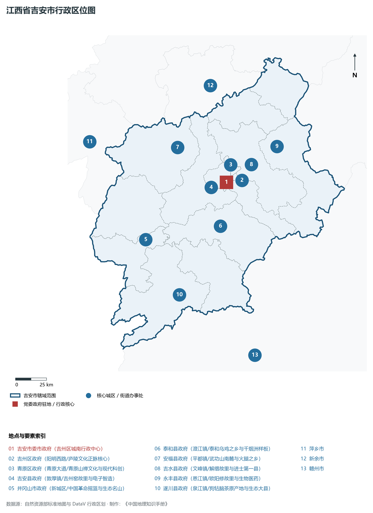
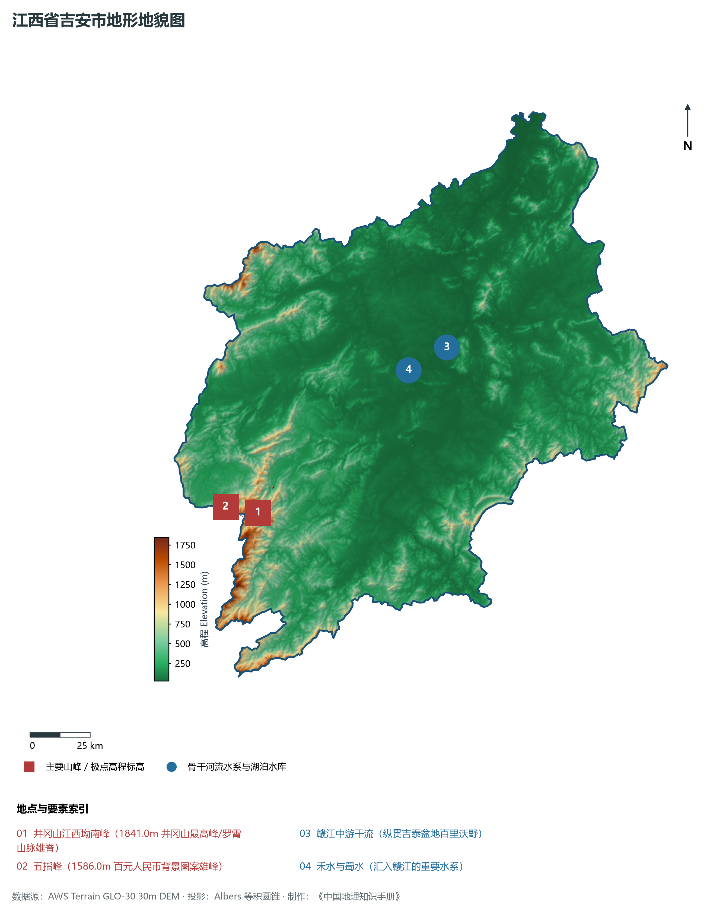
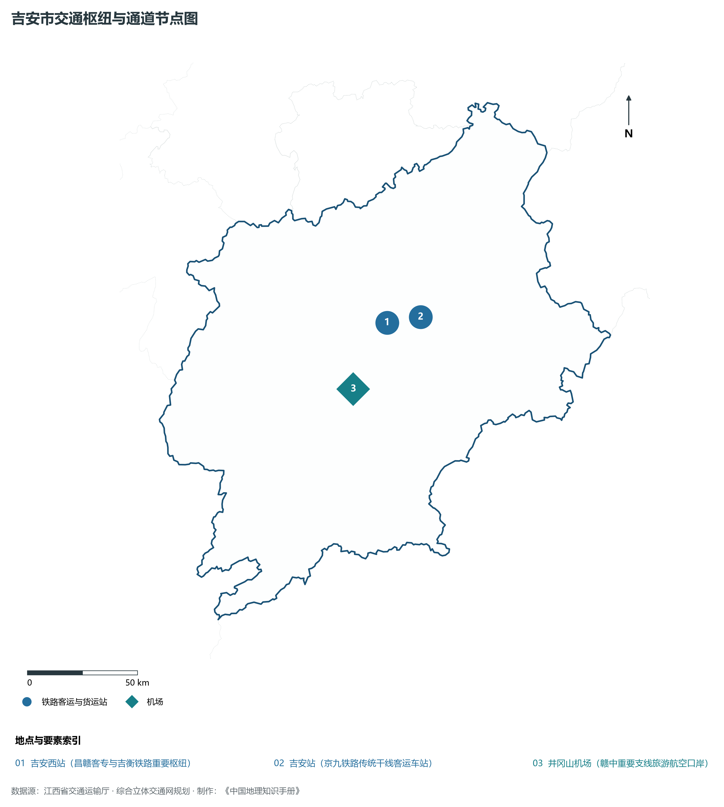
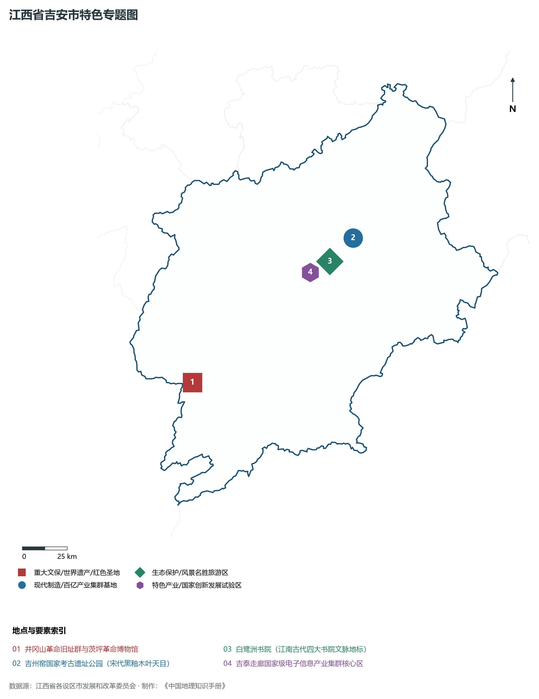
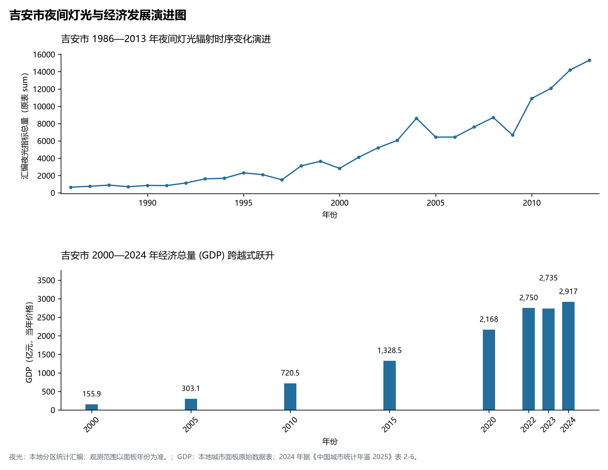

# 14.8 吉安市

吉安市，位于江西省关键战略版图，其城市综合定位与发展愿景概括为：**中国革命摇篮井冈山·江南望郡庐陵古邑·吉泰走廊电子信息走廊·生态人文绿色高地**。2024 年常住人口 **435 万人**，常住人口城镇化率 **55.76%**，地区生产总值 **2,917 亿元**（当年价格），人均地区生产总值 **66,781 元**，三次产业构成为 **9.34 : 42.15 : 48.51**。

---

## 一、自然地理底盘与山川水系机理

在气候水热配置方面，吉安市全境位于典型的中亚热带温暖湿润季风气候区，温暖湿润、四季分明、热量充沛、雨热同期。年平均气温在 16.5°C ～ 19.8°C 之间，极端最低气温通常高于 -5°C，无霜期长达 255 ～ 300 d，年日照时数达 1650 ～ 2150 h。优越的光温条件使得作物生长期极长，农田水稻多为双季稻制。多年平均降水量达 1450 ～ 1950 mm，降水年内分配呈现明显的“前雨后旱”双峰或单峰汛期特征：4—6 月受极锋停滞与西南暖湿气流抬升影响，暴雨过程频密，山溪性河流短促湍急，水流峰高量大，防汛抗洪与山洪地质灾害防御任务繁重；7—9 月副热带高压控制常伴有伏秋连旱，大中型水库蓄水保供、灌区调蓄与跨流域生态补水工程在水资源优化配置中发挥着决定性支撑作用。

区域骨干控制性山峰与高程标高极点包括：

- **井冈山江西坳南峰 (1841.0m 井冈山最高峰/罗霄山脉雄脊)**（空间坐标约东经 114.165°、北纬 26.575°，海拔标高约 1841.0 m）：构成区域地形骨架与水文生态安全屏障的关键控制极点，在区域气候水热调节、地表水径流汇集拦截与珍稀野生动植物生境保护中具有不可替代的生态基石功能；
- **五指峰 (1586.0m 百元人民币背景图案雄峰)**（空间坐标约东经 114.140°、北纬 26.540°，海拔标高约 1586.0 m）：构成区域地形骨架与水文生态安全屏障的关键控制极点，在区域气候水热调节、地表水径流汇集拦截与珍稀野生动植物生境保护中具有不可替代的生态基石功能；

水系水网与生态湿地廊道方面，吉安市江河纵横、湖库密布、水网互通，全境水文系统深度融入鄱阳湖流域与长江中下游水网：

- **赣江中游干流 (纵贯吉泰盆地百里沃野)**（水系坐标约东经 115.020°、北纬 27.120°）：发挥流域防洪减灾、排涝调峰、农业自流灌溉、工业及城乡优质生活饮用水源保障、内河集装箱水运物流与水生生物资源保护的核心功能；
- **禾水与蜀水 (汇入赣江的重要水系)**（水系坐标约东经 114.850°、北纬 27.050°）：发挥流域防洪减灾、排涝调峰、农业自流灌溉、工业及城乡优质生活饮用水源保障、内河集装箱水运物流与水生生物资源保护的核心功能；

---

## 二、行政区划沿革与城镇空间体系

吉安市建置沿革源远流长，文脉绵延数千年，自古即为物产丰饶、兵家必争、商贾辐辏或红色革命圣火初燃之地。秦汉设县、隋唐置州、宋元设路、明清立府，千百年来留下了灿若星辰的历史地名与人文遗迹。新中国成立后特别是改革开放以来，伴随撤地设市、行政区划优化重组、城区跨江跨河组团拓展与以人为本的新型城镇化战略深入实施，形成了中心城区引领极核、县域板块协同支撑、重点特色小城镇星罗棋布、产城人景深度融合的现代多中心城镇空间网络体系：

- **吉安市委市政府 (吉州区城南行政中心)**（驻地坐标：114.985°E, 27.100°N）：区域公共治理行政中枢、现代生产生活综合服务集聚地与新型城镇化战略承载极核；
- **吉州区政府 (阳明西路/庐陵文化正脉核心)**（驻地坐标：114.980°E, 27.115°N）：区域公共治理行政中枢、现代生产生活综合服务集聚地与新型城镇化战略承载极核；
- **青原区政府 (青原大道/青原山禅文化与现代科创)**（驻地坐标：115.020°E, 27.105°N）：区域公共治理行政中枢、现代生产生活综合服务集聚地与新型城镇化战略承载极核；
- **吉安县政府 (敦厚镇/吉州窑故里与电子智造)**（驻地坐标：114.910°E, 27.040°N）：区域公共治理行政中枢、现代生产生活综合服务集聚地与新型城镇化战略承载极核；
- **井冈山市政府 (新城区/中国革命摇篮与生态名山)**（驻地坐标：114.285°E, 26.745°N）：区域公共治理行政中枢、现代生产生活综合服务集聚地与新型城镇化战略承载极核；
- **泰和县政府 (澄江镇/泰和乌鸡之乡与千烟洲样板)**（驻地坐标：114.900°E, 26.790°N）：区域公共治理行政中枢、现代生产生活综合服务集聚地与新型城镇化战略承载极核；
- **安福县政府 (平都镇/武功山南麓与火腿之乡)**（驻地坐标：114.615°E, 27.385°N）：区域公共治理行政中枢、现代生产生活综合服务集聚地与新型城镇化战略承载极核；
- **吉水县政府 (文峰镇/解缙故里与进士第一县)**（驻地坐标：115.135°E, 27.215°N）：区域公共治理行政中枢、现代生产生活综合服务集聚地与新型城镇化战略承载极核；
- **永丰县政府 (恩江镇/欧阳修故里与生物医药)**（驻地坐标：115.425°E, 27.320°N）：区域公共治理行政中枢、现代生产生活综合服务集聚地与新型城镇化战略承载极核；
- **遂川县政府 (泉江镇/狗牯脑茶原产地与生态大县)**（驻地坐标：114.515°E, 26.325°N）：区域公共治理行政中枢、现代生产生活综合服务集聚地与新型城镇化战略承载极核；

在面向2035年的国土空间总体规划指引下，吉安市统筹推进“三区三线”科学划定与刚性管控，坚决严守耕地和永久基本农田保护红线、生态保护红线与城镇开发边界，统筹优化农业空间、生态空间与城镇空间布局，推动高能级产业园区集聚集约转型，持续缩小城乡基本公共服务与基础设施差距，打造彰显江南水乡特色、富含文化底蕴、宜居宜业宜游的现代和美之城。

---

## 三、综合立体交通网络与内陆开放通道

吉安市地处中部崛起与内陆开放型经济试验区前沿，全面融入国家综合立体交通网与长江经济带高质量发展大局。依托设计时速 350 公里高速铁路客运大动脉、国家干线货运铁路、纵横交错的国家高速公路网、现代化民用航空港与千吨级内河高等级航道，构筑起外畅内通、陆空联运、通江达海的综合立体交通大网络：

**核心综合交通客运与货运物流枢纽节点：**

- **吉安西站 (昌赣客专与吉衡铁路重要枢纽)**（位置坐标：114.920°E, 27.110°N）：客流高铁干线快速转换、大宗工业原料与集装箱货物铁水公多式联运、以及全面无缝对接长三角一体化与粤港澳大湾区现代物流体系的核心交通支点；
- **吉安站 (京九铁路传统干线客运车站)**（位置坐标：115.010°E, 27.125°N）：客流高铁干线快速转换、大宗工业原料与集装箱货物铁水公多式联运、以及全面无缝对接长三角一体化与粤港澳大湾区现代物流体系的核心交通支点；
- **井冈山机场 (赣中重要支线旅游航空口岸)**（位置坐标：114.735°E, 26.855°N）：客流高铁干线快速转换、大宗工业原料与集装箱货物铁水公多式联运、以及全面无缝对接长三角一体化与粤港澳大湾区现代物流体系的核心交通支点；

当前，吉安市持续加快交通基础设施数字化升级、智慧交通调度平台建设与绿色低碳改造，重点攻坚“铁公水空”多式联运无缝衔接与枢纽集疏运道路闭环，大力拓展中欧班列与铁海联运国际物流货运走廊，实现“出海口搬到企业厂门口”，全力打造安全便捷、内联外通、绿色智能的现代化交通强市。

---

## 四、现代产业体系与新质生产力布局

吉安市坚定不移实施“工业强市、产业兴市”核心战略，深入贯彻落实江西省制造业重点产业链现代化建设“1269”行动计划，大力推进传统优势产业高端化智改数转网联，聚力发展战略性新兴产业，前瞻布局前沿未来产业，加速构建体现自身特色与国际国内市场竞争力的现代产业体系：

**标志性先进制造园区、特色产业基地、创新平台与重大产业地标：**

- **井冈山革命旧址群与茨坪革命博物馆**（空间坐标：114.165°E, 26.575°N）：区域战略性新兴产业深度孵化集聚与新质生产力全面赋能的现代核心载体；
- **吉州窑国家考古遗址公园 (宋代黑釉木叶天目)**（空间坐标：115.145°E, 27.215°N）：区域战略性新兴产业深度孵化集聚与新质生产力全面赋能的现代核心载体；
- **白鹭洲书院 (江南古代四大书院文脉地标)**（空间坐标：115.000°E, 27.110°N）：区域战略性新兴产业深度孵化集聚与新质生产力全面赋能的现代核心载体；
- **吉泰走廊国家级电子信息产业集群核心区**（空间坐标：114.950°E, 27.060°N）：区域战略性新兴产业深度孵化集聚与新质生产力全面赋能的现代核心载体；

通过深入实施工业“链长制”与“链主”龙头企业领航工程，吉安市围绕产业链上下游部署创新链、资金链与人才链，梯次培育国家级高新技术企业、制造业单项冠军与专精特新“小巨人”企业集群，积极抢占新能源、新材料、先进装备制造、高端电子信息、绿色医药与绿色建材等行业制高点，全力夯实现代化经济强市的实体产业硬核底盘。

---

## 五、历史文化名胜、人文底蕴与全域文旅地理

吉安市文源深脉长、名胜甲于江南，融汇了红色革命文化精神洗礼、千年古色人文理学墨韵、秀美绿色山水自然生态与厚重金色工矿匠心，是世界级文旅遗产、国家 5A 级风景区、国家历史文化名城与全国重点文保单位高度富集的胜境：

- **井冈山革命旧址群与茨坪革命博物馆**：承载千百年深厚人文沉淀，生动彰显坚定执着的革命理想信念、崇文重教的古老书院文脉、独具特色的非物质文化遗产与天人合一的山水生态美学风范；
- **吉州窑国家考古遗址公园 (宋代黑釉木叶天目)**：承载千百年深厚人文沉淀，生动彰显坚定执着的革命理想信念、崇文重教的古老书院文脉、独具特色的非物质文化遗产与天人合一的山水生态美学风范；
- **白鹭洲书院 (江南古代四大书院文脉地标)**：承载千百年深厚人文沉淀，生动彰显坚定执着的革命理想信念、崇文重教的古老书院文脉、独具特色的非物质文化遗产与天人合一的山水生态美学风范；
- **吉泰走廊国家级电子信息产业集群核心区**：承载千百年深厚人文沉淀，生动彰显坚定执着的革命理想信念、崇文重教的古老书院文脉、独具特色的非物质文化遗产与天人合一的山水生态美学风范；

立足全域旅游与高品质康养度假新时代需求，吉安市坚持“以文塑旅、以旅彰文”，推进红色文化研学、古村落活化利用、高山草甸户外运动、温泉康养与乡村休闲农文旅深度融合，打造辐射全国、享誉海外的特色文旅超级品牌。

---

## 六、夜间灯光辐射与跨世纪经济变化时序演进

本节夜光图的观测年份为 1986—2013 年，指标为行政区汇总值（原表 sum）。

| 年份 | 地区生产总值（亿元，当年价格） |
|:---|---:|
| 2000 年 | 155.9 |
| 2005 年 | 303.1 |
| 2010 年 | 720.5 |
| 2015 年 | 1,328.5 |
| 2020 年 | 2,168 |
| 2022 年 | 2,750 |
| 2023 年 | 2,735 |
| 2024 年 | 2,917 |

2024 年统计来源：《中国城市统计年鉴 2025》表 2-1、2-6、2-7（2024 年，全市）。其他年份 GDP 据本地城市面板“原始数据”表，单位为亿元、当年价格。
