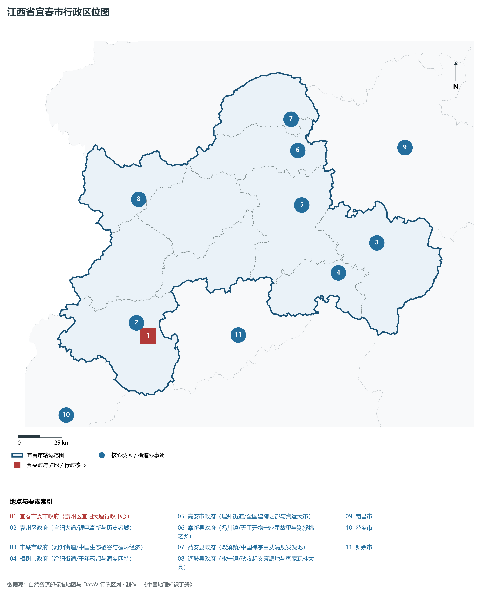
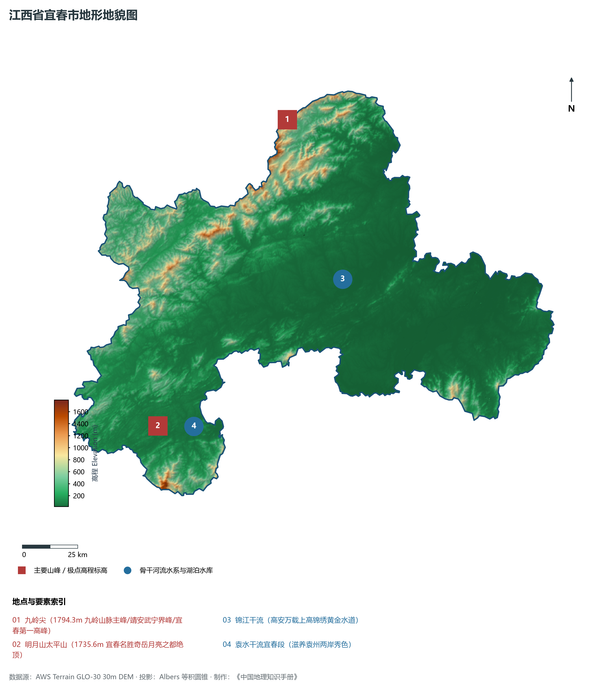
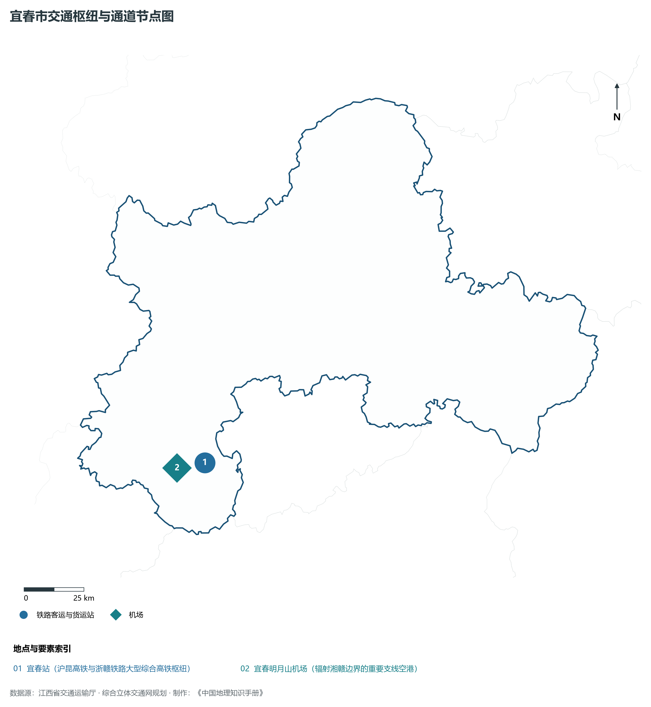
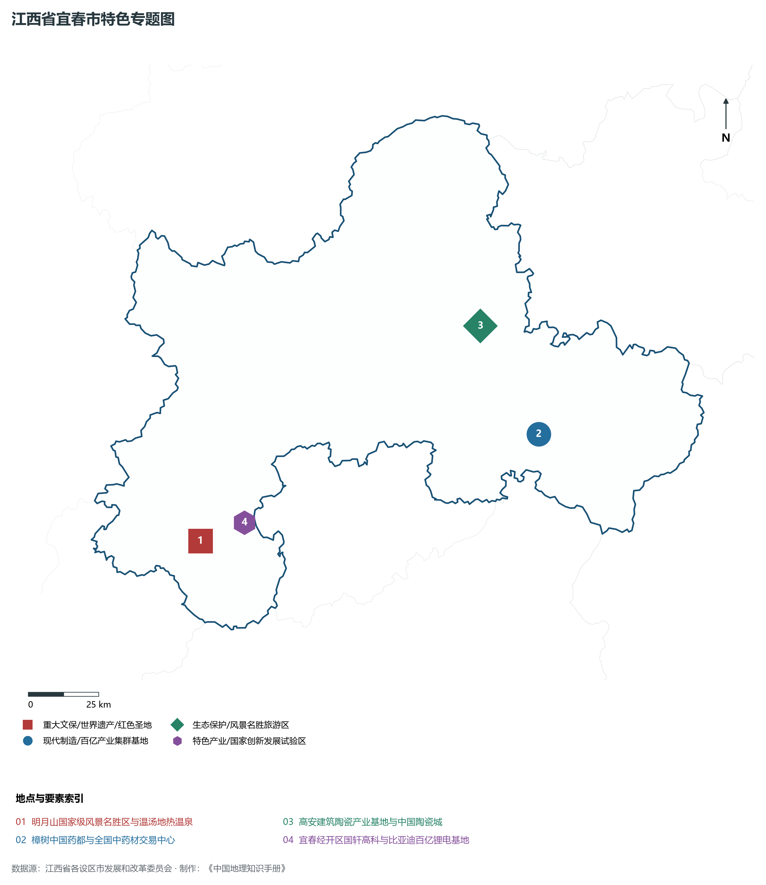
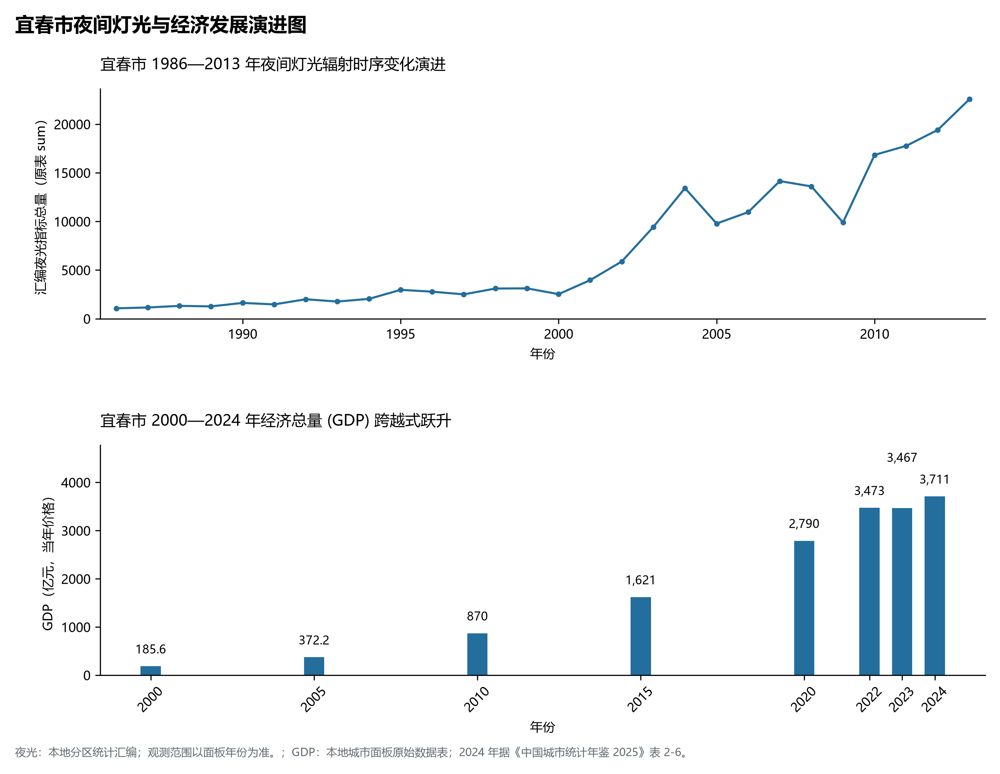

# 14.9 宜春市

宜春市，位于江西省关键战略版图，其城市综合定位与发展愿景概括为：**亚洲锂都·月亮之都与温汤富硒名泉·中国药都樟树·中国建筑陶瓷之都高安·禅宗圣地**。2024 年常住人口 **490 万人**，常住人口城镇化率 **59.85%**，地区生产总值 **3,711 亿元**（当年价格），人均地区生产总值 **75,404 元**，三次产业构成为 **10.2 : 39.44 : 50.36**。

---

## 一、自然地理底盘与山川水系机理

在气候水热配置方面，宜春市全境位于典型的中亚热带温暖湿润季风气候区，温暖湿润、四季分明、热量充沛、雨热同期。年平均气温在 16.5°C ～ 19.8°C 之间，极端最低气温通常高于 -5°C，无霜期长达 255 ～ 300 d，年日照时数达 1650 ～ 2150 h。优越的光温条件使得作物生长期极长，农田水稻多为双季稻制。多年平均降水量达 1450 ～ 1950 mm，降水年内分配呈现明显的“前雨后旱”双峰或单峰汛期特征：4—6 月受极锋停滞与西南暖湿气流抬升影响，暴雨过程频密，山溪性河流短促湍急，水流峰高量大，防汛抗洪与山洪地质灾害防御任务繁重；7—9 月副热带高压控制常伴有伏秋连旱，大中型水库蓄水保供、灌区调蓄与跨流域生态补水工程在水资源优化配置中发挥着决定性支撑作用。

区域骨干控制性山峰与高程标高极点包括：

- **九岭尖 (1794.3m 九岭山脉主峰/靖安武宁界峰/宜春第一高峰)**（空间坐标约东经 115.020°、北纬 29.010°，海拔标高约 1794.3 m）：构成区域地形骨架与水文生态安全屏障的关键控制极点，在区域气候水热调节、地表水径流汇集拦截与珍稀野生动植物生境保护中具有不可替代的生态基石功能；
- **明月山太平山 (1735.6m 宜春名胜奇岳月亮之都绝顶)**（空间坐标约东经 114.285°、北纬 27.835°，海拔标高约 1735.6 m）：构成区域地形骨架与水文生态安全屏障的关键控制极点，在区域气候水热调节、地表水径流汇集拦截与珍稀野生动植物生境保护中具有不可替代的生态基石功能；

水系水网与生态湿地廊道方面，宜春市江河纵横、湖库密布、水网互通，全境水文系统深度融入鄱阳湖流域与长江中下游水网：

- **锦江干流 (高安万载上高锦绣黄金水道)**（水系坐标约东经 115.200°、北纬 28.350°）：发挥流域防洪减灾、排涝调峰、农业自流灌溉、工业及城乡优质生活饮用水源保障、内河集装箱水运物流与水生生物资源保护的核心功能；
- **袁水干流宜春段 (滋养袁州两岸秀色)**（水系坐标约东经 114.450°、北纬 27.820°）：发挥流域防洪减灾、排涝调峰、农业自流灌溉、工业及城乡优质生活饮用水源保障、内河集装箱水运物流与水生生物资源保护的核心功能；

---

## 二、行政区划沿革与城镇空间体系

宜春市建置沿革源远流长，文脉绵延数千年，自古即为物产丰饶、兵家必争、商贾辐辏或红色革命圣火初燃之地。秦汉设县、隋唐置州、宋元设路、明清立府，千百年来留下了灿若星辰的历史地名与人文遗迹。新中国成立后特别是改革开放以来，伴随撤地设市、行政区划优化重组、城区跨江跨河组团拓展与以人为本的新型城镇化战略深入实施，形成了中心城区引领极核、县域板块协同支撑、重点特色小城镇星罗棋布、产城人景深度融合的现代多中心城镇空间网络体系：

- **宜春市委市政府 (袁州区宜阳大厦行政中心)**（驻地坐标：114.415°E, 27.845°N）：区域公共治理行政中枢、现代生产生活综合服务集聚地与新型城镇化战略承载极核；
- **袁州区政府 (宜阳大道/锂电高新与历史名城)**（驻地坐标：114.400°E, 27.830°N）：区域公共治理行政中枢、现代生产生活综合服务集聚地与新型城镇化战略承载极核；
- **丰城市政府 (河洲街道/中国生态硒谷与循环经济)**（驻地坐标：115.785°E, 28.195°N）：区域公共治理行政中枢、现代生产生活综合服务集聚地与新型城镇化战略承载极核；
- **樟树市政府 (淦阳街道/千年药都与酒乡四特)**（驻地坐标：115.545°E, 28.065°N）：区域公共治理行政中枢、现代生产生活综合服务集聚地与新型城镇化战略承载极核；
- **高安市政府 (瑞州街道/全国建陶之都与汽运大市)**（驻地坐标：115.375°E, 28.425°N）：区域公共治理行政中枢、现代生产生活综合服务集聚地与新型城镇化战略承载极核；
- **奉新县政府 (冯川镇/天工开物宋应星故里与猕猴桃之乡)**（驻地坐标：115.385°E, 28.700°N）：区域公共治理行政中枢、现代生产生活综合服务集聚地与新型城镇化战略承载极核；
- **靖安县政府 (双溪镇/中国禅宗百丈清规发源地)**（驻地坐标：115.365°E, 28.860°N）：区域公共治理行政中枢、现代生产生活综合服务集聚地与新型城镇化战略承载极核；
- **铜鼓县政府 (永宁镇/秋收起义策源地与客家森林大县)**（驻地坐标：114.435°E, 28.535°N）：区域公共治理行政中枢、现代生产生活综合服务集聚地与新型城镇化战略承载极核；

在面向2035年的国土空间总体规划指引下，宜春市统筹推进“三区三线”科学划定与刚性管控，坚决严守耕地和永久基本农田保护红线、生态保护红线与城镇开发边界，统筹优化农业空间、生态空间与城镇空间布局，推动高能级产业园区集聚集约转型，持续缩小城乡基本公共服务与基础设施差距，打造彰显江南水乡特色、富含文化底蕴、宜居宜业宜游的现代和美之城。

---

## 三、综合立体交通网络与内陆开放通道

宜春市地处中部崛起与内陆开放型经济试验区前沿，全面融入国家综合立体交通网与长江经济带高质量发展大局。依托设计时速 350 公里高速铁路客运大动脉、国家干线货运铁路、纵横交错的国家高速公路网、现代化民用航空港与千吨级内河高等级航道，构筑起外畅内通、陆空联运、通江达海的综合立体交通大网络：

**核心综合交通客运与货运物流枢纽节点：**

- **宜春站 (沪昆高铁与浙赣铁路大型综合高铁枢纽)**（位置坐标：114.430°E, 27.810°N）：客流高铁干线快速转换、大宗工业原料与集装箱货物铁水公多式联运、以及全面无缝对接长三角一体化与粤港澳大湾区现代物流体系的核心交通支点；
- **宜春明月山机场 (辐射湘赣边界的重要支线空港)**（位置坐标：114.310°E, 27.800°N）：客流高铁干线快速转换、大宗工业原料与集装箱货物铁水公多式联运、以及全面无缝对接长三角一体化与粤港澳大湾区现代物流体系的核心交通支点；

当前，宜春市持续加快交通基础设施数字化升级、智慧交通调度平台建设与绿色低碳改造，重点攻坚“铁公水空”多式联运无缝衔接与枢纽集疏运道路闭环，大力拓展中欧班列与铁海联运国际物流货运走廊，实现“出海口搬到企业厂门口”，全力打造安全便捷、内联外通、绿色智能的现代化交通强市。

---

## 四、现代产业体系与新质生产力布局

宜春市坚定不移实施“工业强市、产业兴市”核心战略，深入贯彻落实江西省制造业重点产业链现代化建设“1269”行动计划，大力推进传统优势产业高端化智改数转网联，聚力发展战略性新兴产业，前瞻布局前沿未来产业，加速构建体现自身特色与国际国内市场竞争力的现代产业体系：

**标志性先进制造园区、特色产业基地、创新平台与重大产业地标：**

- **明月山国家级风景名胜区与温汤地热温泉**（空间坐标：114.285°E, 27.835°N）：区域战略性新兴产业深度孵化集聚与新质生产力全面赋能的现代核心载体；
- **樟树中国药都与全国中药材交易中心**（空间坐标：115.545°E, 28.065°N）：区域战略性新兴产业深度孵化集聚与新质生产力全面赋能的现代核心载体；
- **高安建筑陶瓷产业基地与中国陶瓷城**（空间坐标：115.375°E, 28.425°N）：区域战略性新兴产业深度孵化集聚与新质生产力全面赋能的现代核心载体；
- **宜春经开区国轩高科与比亚迪百亿锂电基地**（空间坐标：114.450°E, 27.880°N）：区域战略性新兴产业深度孵化集聚与新质生产力全面赋能的现代核心载体；

通过深入实施工业“链长制”与“链主”龙头企业领航工程，宜春市围绕产业链上下游部署创新链、资金链与人才链，梯次培育国家级高新技术企业、制造业单项冠军与专精特新“小巨人”企业集群，积极抢占新能源、新材料、先进装备制造、高端电子信息、绿色医药与绿色建材等行业制高点，全力夯实现代化经济强市的实体产业硬核底盘。

---

## 五、历史文化名胜、人文底蕴与全域文旅地理

宜春市文源深脉长、名胜甲于江南，融汇了红色革命文化精神洗礼、千年古色人文理学墨韵、秀美绿色山水自然生态与厚重金色工矿匠心，是世界级文旅遗产、国家 5A 级风景区、国家历史文化名城与全国重点文保单位高度富集的胜境：

- **明月山国家级风景名胜区与温汤地热温泉**：承载千百年深厚人文沉淀，生动彰显坚定执着的革命理想信念、崇文重教的古老书院文脉、独具特色的非物质文化遗产与天人合一的山水生态美学风范；
- **樟树中国药都与全国中药材交易中心**：承载千百年深厚人文沉淀，生动彰显坚定执着的革命理想信念、崇文重教的古老书院文脉、独具特色的非物质文化遗产与天人合一的山水生态美学风范；
- **高安建筑陶瓷产业基地与中国陶瓷城**：承载千百年深厚人文沉淀，生动彰显坚定执着的革命理想信念、崇文重教的古老书院文脉、独具特色的非物质文化遗产与天人合一的山水生态美学风范；
- **宜春经开区国轩高科与比亚迪百亿锂电基地**：承载千百年深厚人文沉淀，生动彰显坚定执着的革命理想信念、崇文重教的古老书院文脉、独具特色的非物质文化遗产与天人合一的山水生态美学风范；

立足全域旅游与高品质康养度假新时代需求，宜春市坚持“以文塑旅、以旅彰文”，推进红色文化研学、古村落活化利用、高山草甸户外运动、温泉康养与乡村休闲农文旅深度融合，打造辐射全国、享誉海外的特色文旅超级品牌。

---

## 六、夜间灯光辐射与跨世纪经济变化时序演进

本节夜光图的观测年份为 1986—2013 年，指标为行政区汇总值（原表 sum）。

| 年份 | 地区生产总值（亿元，当年价格） |
|:---|---:|
| 2000 年 | 185.6 |
| 2005 年 | 372.2 |
| 2010 年 | 870 |
| 2015 年 | 1,621 |
| 2020 年 | 2,790 |
| 2022 年 | 3,473 |
| 2023 年 | 3,467 |
| 2024 年 | 3,711 |

2024 年统计来源：《中国城市统计年鉴 2025》表 2-1、2-6、2-7（2024 年，全市）。其他年份 GDP 据本地城市面板“原始数据”表，单位为亿元、当年价格。
