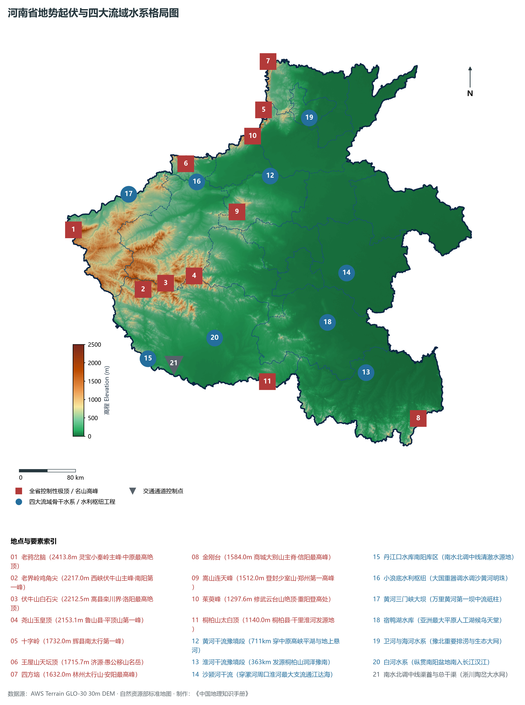
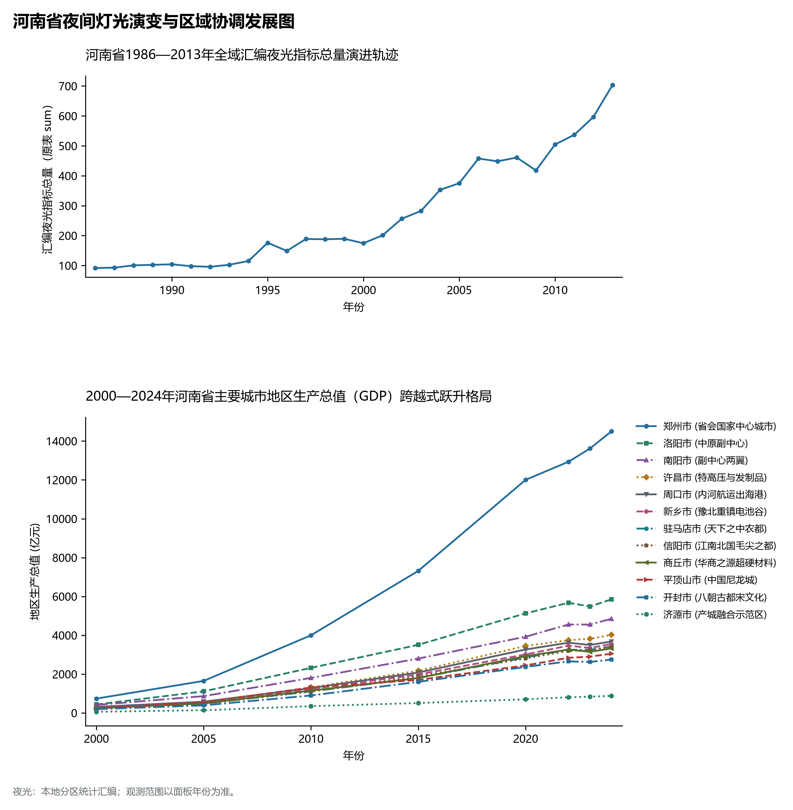
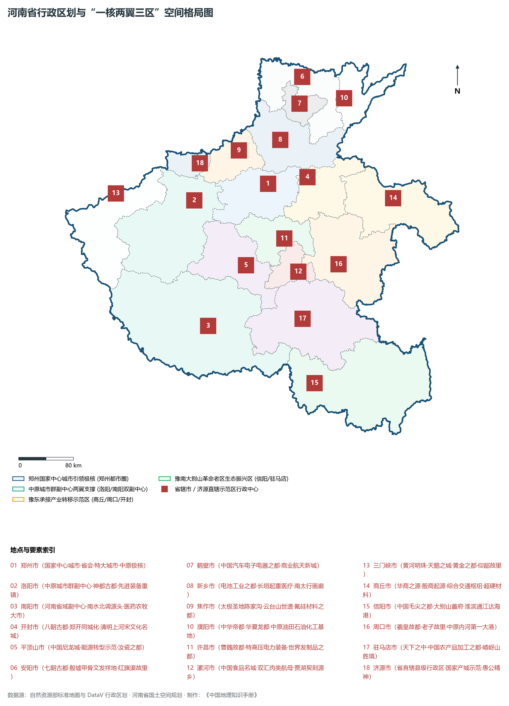
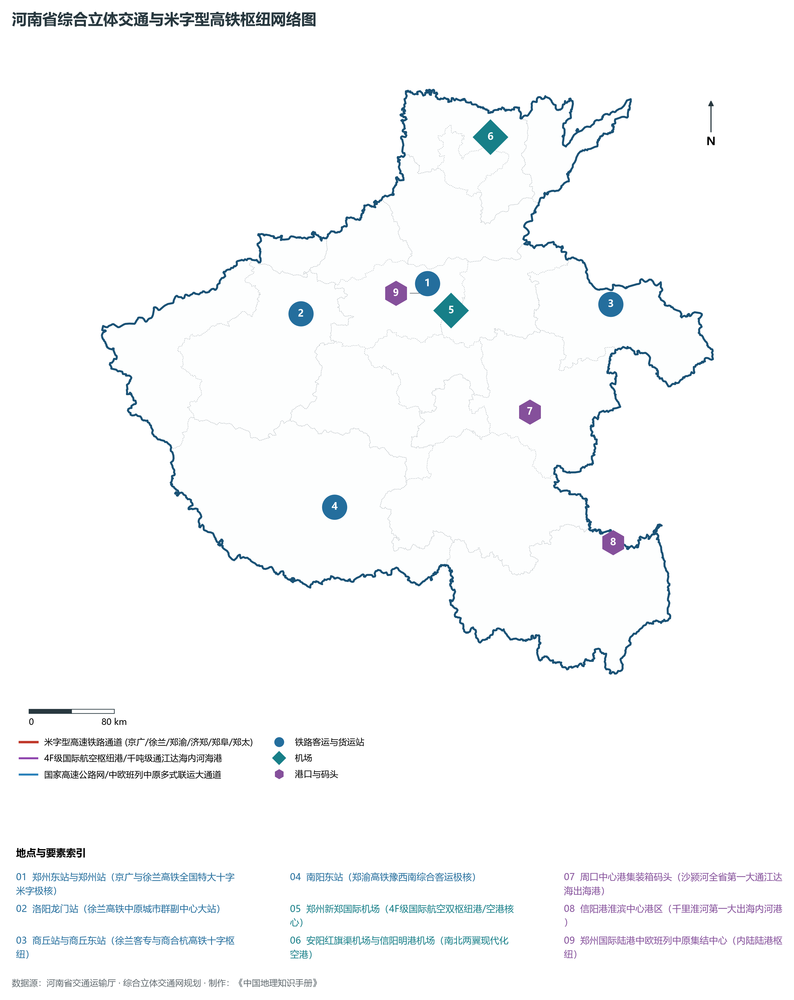
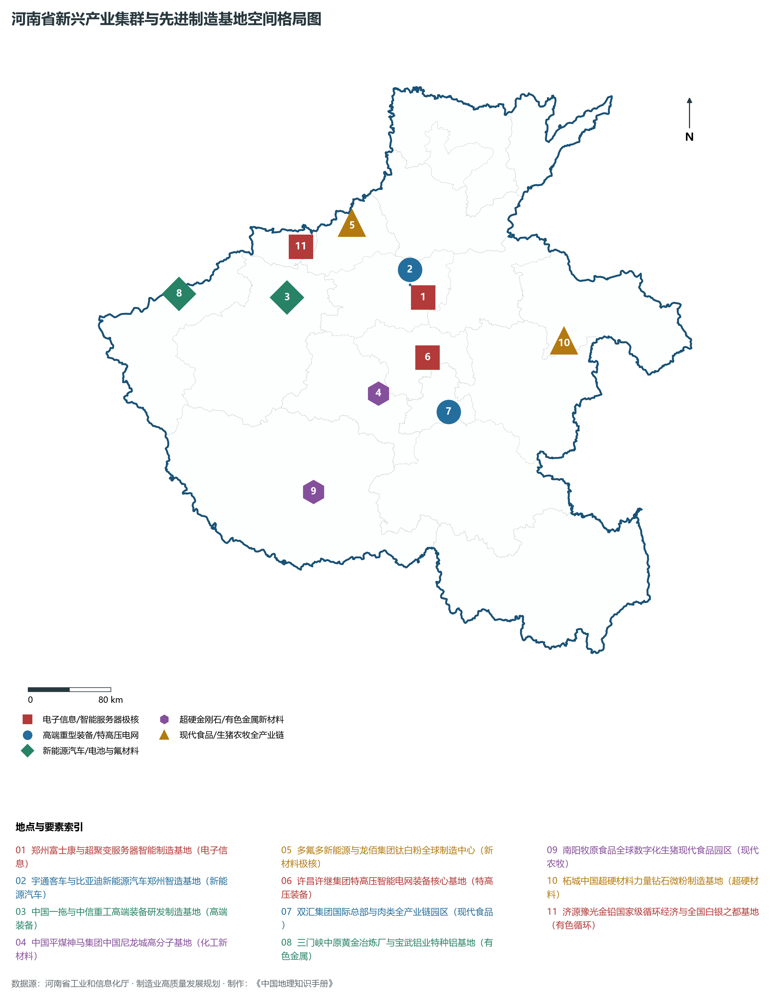

# 15.0 河南省地理统揽

河南省，简称“豫”，省会郑州市，地处中国中东部、黄河中下游转换带与华北大平原西南缘，位于东经 110° 21' ～ 116° 39'、北纬 31° 23' ～ 36° 22' 之间。全省陆域总面积达 **16.70 × 10⁴ km²**，占全国国土总面积的 1.74%。河南承东启西、连南贯北，北界河北、山西，西接陕西，南邻湖北，东连安徽、山东，自古为“天下之中”、“十省通衢”、“九州腹地、十省冲要”，是中华民族和华夏文明的重要发祥地。全省地跨**黄河、淮河、海河、长江**四大流域，素有“九州之中、十省通衢、中原粮仓、国人厨房”之美誉。

从宏观地势格局剖析，河南省地势呈现出鲜明壮阔的**“西高东低、三面环山、中东部平原广袤坦荡”**的大地构造地貌特征。北部太行山脉崔嵬耸立，西部伏牛山、熊耳山、崤山、小秦岭层峦叠嶂，南部桐柏山、大别山横亘逶迤，中东部则是广袤无垠的黄淮海冲积平原。全省现辖 17 个地级市（郑州、开封、洛阳、平顶山、安阳、鹤壁、新乡、焦作、濮阳、许昌、漯河、三门峡、南阳、商丘、信阳、周口、驻马店）及 1 个省直辖县级行政单位（济源市）。截至 2024 年末，全省常住人口达到 **9815.0 万人**，常住人口城镇化率达 **58.5%**。2024 年全省实现地区生产总值（GDP）突破 **6.15 万亿元**（达 61,500 亿元），稳居全国前列与中西部第一位。当前，河南正深入贯彻黄河流域生态保护和高质量发展重大国家战略，大力构建“一核两翼三区”协同发展格局，加快推进“7+28+N”产业链群建设，在新时代中部地区崛起中奋勇争先。

---

## 一、大地构造、地势起伏与“西高东低、三面环山”宏观地理底盘

河南省横跨中朝准地台与秦岭—大别造山带两大一级大地构造单元，以著名的三门峡—鲁山—确山—固始深大断裂带为重要构造分界。自太古宙、元古宙陆核形成，经历晋宁运动、加里东运动、华力西运动、印支运动与强烈的燕山期中生代陆内造山挤压，地壳深部岩浆频繁侵入，最终在新生代喜马拉雅运动中奠定了西侧断块剧烈隆升、东侧断陷沉降并被巨厚新生代第四纪松散泥沙沉积物覆盖的“半环状向心屏障与坦荡大平原”地貌框架：

全省地表高程极值跨度介于信阳固始县淮河出省境处沙滩的 **19.3 m** 至灵宝市境内小秦岭主峰老鸦岔脑的 **2413.8 m** 之间，相对落差高达 **2394.5 m**：

- **全省自然最高绝顶（中原第一峰）**：位于三门峡灵宝市境内的小秦岭主峰**老鸦岔脑（海拔 2413.8 m）**，苍茫崔嵬，绝壁千仞，属于秦岭东延余脉的断块天堑，蕴藏着富冠全国的黄金矿脉；
- **伏牛山脉最高主峰**：南阳市西峡县境内的**白石尖（海拔 2212.5 m）**与栾川西峡界岭**鸡角尖/老界岭（2217.0 m）**，作为中国南北地理核心分水岭的核心段落，横亘中央，锁钥南北；
- **伏牛山东段名胜绝顶**：平顶山鲁山县境内的**尧山玉皇顶（海拔 2153.1 m）**，峰林奇绝；
- **太行山脉豫境最高峰**：新乡市辉县市境内的**十字岭（海拔 1732.0 m）**与安阳林州五龙洞金灯寺峰，丹崖千仞，绝壁万丈；
- **王屋山脉主峰**：济源市境内的**天坛顶（海拔 1715.7 m）**，愚公移山神话传说之策源地；
- **中岳嵩山最高峰**：郑州登封市境内的**连天峰（海拔 1512.0 m）**与峻极峰（1491.7 m），五岳之中，世界地质公园；
- **大别山脉豫境最高峰**：信阳商城县境内的**金刚台（海拔 1584.0 m）**，大别山国家地质公园核心；
- **桐柏山脉主峰**：信阳平桥区与南阳桐柏县界岭**太白顶（海拔 1140.0 m）**，淮河千里干流之发源地；
- **全省地表最低极点**：信阳市固始县往东淮河干流出省边界沙滩湿地，海拔高程仅 **19.3 m**。

从空间地貌宏观分类来看，河南省可划分为五大地貌单元阶梯：

1. **豫西中高山与断块中山区**：由小秦岭、崤山、熊耳山、伏牛山组成，海拔多在 1000～ 2200 m，森林茂密，矿产丰富，是黄河与长江、淮河天然分水岭；
2. **豫北南太行峡谷中山区**：太行山拔地而起，断层崖壁极为发育，红岩嶂谷纵横，造就了林州大峡谷、云台山等典型嶂谷地貌；
3. **豫南桐柏—大别低中山丘陵区**：作为江淮分水岭，山势和缓，茶园竹海连绵；
4. **豫中豫西山前过渡过渡倾斜阶地岗丘带**：由嵩山、崤山东麓、伏牛山东麓向平原过渡，黄土台塬与侵蚀剥蚀低丘相间，农业生产基础雄厚；
5. **豫中东部黄淮冲积平原区**：占全省总面积的 55.7%，系黄河、淮河及其支流千百年来巨量泥沙泛滥堆积而成，土层深厚肥沃，为全国第一大粮食主产区。

**河南省地貌自西向东阶梯剖面格局纵览**

| 高大山体巍峨屏障 | 山前过渡丘陵台塬 | 华北大平原西南翼 | 淮河流域低平出境 |
| --- | --- | --- | --- |
| (老鸦岔脑 2413.8m)；中原第一峰·伏牛主脊；南北分水岭·金矿铝土 | (嵩山连天峰 1512m)；五代古都·中岳腹地；黄土堆积·工业集聚 | (郑汴许商广袤平原)；万里沃野·中国粮仓；地下粮仓·超亿人口 | (固始出境处 19.3m)；江淮交汇·千里淮河；湿地滩涂·生态绿肾 |

西缘山地 (小秦岭/伏牛山/太行) · → 山前丘陵台塬 (洛阳盆地/嵩山) · → 冲积黄淮平原 (开封/商丘/周口) · → 淮河下游湿地 (固始出境沙滩)

---

## 二、暖温带向亚热带过渡气候与四大流域水文网络

河南省地处**北亚热带向暖温带过渡区**，属于典型的大陆性季风半湿润气候：

- **热量与气温分布**：全省年平均气温在 **12.5°C ～ 16.2°C** 之间，自南向北递减。豫南大别山南麓信阳地区气温最高，具有明显的亚热带特征；豫北太行山区与豫西高山地区气温较低。全省年无霜期长达 200～ 240 d，年均日照时数达 1900～ 2300 h；
- **降水时空分配格局**：全省多年平均降水量在 **550～ 1250 mm** 之间。降水受伏牛山、桐柏山阻挡抬升影响，南部大别山及伏牛山东南麓信阳、南阳降水量可达 1000～ 1250 mm；而豫北安阳、濮阳降水在 550～ 650 mm 左右。降水年内高度集中在 6—8 月（占全年 60%～ 70%），极易发生旱涝急转。

全省水系脉络极为独特，分属于全国四大水系，总流域面积中**淮河流域占 51.7%、黄河流域占 21.6%、长江流域占 16.3%、海河流域占 10.4%**：

1. **黄河水系（奔腾出谷·悬河安澜）**：
   - 黄河干流在河南省境内流长达 **711 km**，自灵宝入省境，穿三门峡峡谷，经小浪底出太行余脉，流经洛阳、郑州、焦作、新乡、开封、濮阳。桃花峪以下进入下游，河槽高出两岸地面数米至十余米，形成著名的**“地上悬河”**。三门峡水利枢纽与小浪底水利枢纽作为调节黄河水沙的关键工程，保障了下游长治久安；
2. **淮河水系（大河之源·平原汇注）**：
   - 淮河正源发源于南阳市桐柏县桐柏山太白顶，河南境内干流长 **340 km**，淮河流域涵盖信阳、驻马店、漯河、周口、商丘、许昌、开封南部等地。主要支流有沙颍河（淮河第一大支流，由沙河与颍河在周口汇合）、洪汝河、涡河、沱河等，河网纵横交错，是豫东平原农业灌溉与生态命脉；
3. **长江水系（丹江水源·汉水明珠）**：
   - 主要分布于豫西南南阳盆地，属于长江第一大支流汉江水系。主要河流包括丹江、唐河、白河。丹江口水库是**南水北调中线工程**的核心水源地，渠首位于南阳淅川县陶岔，碧水北送，滋养京津冀豫千万人；
4. **海河水系（豫北卫漳·通达渤海）**：
   - 分布于豫北安阳、鹤壁、新乡、焦作、濮阳等地，主要支流有卫河、漳河，水系向东北流入河北、山东注入渤海。著名的**红旗渠**自漳河引水，横跨悬崖峭壁，创造了“人工天河”的人间奇迹。

---

## 三、行政区划、人口与“一核两翼三区”空间协同战略

河南省现辖 17 个地级市、1 个省直辖县级市，下设 54 个市辖区、21 个县级市、82 个县，共 157 个县级行政区。截至 2024 年末，全省常住人口达到 9815.0 万人，是全国户籍人口第一大省、常住人口第三大省，人口密度高达 588 人/km²。

立足资源禀赋与国家战略定位，河南省在国土空间总体规划中高位确立了**“一核两翼三区”**的区域协调发展战略总体布局：

1. **“一核引领”：郑州国家中心城市与郑州都市圈极核驱动**：
   - 深入推进郑开同城化，辐射带动许昌、新乡、焦作、漯河等周边城市，构建“一核集聚、多极联动”的高能级现代都市圈，打造黄河流域生态保护和高质量发展的核心引擎与具有全球影响力的现代国际物流枢纽；
2. **“两翼齐飞”：洛阳副中心与南阳副中心双轮支撑**：
   - **洛阳中原城市群副中心城市**：辐射带动豫西北三门峡、济源，做强先进装备制造、新材料、电子信息与古都文旅，打造协同向西开放的高地；
   - **南阳省域副中心城市**：依托南阳盆地跨省辐射能力，强化与汉江生态经济带协同，打造高效生态经济引领区与全国性综合交通枢纽；
3. **“三区协同”：三大区域板块各展所长、互促共荣**：
   - **豫东承接产业转移示范区**（商丘、周口）：深耕现代农业与农产品加工、轻纺服装、新材料，强化沙颍河内河水运航道建设，建设内陆开放前沿；
   - **豫南大别山革命老区振兴发展区**（信阳、驻马店）：弘扬大别山精神，践行“两山”理念，发展绿色生态茶饮、康养旅游与现代农牧装备；
   - **豫北跨区域协同发展示范区**（安阳、鹤壁、新乡、焦作、濮阳）：深度对接京津冀协同发展，加快钢铁、煤化工等传统重化工业绿色蝶变，壮大先进材料、尼龙化工、氢能等新兴产业集群。

---

## 四、综合立体交通网络与“米”字形高速铁路第一枢纽

作为中华陆路腹心，河南将交通区位优势转化为综合竞争优势，全面建成了享誉全国的现代综合立体交通大网络：

1. **全国首个落成落地的“米”字形高速铁路网**：
   - 以**郑州东站**为绝对极核，京广高铁（南北主轴）、徐兰高铁（东西主轴）、郑渝高铁（西南斜向）、郑阜高铁（东南斜向）、郑太高铁（西北斜向）、济郑高铁（东北斜向）全面落成通车，全国率先实现米字形高铁全网贯通，实现郑州至省内所有地级市 1 小时通达、至周边省会 2 小时通达、至主要一线城市半日通达；
2. **“米”字连线与普速铁路双十字枢纽**：
   - 京广铁路与陇海铁路在郑州站交汇，构筑起贯通欧亚大陆桥与中国南北动脉的“百年双十字”枢纽；郑州北编组站为亚洲规模最大的铁路编组站之一；
3. **航空大都市港区与“空中丝绸之路”**：
   - **郑州新郑国际机场**为全国首个国家级航空港经济综合实验区（郑州航空港区）的核心，货邮吞吐量长年稳居全国前列，开通卢森堡—郑州“空中丝绸之路”，洛阳北郊、南阳姜营、信阳明港、安阳红旗渠机场等构建起密集支线航空走廊；
4. **国家高速公路网与周口沙颍河内河航运**：
   - 京港澳、连霍、大广、二广、宁洛、济广等国家级高速大动脉纵横交织，全省高速公路通车里程突破 8300 公里；
   - **周口港、信阳淮滨港**全面打通江淮运河与通江达海航道，沙颍河千吨级船舶直达长江口，河南正式迈入“河海联运、向海图强”的全新发展纪元。

---

## 五、现代产业体系建设、“7+28+N”群链与新质生产力布局

河南省大力实施工业立省、制造强省战略，把制造业高质量发展作为主攻方向，加快构建**先进制造业开发区载体**与**“7+28+N”产业链群**：

1. **新一代电子信息与智能终端集群**：
   - 郑州航空港区依托富士康科技园、超聚变服务器、合庆微电子等龙头，构建起全球最大的智能手机制造基地与全国重要的算力服务器研发生产基地；
2. **新能源与智能网联汽车超级集群**：
   - 郑州集聚比亚迪百万辆整车生产基地、宇通客车（全球客车领军者）、上汽乘用车、东风日产等整车与零部件体系，打造全国新能源汽车之都；
3. **先进装备与重工业智造高地**：
   - 洛阳聚集中国一拖（东方红拖拉机）、中信重工（特种重型装备与机器人）、中航光电、中信洛矿等国之重器；郑州中铁装备盾构机产销量全球第一；平顶山平高电气特高压开关技术领跑全球；
4. **超硬材料与先进新材料王国**：
   - 河南人造金刚石产量占全国 80% 以上、全球 70% 以上，商丘柘城（中国钻石之都）、许昌长葛（黄河旋风）、郑州三磨所铸就“全球培育钻石与超硬材料看河南”之产业传奇；
   - 平顶山“中国尼龙城”建成全球全品类尼龙新材料高地；焦作多氟多氟化盐、龙佰集团钛白粉产销量全球第一；济源豫光金铅、金利金铅打造“中国白银之都”与世界级铅锌冶炼基地；
5. **现代食品加工与万亿食品工业集群**：
   - 漯河“中国食品名城”孕育了全球最大猪肉加工企业双汇集团、卫龙辣条；南阳牧原股份成为全球最大的生猪养殖与肉食加工现代化航母；三全、思念让全国每两只水饺就有一只来自河南，河南不仅是“中国粮仓”，更是名副其实的“国人厨房”与“世人餐桌”。

---

## 六、夜间灯光遥感时序与跨越式区域协调演变

本节夜光图的观测年份为 1986—2013 年，指标为行政区汇总值（原表 sum）。

- **1980—1990 年代（核心点状微弱初发）**：
- **2000—2010 年代（“郑汴洛”主轴隆起，京广连霍十字成形）**：
- **2010—2024 年（郑州都市圈万峰竞秀，多极支撑网络成型）**：

中原熟，天下足！厚重的中原文化、四通八达的枢纽交通、坚实雄厚的实体工业与广袤富饶的平原大地，正凝聚起近一亿河南人民的磅礴力量，在推进中国式现代化建设中昂首阔步、奋勇谱写中原崛起的崭新华章！
